# Run corridor-02 10:31 — relatório completo de artefatos (frames 55 e 61, braços raw e voxel)

> Gerado em 30/09/2026 a partir dos artefatos gravados da run `run-frame-10_31` (nada foi recalculado; só leitura de `outputs/`, `metrics/`, `debug/` e manifests). Destinado a um agente especialista de domínio: contém o que o pipeline recebeu, o que cada modelo respondeu (prompts e respostas brutas do VLM), as labels, máscaras, bounding boxes, a associação LiDAR e o mapa final (entidades e relações).

## Sumário

- 1. Contexto da run
- 2. Pipeline e modelos
- 3. Imagens de entrada e máscaras de preparação
- 4. Descoberta de regiões (SAM2)
- 5. Prompt enviado ao VLM (Qwen3-VL)
- 6. Resultados por região — frame 55
- 7. Resultados por região — frame 61
- 8. Associação 2D→3D (LiDAR)
- 9. Fusão, mapeamento semântico e resolução de entidades
- 10. Entidades do mapa final
- 11. Relações espaciais
- 12. Achados e limitações
- 13. Índice de arquivos

## 1. Contexto da run

| Item | Valor |
|---|---|
| Dataset / sequência | `corridor-02` (rosbag ROS1 `datasets/corridor-02/corridor-02/corridor02.bag`), janela 628–637 s |
| Sequência ingerida | `4a4d895e0e4e4731ad91326114607296` — 216 imagens, 89 scans LiDAR, 1798 IMU |
| Frames processados | `camera_1_image_raw-000055` (10:31; header ts 1724621714.984856033) e `camera_1_image_raw-000061` (ts 1724621715.229301649; ~0,25 s depois) |
| Câmera | `camera_1` (`/camera_1/image_raw`), 640×480 `bgr8`, modelo fisheye **MEI**, frame `d` |
| Calibração | refinada: `corridor-02-camera-body-refinement-v1`, correção de rotação yaw 4.0°, pitch -1.75°, roll 0.0° (consistência fotométrica multi-frame) |
| Trajetória | `external_pose` = ground truth (TUM), interpolada |
| Braço **raw** | mapa geométrico com deskew, 2.264.716 pontos → ContextMap `91a94edf924d74485a33587a805e02fb` (`workspace/frame-10_31-raw/000001`) |
| Braço **voxel** | mesmo mapa com agregação voxel intra-scan 0,10 m, 393.054 pontos → ContextMap `71613c69963db1f61eb8a1e2ecff0a90` (`workspace/frame-10_31-voxel/000001`) |
| Percepção | roda **uma vez** (run-0006 = frame 55, run-0007 = frame 61) e é reusada nos dois braços → regiões e labels são idênticas em raw e voxel |
| Identidade de código | `a3a175f+local.04d61c01a05c` (build/mapas); percepção `a3a175f+local.63077e630372` |

Runs do run store (`workspace/run-frame-10_31/corridor-02/`):

| Run | Conteúdo |
|---|---|
| run-0001 | fundação raw: trajetória GT + mapa com deskew (2.264.716 pts) |
| run-0003 | fundação voxel: mesma trajetória, mapa voxel 0,10 m (393.054 pts) |
| run-0004 | frame 55, prompt `region-interaction/v1` — **descartado** (54% falha de parse) |
| run-0005 | frame 55, prompt `region-interaction/v2` — **descartado** (97% falha de parse) |
| run-0006 | frame 55, prompt `region-interaction/v3` — percepção + associação raw **(usado)** |
| run-0007 | frame 61, prompt `region-interaction/v3` — percepção + associação raw **(usado)** |
| run-0009 / run-0010 | associação voxel dos frames 55 / 61 (percepção de run-0006 / run-0007 reusada) |
| run-0012 | build raw: fusão → mapeamento → resolução → relações → context_map |
| run-0013 | build voxel: idem |

## 2. Pipeline e modelos

```text
rosbag → ingestão (câmera+LiDAR+IMU, calibração refinada) → estado (GT) → mapa geométrico (deskew [+voxel])
  → percepção visual por frame: SAM2 (regiões) → CLIP (feature por região) + DINOv2 (feature densa + pooling por região)
                                 → Qwen3-VL (label + atributos + interaction_factor por região; SEM prompt de cena)
  → associação 2D↔3D (projeção MEI, oclusão por profundidade, pertinência à máscara)
  → fusão semântica (suportes por Jaccard de geometria) → mapeamento semântico (entidades)
  → resolução de entidades (só canal geometria) + crença C9 → relações espaciais → ContextMapArtifact
```

| Estágio | Backend / modelo | Parâmetros relevantes |
|---|---|---|
| Descoberta de regiões | SAM2 `facebook/sam2.1-hiera-tiny` (rev `de431c404385`) | automático em frame inteiro, até 256 candidatos; predicted IoU ≥ 0.5, estabilidade ≥ 0.8; `minimum_valid_fraction`=0.5, `maximum_exclusion_fraction`=0.0 |
| Feature por região | CLIP `openai/clip-vit-large-patch14` | fp32 |
| Feature densa | DINOv2 `facebook/dinov2-base` (768-d, patch tokens) | + `dense_region_pooling` por máscara |
| Interpretação semântica | `Qwen/Qwen3-VL-4B-Instruct` rev `ebb281ec70b0`, 4bit / bfloat16 | temperature 0.0, max_new_tokens 1024, prompt de região `region-interaction/v3`, prompt de cena **desligado** (`scene=null`), view `mask_outline_crop` com contorno RGB (255, 0, 255) (magenta) de 2 px |
| Semantic scoring (CLIP texto) | desligado nesta run | a fusão não consome scores |
| Associação 2D↔3D | `conservative-depth-support-v1` + `mask-membership-v1` | célula 4 px, margem de profundidade 0.1 m / 0.02; pose interpolada (gap ≤ 450 ms) |
| Fusão semântica | `geometry-jaccard-support-v1` + `baseline-evidence-accumulation-v1` | ≥ 5 pontos por observação; sobreposição ≥ 0.3; canais `semantic_claims` + `visual_features` |
| Resolução de entidades | `conservative-staged-resolution-v1` (só canal geometria) | Jaccard 0.5, IoU 0.5, contenção 0.9, gap de conflito 0.5 m, razão de extensão 0.3; crença `resolved-belief-min-support-v1` (label `supported` com ≥ 2 observações físicas) |
| Relações espaciais | `bounds-neighborhood-candidates-v1` + predicados | `next_to`, `touching`, `within_interaction_range`; proximidade 0.6 m, direcional 2.0 m; `next_to` gap ≤ 0.5 m; contato ≤ 0.05 m (≥ 3 pts); alcance de interação **derivado** do maior raio de entidade |

**Raio de interação** (`interaction-radius-from-factor-v1`): `interaction_radius_m = 0,5 × max(extensão da entidade) × clamp(interaction_factor, 0,1, 5,0)`. O `interaction_factor` vem do VLM (adimensional); a extensão vem da geometria LiDAR medida.

## 3. Imagens de entrada e máscaras de preparação

Máscaras estáticas por câmera (`examples/v0.2.0/corridor-02-image-masks.toml`): `valid_region` exclui a vinheta preta do fisheye; `exclusions.ego` exclui o rig (quadriciclo) na faixa inferior. Regiões do SAM que tocam o ego (fração > 0) ou ficam majoritariamente fora do círculo válido (< 50%) são rejeitadas antes do VLM.

**Frame 000055** — RGB original / máscaras de preparação

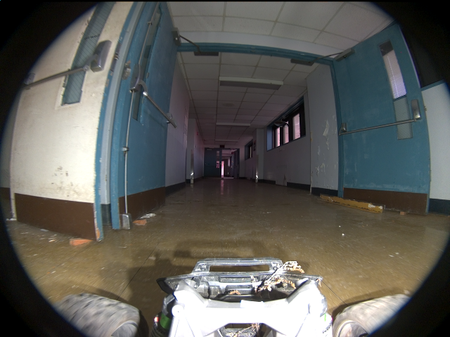
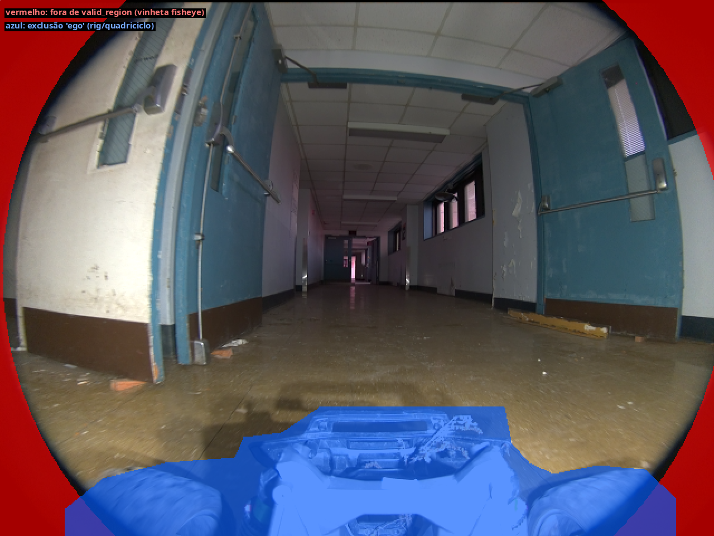

**Frame 000061** — RGB original / máscaras de preparação

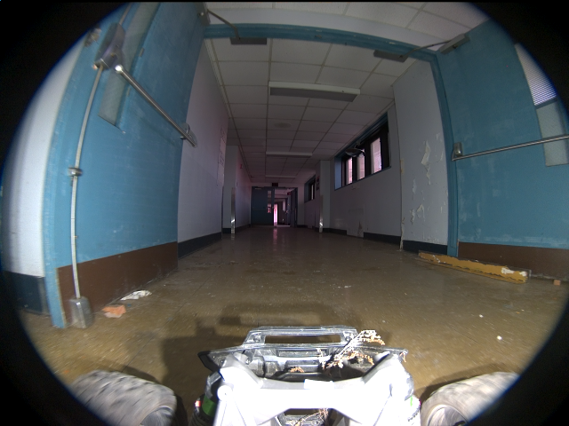
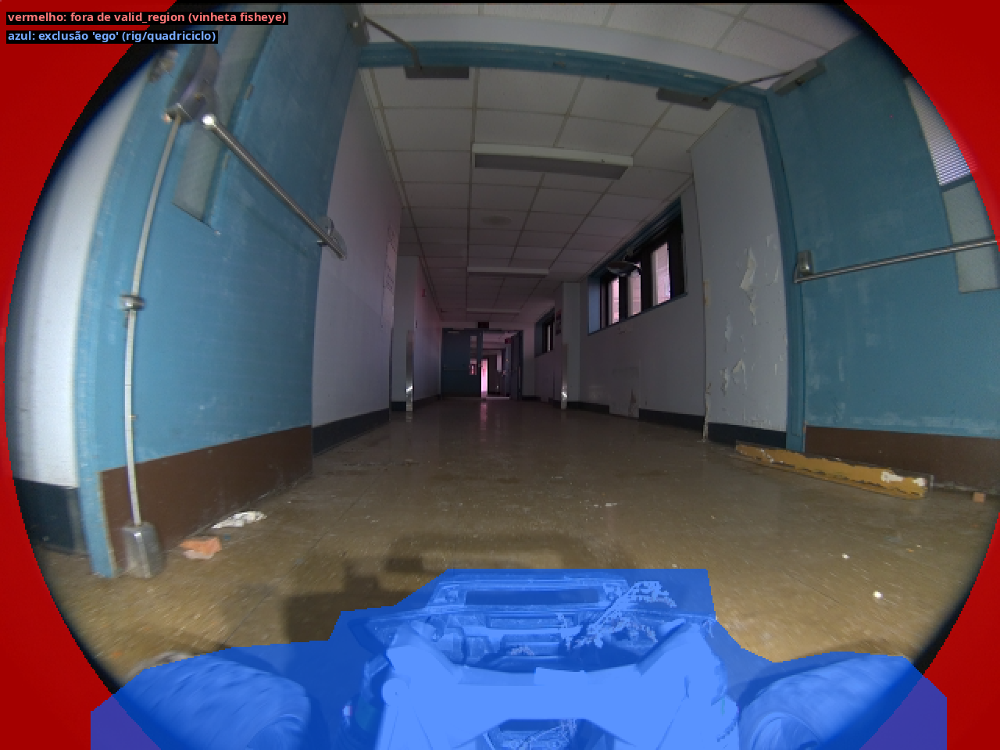

## 4. Descoberta de regiões (SAM2)

| Frame | Propostas SAM2 (brutas) | Tocaram o ego (`exclusion_overlap`) | Fora do círculo válido (`outside_valid_region`) | Fundidas em outra (`merged_duplicate`: duplicata IoU / contenção) | Regiões aceitas = enviadas ao VLM | Tempo SAM2 |
|---|---|---|---|---|---|---|
| 000055 | 113 | 13 | 11 | 28 (iou_duplicate: 7, containment: 21) | 61 | 4.3 s |
| 000061 | 114 | 15 | 6 | 25 (iou_duplicate: 8, containment: 17) | 68 | 4.4 s |

As máscaras das propostas rejeitadas/fundidas não são persistidas (só o registro de auditoria em `dados/sam2-auditoria-frame-*.json`, com IoU e fração de contenção de cada fusão).

**Frame 000055** — todas as máscaras aceitas (número = `region-00NN`) e bounding boxes com a label primária do VLM:

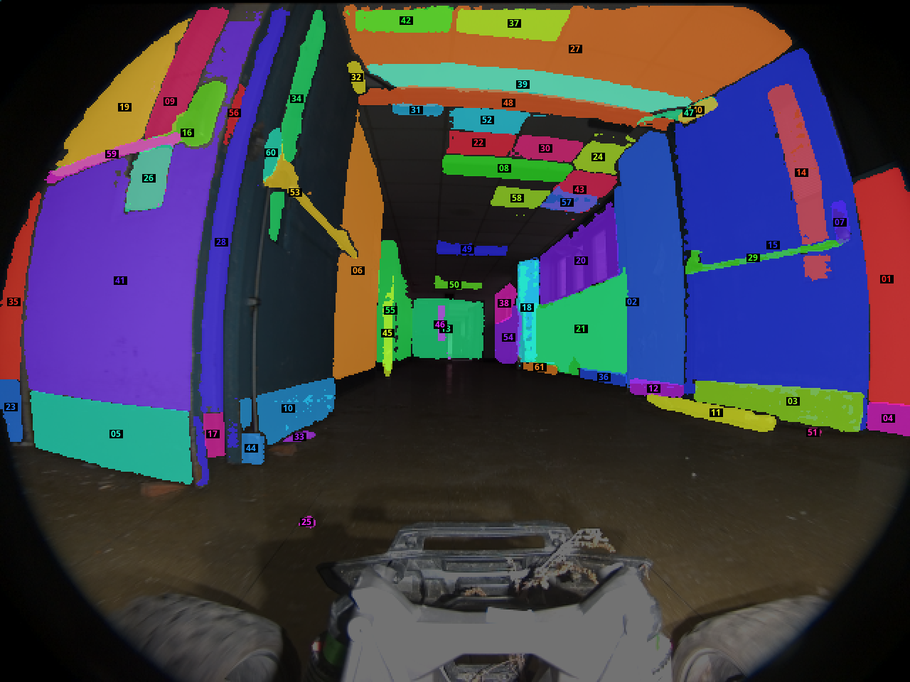
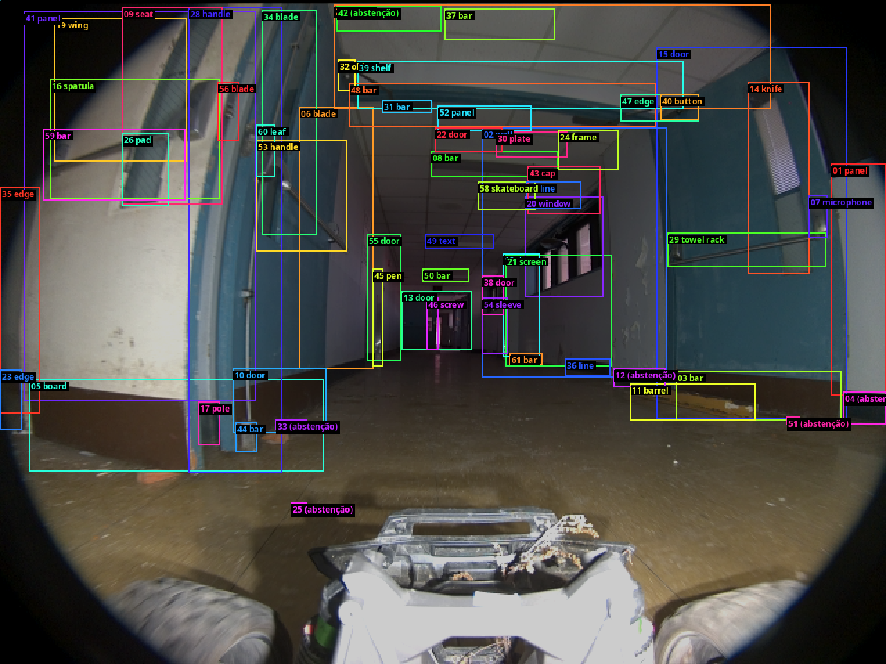

**Frame 000061** — todas as máscaras aceitas (número = `region-00NN`) e bounding boxes com a label primária do VLM:

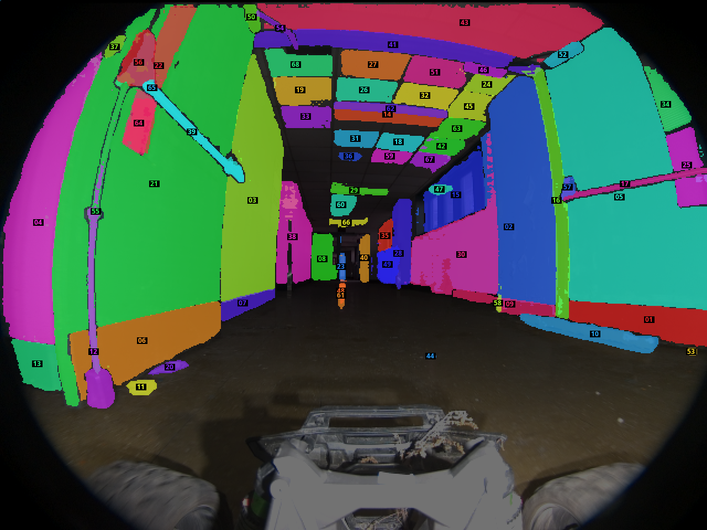
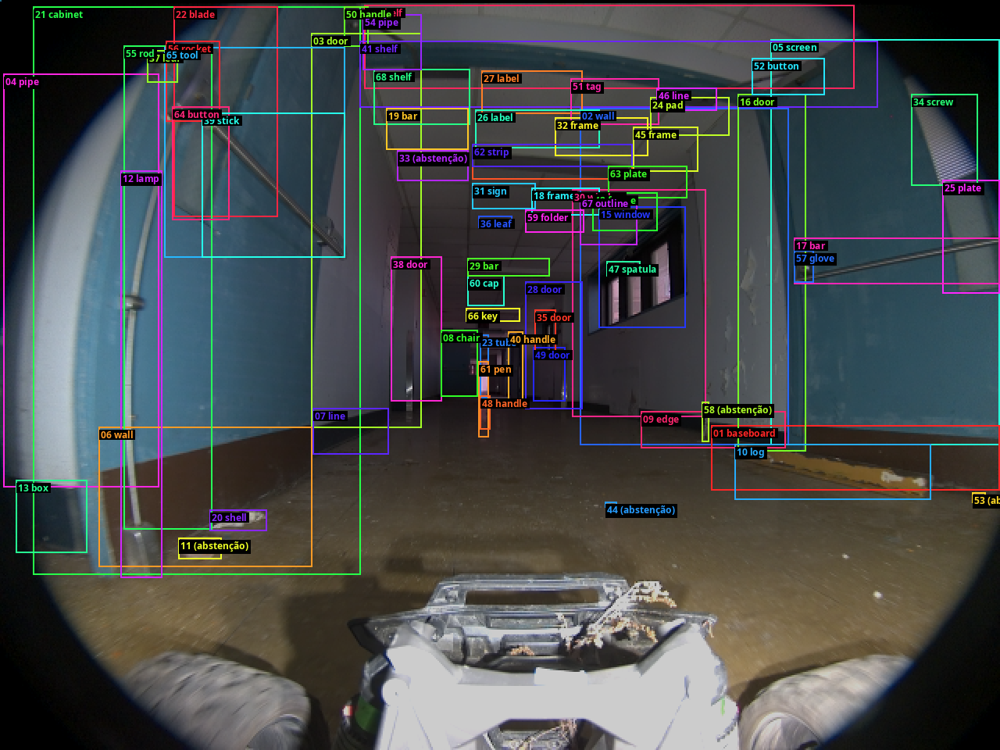

## 5. Prompt enviado ao VLM (Qwen3-VL-4B)

Uma chamada por região aceita. A entrada visual é **uma única imagem**: a view `mask_outline_crop` (recorte da bbox da região com o contorno da máscara desenhado em magenta, 2 px). Não há prompt de cena nem contexto do frame inteiro. O texto abaixo é **idêntico para todas as regiões**, exceto o bloco `Request` (muda `region_id`, `request_id`, `view_id`, `perception_result_id`).

### 5.1 Template `region-interaction/v3` (texto integral usado nas runs 0006 e 0007)

```text
Template: region-interaction/v3

Name what the referenced region shows. Each hypothesis is the bare noun of what is shown: one to three lowercase words without articles, never a color, material, condition or any other modifier (for example "door", "pallet", "fire extinguisher"), and never a sentence or a description. Return one primary hypothesis and preserve plausible alternatives in the same form. Report what modifies the object only as attributes, and only when it is visible: its color in attributes.color, its material in attributes.material and its condition in attributes.condition. Put any free description in attributes.description. Also give attributes.interaction_factor: one positive number, not a measurement, saying how far this kind of object usually interacts with things around it relative to its own size. Use 1.0 when its zone of interaction is about its own extent, above 1.0 when it relates to things noticeably farther away, and below 1.0 when only things very close to it are related; omit it when you cannot tell. Set category to a coarse class or null, never "thing" or "stuff", which belong in region_kind. Abstain instead of guessing when the visible evidence does not support a hypothesis. Never invent confidence: omit it or set it to null. The whole response has exactly this shape, with interaction_factor and every other attribute inside attributes, never next to them: {"abstained": false, "claims": [{"hypothesis": "<bare noun>", "role": "primary", "category": "<coarse class or null>", "region_kind": "<thing, stuff or null>", "attributes": {"color": "<color>", "interaction_factor": <number>}}], "scene_context": null}. Alternatives are further items of claims with role "alternative". Leave out any attribute you cannot see. To abstain, return {"abstained": true, "claims": [], "scene_context": null}.
```

### 5.2 Bloco `Request` (exemplo: frame 55, region-0001)

```json
{
  "mode": "region",
  "perception_result_id": "c4e5415bf8afbb83bcdd401f4cbfae50--camera_1_image_raw-000055",
  "region_id": "region-0001",
  "request_id": "region-camera_1_image_raw-000055-region-0001",
  "scene_context_reference": null,
  "source_observation_id": "camera_1_image_raw-000055",
  "supporting_metadata": [],
  "visual_features": [],
  "visual_views": [
    {
      "kind": "mask_outline_crop",
      "view_id": "v-camera_1_image_raw-000055-region-0001-mask_outline_crop"
    }
  ]
}
```

### 5.3 Schema de saída anexado ao prompt (`semantic-response/1`) e instrução final

```json
{
  "additionalProperties": false,
  "oneOf": [
    {
      "properties": {
        "abstained": {
          "const": true
        },
        "claims": {
          "maxItems": 0,
          "type": "array"
        },
        "scene_context": {
          "type": "null"
        }
      }
    },
    {
      "properties": {
        "abstained": {
          "const": false
        },
        "claims": {
          "description": "Exactly one item must have role=primary.",
          "items": {
            "additionalProperties": false,
            "properties": {
              "attributes": {
                "additionalProperties": {
                  "type": [
                    "string",
                    "number",
                    "boolean",
                    "null"
                  ]
                },
                "propertyNames": {
                  "minLength": 1
                },
                "type": "object"
              },
              "category": {
                "anyOf": [
                  {
                    "minLength": 1,
                    "type": "string"
                  },
                  {
                    "type": "null"
                  }
                ]
              },
              "confidence": {
                "type": "null"
              },
              "hypothesis": {
                "minLength": 1,
                "type": "string"
              },
              "region_kind": {
                "enum": [
                  "thing",
                  "stuff",
                  null
                ]
              },
              "role": {
                "enum": [
                  "primary",
                  "alternative"
                ]
              }
            },
            "required": [
              "hypothesis",
              "role",
              "category",
              "region_kind",
              "attributes"
            ],
            "type": "object"
          },
          "minItems": 1,
          "type": "array"
        },
        "scene_context": {
          "type": "null"
        }
      }
    }
  ],
  "required": [
    "abstained",
    "claims",
    "scene_context"
  ],
  "type": "object"
}
```

```text
Return exactly one JSON object and no explanatory text.
```

O prompt completo renderizado (template + request + schema) de cada versão está em `dados/prompts/region-interaction-v{1,2,3}-prompt-renderizado-region-0001.txt`.

### 5.4 Evolução do prompt (frame 55) — por que v3

| Prompt | Run | Regiões | Falhas de parse | Causa dominante | Claims primárias com fator |
|---|---|---|---|---|---|
| `region-interaction/v1` | run-0004 | 61 | 33 (54%) | `interaction_factor` fora de `attributes` (31), campo obrigatório ausente (2) | 0 de 28 |
| `region-interaction/v2` | run-0005 | 61 | 59 (97%) | o modelo devolveu só o claim do exemplo, sem `abstained`/`claims` | 2 de 2 |
| `region-interaction/v3` | run-0006 | 61 | **0** (6 abstenções) | — | 55 de 55 |
| `region-interaction/v3` | run-0007 (frame 61) | 68 | **0** (5 abstenções) | — | 63 de 63 |

Diferença textual entre versões: v1 não mostra formato; v2 mostra o formato de **um claim** (o modelo copiou como resposta inteira); v3 mostra o formato da **resposta inteira** (`{"abstained": false, "claims": [...], "scene_context": null}`) e explica como abster. As respostas brutas que falharam no parser estrito estão em `dados/prompts/region-interaction-v{1,2}-falhas-de-parse.jsonl`.

## 6. Resultados por região — frame 000055

Percepção `c4e5415bf8afbb83bcdd401f4cbfae50` (run-0006): 61 regiões, 55 com label, 6 abstenções, 0 falhas de parse, 0 falhas de chamada. Latência do VLM por região: mediana 2.52 s (min 1.01, máx 6.11); pico de memória GPU ~5.28 GiB.

**Distribuição de labels primárias:** bar ×9, door ×7, (abstenção) ×6, panel ×3, blade ×3, edge ×3, handle ×2, line ×2, wall ×1, board ×1, microphone ×1, seat ×1, barrel ×1, knife ×1, spatula ×1, pole ×1, wing ×1, window ×1, screen ×1, frame ×1, pad ×1, ceiling ×1, towel rack ×1, plate ×1, object ×1, shelf ×1, button ×1, cap ×1, pen ×1, screw ×1, text ×1, sleeve ×1, skateboard ×1, leaf ×1

**interaction_factor:** 0.8 ×53, 0.5 ×2; `region_kind`: {'thing': 55, None: 6}; `category`: {'structure': 20, 'furniture': 10, None: 6, 'tool': 6, 'container': 2, 'electronic': 2, 'hardware': 2, 'geometry': 2, 'audio device': 1, 'cutlery': 1, 'aircraft': 1, 'fixture': 1, 'accessory': 1, 'writing instrument': 1, 'fastener': 1, 'text': 1, 'clothing': 1, 'vehicle': 1, 'plant': 1}

Colunas: bbox em px `x,y,w,h` (origem no canto superior esquerdo); **pts LiDAR** = pontos do mapa associados à máscara (raw / voxel); **entidade** = entidade do mapa final onde a região terminou (raw / voxel). Imagens: `view` = exatamente o que o VLM recebeu; `máscara` = máscara destacada no frame + bbox.

| Região | bbox x,y,w,h | Área px | Label primária | Alternativas | Categoria | Cor | Material | Condição | Fator | pts LiDAR raw/voxel | Entidade raw / voxel | Imagens |
|---|---|---|---|---|---|---|---|---|---|---|---|---|
| region-0001 | 600,118,40,168 | 5051 | **panel** | — | structure | gray | — | — | 0.800 | 1435 / 349 | entity-0047 / entity-0042 | [view](imagens/frame-000055/regioes/region-0001-view-vlm.png) · [máscara](imagens/frame-000055/regioes/region-0001-mascara.png) |
| region-0002 | 348,92,134,181 | 11389 | **wall** | — | structure | gray | — | peeling | 0.800 | 41 / 37 | entity-0063 / entity-0051 | [view](imagens/frame-000055/regioes/region-0002-view-vlm.png) · [máscara](imagens/frame-000055/regioes/region-0002-mascara.png) |
| region-0003 | 488,268,120,36 | 2591 | **bar** | — | furniture | brown | — | — | 0.800 | 4399 / 616 | entity-0022 / entity-0022 | [view](imagens/frame-000055/regioes/region-0003-view-vlm.png) · [máscara](imagens/frame-000055/regioes/region-0003-mascara.png) |
| region-0004 | 609,283,31,24 | 631 | **(abstenção)** | — | — | — | — | — | — | 233 / 43 | entity-0042 / entity-0006 | [view](imagens/frame-000055/regioes/region-0004-view-vlm.png) · [máscara](imagens/frame-000055/regioes/region-0004-mascara.png) |
| region-0005 | 21,274,213,67 | 5168 | **board** | — | furniture | dark | — | — | 0.800 | 1149 / 117 | entity-0018 / entity-0036 | [view](imagens/frame-000055/regioes/region-0005-view-vlm.png) · [máscara](imagens/frame-000055/regioes/region-0005-mascara.png) |
| region-0006 | 216,77,54,190 | 4334 | **blade** | — | tool | dark | — | — | 0.800 | 5 / 4 | entity-0001 / excluída na fusão (4 pts < 5) | [view](imagens/frame-000055/regioes/region-0006-view-vlm.png) · [máscara](imagens/frame-000055/regioes/region-0006-mascara.png) |
| region-0007 | 584,141,14,31 | 307 | **microphone** | — | audio device | dark gray | — | — | 0.800 | 33 / 18 | entity-0043 / entity-0027 | [view](imagens/frame-000055/regioes/region-0007-view-vlm.png) · [máscara](imagens/frame-000055/regioes/region-0007-mascara.png) |
| region-0008 | 311,109,92,19 | 1251 | **bar** | — | furniture | dark gray | — | — | 0.800 | 144 / 43 | entity-0062 / entity-0008 | [view](imagens/frame-000055/regioes/region-0008-view-vlm.png) · [máscara](imagens/frame-000055/regioes/region-0008-mascara.png) |
| region-0009 | 88,5,73,143 | 3178 | **seat** | — | furniture | gray | fabric | worn | 0.800 | 88 / 49 | entity-0026 / entity-0046 | [view](imagens/frame-000055/regioes/region-0009-view-vlm.png) · [máscara](imagens/frame-000055/regioes/region-0009-mascara.png) |
| region-0010 | 168,266,68,47 | 1813 | **door** | — | structure | dark | — | — | 0.800 | 27 / 16 | entity-0045 / entity-0041 | [view](imagens/frame-000055/regioes/region-0010-view-vlm.png) · [máscara](imagens/frame-000055/regioes/region-0010-mascara.png) |
| region-0011 | 455,277,91,27 | 967 | **barrel** | — | container | brown | — | — | 0.800 | 52 / 21 | entity-0053 / entity-0031 | [view](imagens/frame-000055/regioes/region-0011-view-vlm.png) · [máscara](imagens/frame-000055/regioes/region-0011-mascara.png) |
| region-0012 | 443,266,38,14 | 382 | **(abstenção)** | — | — | — | — | — | — | 0 / 0 | excluída na fusão (0 pts < 5) / excluída na fusão (0 pts < 5) | [view](imagens/frame-000055/regioes/region-0012-view-vlm.png) · [máscara](imagens/frame-000055/regioes/region-0012-mascara.png) |
| region-0013 | 290,210,51,43 | 2046 | **door** | — | structure | black | — | — | 0.800 | 3314 / 490 | entity-0033 / entity-0015 | [view](imagens/frame-000055/regioes/region-0013-view-vlm.png) · [máscara](imagens/frame-000055/regioes/region-0013-mascara.png) |
| region-0014 | 540,59,45,139 | 2469 | **knife** | — | cutlery | gray | metal | sharp | 0.800 | 109 / 54 | entity-0024 / entity-0038 | [view](imagens/frame-000055/regioes/region-0014-view-vlm.png) · [máscara](imagens/frame-000055/regioes/region-0014-mascara.png) |
| region-0015 | 474,34,138,269 | 25806 | **door** | — | structure | teal | — | — | 0.800 | 16958 / 2758 | entity-0049 / entity-0044 | [view](imagens/frame-000055/regioes/region-0015-view-vlm.png) · [máscara](imagens/frame-000055/regioes/region-0015-mascara.png) |
| region-0016 | 36,57,123,87 | 1674 | **spatula** | — | tool | gray | plastic | used | 0.800 | 108 / 39 | entity-0036 / entity-0019 | [view](imagens/frame-000055/regioes/region-0016-view-vlm.png) · [máscara](imagens/frame-000055/regioes/region-0016-mascara.png) |
| region-0017 | 143,290,16,32 | 423 | **pole** | — | structure | gray | — | — | 0.800 | 25 / 10 | entity-0004 / entity-0001 | [view](imagens/frame-000055/regioes/region-0017-view-vlm.png) · [máscara](imagens/frame-000055/regioes/region-0017-mascara.png) |
| region-0018 | 363,183,27,75 | 997 | **door** | — | structure | dark gray | — | — | 0.800 | 9 / 7 | entity-0010 / entity-0040 | [view](imagens/frame-000055/regioes/region-0018-view-vlm.png) · [máscara](imagens/frame-000055/regioes/region-0018-mascara.png) |
| region-0019 | 39,13,96,104 | 3257 | **wing** | — | aircraft | gray | — | — | 0.800 | 213 / 69 | entity-0034 / entity-0026 | [view](imagens/frame-000055/regioes/region-0019-view-vlm.png) · [máscara](imagens/frame-000055/regioes/region-0019-mascara.png) |
| region-0020 | 379,142,57,73 | 2410 | **window** | — | structure | dark | — | — | 0.800 | 8 / 5 | entity-0063 / entity-0051 | [view](imagens/frame-000055/regioes/region-0020-view-vlm.png) · [máscara](imagens/frame-000055/regioes/region-0020-mascara.png) |
| region-0021 | 365,184,77,81 | 4078 | **screen** | — | electronic | black | — | — | 0.800 | 3 / 4 | excluída na fusão (3 pts < 5) / excluída na fusão (4 pts < 5) | [view](imagens/frame-000055/regioes/region-0021-view-vlm.png) · [máscara](imagens/frame-000055/regioes/region-0021-mascara.png) |
| region-0022 | 314,92,49,18 | 711 | **door** | — | structure | gray | — | — | 0.800 | 1 / 1 | excluída na fusão (1 pts < 5) / excluída na fusão (1 pts < 5) | [view](imagens/frame-000055/regioes/region-0022-view-vlm.png) · [máscara](imagens/frame-000055/regioes/region-0022-mascara.png) |
| region-0023 | 0,267,16,44 | 553 | **edge** | — | structure | pink | — | — | 0.800 | 40 / 12 | entity-0003 / entity-0037 | [view](imagens/frame-000055/regioes/region-0023-view-vlm.png) · [máscara](imagens/frame-000055/regioes/region-0023-mascara.png) |
| region-0024 | 403,94,44,29 | 613 | **frame** | — | structure | pink | — | — | 0.800 | 22 / 8 | entity-0013 / entity-0047 | [view](imagens/frame-000055/regioes/region-0024-view-vlm.png) · [máscara](imagens/frame-000055/regioes/region-0024-mascara.png) |
| region-0025 | 210,363,12,9 | 70 | **(abstenção)** | — | — | — | — | — | — | 9 / 1 | entity-0002 / excluída na fusão (1 pts < 5) | [view](imagens/frame-000055/regioes/region-0025-view-vlm.png) · [máscara](imagens/frame-000055/regioes/region-0025-mascara.png) |
| region-0026 | 88,96,34,53 | 1125 | **pad** | — | tool | gray | — | — | 0.800 | 43 / 19 | entity-0026 / entity-0046 | [view](imagens/frame-000055/regioes/region-0026-view-vlm.png) · [máscara](imagens/frame-000055/regioes/region-0026-mascara.png) |
| region-0027 | 241,3,316,76 | 17583 | **ceiling** | — | structure | white | tile | clean | 0.800 | 98 / 50 | entity-0046 / entity-0010 | [view](imagens/frame-000055/regioes/region-0027-view-vlm.png) · [máscara](imagens/frame-000055/regioes/region-0027-mascara.png) |
| region-0028 | 136,5,68,337 | 4320 | **handle** | — | hardware | gray | metal | worn | 0.800 | 414 / 115 | entity-0030 / entity-0033 | [view](imagens/frame-000055/regioes/region-0028-view-vlm.png) · [máscara](imagens/frame-000055/regioes/region-0028-mascara.png) |
| region-0029 | 482,168,115,25 | 616 | **towel rack** | — | fixture | black | — | — | 0.800 | 10 / 9 | entity-0038 / entity-0024 | [view](imagens/frame-000055/regioes/region-0029-view-vlm.png) · [máscara](imagens/frame-000055/regioes/region-0029-mascara.png) |
| region-0030 | 358,95,52,19 | 698 | **plate** | — | container | gray | — | — | 0.800 | 2 / 2 | excluída na fusão (2 pts < 5) / excluída na fusão (2 pts < 5) | [view](imagens/frame-000055/regioes/region-0030-view-vlm.png) · [máscara](imagens/frame-000055/regioes/region-0030-mascara.png) |
| region-0031 | 276,72,36,10 | 269 | **bar** | — | furniture | black | — | — | 0.800 | 6 / 2 | entity-0059 / excluída na fusão (2 pts < 5) | [view](imagens/frame-000055/regioes/region-0031-view-vlm.png) · [máscara](imagens/frame-000055/regioes/region-0031-mascara.png) |
| region-0032 | 244,43,13,23 | 205 | **object** | — | tool | black | — | — | 0.800 | 1 / 1 | excluída na fusão (1 pts < 5) / excluída na fusão (1 pts < 5) | [view](imagens/frame-000055/regioes/region-0032-view-vlm.png) · [máscara](imagens/frame-000055/regioes/region-0032-mascara.png) |
| region-0033 | 199,303,23,8 | 114 | **(abstenção)** | — | — | — | — | — | — | 0 / 0 | excluída na fusão (0 pts < 5) / excluída na fusão (0 pts < 5) | [view](imagens/frame-000055/regioes/region-0033-view-vlm.png) · [máscara](imagens/frame-000055/regioes/region-0033-mascara.png) |
| region-0034 | 189,7,40,163 | 1546 | **blade** | — | tool | gray | — | — | 0.800 | 32 / 26 | entity-0028 / entity-0032 | [view](imagens/frame-000055/regioes/region-0034-view-vlm.png) · [máscara](imagens/frame-000055/regioes/region-0034-mascara.png) |
| region-0035 | 0,135,29,164 | 1619 | **edge** | — | structure | pink | — | — | 0.800 | 165 / 37 | entity-0052 / entity-0004 | [view](imagens/frame-000055/regioes/region-0035-view-vlm.png) · [máscara](imagens/frame-000055/regioes/region-0035-mascara.png) |
| region-0036 | 408,259,33,13 | 269 | **line** | — | geometry | pink | — | — | 0.500 | 2 / 2 | excluída na fusão (2 pts < 5) / excluída na fusão (2 pts < 5) | [view](imagens/frame-000055/regioes/region-0036-view-vlm.png) · [máscara](imagens/frame-000055/regioes/region-0036-mascara.png) |
| region-0037 | 321,6,80,23 | 1475 | **bar** | — | structure | gray | — | — | 0.800 | 2 / 2 | excluída na fusão (2 pts < 5) / excluída na fusão (2 pts < 5) | [view](imagens/frame-000055/regioes/region-0037-view-vlm.png) · [máscara](imagens/frame-000055/regioes/region-0037-mascara.png) |
| region-0038 | 348,199,16,29 | 315 | **door** | — | structure | black | — | — | 0.800 | 3 / 3 | excluída na fusão (3 pts < 5) / excluída na fusão (3 pts < 5) | [view](imagens/frame-000055/regioes/region-0038-view-vlm.png) · [máscara](imagens/frame-000055/regioes/region-0038-mascara.png) |
| region-0039 | 258,44,236,35 | 3595 | **shelf** | — | furniture | gray | — | — | 0.800 | 113 / 42 | entity-0046 / entity-0010 | [view](imagens/frame-000055/regioes/region-0039-view-vlm.png) · [máscara](imagens/frame-000055/regioes/region-0039-mascara.png) |
| region-0040 | 477,68,28,19 | 255 | **button** | — | electronic | black | — | — | 0.800 | 3 / 2 | excluída na fusão (3 pts < 5) / excluída na fusão (2 pts < 5) | [view](imagens/frame-000055/regioes/region-0040-view-vlm.png) · [máscara](imagens/frame-000055/regioes/region-0040-mascara.png) |
| region-0041 | 17,8,168,282 | 19889 | **panel** | — | structure | off-white | — | — | 0.800 | 5883 / 517 | entity-0020 / entity-0011 | [view](imagens/frame-000055/regioes/region-0041-view-vlm.png) · [máscara](imagens/frame-000055/regioes/region-0041-mascara.png) |
| region-0042 | 243,4,76,19 | 1100 | **(abstenção)** | — | — | — | — | — | — | 0 / 0 | excluída na fusão (0 pts < 5) / excluída na fusão (0 pts < 5) | [view](imagens/frame-000055/regioes/region-0042-view-vlm.png) · [máscara](imagens/frame-000055/regioes/region-0042-mascara.png) |
| region-0043 | 381,120,53,35 | 912 | **cap** | — | accessory | pink | — | — | 0.800 | 3 / 1 | excluída na fusão (3 pts < 5) / excluída na fusão (1 pts < 5) | [view](imagens/frame-000055/regioes/region-0043-view-vlm.png) · [máscara](imagens/frame-000055/regioes/region-0043-mascara.png) |
| region-0044 | 170,305,16,22 | 331 | **bar** | — | furniture | gray | — | — | 0.800 | 11 / 6 | entity-0009 / entity-0029 | [view](imagens/frame-000055/regioes/region-0044-view-vlm.png) · [máscara](imagens/frame-000055/regioes/region-0044-mascara.png) |
| region-0045 | 269,194,8,71 | 364 | **pen** | — | writing instrument | black | — | — | 0.800 | 0 / 0 | excluída na fusão (0 pts < 5) / excluída na fusão (0 pts < 5) | [view](imagens/frame-000055/regioes/region-0045-view-vlm.png) · [máscara](imagens/frame-000055/regioes/region-0045-mascara.png) |
| region-0046 | 308,215,9,38 | 126 | **screw** | — | fastener | pink | — | — | 0.800 | 2852 / 390 | entity-0033 / entity-0015 | [view](imagens/frame-000055/regioes/region-0046-view-vlm.png) · [máscara](imagens/frame-000055/regioes/region-0046-mascara.png) |
| region-0047 | 448,68,57,20 | 379 | **edge** | — | structure | pink | — | — | 0.800 | 4 / 3 | excluída na fusão (4 pts < 5) / excluída na fusão (3 pts < 5) | [view](imagens/frame-000055/regioes/region-0047-view-vlm.png) · [máscara](imagens/frame-000055/regioes/region-0047-mascara.png) |
| region-0048 | 252,60,222,32 | 2743 | **bar** | — | furniture | dark green | — | — | 0.800 | 101 / 40 | entity-0055 / entity-0010 | [view](imagens/frame-000055/regioes/region-0048-view-vlm.png) · [máscara](imagens/frame-000055/regioes/region-0048-mascara.png) |
| region-0049 | 307,169,50,11 | 367 | **text** | — | text | pink | — | — | 0.800 | 0 / 0 | excluída na fusão (0 pts < 5) / excluída na fusão (0 pts < 5) | [view](imagens/frame-000055/regioes/region-0049-view-vlm.png) · [máscara](imagens/frame-000055/regioes/region-0049-mascara.png) |
| region-0050 | 305,194,34,10 | 179 | **bar** | — | furniture | pink | — | — | 0.800 | 0 / 0 | excluída na fusão (0 pts < 5) / excluída na fusão (0 pts < 5) | [view](imagens/frame-000055/regioes/region-0050-view-vlm.png) · [máscara](imagens/frame-000055/regioes/region-0050-mascara.png) |
| region-0051 | 568,301,10,6 | 51 | **(abstenção)** | — | — | — | — | — | — | 0 / 0 | excluída na fusão (0 pts < 5) / excluída na fusão (0 pts < 5) | [view](imagens/frame-000055/regioes/region-0051-view-vlm.png) · [máscara](imagens/frame-000055/regioes/region-0051-mascara.png) |
| region-0052 | 316,76,68,19 | 829 | **panel** | — | structure | gray | — | — | 0.800 | 6 / 4 | entity-0058 / excluída na fusão (4 pts < 5) | [view](imagens/frame-000055/regioes/region-0052-view-vlm.png) · [máscara](imagens/frame-000055/regioes/region-0052-mascara.png) |
| region-0053 | 185,101,66,81 | 806 | **handle** | — | hardware | gray | — | — | 0.800 | 24 / 19 | entity-0014 / entity-0005 | [view](imagens/frame-000055/regioes/region-0053-view-vlm.png) · [máscara](imagens/frame-000055/regioes/region-0053-mascara.png) |
| region-0054 | 348,215,19,41 | 587 | **sleeve** | — | clothing | black | — | — | 0.800 | 0 / 0 | excluída na fusão (0 pts < 5) / excluída na fusão (0 pts < 5) | [view](imagens/frame-000055/regioes/region-0054-view-vlm.png) · [máscara](imagens/frame-000055/regioes/region-0054-mascara.png) |
| region-0055 | 265,169,25,92 | 1706 | **door** | — | structure | dark | — | — | 0.800 | 15 / 7 | entity-0035 / entity-0048 | [view](imagens/frame-000055/regioes/region-0055-view-vlm.png) · [máscara](imagens/frame-000055/regioes/region-0055-mascara.png) |
| region-0056 | 157,59,16,43 | 226 | **blade** | — | tool | black | — | — | 0.800 | 17 / 10 | entity-0029 / entity-0003 | [view](imagens/frame-000055/regioes/region-0056-view-vlm.png) · [máscara](imagens/frame-000055/regioes/region-0056-mascara.png) |
| region-0057 | 380,131,40,20 | 447 | **line** | — | geometry | pink | — | — | 0.500 | 3 / 2 | excluída na fusão (3 pts < 5) / excluída na fusão (2 pts < 5) | [view](imagens/frame-000055/regioes/region-0057-view-vlm.png) · [máscara](imagens/frame-000055/regioes/region-0057-mascara.png) |
| region-0058 | 345,131,42,21 | 485 | **skateboard** | — | vehicle | pink | — | — | 0.800 | 41 / 14 | entity-0050 / entity-0045 | [view](imagens/frame-000055/regioes/region-0058-view-vlm.png) · [máscara](imagens/frame-000055/regioes/region-0058-mascara.png) |
| region-0059 | 31,93,103,52 | 733 | **bar** | — | structure | gray | — | — | 0.800 | 63 / 21 | entity-0036 / entity-0019 | [view](imagens/frame-000055/regioes/region-0059-view-vlm.png) · [máscara](imagens/frame-000055/regioes/region-0059-mascara.png) |
| region-0060 | 185,90,14,38 | 320 | **leaf** | — | plant | green | — | — | 0.800 | 8 / 7 | entity-0039 / entity-0002 | [view](imagens/frame-000055/regioes/region-0060-view-vlm.png) · [máscara](imagens/frame-000055/regioes/region-0060-mascara.png) |
| region-0061 | 368,255,24,9 | 142 | **bar** | — | furniture | black | — | — | 0.800 | 3 / 0 | excluída na fusão (3 pts < 5) / excluída na fusão (0 pts < 5) | [view](imagens/frame-000055/regioes/region-0061-view-vlm.png) · [máscara](imagens/frame-000055/regioes/region-0061-mascara.png) |

Atributos adicionais (descrição livre, atributos extras, atributos das alternativas):

- `region-0002` (wall): description: "partially peeled paint"
- `region-0009` (seat): description: "a worn gray seat with visible wear patterns"
- `region-0014` (knife): description: "a metallic knife with a textured blade and handle"
- `region-0016` (spatula): description: "a gray plastic spatula with a long handle and a flat, slightly curved head"
- `region-0027` (ceiling): description: "a curved ceiling with square tiles"
- `region-0028` (handle): description: "a curved metallic handle with visible wear and a small rectangular attachment near its base"

<details><summary>Respostas brutas do VLM — frame 000055 (uma linha por região, texto exato devolvido pelo modelo)</summary>

```text
region-0001 [6.11s, in 858 tok, out 63 tok, view 128x544]: {"abstained": false, "claims": [{"hypothesis": "panel", "role": "primary", "category": "structure", "region_kind": "thing", "attributes": {"color": "gray", "interaction_factor": 0.8}}], "scene_context": null}
region-0002 [3.08s, in 860 tok, out 79 tok, view 224x320]: {"abstained": false, "claims": [{"hypothesis": "wall", "role": "primary", "category": "structure", "region_kind": "thing", "attributes": {"color": "gray", "condition": "peeling", "description": "partially peeled paint", "interaction_factor": 0.8}}], "scene_context": null}
region-0003 [2.55s, in 865 tok, out 64 tok, view 480x160]: {"abstained": false, "claims": [{"hypothesis": "bar", "role": "primary", "category": "furniture", "region_kind": "thing", "attributes": {"color": "brown", "interaction_factor": 0.8}}], "scene_context": null}
region-0004 [1.01s, in 870 tok, out 18 tok, view 320x256]: {"abstained": true, "claims": [], "scene_context": null}
region-0005 [2.54s, in 865 tok, out 64 tok, view 480x160]: {"abstained": false, "claims": [{"hypothesis": "board", "role": "primary", "category": "furniture", "region_kind": "thing", "attributes": {"color": "dark", "interaction_factor": 0.8}}], "scene_context": null}
region-0006 [2.51s, in 870 tok, out 63 tok, view 160x512]: {"abstained": false, "claims": [{"hypothesis": "blade", "role": "primary", "category": "tool", "region_kind": "thing", "attributes": {"color": "dark", "interaction_factor": 0.8}}], "scene_context": null}
region-0007 [2.60s, in 862 tok, out 66 tok, view 192x384]: {"abstained": false, "claims": [{"hypothesis": "microphone", "role": "primary", "category": "audio device", "region_kind": "thing", "attributes": {"color": "dark gray", "interaction_factor": 0.8}}], "scene_context": null}
region-0008 [2.57s, in 862 tok, out 65 tok, view 576x128]: {"abstained": false, "claims": [{"hypothesis": "bar", "role": "primary", "category": "furniture", "region_kind": "thing", "attributes": {"color": "dark gray", "interaction_factor": 0.8}}], "scene_context": null}
region-0009 [3.40s, in 862 tok, out 90 tok, view 192x384]: {"abstained": false, "claims": [{"hypothesis": "seat", "role": "primary", "category": "furniture", "region_kind": "thing", "attributes": {"color": "gray", "material": "fabric", "condition": "worn", "description": "a worn gray seat with visible wear patterns", "interaction_factor": 0.8}}], "scene_context": null}
region-0010 [2.51s, in 860 tok, out 63 tok, view 320x224]: {"abstained": false, "claims": [{"hypothesis": "door", "role": "primary", "category": "structure", "region_kind": "thing", "attributes": {"color": "dark", "interaction_factor": 0.8}}], "scene_context": null}
region-0011 [2.54s, in 865 tok, out 64 tok, view 480x160]: {"abstained": false, "claims": [{"hypothesis": "barrel", "role": "primary", "category": "container", "region_kind": "thing", "attributes": {"color": "brown", "interaction_factor": 0.8}}], "scene_context": null}
region-0012 [1.01s, in 860 tok, out 18 tok, view 448x160]: {"abstained": true, "claims": [], "scene_context": null}
region-0013 [2.50s, in 862 tok, out 63 tok, view 288x256]: {"abstained": false, "claims": [{"hypothesis": "door", "role": "primary", "category": "structure", "region_kind": "thing", "attributes": {"color": "black", "interaction_factor": 0.8}}], "scene_context": null}
region-0014 [3.44s, in 865 tok, out 91 tok, view 160x480]: {"abstained": false, "claims": [{"hypothesis": "knife", "role": "primary", "category": "cutlery", "region_kind": "thing", "attributes": {"color": "gray", "material": "metal", "condition": "sharp", "description": "a metallic knife with a textured blade and handle", "interaction_factor": 0.8}}], "scene_context": null}
region-0015 [2.54s, in 862 tok, out 64 tok, view 192x384]: {"abstained": false, "claims": [{"hypothesis": "door", "role": "primary", "category": "structure", "region_kind": "thing", "attributes": {"color": "teal", "interaction_factor": 0.8}}], "scene_context": null}
region-0016 [3.73s, in 860 tok, out 99 tok, view 320x224]: {"abstained": false, "claims": [{"hypothesis": "spatula", "role": "primary", "category": "tool", "region_kind": "thing", "attributes": {"color": "gray", "material": "plastic", "condition": "used", "description": "a gray plastic spatula with a long handle and a flat, slightly curved head", "interaction_factor": 0.8}}], "scene_context": null}
region-0017 [2.51s, in 862 tok, out 63 tok, view 192x384]: {"abstained": false, "claims": [{"hypothesis": "pole", "role": "primary", "category": "structure", "region_kind": "thing", "attributes": {"color": "gray", "interaction_factor": 0.8}}], "scene_context": null}
region-0018 [2.54s, in 860 tok, out 64 tok, view 160x448]: {"abstained": false, "claims": [{"hypothesis": "door", "role": "primary", "category": "structure", "region_kind": "thing", "attributes": {"color": "dark gray", "interaction_factor": 0.8}}], "scene_context": null}
region-0019 [2.54s, in 862 tok, out 64 tok, view 256x288]: {"abstained": false, "claims": [{"hypothesis": "wing", "role": "primary", "category": "aircraft", "region_kind": "thing", "attributes": {"color": "gray", "interaction_factor": 0.8}}], "scene_context": null}
region-0020 [2.51s, in 870 tok, out 63 tok, view 256x320]: {"abstained": false, "claims": [{"hypothesis": "window", "role": "primary", "category": "structure", "region_kind": "thing", "attributes": {"color": "dark", "interaction_factor": 0.8}}], "scene_context": null}
region-0021 [2.55s, in 862 tok, out 64 tok, view 256x288]: {"abstained": false, "claims": [{"hypothesis": "screen", "role": "primary", "category": "electronic", "region_kind": "thing", "attributes": {"color": "black", "interaction_factor": 0.8}}], "scene_context": null}
region-0022 [2.50s, in 860 tok, out 63 tok, view 448x160]: {"abstained": false, "claims": [{"hypothesis": "door", "role": "primary", "category": "structure", "region_kind": "thing", "attributes": {"color": "gray", "interaction_factor": 0.8}}], "scene_context": null}
region-0023 [2.51s, in 860 tok, out 63 tok, view 160x448]: {"abstained": false, "claims": [{"hypothesis": "edge", "role": "primary", "category": "structure", "region_kind": "thing", "attributes": {"color": "pink", "interaction_factor": 0.8}}], "scene_context": null}
region-0024 [2.51s, in 860 tok, out 63 tok, view 320x224]: {"abstained": false, "claims": [{"hypothesis": "frame", "role": "primary", "category": "structure", "region_kind": "thing", "attributes": {"color": "pink", "interaction_factor": 0.8}}], "scene_context": null}
region-0025 [1.01s, in 860 tok, out 18 tok, view 320x224]: {"abstained": true, "claims": [], "scene_context": null}
region-0026 [2.52s, in 860 tok, out 63 tok, view 224x320]: {"abstained": false, "claims": [{"hypothesis": "pad", "role": "primary", "category": "tool", "region_kind": "thing", "attributes": {"color": "gray", "interaction_factor": 0.8}}], "scene_context": null}
region-0027 [3.31s, in 858 tok, out 87 tok, view 544x128]: {"abstained": false, "claims": [{"hypothesis": "ceiling", "role": "primary", "category": "structure", "region_kind": "thing", "attributes": {"color": "white", "material": "tile", "condition": "clean", "description": "a curved ceiling with square tiles", "interaction_factor": 0.8}}], "scene_context": null}
region-0028 [3.60s, in 862 tok, out 96 tok, view 128x576]: {"abstained": false, "claims": [{"hypothesis": "handle", "role": "primary", "category": "hardware", "region_kind": "thing", "attributes": {"color": "gray", "material": "metal", "condition": "worn", "description": "a curved metallic handle with visible wear and a small rectangular attachment near its base", "interaction_factor": 0.8}}], "scene_context": null}
region-0029 [2.58s, in 862 tok, out 65 tok, view 576x128]: {"abstained": false, "claims": [{"hypothesis": "towel rack", "role": "primary", "category": "fixture", "region_kind": "thing", "attributes": {"color": "black", "interaction_factor": 0.8}}], "scene_context": null}
region-0030 [2.50s, in 860 tok, out 63 tok, view 448x160]: {"abstained": false, "claims": [{"hypothesis": "plate", "role": "primary", "category": "container", "region_kind": "thing", "attributes": {"color": "gray", "interaction_factor": 0.8}}], "scene_context": null}
region-0031 [2.55s, in 870 tok, out 64 tok, view 512x160]: {"abstained": false, "claims": [{"hypothesis": "bar", "role": "primary", "category": "furniture", "region_kind": "thing", "attributes": {"color": "black", "interaction_factor": 0.8}}], "scene_context": null}
region-0032 [2.50s, in 867 tok, out 63 tok, view 224x352]: {"abstained": false, "claims": [{"hypothesis": "object", "role": "primary", "category": "tool", "region_kind": "thing", "attributes": {"color": "black", "interaction_factor": 0.8}}], "scene_context": null}
region-0033 [1.02s, in 860 tok, out 18 tok, view 448x160]: {"abstained": true, "claims": [], "scene_context": null}
region-0034 [2.52s, in 858 tok, out 63 tok, view 128x544]: {"abstained": false, "claims": [{"hypothesis": "blade", "role": "primary", "category": "tool", "region_kind": "thing", "attributes": {"color": "gray", "interaction_factor": 0.8}}], "scene_context": null}
region-0035 [2.51s, in 870 tok, out 63 tok, view 128x640]: {"abstained": false, "claims": [{"hypothesis": "edge", "role": "primary", "category": "structure", "region_kind": "thing", "attributes": {"color": "pink", "interaction_factor": 0.8}}], "scene_context": null}
region-0036 [2.51s, in 868 tok, out 63 tok, view 416x192]: {"abstained": false, "claims": [{"hypothesis": "line", "role": "primary", "category": "geometry", "region_kind": "thing", "attributes": {"color": "pink", "interaction_factor": 0.5}}], "scene_context": null}
region-0037 [2.51s, in 865 tok, out 63 tok, view 480x160]: {"abstained": false, "claims": [{"hypothesis": "bar", "role": "primary", "category": "structure", "region_kind": "thing", "attributes": {"color": "gray", "interaction_factor": 0.8}}], "scene_context": null}
region-0038 [2.50s, in 856 tok, out 63 tok, view 192x352]: {"abstained": false, "claims": [{"hypothesis": "door", "role": "primary", "category": "structure", "region_kind": "thing", "attributes": {"color": "black", "interaction_factor": 0.8}}], "scene_context": null}
region-0039 [2.55s, in 874 tok, out 64 tok, view 672x128]: {"abstained": false, "claims": [{"hypothesis": "shelf", "role": "primary", "category": "furniture", "region_kind": "thing", "attributes": {"color": "gray", "interaction_factor": 0.8}}], "scene_context": null}
region-0040 [2.55s, in 860 tok, out 64 tok, view 320x224]: {"abstained": false, "claims": [{"hypothesis": "button", "role": "primary", "category": "electronic", "region_kind": "thing", "attributes": {"color": "black", "interaction_factor": 0.8}}], "scene_context": null}
region-0041 [2.55s, in 867 tok, out 64 tok, view 224x352]: {"abstained": false, "claims": [{"hypothesis": "panel", "role": "primary", "category": "structure", "region_kind": "thing", "attributes": {"color": "off-white", "interaction_factor": 0.8}}], "scene_context": null}
region-0042 [1.01s, in 854 tok, out 18 tok, view 512x128]: {"abstained": true, "claims": [], "scene_context": null}
region-0043 [2.54s, in 860 tok, out 64 tok, view 320x224]: {"abstained": false, "claims": [{"hypothesis": "cap", "role": "primary", "category": "accessory", "region_kind": "thing", "attributes": {"color": "pink", "interaction_factor": 0.8}}], "scene_context": null}
region-0044 [2.54s, in 860 tok, out 64 tok, view 224x320]: {"abstained": false, "claims": [{"hypothesis": "bar", "role": "primary", "category": "furniture", "region_kind": "thing", "attributes": {"color": "gray", "interaction_factor": 0.8}}], "scene_context": null}
region-0045 [2.56s, in 862 tok, out 64 tok, view 96x768]: {"abstained": false, "claims": [{"hypothesis": "pen", "role": "primary", "category": "writing instrument", "region_kind": "thing", "attributes": {"color": "black", "interaction_factor": 0.8}}], "scene_context": null}
region-0046 [2.60s, in 858 tok, out 65 tok, view 128x544]: {"abstained": false, "claims": [{"hypothesis": "screw", "role": "primary", "category": "fastener", "region_kind": "thing", "attributes": {"color": "pink", "interaction_factor": 0.8}}], "scene_context": null}
region-0047 [2.52s, in 860 tok, out 63 tok, view 448x160]: {"abstained": false, "claims": [{"hypothesis": "edge", "role": "primary", "category": "structure", "region_kind": "thing", "attributes": {"color": "pink", "interaction_factor": 0.8}}], "scene_context": null}
region-0048 [2.58s, in 878 tok, out 65 tok, view 704x128]: {"abstained": false, "claims": [{"hypothesis": "bar", "role": "primary", "category": "furniture", "region_kind": "thing", "attributes": {"color": "dark green", "interaction_factor": 0.8}}], "scene_context": null}
region-0049 [2.51s, in 862 tok, out 63 tok, view 576x128]: {"abstained": false, "claims": [{"hypothesis": "text", "role": "primary", "category": "text", "region_kind": "thing", "attributes": {"color": "pink", "interaction_factor": 0.8}}], "scene_context": null}
region-0050 [2.55s, in 865 tok, out 64 tok, view 480x160]: {"abstained": false, "claims": [{"hypothesis": "bar", "role": "primary", "category": "furniture", "region_kind": "thing", "attributes": {"color": "pink", "interaction_factor": 0.8}}], "scene_context": null}
region-0051 [1.01s, in 867 tok, out 18 tok, view 352x224]: {"abstained": true, "claims": [], "scene_context": null}
region-0052 [2.51s, in 870 tok, out 63 tok, view 512x160]: {"abstained": false, "claims": [{"hypothesis": "panel", "role": "primary", "category": "structure", "region_kind": "thing", "attributes": {"color": "gray", "interaction_factor": 0.8}}], "scene_context": null}
region-0053 [2.51s, in 862 tok, out 63 tok, view 256x288]: {"abstained": false, "claims": [{"hypothesis": "handle", "role": "primary", "category": "hardware", "region_kind": "thing", "attributes": {"color": "gray", "interaction_factor": 0.8}}], "scene_context": null}
region-0054 [2.61s, in 862 tok, out 66 tok, view 192x384]: {"abstained": false, "claims": [{"hypothesis": "sleeve", "role": "primary", "category": "clothing", "region_kind": "thing", "attributes": {"color": "black", "interaction_factor": 0.8}}], "scene_context": null}
region-0055 [2.51s, in 870 tok, out 63 tok, view 160x512]: {"abstained": false, "claims": [{"hypothesis": "door", "role": "primary", "category": "structure", "region_kind": "thing", "attributes": {"color": "dark", "interaction_factor": 0.8}}], "scene_context": null}
region-0056 [2.51s, in 860 tok, out 63 tok, view 160x448]: {"abstained": false, "claims": [{"hypothesis": "blade", "role": "primary", "category": "tool", "region_kind": "thing", "attributes": {"color": "black", "interaction_factor": 0.8}}], "scene_context": null}
region-0057 [2.51s, in 862 tok, out 63 tok, view 384x192]: {"abstained": false, "claims": [{"hypothesis": "line", "role": "primary", "category": "geometry", "region_kind": "thing", "attributes": {"color": "pink", "interaction_factor": 0.5}}], "scene_context": null}
region-0058 [2.58s, in 862 tok, out 65 tok, view 384x192]: {"abstained": false, "claims": [{"hypothesis": "skateboard", "role": "primary", "category": "vehicle", "region_kind": "thing", "attributes": {"color": "pink", "interaction_factor": 0.8}}], "scene_context": null}
region-0059 [2.50s, in 862 tok, out 63 tok, view 384x192]: {"abstained": false, "claims": [{"hypothesis": "bar", "role": "primary", "category": "structure", "region_kind": "thing", "attributes": {"color": "gray", "interaction_factor": 0.8}}], "scene_context": null}
region-0060 [2.52s, in 860 tok, out 63 tok, view 160x448]: {"abstained": false, "claims": [{"hypothesis": "leaf", "role": "primary", "category": "plant", "region_kind": "thing", "attributes": {"color": "green", "interaction_factor": 0.8}}], "scene_context": null}
region-0061 [2.54s, in 860 tok, out 64 tok, view 448x160]: {"abstained": false, "claims": [{"hypothesis": "bar", "role": "primary", "category": "furniture", "region_kind": "thing", "attributes": {"color": "black", "interaction_factor": 0.8}}], "scene_context": null}
```

</details>

<details><summary>Galeria — view enviada ao VLM + máscara no frame, frame 000055</summary>

**region-0001 — panel**

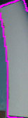 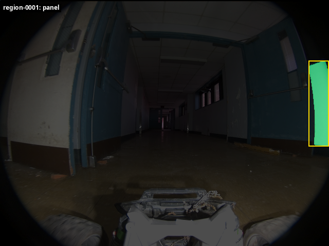

**region-0002 — wall**

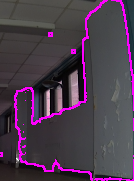 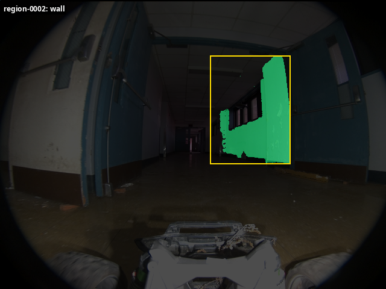

**region-0003 — bar**

 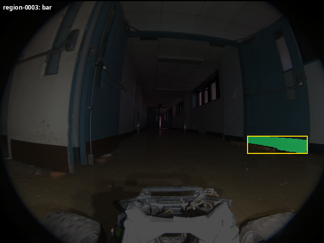

**region-0004 — (abstenção)**

 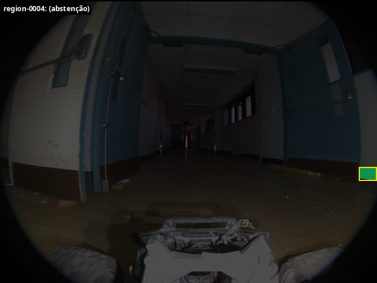

**region-0005 — board**

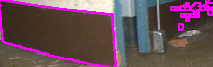 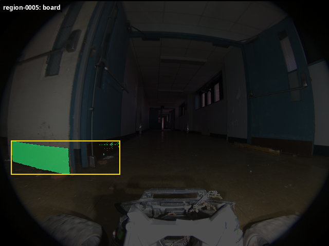

**region-0006 — blade**

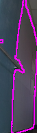 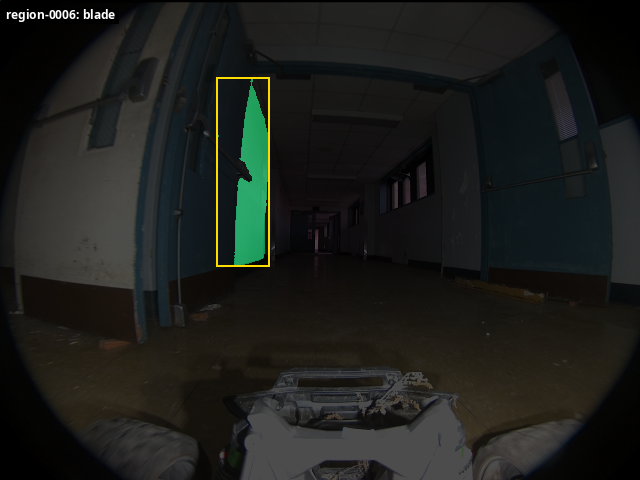

**region-0007 — microphone**

 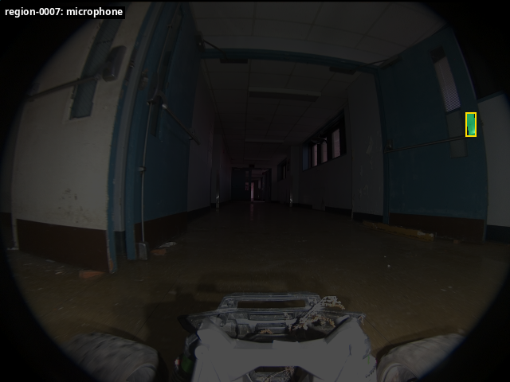

**region-0008 — bar**

 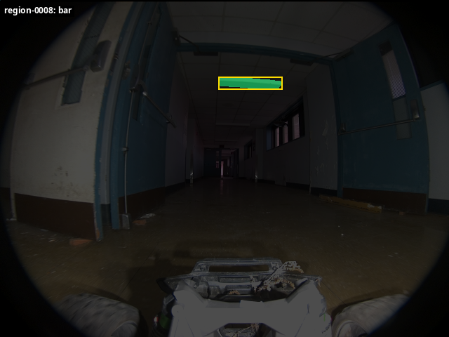

**region-0009 — seat**

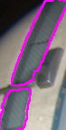 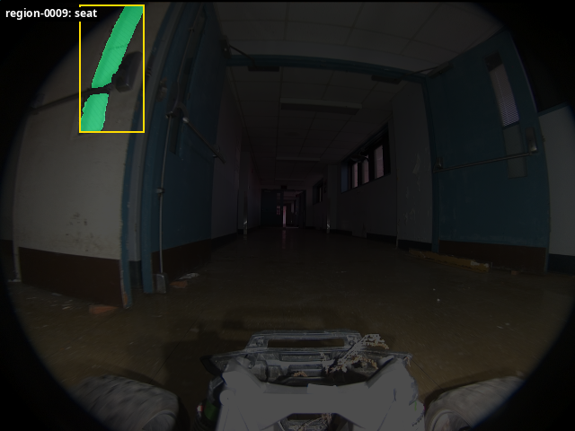

**region-0010 — door**

 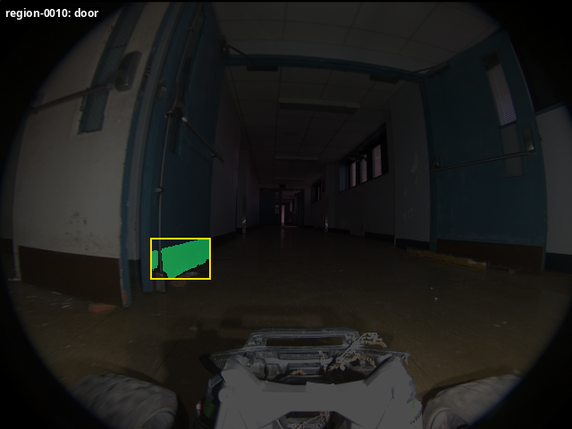

**region-0011 — barrel**

 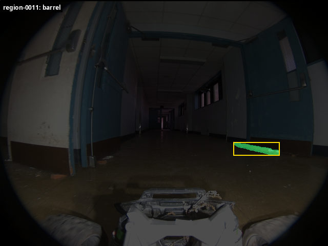

**region-0012 — (abstenção)**

 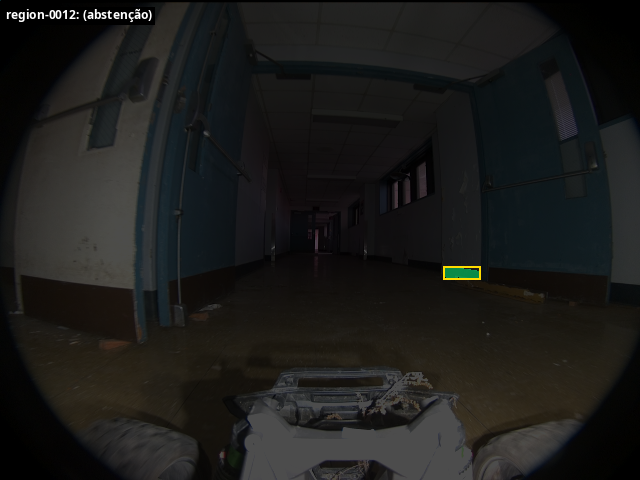

**region-0013 — door**

 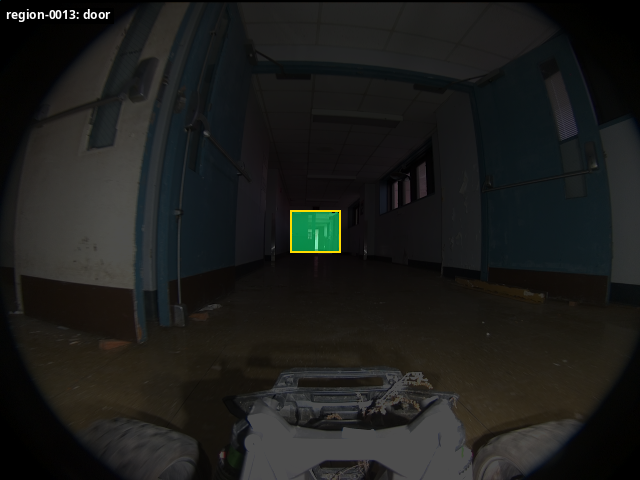

**region-0014 — knife**

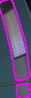 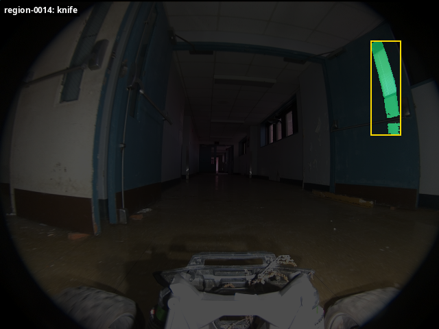

**region-0015 — door**

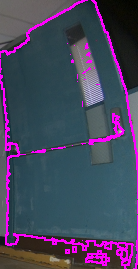 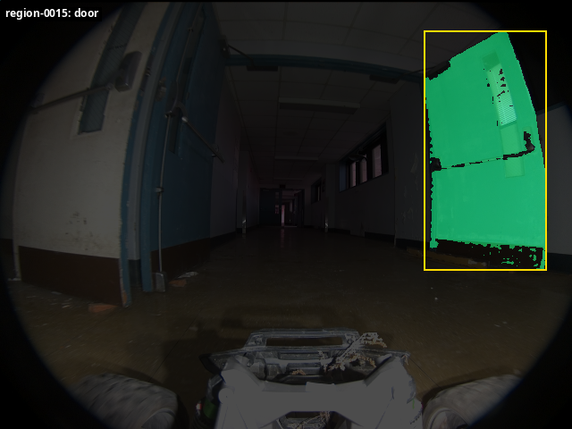

**region-0016 — spatula**

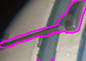 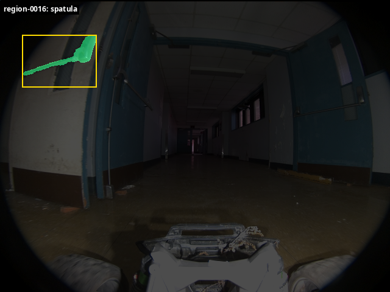

**region-0017 — pole**

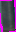 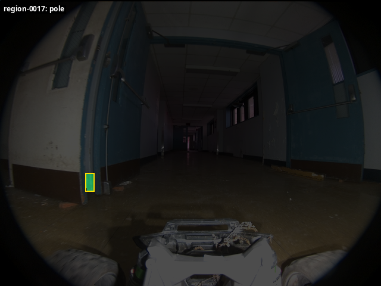

**region-0018 — door**

 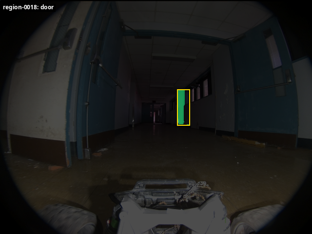

**region-0019 — wing**

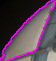 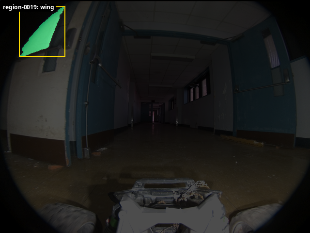

**region-0020 — window**

 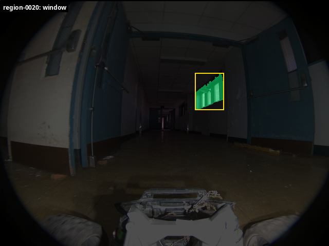

**region-0021 — screen**

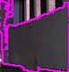 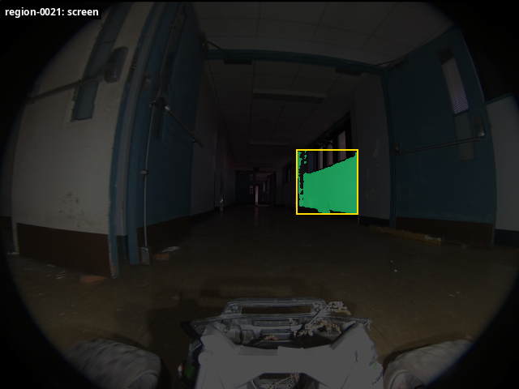

**region-0022 — door**

 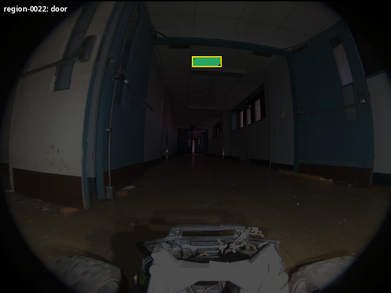

**region-0023 — edge**

 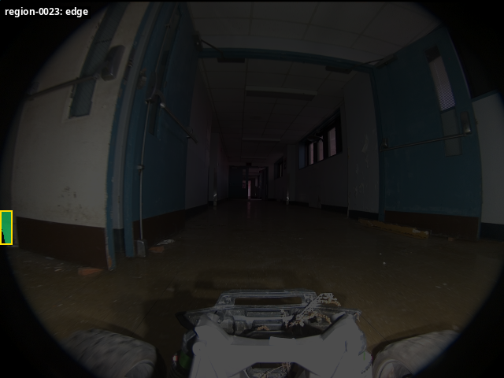

**region-0024 — frame**

 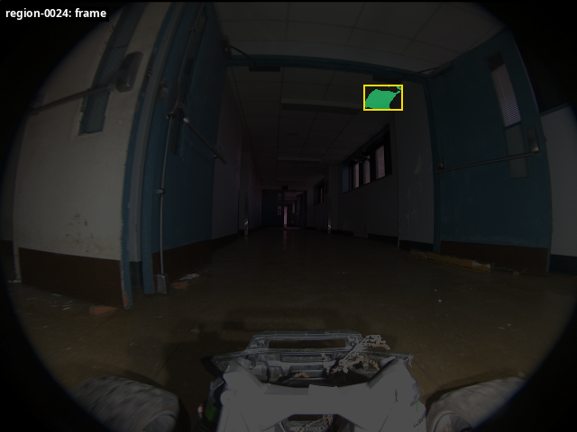

**region-0025 — (abstenção)**

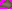 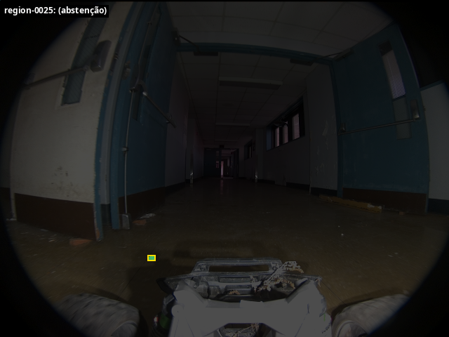

**region-0026 — pad**

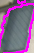 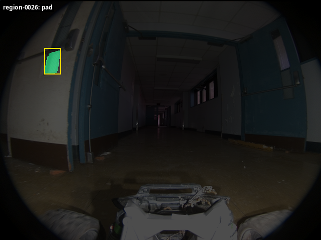

**region-0027 — ceiling**

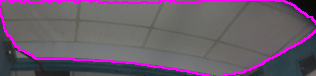 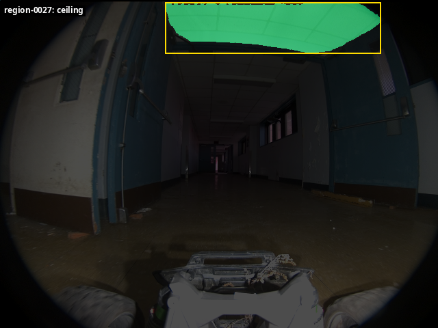

**region-0028 — handle**

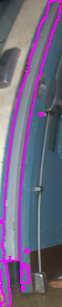 

**region-0029 — towel rack**

 

**region-0030 — plate**

 

**region-0031 — bar**

 

**region-0032 — object**

 

**region-0033 — (abstenção)**

 

**region-0034 — blade**

 

**region-0035 — edge**

 

**region-0036 — line**

 

**region-0037 — bar**

 

**region-0038 — door**

 

**region-0039 — shelf**

 

**region-0040 — button**

 

**region-0041 — panel**

 

**region-0042 — (abstenção)**

 

**region-0043 — cap**

 

**region-0044 — bar**

 

**region-0045 — pen**

 

**region-0046 — screw**

 

**region-0047 — edge**

 

**region-0048 — bar**

 

**region-0049 — text**

 

**region-0050 — bar**

 

**region-0051 — (abstenção)**

 

**region-0052 — panel**

 

**region-0053 — handle**

 

**region-0054 — sleeve**

 

**region-0055 — door**

 

**region-0056 — blade**

 

**region-0057 — line**

 

**region-0058 — skateboard**

 

**region-0059 — bar**

 

**region-0060 — leaf**

 

**region-0061 — bar**

 

</details>

## 7. Resultados por região — frame 000061

Percepção `bdb3a1a34ad65531210cfd28ce3d84ee` (run-0007): 68 regiões, 63 com label, 5 abstenções, 0 falhas de parse, 0 falhas de chamada. Latência do VLM por região: mediana 2.52 s (min 1.01, máx 7.14); pico de memória GPU ~5.28 GiB.

**Distribuição de labels primárias:** door ×6, (abstenção) ×5, bar ×4, frame ×4, handle ×3, shelf ×3, wall ×2, pipe ×2, line ×2, window ×2, plate ×2, label ×2, leaf ×2, button ×2, baseboard ×1, screen ×1, chair ×1, edge ×1, log ×1, lamp ×1, box ×1, shell ×1, cabinet ×1, blade ×1, tube ×1, pad ×1, sign ×1, screw ×1, stick ×1, spatula ×1, tag ×1, rod ×1, rocket ×1, glove ×1, folder ×1, cap ×1, pen ×1, strip ×1, tool ×1, key ×1, outline ×1

**interaction_factor:** 0.8 ×60, 0.5 ×3; `region_kind`: {'thing': 63, None: 5}; `category`: {'structure': 13, 'furniture': 10, 'tool': 8, None: 5, 'mark': 2, 'container': 2, 'building': 2, 'electronic': 2, 'food': 2, 'sign': 2, 'label': 2, 'plant': 2, 'hardware': 2, 'control': 2, 'display': 1, 'wood': 1, 'electrical': 1, 'door': 1, 'object': 1, 'equipment': 1, 'fastener': 1, 'mechanical': 1, 'vehicle': 1, 'writing instrument': 1, 'decorative': 1, 'shape': 1}

Colunas: bbox em px `x,y,w,h` (origem no canto superior esquerdo); **pts LiDAR** = pontos do mapa associados à máscara (raw / voxel); **entidade** = entidade do mapa final onde a região terminou (raw / voxel). Imagens: `view` = exatamente o que o VLM recebeu; `máscara` = máscara destacada no frame + bbox.

| Região | bbox x,y,w,h | Área px | Label primária | Alternativas | Categoria | Cor | Material | Condição | Fator | pts LiDAR raw/voxel | Entidade raw / voxel | Imagens |
|---|---|---|---|---|---|---|---|---|---|---|---|---|
| region-0001 | 455,272,185,42 | 3204 | **baseboard** | — | furniture | yellow | wood | worn | 0.800 | 4854 / 582 | entity-0022 / entity-0022 | [view](imagens/frame-000061/regioes/region-0001-view-vlm.png) · [máscara](imagens/frame-000061/regioes/region-0001-mascara.png) |
| region-0002 | 371,69,134,216 | 15347 | **wall** | — | structure | gray | — | peeling | 0.800 | 104 / 94 | entity-0063 / entity-0051 | [view](imagens/frame-000061/regioes/region-0002-view-vlm.png) · [máscara](imagens/frame-000061/regioes/region-0002-mascara.png) |
| region-0003 | 199,21,71,253 | 8805 | **door** | — | structure | gray | — | — | 0.800 | 32 / 29 | entity-0025 / entity-0025 | [view](imagens/frame-000061/regioes/region-0003-view-vlm.png) · [máscara](imagens/frame-000061/regioes/region-0003-mascara.png) |
| region-0004 | 2,47,100,265 | 9589 | **pipe** | — | structure | white | metal | clean | 0.800 | 1373 / 143 | entity-0031 / entity-0028 | [view](imagens/frame-000061/regioes/region-0004-view-vlm.png) · [máscara](imagens/frame-000061/regioes/region-0004-mascara.png) |
| region-0005 | 493,25,147,260 | 24203 | **screen** | — | display | teal | — | — | 0.800 | 16574 / 2349 | entity-0049 / entity-0044 | [view](imagens/frame-000061/regioes/region-0005-view-vlm.png) · [máscara](imagens/frame-000061/regioes/region-0005-mascara.png) |
| region-0006 | 63,273,137,90 | 5620 | **wall** | — | structure | dark | — | — | 0.800 | 398 / 152 | entity-0037 / entity-0034 | [view](imagens/frame-000061/regioes/region-0006-view-vlm.png) · [máscara](imagens/frame-000061/regioes/region-0006-mascara.png) |
| region-0007 | 200,261,49,30 | 699 | **line** | — | mark | pink | — | — | 0.500 | 1 / 1 | excluída na fusão (1 pts < 5) / excluída na fusão (1 pts < 5) | [view](imagens/frame-000061/regioes/region-0007-view-vlm.png) · [máscara](imagens/frame-000061/regioes/region-0007-mascara.png) |
| region-0008 | 282,211,24,43 | 845 | **chair** | — | furniture | black | — | — | 0.800 | 2150 / 318 | entity-0033 / entity-0015 | [view](imagens/frame-000061/regioes/region-0008-view-vlm.png) · [máscara](imagens/frame-000061/regioes/region-0008-mascara.png) |
| region-0009 | 410,263,93,24 | 949 | **edge** | — | structure | pink | — | — | 0.800 | 4 / 6 | excluída na fusão (4 pts < 5) / entity-0039 | [view](imagens/frame-000061/regioes/region-0009-view-vlm.png) · [máscara](imagens/frame-000061/regioes/region-0009-mascara.png) |
| region-0010 | 470,284,126,36 | 1744 | **log** | — | wood | brown | — | — | 0.800 | 277 / 73 | entity-0053 / entity-0031 | [view](imagens/frame-000061/regioes/region-0010-view-vlm.png) · [máscara](imagens/frame-000061/regioes/region-0010-mascara.png) |
| region-0011 | 114,344,28,14 | 315 | **(abstenção)** | — | — | — | — | — | — | 28 / 11 | entity-0032 / entity-0016 | [view](imagens/frame-000061/regioes/region-0011-view-vlm.png) · [máscara](imagens/frame-000061/regioes/region-0011-mascara.png) |
| region-0012 | 77,109,27,261 | 1797 | **lamp** | — | electrical | silver | — | — | 0.800 | 298 / 71 | entity-0015 / entity-0021 | [view](imagens/frame-000061/regioes/region-0012-view-vlm.png) · [máscara](imagens/frame-000061/regioes/region-0012-mascara.png) |
| region-0013 | 10,307,46,47 | 1485 | **box** | — | container | dark | — | — | 0.800 | 148 / 27 | entity-0021 / entity-0014 | [view](imagens/frame-000061/regioes/region-0013-view-vlm.png) · [máscara](imagens/frame-000061/regioes/region-0013-mascara.png) |
| region-0014 | 302,92,103,23 | 1617 | **bar** | — | furniture | gray | — | — | 0.800 | 174 / 48 | entity-0062 / entity-0008 | [view](imagens/frame-000061/regioes/region-0014-view-vlm.png) · [máscara](imagens/frame-000061/regioes/region-0014-mascara.png) |
| region-0015 | 383,132,56,78 | 2563 | **window** | — | building | black | — | — | 0.800 | 8 / 3 | entity-0063 / excluída na fusão (3 pts < 5) | [view](imagens/frame-000061/regioes/region-0015-view-vlm.png) · [máscara](imagens/frame-000061/regioes/region-0015-mascara.png) |
| region-0016 | 472,60,44,229 | 2600 | **door** | — | door | dark green | — | — | 0.800 | 30 / 15 | entity-0023 / entity-0023 | [view](imagens/frame-000061/regioes/region-0016-view-vlm.png) · [máscara](imagens/frame-000061/regioes/region-0016-mascara.png) |
| region-0017 | 508,152,132,30 | 786 | **bar** | — | furniture | black | — | — | 0.800 | 30 / 22 | entity-0048 / entity-0043 | [view](imagens/frame-000061/regioes/region-0017-view-vlm.png) · [máscara](imagens/frame-000061/regioes/region-0017-mascara.png) |
| region-0018 | 340,120,44,18 | 551 | **frame** | — | electronic | pink | — | — | 0.800 | 61 / 21 | entity-0050 / entity-0045 | [view](imagens/frame-000061/regioes/region-0018-view-vlm.png) · [máscara](imagens/frame-000061/regioes/region-0018-mascara.png) |
| region-0019 | 247,69,53,27 | 1204 | **bar** | — | furniture | gray | — | — | 0.800 | 27 / 11 | entity-0008 / entity-0009 | [view](imagens/frame-000061/regioes/region-0019-view-vlm.png) · [máscara](imagens/frame-000061/regioes/region-0019-mascara.png) |
| region-0020 | 134,326,37,14 | 269 | **shell** | — | object | white | — | — | 0.800 | 20 / 10 | entity-0061 / entity-0050 | [view](imagens/frame-000061/regioes/region-0020-view-vlm.png) · [máscara](imagens/frame-000061/regioes/region-0020-mascara.png) |
| region-0021 | 21,4,210,364 | 36299 | **cabinet** | — | furniture | blue | plastic | damaged | 0.800 | 4934 / 957 | entity-0012 / entity-0013 | [view](imagens/frame-000061/regioes/region-0021-view-vlm.png) · [máscara](imagens/frame-000061/regioes/region-0021-mascara.png) |
| region-0022 | 111,4,67,135 | 2439 | **blade** | — | tool | gray | — | — | 0.800 | 80 / 53 | entity-0060 / entity-0049 | [view](imagens/frame-000061/regioes/region-0022-view-vlm.png) · [máscara](imagens/frame-000061/regioes/region-0022-mascara.png) |
| region-0023 | 307,214,6,41 | 153 | **tube** | — | container | pink | — | — | 0.800 | 295 / 79 | entity-0016 / entity-0017 | [view](imagens/frame-000061/regioes/region-0023-view-vlm.png) · [máscara](imagens/frame-000061/regioes/region-0023-mascara.png) |
| region-0024 | 416,62,51,25 | 565 | **pad** | — | equipment | pink | — | — | 0.800 | 6 / 3 | entity-0011 / excluída na fusão (3 pts < 5) | [view](imagens/frame-000061/regioes/region-0024-view-vlm.png) · [máscara](imagens/frame-000061/regioes/region-0024-mascara.png) |
| region-0025 | 603,115,37,73 | 1656 | **plate** | — | food | gray | — | — | 0.800 | 133 / 38 | entity-0051 / entity-0012 | [view](imagens/frame-000061/regioes/region-0025-view-vlm.png) · [máscara](imagens/frame-000061/regioes/region-0025-mascara.png) |
| region-0026 | 304,70,80,25 | 1058 | **label** | — | sign | pink | — | — | 0.800 | 8 / 5 | entity-0062 / entity-0030 | [view](imagens/frame-000061/regioes/region-0026-view-vlm.png) · [máscara](imagens/frame-000061/regioes/region-0026-mascara.png) |
| region-0027 | 308,45,65,28 | 1393 | **label** | — | label | pink | — | — | 0.800 | 12 / 8 | entity-0019 / entity-0030 | [view](imagens/frame-000061/regioes/region-0027-view-vlm.png) · [máscara](imagens/frame-000061/regioes/region-0027-mascara.png) |
| region-0028 | 336,180,37,82 | 1705 | **door** | — | structure | dark | — | — | 0.800 | 12 / 8 | entity-0007 / entity-0020 | [view](imagens/frame-000061/regioes/region-0028-view-vlm.png) · [máscara](imagens/frame-000061/regioes/region-0028-mascara.png) |
| region-0029 | 299,165,53,12 | 357 | **bar** | — | furniture | black | — | — | 0.800 | 0 / 0 | excluída na fusão (0 pts < 5) / excluída na fusão (0 pts < 5) | [view](imagens/frame-000061/regioes/region-0029-view-vlm.png) · [máscara](imagens/frame-000061/regioes/region-0029-mascara.png) |
| region-0030 | 366,121,86,146 | 5187 | **window** | — | building | dark | — | — | 0.800 | 4 / 4 | excluída na fusão (4 pts < 5) / excluída na fusão (4 pts < 5) | [view](imagens/frame-000061/regioes/region-0030-view-vlm.png) · [máscara](imagens/frame-000061/regioes/region-0030-mascara.png) |
| region-0031 | 302,117,41,17 | 564 | **sign** | — | sign | pink | — | — | 0.800 | 0 / 0 | excluída na fusão (0 pts < 5) / excluída na fusão (0 pts < 5) | [view](imagens/frame-000061/regioes/region-0031-view-vlm.png) · [máscara](imagens/frame-000061/regioes/region-0031-mascara.png) |
| region-0032 | 355,75,60,25 | 985 | **frame** | — | structure | pink | — | — | 0.800 | 5 / 3 | entity-0017 / excluída na fusão (3 pts < 5) | [view](imagens/frame-000061/regioes/region-0032-view-vlm.png) · [máscara](imagens/frame-000061/regioes/region-0032-mascara.png) |
| region-0033 | 254,96,46,20 | 848 | **(abstenção)** | — | — | — | — | — | — | 12 / 9 | entity-0057 / entity-0007 | [view](imagens/frame-000061/regioes/region-0033-view-vlm.png) · [máscara](imagens/frame-000061/regioes/region-0033-mascara.png) |
| region-0034 | 583,60,43,59 | 1125 | **screw** | — | fastener | gray | — | — | 0.800 | 66 / 30 | entity-0005 / entity-0018 | [view](imagens/frame-000061/regioes/region-0034-view-vlm.png) · [máscara](imagens/frame-000061/regioes/region-0034-mascara.png) |
| region-0035 | 342,198,14,30 | 307 | **door** | — | structure | black | — | — | 0.800 | 4 / 4 | excluída na fusão (4 pts < 5) / excluída na fusão (4 pts < 5) | [view](imagens/frame-000061/regioes/region-0035-view-vlm.png) · [máscara](imagens/frame-000061/regioes/region-0035-mascara.png) |
| region-0036 | 306,138,22,8 | 137 | **leaf** | — | plant | dark green | — | — | 0.800 | 2 / 1 | excluída na fusão (2 pts < 5) / excluída na fusão (1 pts < 5) | [view](imagens/frame-000061/regioes/region-0036-view-vlm.png) · [máscara](imagens/frame-000061/regioes/region-0036-mascara.png) |
| region-0037 | 94,32,20,21 | 214 | **leaf** | — | plant | green | — | — | 0.800 | 3 / 2 | excluída na fusão (3 pts < 5) / excluída na fusão (2 pts < 5) | [view](imagens/frame-000061/regioes/region-0037-view-vlm.png) · [máscara](imagens/frame-000061/regioes/region-0037-mascara.png) |
| region-0038 | 250,164,33,93 | 2253 | **door** | — | structure | dark | — | — | 0.800 | 20 / 8 | entity-0035 / entity-0048 | [view](imagens/frame-000061/regioes/region-0038-view-vlm.png) · [máscara](imagens/frame-000061/regioes/region-0038-mascara.png) |
| region-0039 | 129,72,92,93 | 1054 | **stick** | — | tool | black | — | — | 0.800 | 37 / 17 | entity-0040 / entity-0005 | [view](imagens/frame-000061/regioes/region-0039-view-vlm.png) · [máscara](imagens/frame-000061/regioes/region-0039-mascara.png) |
| region-0040 | 325,212,10,44 | 362 | **handle** | — | hardware | black | — | — | 0.800 | 3 / 3 | excluída na fusão (3 pts < 5) / excluída na fusão (3 pts < 5) | [view](imagens/frame-000061/regioes/region-0040-view-vlm.png) · [máscara](imagens/frame-000061/regioes/region-0040-mascara.png) |
| region-0041 | 230,26,332,43 | 3738 | **shelf** | — | furniture | blue | plastic | damaged | 0.800 | 63 / 26 | entity-0055 / entity-0010 | [view](imagens/frame-000061/regioes/region-0041-view-vlm.png) · [máscara](imagens/frame-000061/regioes/region-0041-mascara.png) |
| region-0042 | 379,123,42,25 | 545 | **frame** | — | structure | pink | — | — | 0.800 | 14 / 5 | entity-0056 / entity-0035 | [view](imagens/frame-000061/regioes/region-0042-view-vlm.png) · [máscara](imagens/frame-000061/regioes/region-0042-mascara.png) |
| region-0043 | 233,3,314,54 | 9332 | **shelf** | — | furniture | white | — | — | 0.800 | 145 / 64 | entity-0046 / entity-0010 | [view](imagens/frame-000061/regioes/region-0043-view-vlm.png) · [máscara](imagens/frame-000061/regioes/region-0043-mascara.png) |
| region-0044 | 387,321,8,4 | 25 | **(abstenção)** | — | — | — | — | — | — | 0 / 0 | excluída na fusão (0 pts < 5) / excluída na fusão (0 pts < 5) | [view](imagens/frame-000061/regioes/region-0044-view-vlm.png) · [máscara](imagens/frame-000061/regioes/region-0044-mascara.png) |
| region-0045 | 405,81,42,29 | 775 | **frame** | — | structure | pink | — | — | 0.800 | 23 / 13 | entity-0013 / entity-0047 | [view](imagens/frame-000061/regioes/region-0045-view-vlm.png) · [máscara](imagens/frame-000061/regioes/region-0045-mascara.png) |
| region-0046 | 420,56,39,15 | 333 | **line** | — | mark | pink | — | — | 0.500 | 9 / 4 | entity-0006 / excluída na fusão (4 pts < 5) | [view](imagens/frame-000061/regioes/region-0046-view-vlm.png) · [máscara](imagens/frame-000061/regioes/region-0046-mascara.png) |
| region-0047 | 388,167,22,10 | 160 | **spatula** | — | tool | black | — | — | 0.800 | 2 / 1 | excluída na fusão (2 pts < 5) / excluída na fusão (1 pts < 5) | [view](imagens/frame-000061/regioes/region-0047-view-vlm.png) · [máscara](imagens/frame-000061/regioes/region-0047-mascara.png) |
| region-0048 | 307,253,7,22 | 100 | **handle** | — | hardware | dark | — | — | 0.800 | 1 / 1 | excluída na fusão (1 pts < 5) / excluída na fusão (1 pts < 5) | [view](imagens/frame-000061/regioes/region-0048-view-vlm.png) · [máscara](imagens/frame-000061/regioes/region-0048-mascara.png) |
| region-0049 | 341,222,21,35 | 575 | **door** | — | structure | black | — | — | 0.800 | 2 / 2 | excluída na fusão (2 pts < 5) / excluída na fusão (2 pts < 5) | [view](imagens/frame-000061/regioes/region-0049-view-vlm.png) · [máscara](imagens/frame-000061/regioes/region-0049-mascara.png) |
| region-0050 | 220,4,16,26 | 287 | **handle** | — | mechanical | dark | — | — | 0.800 | 4 / 4 | excluída na fusão (4 pts < 5) / excluída na fusão (4 pts < 5) | [view](imagens/frame-000061/regioes/region-0050-view-vlm.png) · [máscara](imagens/frame-000061/regioes/region-0050-mascara.png) |
| region-0051 | 365,50,57,30 | 1260 | **tag** | — | label | pink | — | — | 0.800 | 4 / 2 | excluída na fusão (4 pts < 5) / excluída na fusão (2 pts < 5) | [view](imagens/frame-000061/regioes/region-0051-view-vlm.png) · [máscara](imagens/frame-000061/regioes/region-0051-mascara.png) |
| region-0052 | 481,37,47,24 | 396 | **button** | — | control | gray | — | — | 0.800 | 7 / 4 | entity-0041 / excluída na fusão (4 pts < 5) | [view](imagens/frame-000061/regioes/region-0052-view-vlm.png) · [máscara](imagens/frame-000061/regioes/region-0052-mascara.png) |
| region-0053 | 622,315,9,7 | 57 | **(abstenção)** | — | — | — | — | — | — | 1 / 0 | excluída na fusão (1 pts < 5) / excluída na fusão (0 pts < 5) | [view](imagens/frame-000061/regioes/region-0053-view-vlm.png) · [máscara](imagens/frame-000061/regioes/region-0053-mascara.png) |
| region-0054 | 232,9,38,36 | 236 | **pipe** | — | structure | pink | — | — | 0.800 | 5 / 1 | entity-0027 / excluída na fusão (1 pts < 5) | [view](imagens/frame-000061/regioes/region-0054-view-vlm.png) · [máscara](imagens/frame-000061/regioes/region-0054-mascara.png) |
| region-0055 | 79,29,57,310 | 1819 | **rod** | — | tool | gray | — | — | 0.800 | 319 / 85 | entity-0015 / entity-0021 | [view](imagens/frame-000061/regioes/region-0055-view-vlm.png) · [máscara](imagens/frame-000061/regioes/region-0055-mascara.png) |
| region-0056 | 106,26,35,52 | 1213 | **rocket** | — | vehicle | gray | — | — | 0.800 | 36 / 19 | entity-0040 / entity-0005 | [view](imagens/frame-000061/regioes/region-0056-view-vlm.png) · [máscara](imagens/frame-000061/regioes/region-0056-mascara.png) |
| region-0057 | 508,160,13,21 | 194 | **glove** | — | tool | dark | — | — | 0.800 | 8 / 3 | entity-0054 / excluída na fusão (3 pts < 5) | [view](imagens/frame-000061/regioes/region-0057-view-vlm.png) · [máscara](imagens/frame-000061/regioes/region-0057-mascara.png) |
| region-0058 | 449,257,5,26 | 68 | **(abstenção)** | — | — | — | — | — | — | 0 / 0 | excluída na fusão (0 pts < 5) / excluída na fusão (0 pts < 5) | [view](imagens/frame-000061/regioes/region-0058-view-vlm.png) · [máscara](imagens/frame-000061/regioes/region-0058-mascara.png) |
| region-0059 | 336,134,38,15 | 384 | **folder** | — | electronic | pink | plastic | open | 0.800 | 0 / 0 | excluída na fusão (0 pts < 5) / excluída na fusão (0 pts < 5) | [view](imagens/frame-000061/regioes/region-0059-view-vlm.png) · [máscara](imagens/frame-000061/regioes/region-0059-mascara.png) |
| region-0060 | 299,176,24,20 | 394 | **cap** | — | tool | pink | — | — | 0.800 | 0 / 0 | excluída na fusão (0 pts < 5) / excluída na fusão (0 pts < 5) | [view](imagens/frame-000061/regioes/region-0060-view-vlm.png) · [máscara](imagens/frame-000061/regioes/region-0060-mascara.png) |
| region-0061 | 306,231,7,49 | 123 | **pen** | — | writing instrument | pink | — | — | 0.800 | 2 / 2 | excluída na fusão (2 pts < 5) / excluída na fusão (2 pts < 5) | [view](imagens/frame-000061/regioes/region-0061-view-vlm.png) · [máscara](imagens/frame-000061/regioes/region-0061-mascara.png) |
| region-0062 | 302,92,103,15 | 799 | **strip** | — | decorative | pink | — | — | 0.500 | 90 / 25 | entity-0062 / entity-0008 | [view](imagens/frame-000061/regioes/region-0062-view-vlm.png) · [máscara](imagens/frame-000061/regioes/region-0062-mascara.png) |
| region-0063 | 389,106,51,21 | 689 | **plate** | — | food | gray | — | — | 0.800 | 3 / 2 | excluída na fusão (3 pts < 5) / excluída na fusão (2 pts < 5) | [view](imagens/frame-000061/regioes/region-0063-view-vlm.png) · [máscara](imagens/frame-000061/regioes/region-0063-mascara.png) |
| region-0064 | 110,68,37,73 | 1126 | **button** | — | control | gray | — | — | 0.800 | 53 / 33 | entity-0060 / entity-0049 | [view](imagens/frame-000061/regioes/region-0064-view-vlm.png) · [máscara](imagens/frame-000061/regioes/region-0064-mascara.png) |
| region-0065 | 105,30,116,135 | 1900 | **tool** | — | tool | gray | — | — | 0.800 | 67 / 33 | entity-0040 / entity-0005 | [view](imagens/frame-000061/regioes/region-0065-view-vlm.png) · [máscara](imagens/frame-000061/regioes/region-0065-mascara.png) |
| region-0066 | 298,197,35,9 | 181 | **key** | — | tool | pink | — | — | 0.800 | 4 / 3 | excluída na fusão (4 pts < 5) / excluída na fusão (3 pts < 5) | [view](imagens/frame-000061/regioes/region-0066-view-vlm.png) · [máscara](imagens/frame-000061/regioes/region-0066-mascara.png) |
| region-0067 | 371,125,37,32 | 457 | **outline** | — | shape | pink | — | — | 0.800 | 0 / 0 | excluída na fusão (0 pts < 5) / excluída na fusão (0 pts < 5) | [view](imagens/frame-000061/regioes/region-0067-view-vlm.png) · [máscara](imagens/frame-000061/regioes/region-0067-mascara.png) |
| region-0068 | 239,44,62,36 | 1232 | **shelf** | — | furniture | gray | — | — | 0.800 | 7 / 4 | entity-0044 / excluída na fusão (4 pts < 5) | [view](imagens/frame-000061/regioes/region-0068-view-vlm.png) · [máscara](imagens/frame-000061/regioes/region-0068-mascara.png) |

Atributos adicionais (descrição livre, atributos extras, atributos das alternativas):

- `region-0001` (baseboard): description: "a yellow baseboard with visible wear and tear along its length"
- `region-0002` (wall): description: "vertical surface with peeling paint"
- `region-0004` (pipe): description: "vertical cylindrical object with smooth surface"
- `region-0021` (cabinet): description: "a blue plastic cabinet with visible damage and a broken handle"
- `region-0041` (shelf): description: "a curved blue plastic shelf with visible cracks and a broken end"
- `region-0059` (folder): description: "a folder with a pink border and dark interior"

<details><summary>Respostas brutas do VLM — frame 000061 (uma linha por região, texto exato devolvido pelo modelo)</summary>

```text
region-0001 [7.14s, in 859 tok, out 95 tok, view 544x128]: {"abstained": false, "claims": [{"hypothesis": "baseboard", "role": "primary", "category": "furniture", "region_kind": "thing", "attributes": {"color": "yellow", "material": "wood", "condition": "worn", "description": "a yellow baseboard with visible wear and tear along its length", "interaction_factor": 0.8}}], "scene_context": null}
region-0002 [3.11s, in 868 tok, out 81 tok, view 224x352]: {"abstained": false, "claims": [{"hypothesis": "wall", "role": "primary", "category": "structure", "region_kind": "thing", "attributes": {"color": "gray", "condition": "peeling", "description": "vertical surface with peeling paint", "interaction_factor": 0.8}}], "scene_context": null}
region-0003 [2.51s, in 871 tok, out 63 tok, view 160x512]: {"abstained": false, "claims": [{"hypothesis": "door", "role": "primary", "category": "structure", "region_kind": "thing", "attributes": {"color": "gray", "interaction_factor": 0.8}}], "scene_context": null}
region-0004 [3.27s, in 861 tok, out 86 tok, view 160x448]: {"abstained": false, "claims": [{"hypothesis": "pipe", "role": "primary", "category": "structure", "region_kind": "thing", "attributes": {"color": "white", "material": "metal", "condition": "clean", "description": "vertical cylindrical object with smooth surface", "interaction_factor": 0.8}}], "scene_context": null}
region-0005 [2.55s, in 868 tok, out 64 tok, view 224x352]: {"abstained": false, "claims": [{"hypothesis": "screen", "role": "primary", "category": "display", "region_kind": "thing", "attributes": {"color": "teal", "interaction_factor": 0.8}}], "scene_context": null}
region-0006 [2.51s, in 861 tok, out 63 tok, view 320x224]: {"abstained": false, "claims": [{"hypothesis": "wall", "role": "primary", "category": "structure", "region_kind": "thing", "attributes": {"color": "dark", "interaction_factor": 0.8}}], "scene_context": null}
region-0007 [2.51s, in 868 tok, out 63 tok, view 352x224]: {"abstained": false, "claims": [{"hypothesis": "line", "role": "primary", "category": "mark", "region_kind": "thing", "attributes": {"color": "pink", "interaction_factor": 0.5}}], "scene_context": null}
region-0008 [2.54s, in 857 tok, out 64 tok, view 192x352]: {"abstained": false, "claims": [{"hypothesis": "chair", "role": "primary", "category": "furniture", "region_kind": "thing", "attributes": {"color": "black", "interaction_factor": 0.8}}], "scene_context": null}
region-0009 [2.51s, in 871 tok, out 63 tok, view 512x160]: {"abstained": false, "claims": [{"hypothesis": "edge", "role": "primary", "category": "structure", "region_kind": "thing", "attributes": {"color": "pink", "interaction_factor": 0.8}}], "scene_context": null}
region-0010 [2.51s, in 866 tok, out 63 tok, view 480x160]: {"abstained": false, "claims": [{"hypothesis": "log", "role": "primary", "category": "wood", "region_kind": "thing", "attributes": {"color": "brown", "interaction_factor": 0.8}}], "scene_context": null}
region-0011 [1.01s, in 863 tok, out 18 tok, view 384x192]: {"abstained": true, "claims": [], "scene_context": null}
region-0012 [2.53s, in 866 tok, out 64 tok, view 96x800]: {"abstained": false, "claims": [{"hypothesis": "lamp", "role": "primary", "category": "electrical", "region_kind": "thing", "attributes": {"color": "silver", "interaction_factor": 0.8}}], "scene_context": null}
region-0013 [2.51s, in 863 tok, out 63 tok, view 256x288]: {"abstained": false, "claims": [{"hypothesis": "box", "role": "primary", "category": "container", "region_kind": "thing", "attributes": {"color": "dark", "interaction_factor": 0.8}}], "scene_context": null}
region-0014 [2.54s, in 859 tok, out 64 tok, view 544x128]: {"abstained": false, "claims": [{"hypothesis": "bar", "role": "primary", "category": "furniture", "region_kind": "thing", "attributes": {"color": "gray", "interaction_factor": 0.8}}], "scene_context": null}
region-0015 [2.52s, in 861 tok, out 63 tok, view 224x320]: {"abstained": false, "claims": [{"hypothesis": "window", "role": "primary", "category": "building", "region_kind": "thing", "attributes": {"color": "black", "interaction_factor": 0.8}}], "scene_context": null}
region-0016 [2.54s, in 867 tok, out 64 tok, view 128x608]: {"abstained": false, "claims": [{"hypothesis": "door", "role": "primary", "category": "door", "region_kind": "thing", "attributes": {"color": "dark green", "interaction_factor": 0.8}}], "scene_context": null}
region-0017 [2.54s, in 859 tok, out 64 tok, view 544x128]: {"abstained": false, "claims": [{"hypothesis": "bar", "role": "primary", "category": "furniture", "region_kind": "thing", "attributes": {"color": "black", "interaction_factor": 0.8}}], "scene_context": null}
region-0018 [2.55s, in 869 tok, out 64 tok, view 416x192]: {"abstained": false, "claims": [{"hypothesis": "frame", "role": "primary", "category": "electronic", "region_kind": "thing", "attributes": {"color": "pink", "interaction_factor": 0.8}}], "scene_context": null}
region-0019 [2.55s, in 863 tok, out 64 tok, view 384x192]: {"abstained": false, "claims": [{"hypothesis": "bar", "role": "primary", "category": "furniture", "region_kind": "thing", "attributes": {"color": "gray", "interaction_factor": 0.8}}], "scene_context": null}
region-0020 [2.51s, in 861 tok, out 63 tok, view 448x160]: {"abstained": false, "claims": [{"hypothesis": "shell", "role": "primary", "category": "object", "region_kind": "thing", "attributes": {"color": "white", "interaction_factor": 0.8}}], "scene_context": null}
region-0021 [3.57s, in 868 tok, out 95 tok, view 224x352]: {"abstained": false, "claims": [{"hypothesis": "cabinet", "role": "primary", "category": "furniture", "region_kind": "thing", "attributes": {"color": "blue", "material": "plastic", "condition": "damaged", "description": "a blue plastic cabinet with visible damage and a broken handle", "interaction_factor": 0.8}}], "scene_context": null}
region-0022 [2.51s, in 863 tok, out 63 tok, view 192x384]: {"abstained": false, "claims": [{"hypothesis": "blade", "role": "primary", "category": "tool", "region_kind": "thing", "attributes": {"color": "gray", "interaction_factor": 0.8}}], "scene_context": null}
region-0023 [2.52s, in 875 tok, out 63 tok, view 128x672]: {"abstained": false, "claims": [{"hypothesis": "tube", "role": "primary", "category": "container", "region_kind": "thing", "attributes": {"color": "pink", "interaction_factor": 0.8}}], "scene_context": null}
region-0024 [2.50s, in 863 tok, out 63 tok, view 384x192]: {"abstained": false, "claims": [{"hypothesis": "pad", "role": "primary", "category": "equipment", "region_kind": "thing", "attributes": {"color": "pink", "interaction_factor": 0.8}}], "scene_context": null}
region-0025 [2.52s, in 863 tok, out 63 tok, view 192x384]: {"abstained": false, "claims": [{"hypothesis": "plate", "role": "primary", "category": "food", "region_kind": "thing", "attributes": {"color": "gray", "interaction_factor": 0.8}}], "scene_context": null}
region-0026 [2.51s, in 866 tok, out 63 tok, view 480x160]: {"abstained": false, "claims": [{"hypothesis": "label", "role": "primary", "category": "sign", "region_kind": "thing", "attributes": {"color": "pink", "interaction_factor": 0.8}}], "scene_context": null}
region-0027 [2.52s, in 869 tok, out 63 tok, view 416x192]: {"abstained": false, "claims": [{"hypothesis": "label", "role": "primary", "category": "label", "region_kind": "thing", "attributes": {"color": "pink", "interaction_factor": 0.8}}], "scene_context": null}
region-0028 [2.51s, in 863 tok, out 63 tok, view 192x384]: {"abstained": false, "claims": [{"hypothesis": "door", "role": "primary", "category": "structure", "region_kind": "thing", "attributes": {"color": "dark", "interaction_factor": 0.8}}], "scene_context": null}
region-0029 [2.54s, in 859 tok, out 64 tok, view 544x128]: {"abstained": false, "claims": [{"hypothesis": "bar", "role": "primary", "category": "furniture", "region_kind": "thing", "attributes": {"color": "black", "interaction_factor": 0.8}}], "scene_context": null}
region-0030 [2.51s, in 868 tok, out 63 tok, view 224x352]: {"abstained": false, "claims": [{"hypothesis": "window", "role": "primary", "category": "building", "region_kind": "thing", "attributes": {"color": "dark", "interaction_factor": 0.8}}], "scene_context": null}
region-0031 [2.51s, in 869 tok, out 63 tok, view 416x192]: {"abstained": false, "claims": [{"hypothesis": "sign", "role": "primary", "category": "sign", "region_kind": "thing", "attributes": {"color": "pink", "interaction_factor": 0.8}}], "scene_context": null}
region-0032 [2.52s, in 869 tok, out 63 tok, view 416x192]: {"abstained": false, "claims": [{"hypothesis": "frame", "role": "primary", "category": "structure", "region_kind": "thing", "attributes": {"color": "pink", "interaction_factor": 0.8}}], "scene_context": null}
region-0033 [1.01s, in 869 tok, out 18 tok, view 416x192]: {"abstained": true, "claims": [], "scene_context": null}
region-0034 [2.57s, in 861 tok, out 65 tok, view 224x320]: {"abstained": false, "claims": [{"hypothesis": "screw", "role": "primary", "category": "fastener", "region_kind": "thing", "attributes": {"color": "gray", "interaction_factor": 0.8}}], "scene_context": null}
region-0035 [2.52s, in 863 tok, out 63 tok, view 192x384]: {"abstained": false, "claims": [{"hypothesis": "door", "role": "primary", "category": "structure", "region_kind": "thing", "attributes": {"color": "black", "interaction_factor": 0.8}}], "scene_context": null}
region-0036 [2.54s, in 861 tok, out 64 tok, view 448x160]: {"abstained": false, "claims": [{"hypothesis": "leaf", "role": "primary", "category": "plant", "region_kind": "thing", "attributes": {"color": "dark green", "interaction_factor": 0.8}}], "scene_context": null}
region-0037 [2.51s, in 863 tok, out 63 tok, view 256x288]: {"abstained": false, "claims": [{"hypothesis": "leaf", "role": "primary", "category": "plant", "region_kind": "thing", "attributes": {"color": "green", "interaction_factor": 0.8}}], "scene_context": null}
region-0038 [2.51s, in 861 tok, out 63 tok, view 160x448]: {"abstained": false, "claims": [{"hypothesis": "door", "role": "primary", "category": "structure", "region_kind": "thing", "attributes": {"color": "dark", "interaction_factor": 0.8}}], "scene_context": null}
region-0039 [2.51s, in 863 tok, out 63 tok, view 256x288]: {"abstained": false, "claims": [{"hypothesis": "stick", "role": "primary", "category": "tool", "region_kind": "thing", "attributes": {"color": "black", "interaction_factor": 0.8}}], "scene_context": null}
region-0040 [2.50s, in 859 tok, out 63 tok, view 128x544]: {"abstained": false, "claims": [{"hypothesis": "handle", "role": "primary", "category": "hardware", "region_kind": "thing", "attributes": {"color": "black", "interaction_factor": 0.8}}], "scene_context": null}
region-0041 [3.57s, in 860 tok, out 95 tok, view 736x96]: {"abstained": false, "claims": [{"hypothesis": "shelf", "role": "primary", "category": "furniture", "region_kind": "thing", "attributes": {"color": "blue", "material": "plastic", "condition": "damaged", "description": "a curved blue plastic shelf with visible cracks and a broken end", "interaction_factor": 0.8}}], "scene_context": null}
region-0042 [2.51s, in 868 tok, out 63 tok, view 352x224]: {"abstained": false, "claims": [{"hypothesis": "frame", "role": "primary", "category": "structure", "region_kind": "thing", "attributes": {"color": "pink", "interaction_factor": 0.8}}], "scene_context": null}
region-0043 [2.56s, in 871 tok, out 64 tok, view 640x128]: {"abstained": false, "claims": [{"hypothesis": "shelf", "role": "primary", "category": "furniture", "region_kind": "thing", "attributes": {"color": "white", "interaction_factor": 0.8}}], "scene_context": null}
region-0044 [1.01s, in 863 tok, out 18 tok, view 384x192]: {"abstained": true, "claims": [], "scene_context": null}
region-0045 [2.52s, in 861 tok, out 63 tok, view 320x224]: {"abstained": false, "claims": [{"hypothesis": "frame", "role": "primary", "category": "structure", "region_kind": "thing", "attributes": {"color": "pink", "interaction_factor": 0.8}}], "scene_context": null}
region-0046 [2.51s, in 856 tok, out 63 tok, view 416x160]: {"abstained": false, "claims": [{"hypothesis": "line", "role": "primary", "category": "mark", "region_kind": "thing", "attributes": {"color": "pink", "interaction_factor": 0.5}}], "scene_context": null}
region-0047 [2.58s, in 863 tok, out 65 tok, view 384x192]: {"abstained": false, "claims": [{"hypothesis": "spatula", "role": "primary", "category": "tool", "region_kind": "thing", "attributes": {"color": "black", "interaction_factor": 0.8}}], "scene_context": null}
region-0048 [2.51s, in 866 tok, out 63 tok, view 160x480]: {"abstained": false, "claims": [{"hypothesis": "handle", "role": "primary", "category": "hardware", "region_kind": "thing", "attributes": {"color": "dark", "interaction_factor": 0.8}}], "scene_context": null}
region-0049 [2.51s, in 868 tok, out 63 tok, view 224x352]: {"abstained": false, "claims": [{"hypothesis": "door", "role": "primary", "category": "structure", "region_kind": "thing", "attributes": {"color": "black", "interaction_factor": 0.8}}], "scene_context": null}
region-0050 [2.58s, in 868 tok, out 65 tok, view 224x352]: {"abstained": false, "claims": [{"hypothesis": "handle", "role": "primary", "category": "mechanical", "region_kind": "thing", "attributes": {"color": "dark", "interaction_factor": 0.8}}], "scene_context": null}
region-0051 [2.51s, in 863 tok, out 63 tok, view 384x192]: {"abstained": false, "claims": [{"hypothesis": "tag", "role": "primary", "category": "label", "region_kind": "thing", "attributes": {"color": "pink", "interaction_factor": 0.8}}], "scene_context": null}
region-0052 [2.51s, in 863 tok, out 63 tok, view 384x192]: {"abstained": false, "claims": [{"hypothesis": "button", "role": "primary", "category": "control", "region_kind": "thing", "attributes": {"color": "gray", "interaction_factor": 0.8}}], "scene_context": null}
region-0053 [1.01s, in 871 tok, out 18 tok, view 320x256]: {"abstained": true, "claims": [], "scene_context": null}
region-0054 [2.54s, in 863 tok, out 63 tok, view 288x256]: {"abstained": false, "claims": [{"hypothesis": "pipe", "role": "primary", "category": "structure", "region_kind": "thing", "attributes": {"color": "pink", "interaction_factor": 0.8}}], "scene_context": null}
region-0055 [2.52s, in 867 tok, out 63 tok, view 128x608]: {"abstained": false, "claims": [{"hypothesis": "rod", "role": "primary", "category": "tool", "region_kind": "thing", "attributes": {"color": "gray", "interaction_factor": 0.8}}], "scene_context": null}
region-0056 [2.53s, in 861 tok, out 63 tok, view 224x320]: {"abstained": false, "claims": [{"hypothesis": "rocket", "role": "primary", "category": "vehicle", "region_kind": "thing", "attributes": {"color": "gray", "interaction_factor": 0.8}}], "scene_context": null}
region-0057 [2.55s, in 868 tok, out 64 tok, view 224x352]: {"abstained": false, "claims": [{"hypothesis": "glove", "role": "primary", "category": "tool", "region_kind": "thing", "attributes": {"color": "dark", "interaction_factor": 0.8}}], "scene_context": null}
region-0058 [1.03s, in 867 tok, out 18 tok, view 128x608]: {"abstained": true, "claims": [], "scene_context": null}
region-0059 [3.44s, in 869 tok, out 91 tok, view 416x192]: {"abstained": false, "claims": [{"hypothesis": "folder", "role": "primary", "category": "electronic", "region_kind": "thing", "attributes": {"color": "pink", "material": "plastic", "condition": "open", "description": "a folder with a pink border and dark interior", "interaction_factor": 0.8}}], "scene_context": null}
region-0060 [2.53s, in 863 tok, out 63 tok, view 288x256]: {"abstained": false, "claims": [{"hypothesis": "cap", "role": "primary", "category": "tool", "region_kind": "thing", "attributes": {"color": "pink", "interaction_factor": 0.8}}], "scene_context": null}
region-0061 [2.54s, in 879 tok, out 64 tok, view 128x704]: {"abstained": false, "claims": [{"hypothesis": "pen", "role": "primary", "category": "writing instrument", "region_kind": "thing", "attributes": {"color": "pink", "interaction_factor": 0.8}}], "scene_context": null}
region-0062 [2.58s, in 875 tok, out 64 tok, view 672x128]: {"abstained": false, "claims": [{"hypothesis": "strip", "role": "primary", "category": "decorative", "region_kind": "thing", "attributes": {"color": "pink", "interaction_factor": 0.5}}], "scene_context": null}
region-0063 [2.52s, in 869 tok, out 63 tok, view 416x192]: {"abstained": false, "claims": [{"hypothesis": "plate", "role": "primary", "category": "food", "region_kind": "thing", "attributes": {"color": "gray", "interaction_factor": 0.8}}], "scene_context": null}
region-0064 [2.54s, in 863 tok, out 63 tok, view 192x384]: {"abstained": false, "claims": [{"hypothesis": "button", "role": "primary", "category": "control", "region_kind": "thing", "attributes": {"color": "gray", "interaction_factor": 0.8}}], "scene_context": null}
region-0065 [2.52s, in 863 tok, out 63 tok, view 256x288]: {"abstained": false, "claims": [{"hypothesis": "tool", "role": "primary", "category": "tool", "region_kind": "thing", "attributes": {"color": "gray", "interaction_factor": 0.8}}], "scene_context": null}
region-0066 [2.55s, in 871 tok, out 63 tok, view 512x160]: {"abstained": false, "claims": [{"hypothesis": "key", "role": "primary", "category": "tool", "region_kind": "thing", "attributes": {"color": "pink", "interaction_factor": 0.8}}], "scene_context": null}
region-0067 [2.51s, in 863 tok, out 63 tok, view 288x256]: {"abstained": false, "claims": [{"hypothesis": "outline", "role": "primary", "category": "shape", "region_kind": "thing", "attributes": {"color": "pink", "interaction_factor": 0.8}}], "scene_context": null}
region-0068 [2.59s, in 868 tok, out 64 tok, view 352x224]: {"abstained": false, "claims": [{"hypothesis": "shelf", "role": "primary", "category": "furniture", "region_kind": "thing", "attributes": {"color": "gray", "interaction_factor": 0.8}}], "scene_context": null}
```

</details>

<details><summary>Galeria — view enviada ao VLM + máscara no frame, frame 000061</summary>

**region-0001 — baseboard**

 

**region-0002 — wall**

 

**region-0003 — door**

 

**region-0004 — pipe**

 

**region-0005 — screen**

 

**region-0006 — wall**

 

**region-0007 — line**

 

**region-0008 — chair**

 

**region-0009 — edge**

 

**region-0010 — log**

 

**region-0011 — (abstenção)**

 

**region-0012 — lamp**

 

**region-0013 — box**

 

**region-0014 — bar**

 

**region-0015 — window**

 

**region-0016 — door**

 

**region-0017 — bar**

 

**region-0018 — frame**

 

**region-0019 — bar**

 

**region-0020 — shell**

 

**region-0021 — cabinet**

 

**region-0022 — blade**

 

**region-0023 — tube**

 

**region-0024 — pad**

 

**region-0025 — plate**

 

**region-0026 — label**

 

**region-0027 — label**

 

**region-0028 — door**

 

**region-0029 — bar**

 

**region-0030 — window**

 

**region-0031 — sign**

 

**region-0032 — frame**

 

**region-0033 — (abstenção)**

 

**region-0034 — screw**

 

**region-0035 — door**

 

**region-0036 — leaf**

 

**region-0037 — leaf**

 

**region-0038 — door**

 

**region-0039 — stick**

 

**region-0040 — handle**

 

**region-0041 — shelf**

 

**region-0042 — frame**

 

**region-0043 — shelf**

 

**region-0044 — (abstenção)**

 

**region-0045 — frame**

 

**region-0046 — line**

 

**region-0047 — spatula**

 

**region-0048 — handle**

 

**region-0049 — door**

 

**region-0050 — handle**

 

**region-0051 — tag**

 

**region-0052 — button**

 

**region-0053 — (abstenção)**

 

**region-0054 — pipe**

 

**region-0055 — rod**

 

**region-0056 — rocket**

 

**region-0057 — glove**

 

**region-0058 — (abstenção)**

 

**region-0059 — folder**

 

**region-0060 — cap**

 

**region-0061 — pen**

 

**region-0062 — strip**

 

**region-0063 — plate**

 

**region-0064 — button**

 

**region-0065 — tool**

 

**region-0066 — key**

 

**region-0067 — outline**

 

**region-0068 — shelf**

 

</details>

## 8. Associação 2D→3D (LiDAR)

Cada ponto do mapa é projetado na câmera (modelo MEI, pose GT interpolada, extrínseca refinada). Um ponto é **visível** se passa no teste de oclusão por profundidade; é **associado** a uma região se cai dentro da máscara. Observações com < 5 pontos são excluídas na fusão.

| Braço | Frame | Pontos do mapa | Atrás da câmera | Fora da imagem | Ocluídos | Fora do suporte válido | Visíveis | Observações | Sem suporte |
|---|---|---|---|---|---|---|---|---|---|
| raw | 000055 | 2.264.716 | 540.856 | 220.276 | 1.459.215 | 6.180 | 38.189 | 61 | 8 |
| raw | 000061 | 2.264.716 | 592.091 | 235.221 | 1.390.341 | 9.431 | 37.632 | 68 | 7 |
| voxel | 000055 | 393.054 | 105.300 | 39.739 | 240.319 | 1.202 | 6.494 | 61 | 9 |
| voxel | 000061 | 393.054 | 113.029 | 43.223 | 228.158 | 1.979 | 6.665 | 68 | 8 |

Pontos LiDAR visíveis projetados na imagem, coloridos pela região à qual foram associados (mesmas cores de `mascaras.png`):

**Frame 000055** — raw / voxel


**Frame 000061** — raw / voxel


## 9. Fusão, mapeamento semântico e resolução de entidades

| | raw | voxel |
|---|---|---|
| Observações espaciais (55 + 61) | 129 | 129 |
| Excluídas na fusão (< 5 pontos) | 43 | 54 |
| Suportes de fusão | 68 | 57 |
| Entidades (semantic mapping) | 68 | 57 |
| Entidades resolvidas = entidades do mapa | 63 | 51 |
| Resolvidas a partir de > 1 entidade | 4 | 5 |
| Vistas nos dois frames | 11 | 11 |
| Crença C9 (`support_status`) | tentative: 54, insufficient_evidence: 4, supported: 4, contested: 1 | tentative: 43, insufficient_evidence: 3, supported: 5 |
| Sem raio de interação | 14 | 13 |
| Raio de interação mediana / p90 / máx (m) | 0.22 / 0.66 / 3.79 | 0.29 / 0.95 / 3.78 |
| Maior lado da entidade mediana / p90 / máx (m) | 0.59 / 1.75 / 10.38 | 0.71 / 1.84 / 10.38 |
| Labels distintas | 44 | 42 |

Estados da crença: `supported` = mesma label vista em ≥ 2 observações físicas (frames); `tentative` = label vista em 1 só frame; `contested` = labels diferentes com suporte comparável; `insufficient_evidence` = sem label (ex.: só regiões abstidas).

## 10. Entidades do mapa final

Coordenadas no frame `map` (metros; +Z para cima, +X para frente). `hipóteses` = labels fundidas com o nº de frames que as sustentam. `regiões` = de onde a entidade veio (`f55:region-0006` = frame 55, região 6 — ver imagens da seção 6/7).

### 10.1 Braço raw — ContextMap `91a94edf924d74485a33587a805e02fb` (63 entidades)

| Entidade | Label | Hipóteses (label:frames) | Crença | Atributos | Raio interação (m) | Extensão x,y,z (m) | Centro x,y,z (m) | Pontos | Frames | Regiões de origem |
|---|---|---|---|---|---|---|---|---|---|---|
| entity-0001 | **blade** | blade:1 | tentative | category: tool; color: dark | 0.08 | 0.09, 0.19, 0.19 | 43.36, -89.92, -1.15 | 5 | 1 | f55:region-0006 |
| entity-0002 | **sem label** | — | insufficient_evidence | — | — | 0.06, 0.05, 0.01 | 43.84, -90.68, -2.00 | 9 | 1 | f55:region-0025 |
| entity-0003 | **edge** | edge:1 | tentative | category: structure; color: pink | 0.07 | 0.13, 0.03, 0.18 | 43.03, -91.13, -1.79 | 40 | 1 | f55:region-0023 |
| entity-0004 | **pole** | pole:1 | tentative | category: structure; color: gray | 0.03 | 0.07, 0.08, 0.08 | 43.69, -90.81, -1.76 | 25 | 1 | f55:region-0017 |
| entity-0005 | **screw** | screw:1 | tentative | category: fastener; color: gray | 0.19 | 0.11, 0.17, 0.48 | 45.40, -89.34, -0.52 | 66 | 1 | f61:region-0034 |
| entity-0006 | **line** | line:1 | tentative | category: mark; color: pink | 0.04 | 0.11, 0.16, 0.01 | 44.40, -88.84, 0.05 | 9 | 1 | f61:region-0046 |
| entity-0007 | **door** | door:1 | tentative | category: structure; color: dark | 0.37 | 0.45, 0.36, 0.92 | 42.50, -83.66, -0.73 | 12 | 1 | f61:region-0028 |
| entity-0008 | **bar** | bar:1 | tentative | category: furniture; color: gray | 0.17 | 0.43, 0.20, 0.16 | 42.72, -88.40, 0.37 | 27 | 1 | f61:region-0019 |
| entity-0009 | **bar** | bar:1 | tentative | category: furniture; color: gray | 0.04 | 0.09, 0.07, 0.11 | 43.62, -90.64, -1.85 | 11 | 1 | f55:region-0044 |
| entity-0010 | **door** | door:1 | tentative | category: structure; color: dark gray | 0.07 | 0.17, 0.05, 0.18 | 42.81, -83.82, -0.21 | 9 | 1 | f55:region-0018 |
| entity-0011 | **pad** | pad:1 | tentative | category: equipment; color: pink | 0.04 | 0.09, 0.09, 0.02 | 44.58, -88.63, 0.05 | 6 | 1 | f61:region-0024 |
| entity-0012 | **cabinet** | cabinet:1 | tentative | category: furniture; color: blue; condition: damaged; description: a blue plastic cabinet with visible damage and a broken handle; material: plastic | 0.63 | 0.51, 0.87, 1.57 | 43.50, -90.26, -1.09 | 4.934 | 1 | f61:region-0021 |
| entity-0013 | **frame** | frame:2 | supported | category: structure; color: pink | 0.39 | 0.57, 0.98, 0.38 | 44.34, -88.18, 0.24 | 28 | 2 | f55:region-0024, f61:region-0045 |
| entity-0014 | **handle** | handle:1 | tentative | category: hardware; color: gray | 0.15 | 0.13, 0.37, 0.10 | 43.64, -90.48, -1.07 | 24 | 1 | f55:region-0053 |
| entity-0015 | **lamp/rod** | lamp:1, rod:1 | tentative | category: electrical, tool; color: gray, silver | — | 0.17, 0.09, 0.92 | 43.57, -90.56, -1.47 | 412 | 1 | f61:region-0012, f61:region-0055 |
| entity-0016 | **tube** | tube:1 | tentative | category: container; color: pink | 0.45 | 0.10, 0.19, 1.12 | 39.06, -79.44, -0.86 | 295 | 1 | f61:region-0023 |
| entity-0017 | **frame** | frame:1 | tentative | category: structure; color: pink | 0.18 | 0.46, 0.20, 0.31 | 43.75, -87.78, 0.47 | 5 | 1 | f61:region-0032 |
| entity-0018 | **board** | board:1 | tentative | category: furniture; color: dark | 0.26 | 0.65, 0.27, 0.22 | 43.42, -90.96, -1.78 | 1.149 | 1 | f55:region-0005 |
| entity-0019 | **label** | label:1 | tentative | category: label; color: pink | 0.35 | 0.17, 0.87, 0.59 | 43.68, -88.92, 0.15 | 12 | 1 | f61:region-0027 |
| entity-0020 | **panel** | panel:1 | tentative | category: structure; color: off-white | 0.48 | 0.68, 0.31, 1.21 | 43.39, -90.96, -1.11 | 5.883 | 1 | f55:region-0041 |
| entity-0021 | **box** | box:1 | tentative | category: container; color: dark | 0.06 | 0.16, 0.10, 0.15 | 43.61, -90.70, -1.77 | 148 | 1 | f61:region-0013 |
| entity-0022 | **bar/baseboard** | bar:1, baseboard:1 | tentative | category: furniture; color: brown, yellow; condition: worn; description: a yellow baseboard with visible wear and tear along its length; material: wood | — | 0.71, 0.88, 0.20 | 45.25, -89.15, -1.84 | 6.471 | 2 | f55:region-0003, f61:region-0001 |
| entity-0023 | **door** | door:1 | tentative | category: door; color: dark green | 0.63 | 0.18, 0.56, 1.57 | 44.80, -88.96, -1.07 | 30 | 1 | f61:region-0016 |
| entity-0024 | **knife** | knife:1 | tentative | category: cutlery; color: gray; condition: sharp; description: a metallic knife with a textured blade and handle; material: metal | 0.39 | 0.18, 0.24, 0.97 | 45.42, -89.40, -0.70 | 109 | 1 | f55:region-0014 |
| entity-0025 | **door** | door:1 | tentative | category: structure; color: gray | 1.00 | 1.33, 2.49, 1.26 | 42.70, -88.62, -1.09 | 32 | 1 | f61:region-0003 |
| entity-0026 | **pad/seat** | pad:1, seat:1 | tentative | category: furniture, tool; color: gray; condition: worn; description: a worn gray seat with visible wear patterns; material: fabric | — | 0.41, 0.13, 0.89 | 43.48, -90.90, -0.79 | 91 | 1 | f55:region-0009, f55:region-0026 |
| entity-0027 | **pipe** | pipe:1 | tentative | category: structure; color: pink | 0.12 | 0.04, 0.31, 0.09 | 43.29, -89.61, 0.08 | 5 | 1 | f61:region-0054 |
| entity-0028 | **blade** | blade:1 | tentative | category: tool; color: gray | 0.31 | 0.12, 0.13, 0.77 | 43.61, -90.56, -0.71 | 32 | 1 | f55:region-0034 |
| entity-0029 | **blade** | blade:1 | tentative | category: tool; color: black | 0.09 | 0.04, 0.03, 0.23 | 43.63, -90.80, -0.89 | 17 | 1 | f55:region-0056 |
| entity-0030 | **handle** | handle:1 | tentative | category: hardware; color: gray; condition: worn; description: a curved metallic handle with visible wear and a small rectangular attachment near its base; material: metal | 0.56 | 0.13, 0.14, 1.40 | 43.67, -90.80, -1.20 | 414 | 1 | f55:region-0028 |
| entity-0031 | **pipe** | pipe:1 | tentative | category: structure; color: white; condition: clean; description: vertical cylindrical object with smooth surface; material: metal | 0.28 | 0.20, 0.14, 0.69 | 43.59, -90.70, -1.39 | 1.373 | 1 | f61:region-0004 |
| entity-0032 | **sem label** | — | insufficient_evidence | — | — | 0.08, 0.11, 0.07 | 43.49, -90.39, -1.92 | 28 | 1 | f61:region-0011 |
| entity-0033 | **chair/door/screw** | chair:1, door:1, screw:1 | tentative | category: fastener, furniture, structure; color: black, pink | 3.79 | 5.13, 10.38, 0.81 | 41.16, -84.27, -1.07 | 5.464 | 2 | f55:region-0013, f55:region-0046, f61:region-0008 |
| entity-0034 | **wing** | wing:1 | tentative | category: aircraft; color: gray | 0.23 | 0.33, 0.18, 0.58 | 43.19, -90.99, -0.63 | 213 | 1 | f55:region-0019 |
| entity-0035 | **door** | door:2 | supported | category: structure; color: dark | 0.49 | 0.15, 0.11, 1.22 | 42.11, -87.35, -1.01 | 22 | 2 | f55:region-0055, f61:region-0038 |
| entity-0036 | **bar/spatula** | bar:1, spatula:1 | tentative | category: structure, tool; color: gray; condition: used; description: a gray plastic spatula with a long handle and a flat, slightly curved head; material: plastic | — | 0.69, 0.28, 0.33 | 43.35, -90.95, -0.91 | 114 | 1 | f55:region-0016, f55:region-0059 |
| entity-0037 | **wall** | wall:1 | tentative | category: structure; color: dark | 0.30 | 0.36, 0.76, 0.20 | 43.45, -90.25, -1.80 | 398 | 1 | f61:region-0006 |
| entity-0038 | **towel rack** | towel rack:1 | tentative | category: fixture; color: black | 0.48 | 0.83, 1.19, 0.30 | 45.05, -89.89, -1.20 | 10 | 1 | f55:region-0029 |
| entity-0039 | **leaf** | leaf:1 | tentative | category: plant; color: green | 0.05 | 0.09, 0.08, 0.13 | 43.66, -90.65, -0.98 | 8 | 1 | f55:region-0060 |
| entity-0040 | **rocket/stick/tool** | rocket:1, stick:1, tool:1 | tentative | category: tool, vehicle; color: black, gray | — | 0.35, 0.76, 0.17 | 43.52, -90.23, -1.03 | 77 | 1 | f61:region-0039, f61:region-0056, f61:region-0065 |
| entity-0041 | **button** | button:1 | tentative | category: control; color: gray | 0.08 | 0.19, 0.15, 0.07 | 45.01, -88.94, 0.06 | 7 | 1 | f61:region-0052 |
| entity-0042 | **sem label** | — | insufficient_evidence | — | — | 0.15, 0.15, 0.13 | 45.65, -89.61, -1.85 | 233 | 1 | f55:region-0004 |
| entity-0043 | **microphone** | microphone:1 | tentative | category: audio device; color: dark gray | 0.08 | 0.06, 0.11, 0.20 | 45.52, -89.55, -0.93 | 33 | 1 | f55:region-0007 |
| entity-0044 | **shelf** | shelf:1 | tentative | category: furniture; color: gray | 0.09 | 0.14, 0.24, 0.06 | 42.88, -88.93, 0.43 | 7 | 1 | f61:region-0068 |
| entity-0045 | **door** | door:1 | tentative | category: structure; color: dark | 0.14 | 0.16, 0.34, 0.12 | 43.56, -90.50, -1.76 | 27 | 1 | f55:region-0010 |
| entity-0046 | **shelf** | ceiling:1, shelf:2 | supported | category: furniture, structure; color: gray, white; condition: clean; description: a curved ceiling with square tiles; material: tile | — | 1.98, 1.56, 1.79 | 43.94, -89.58, 0.02 | 200 | 2 | f55:region-0027, f55:region-0039, f61:region-0043 |
| entity-0047 | **panel** | panel:1 | tentative | category: structure; color: gray | 0.43 | 0.32, 0.20, 1.08 | 45.69, -89.60, -1.25 | 1.435 | 1 | f55:region-0001 |
| entity-0048 | **bar** | bar:1 | tentative | category: furniture; color: black | 0.24 | 0.49, 0.59, 0.06 | 45.12, -89.16, -1.04 | 30 | 1 | f61:region-0017 |
| entity-0049 | **door/screen** | door:1, screen:1 | tentative | category: display, structure; color: teal | — | 0.99, 2.14, 1.99 | 45.13, -89.78, -0.93 | 23.506 | 2 | f55:region-0015, f61:region-0005 |
| entity-0050 | **frame/skateboard** | frame:1, skateboard:1 | tentative | category: electronic, vehicle; color: pink | — | 0.52, 0.22, 0.04 | 43.38, -87.03, 0.26 | 62 | 2 | f55:region-0058, f61:region-0018 |
| entity-0051 | **plate** | plate:1 | tentative | category: food; color: gray | 0.40 | 0.76, 0.99, 0.57 | 45.09, -89.77, -1.07 | 133 | 1 | f61:region-0025 |
| entity-0052 | **edge** | edge:1 | tentative | category: structure; color: pink | 0.21 | 0.19, 0.04, 0.53 | 43.03, -91.13, -1.41 | 165 | 1 | f55:region-0035 |
| entity-0053 | **log/barrel** | log:1, barrel:1 | tentative | category: container, wood; color: brown | 0.19, 0.27 | 0.41, 0.69, 0.08 | 45.04, -88.97, -1.93 | 296 | 2 | f55:region-0011, f61:region-0010 |
| entity-0054 | **glove** | glove:1 | tentative | category: tool; color: dark | 0.01 | 0.02, 0.03, 0.04 | 44.89, -88.88, -1.03 | 8 | 1 | f61:region-0057 |
| entity-0055 | **bar/shelf** | bar:1, shelf:1 | tentative | category: furniture; color: blue, dark green; condition: damaged; description: a curved blue plastic shelf with visible cracks and a broken end; material: plastic | — | 1.51, 1.75, 1.08 | 43.96, -89.58, -0.32 | 126 | 2 | f55:region-0048, f61:region-0041 |
| entity-0056 | **frame** | frame:1 | tentative | category: structure; color: pink | 0.06 | 0.16, 0.10, 0.02 | 43.74, -86.94, 0.26 | 14 | 1 | f61:region-0042 |
| entity-0057 | **sem label** | — | insufficient_evidence | — | — | 0.25, 0.34, 0.01 | 42.51, -88.18, 0.30 | 12 | 1 | f61:region-0033 |
| entity-0058 | **panel** | panel:1 | tentative | category: structure; color: gray | 0.18 | 0.37, 0.44, 0.37 | 43.83, -89.56, -0.31 | 6 | 1 | f55:region-0052 |
| entity-0059 | **bar** | bar:1 | tentative | category: furniture; color: black | 0.04 | 0.06, 0.11, 0.00 | 43.35, -89.39, 0.04 | 6 | 1 | f55:region-0031 |
| entity-0060 | **blade/button** | blade:1, button:1 | tentative | category: control, tool; color: gray | — | 0.33, 0.20, 0.69 | 43.59, -90.47, -0.88 | 93 | 1 | f61:region-0022, f61:region-0064 |
| entity-0061 | **shell** | shell:1 | tentative | category: object; color: white | 0.07 | 0.07, 0.17, 0.04 | 43.40, -90.20, -1.93 | 20 | 1 | f61:region-0020 |
| entity-0062 | **bar** | bar:2, strip:1, label:1 | supported | category: decorative, furniture, sign; color: dark gray, gray, pink | 0.66 | 0.97, 1.84, 1.21 | 43.57, -88.57, 0.07 | 193 | 2 | f55:region-0008, f61:region-0014, f61:region-0026, f61:region-0062 |
| entity-0063 | **wall/window** | wall:1, window:2, wall:1 | contested | category: building, structure; color: black, dark, gray; condition: peeling; description: partially peeled paint, vertical surface with peeling paint | 0.95, 2.04, 2.10 | 2.12, 5.26, 1.96 | 43.78, -86.42, -0.91 | 131 | 2 | f55:region-0002, f55:region-0020, f61:region-0002, f61:region-0015 |

### 10.2 Braço voxel — ContextMap `71613c69963db1f61eb8a1e2ecff0a90` (51 entidades)

| Entidade | Label | Hipóteses (label:frames) | Crença | Atributos | Raio interação (m) | Extensão x,y,z (m) | Centro x,y,z (m) | Pontos | Frames | Regiões de origem |
|---|---|---|---|---|---|---|---|---|---|---|
| entity-0001 | **pole** | pole:1 | tentative | category: structure; color: gray | 0.02 | 0.05, 0.06, 0.06 | 43.70, -90.82, -1.77 | 10 | 1 | f55:region-0017 |
| entity-0002 | **leaf** | leaf:1 | tentative | category: plant; color: green | 0.06 | 0.10, 0.08, 0.15 | 43.65, -90.65, -0.97 | 7 | 1 | f55:region-0060 |
| entity-0003 | **blade** | blade:1 | tentative | category: tool; color: black | 0.04 | 0.03, 0.02, 0.10 | 43.63, -90.80, -0.84 | 10 | 1 | f55:region-0056 |
| entity-0004 | **edge** | edge:1 | tentative | category: structure; color: pink | 0.21 | 0.18, 0.04, 0.51 | 43.04, -91.13, -1.40 | 37 | 1 | f55:region-0035 |
| entity-0005 | **handle/rocket/stick/tool** | handle:1, rocket:1, stick:1, tool:1 | tentative | category: hardware, tool, vehicle; color: black, gray | — | 0.41, 0.87, 0.17 | 43.50, -90.23, -1.03 | 45 | 2 | f55:region-0053, f61:region-0039, f61:region-0056, f61:region-0065 |
| entity-0006 | **sem label** | — | insufficient_evidence | — | — | 0.14, 0.14, 0.13 | 45.65, -89.61, -1.85 | 43 | 1 | f55:region-0004 |
| entity-0007 | **sem label** | — | insufficient_evidence | — | — | 0.25, 0.33, 0.01 | 42.52, -88.19, 0.30 | 9 | 1 | f61:region-0033 |
| entity-0008 | **bar** | bar:2, strip:1 | supported | category: decorative, furniture; color: dark gray, gray, pink | — | 0.93, 1.84, 0.83 | 43.59, -88.57, -0.12 | 56 | 2 | f55:region-0008, f61:region-0014, f61:region-0062 |
| entity-0009 | **bar** | bar:1 | tentative | category: furniture; color: gray | 0.17 | 0.41, 0.17, 0.16 | 42.74, -88.40, 0.37 | 11 | 1 | f61:region-0019 |
| entity-0010 | **shelf** | bar:1, shelf:1, ceiling:1, shelf:2 | supported | category: furniture, structure; color: blue, dark green, gray, white; condition: clean, damaged; description: a curved blue plastic shelf with visible cracks and a broken end, a curved ceiling with square tiles; material: plastic, tile | — | 1.98, 1.72, 1.79 | 43.94, -89.59, 0.02 | 121 | 2 | f55:region-0027, f55:region-0039, f55:region-0048, f61:region-0041, f61:region-0043 |
| entity-0011 | **panel** | panel:1 | tentative | category: structure; color: off-white | 0.49 | 0.68, 0.32, 1.23 | 43.39, -90.95, -1.11 | 517 | 1 | f55:region-0041 |
| entity-0012 | **plate** | plate:1 | tentative | category: food; color: gray | 0.38 | 0.77, 0.96, 0.57 | 45.10, -89.78, -1.07 | 38 | 1 | f61:region-0025 |
| entity-0013 | **cabinet** | cabinet:1 | tentative | category: furniture; color: blue; condition: damaged; description: a blue plastic cabinet with visible damage and a broken handle; material: plastic | 0.62 | 0.53, 0.84, 1.56 | 43.49, -90.25, -1.09 | 957 | 1 | f61:region-0021 |
| entity-0014 | **box** | box:1 | tentative | category: container; color: dark | 0.06 | 0.15, 0.10, 0.13 | 43.61, -90.70, -1.78 | 27 | 1 | f61:region-0013 |
| entity-0015 | **chair/door/screw** | chair:1, door:1, screw:1 | tentative | category: fastener, furniture, structure; color: black, pink | 3.78 | 5.13, 10.38, 0.81 | 41.15, -84.27, -1.07 | 808 | 2 | f55:region-0013, f55:region-0046, f61:region-0008 |
| entity-0016 | **sem label** | — | insufficient_evidence | — | — | 0.08, 0.09, 0.04 | 43.47, -90.40, -1.93 | 11 | 1 | f61:region-0011 |
| entity-0017 | **tube** | tube:1 | tentative | category: container; color: pink | 0.44 | 0.14, 0.16, 1.11 | 39.08, -79.42, -0.85 | 79 | 1 | f61:region-0023 |
| entity-0018 | **screw** | screw:1 | tentative | category: fastener; color: gray | 0.17 | 0.11, 0.14, 0.42 | 45.40, -89.30, -0.53 | 30 | 1 | f61:region-0034 |
| entity-0019 | **bar/spatula** | bar:1, spatula:1 | tentative | category: structure, tool; color: gray; condition: used; description: a gray plastic spatula with a long handle and a flat, slightly curved head; material: plastic | — | 0.63, 0.26, 0.23 | 43.31, -90.94, -0.87 | 39 | 1 | f55:region-0016, f55:region-0059 |
| entity-0020 | **door** | door:1 | tentative | category: structure; color: dark | 0.37 | 0.47, 0.32, 0.93 | 42.51, -83.67, -0.73 | 8 | 1 | f61:region-0028 |
| entity-0021 | **lamp/rod** | lamp:1, rod:1 | tentative | category: electrical, tool; color: gray, silver | — | 0.18, 0.09, 0.91 | 43.57, -90.56, -1.49 | 117 | 1 | f61:region-0012, f61:region-0055 |
| entity-0022 | **bar/baseboard** | bar:1, baseboard:1 | tentative | category: furniture; color: brown, yellow; condition: worn; description: a yellow baseboard with visible wear and tear along its length; material: wood | — | 0.71, 0.86, 0.21 | 45.24, -89.13, -1.84 | 790 | 2 | f55:region-0003, f61:region-0001 |
| entity-0023 | **door** | door:1 | tentative | category: door; color: dark green | 0.57 | 0.18, 0.69, 1.42 | 44.80, -88.90, -1.16 | 15 | 1 | f61:region-0016 |
| entity-0024 | **towel rack** | towel rack:1 | tentative | category: fixture; color: black | 0.50 | 0.84, 1.26, 0.31 | 45.05, -89.86, -1.19 | 9 | 1 | f55:region-0029 |
| entity-0025 | **door** | door:1 | tentative | category: structure; color: gray | 0.99 | 1.28, 2.48, 1.26 | 42.69, -88.61, -1.09 | 29 | 1 | f61:region-0003 |
| entity-0026 | **wing** | wing:1 | tentative | category: aircraft; color: gray | 0.22 | 0.36, 0.16, 0.56 | 43.16, -90.98, -0.63 | 69 | 1 | f55:region-0019 |
| entity-0027 | **microphone** | microphone:1 | tentative | category: audio device; color: dark gray | 0.07 | 0.06, 0.12, 0.18 | 45.52, -89.55, -0.94 | 18 | 1 | f55:region-0007 |
| entity-0028 | **pipe** | pipe:1 | tentative | category: structure; color: white; condition: clean; description: vertical cylindrical object with smooth surface; material: metal | 0.29 | 0.19, 0.13, 0.71 | 43.59, -90.70, -1.38 | 143 | 1 | f61:region-0004 |
| entity-0029 | **bar** | bar:1 | tentative | category: furniture; color: gray | 0.04 | 0.09, 0.07, 0.11 | 43.62, -90.64, -1.85 | 6 | 1 | f55:region-0044 |
| entity-0030 | **label** | label:1, label:1 | tentative | category: label, sign; color: pink | 0.35, 0.66 | 0.67, 1.65, 1.20 | 43.49, -88.67, 0.08 | 13 | 1 | f61:region-0026, f61:region-0027 |
| entity-0031 | **log/barrel** | log:1, barrel:1 | tentative | category: container, wood; color: brown | 0.19, 0.23 | 0.40, 0.61, 0.10 | 45.05, -89.03, -1.94 | 79 | 2 | f55:region-0011, f61:region-0010 |
| entity-0032 | **blade** | blade:1 | tentative | category: tool; color: gray | 0.34 | 0.11, 0.12, 0.84 | 43.60, -90.55, -0.75 | 26 | 1 | f55:region-0034 |
| entity-0033 | **handle** | handle:1 | tentative | category: hardware; color: gray; condition: worn; description: a curved metallic handle with visible wear and a small rectangular attachment near its base; material: metal | 0.54 | 0.12, 0.12, 1.36 | 43.67, -90.81, -1.22 | 115 | 1 | f55:region-0028 |
| entity-0034 | **wall** | wall:1 | tentative | category: structure; color: dark | 0.33 | 0.43, 0.84, 0.20 | 43.42, -90.22, -1.80 | 152 | 1 | f61:region-0006 |
| entity-0035 | **frame** | frame:1 | tentative | category: structure; color: pink | 0.05 | 0.11, 0.10, 0.02 | 43.71, -86.94, 0.26 | 5 | 1 | f61:region-0042 |
| entity-0036 | **board** | board:1 | tentative | category: furniture; color: dark | 0.27 | 0.67, 0.27, 0.25 | 43.40, -90.96, -1.79 | 117 | 1 | f55:region-0005 |
| entity-0037 | **edge** | edge:1 | tentative | category: structure; color: pink | 0.05 | 0.10, 0.03, 0.12 | 43.01, -91.13, -1.80 | 12 | 1 | f55:region-0023 |
| entity-0038 | **knife** | knife:1 | tentative | category: cutlery; color: gray; condition: sharp; description: a metallic knife with a textured blade and handle; material: metal | 0.39 | 0.17, 0.26, 0.97 | 45.42, -89.41, -0.70 | 54 | 1 | f55:region-0014 |
| entity-0039 | **edge** | edge:1 | tentative | category: structure; color: pink | 0.29 | 0.71, 0.66, 0.10 | 44.48, -88.22, -1.82 | 6 | 1 | f61:region-0009 |
| entity-0040 | **door** | door:1 | tentative | category: structure; color: dark gray | 0.09 | 0.22, 0.05, 0.18 | 42.79, -83.82, -0.21 | 7 | 1 | f55:region-0018 |
| entity-0041 | **door** | door:1 | tentative | category: structure; color: dark | 0.14 | 0.16, 0.34, 0.11 | 43.56, -90.50, -1.77 | 16 | 1 | f55:region-0010 |
| entity-0042 | **panel** | panel:1 | tentative | category: structure; color: gray | 0.43 | 0.29, 0.20, 1.08 | 45.71, -89.60, -1.25 | 349 | 1 | f55:region-0001 |
| entity-0043 | **bar** | bar:1 | tentative | category: furniture; color: black | 0.23 | 0.48, 0.58, 0.06 | 45.12, -89.16, -1.04 | 22 | 1 | f61:region-0017 |
| entity-0044 | **door/screen** | door:1, screen:1 | tentative | category: display, structure; color: teal | — | 0.99, 2.14, 1.98 | 45.13, -89.78, -0.92 | 3.448 | 2 | f55:region-0015, f61:region-0005 |
| entity-0045 | **frame/skateboard** | frame:1, skateboard:1 | tentative | category: electronic, vehicle; color: pink | — | 0.48, 0.18, 0.03 | 43.39, -87.03, 0.26 | 21 | 2 | f55:region-0058, f61:region-0018 |
| entity-0046 | **pad/seat** | pad:1, seat:1 | tentative | category: furniture, tool; color: gray; condition: worn; description: a worn gray seat with visible wear patterns; material: fabric | — | 0.36, 0.11, 0.85 | 43.44, -90.90, -0.77 | 50 | 1 | f55:region-0009, f55:region-0026 |
| entity-0047 | **frame** | frame:2 | supported | category: structure; color: pink | 0.12 | 0.31, 0.09, 0.17 | 44.20, -87.72, 0.34 | 13 | 2 | f55:region-0024, f61:region-0045 |
| entity-0048 | **door** | door:2 | supported | category: structure; color: dark | 0.49 | 0.14, 0.09, 1.22 | 42.12, -87.33, -1.01 | 10 | 2 | f55:region-0055, f61:region-0038 |
| entity-0049 | **blade/button** | blade:1, button:1 | tentative | category: control, tool; color: gray | — | 0.27, 0.19, 0.57 | 43.62, -90.47, -0.93 | 58 | 1 | f61:region-0022, f61:region-0064 |
| entity-0050 | **shell** | shell:1 | tentative | category: object; color: white | 0.07 | 0.10, 0.18, 0.03 | 43.38, -90.21, -1.93 | 10 | 1 | f61:region-0020 |
| entity-0051 | **wall** | wall:1, wall:1, window:1 | supported | category: structure; color: dark, gray; condition: peeling; description: partially peeled paint, vertical surface with peeling paint | 0.95, 2.04, 2.10 | 2.16, 5.26, 1.98 | 43.76, -86.42, -0.80 | 106 | 2 | f55:region-0002, f55:region-0020, f61:region-0002 |

## 11. Relações espaciais

### 11.1 Braço raw

Alcance de interação derivado: **3.786 m** (maior raio de entidade). Pares não enumerados: 179. Candidatos por predicado: next_to: 471, touching: 471, within_interaction_range: 3498.

| Predicado | supported | rejected | unresolved | total |
|---|---|---|---|---|
| `next_to` | 360 | 132 | 450 | 942 |
| `touching` | 116 | 372 | 454 | 942 |
| `within_interaction_range` | 236 | 1386 | 1876 | 3498 |

<details><summary>Todas as relações <code>supported</code> do braço raw (com medições)</summary>

**next_to** (360)

```text
entity-0001 (blade) —next_to→ entity-0014 (handle)  [bounds_gap=0.33m; min_axis_overlap=-0.28m]
entity-0001 (blade) —next_to→ entity-0037 (wall)  [bounds_gap=0.46m; min_axis_overlap=-0.46m]
entity-0001 (blade) —next_to→ entity-0060 (blade/button)  [bounds_gap=0.35m; min_axis_overlap=-0.35m]
entity-0002 (sem label) —next_to→ entity-0004 (pole)  [bounds_gap=0.22m; min_axis_overlap=-0.19m]
entity-0002 (sem label) —next_to→ entity-0009 (bar)  [bounds_gap=0.17m; min_axis_overlap=-0.15m]
entity-0002 (sem label) —next_to→ entity-0012 (cabinet)  [bounds_gap=0.13m; min_axis_overlap=-0.11m]
entity-0002 (sem label) —next_to→ entity-0015 (lamp/rod)  [bounds_gap=0.18m; min_axis_overlap=-0.16m]
entity-0002 (sem label) —next_to→ entity-0018 (board)  [bounds_gap=0.18m; min_axis_overlap=-0.12m]
entity-0002 (sem label) —next_to→ entity-0020 (panel)  [bounds_gap=0.30m; min_axis_overlap=-0.27m]
entity-0002 (sem label) —next_to→ entity-0021 (box)  [bounds_gap=0.19m; min_axis_overlap=-0.14m]
entity-0002 (sem label) —next_to→ entity-0030 (handle)  [bounds_gap=0.12m; min_axis_overlap=-0.09m]
entity-0002 (sem label) —next_to→ entity-0031 (pipe)  [bounds_gap=0.28m; min_axis_overlap=-0.25m]
entity-0002 (sem label) —next_to→ entity-0032 (sem label)  [bounds_gap=0.36m; min_axis_overlap=-0.28m]
entity-0002 (sem label) —next_to→ entity-0037 (wall)  [bounds_gap=0.20m; min_axis_overlap=-0.18m]
entity-0002 (sem label) —next_to→ entity-0045 (door)  [bounds_gap=0.24m; min_axis_overlap=-0.17m]
entity-0003 (edge) —next_to→ entity-0012 (cabinet)  [bounds_gap=0.45m; min_axis_overlap=-0.42m]
entity-0003 (edge) —next_to→ entity-0018 (board)  [bounds_gap=0.02m; min_axis_overlap=-0.02m]
entity-0003 (edge) —next_to→ entity-0020 (panel)  [bounds_gap=0.01m; min_axis_overlap=-0.01m]
entity-0003 (edge) —next_to→ entity-0052 (edge)  [bounds_gap=0.03m; min_axis_overlap=-0.03m]
entity-0004 (pole) —next_to→ entity-0002 (sem label)  [bounds_gap=0.22m; min_axis_overlap=-0.19m]
entity-0004 (pole) —next_to→ entity-0009 (bar)  [bounds_gap=0.10m; min_axis_overlap=-0.10m]
entity-0004 (pole) —next_to→ entity-0012 (cabinet)  [bounds_gap=0.08m; min_axis_overlap=-0.08m]
entity-0004 (pole) —next_to→ entity-0015 (lamp/rod)  [bounds_gap=0.17m; min_axis_overlap=-0.17m]
entity-0004 (pole) —next_to→ entity-0018 (board)  [bounds_gap=0.00m; min_axis_overlap=0.02m]
entity-0004 (pole) —next_to→ entity-0020 (panel)  [bounds_gap=0.00m; min_axis_overlap=-0.00m]
entity-0004 (pole) —next_to→ entity-0021 (box)  [bounds_gap=0.02m; min_axis_overlap=-0.02m]
entity-0004 (pole) —next_to→ entity-0026 (pad/seat)  [bounds_gap=0.48m; min_axis_overlap=-0.48m]
entity-0004 (pole) —next_to→ entity-0031 (pipe)  [bounds_gap=0.01m; min_axis_overlap=-0.01m]
entity-0004 (pole) —next_to→ entity-0032 (sem label)  [bounds_gap=0.36m; min_axis_overlap=-0.33m]
entity-0004 (pole) —next_to→ entity-0037 (wall)  [bounds_gap=0.14m; min_axis_overlap=-0.14m]
entity-0004 (pole) —next_to→ entity-0045 (door)  [bounds_gap=0.10m; min_axis_overlap=-0.10m]
entity-0005 (screw) —next_to→ entity-0023 (door)  [bounds_gap=0.46m; min_axis_overlap=-0.46m]
entity-0005 (screw) —next_to→ entity-0041 (button)  [bounds_gap=0.47m; min_axis_overlap=-0.31m]
entity-0005 (screw) —next_to→ entity-0043 (microphone)  [bounds_gap=0.10m; min_axis_overlap=-0.07m]
entity-0005 (screw) —next_to→ entity-0047 (panel)  [bounds_gap=0.10m; min_axis_overlap=-0.07m]
entity-0005 (screw) —next_to→ entity-0048 (bar)  [bounds_gap=0.25m; min_axis_overlap=-0.25m]
entity-0006 (line) —next_to→ entity-0011 (pad)  [bounds_gap=0.11m; min_axis_overlap=-0.08m]
entity-0006 (line) —next_to→ entity-0023 (door)  [bounds_gap=0.42m; min_axis_overlap=-0.33m]
entity-0006 (line) —next_to→ entity-0041 (button)  [bounds_gap=0.46m; min_axis_overlap=-0.46m]
entity-0006 (line) —next_to→ entity-0049 (door/screen)  [bounds_gap=0.17m; min_axis_overlap=-0.17m]
entity-0008 (bar) —next_to→ entity-0044 (shelf)  [bounds_gap=0.31m; min_axis_overlap=-0.31m]
entity-0008 (bar) —next_to→ entity-0057 (sem label)  [bounds_gap=0.00m; min_axis_overlap=0.01m]
entity-0009 (bar) —next_to→ entity-0002 (sem label)  [bounds_gap=0.17m; min_axis_overlap=-0.15m]
entity-0009 (bar) —next_to→ entity-0004 (pole)  [bounds_gap=0.10m; min_axis_overlap=-0.10m]
entity-0009 (bar) —next_to→ entity-0015 (lamp/rod)  [bounds_gap=0.00m; min_axis_overlap=0.00m]
entity-0009 (bar) —next_to→ entity-0018 (board)  [bounds_gap=0.16m; min_axis_overlap=-0.16m]
entity-0009 (bar) —next_to→ entity-0020 (panel)  [bounds_gap=0.15m; min_axis_overlap=-0.13m]
entity-0009 (bar) —next_to→ entity-0021 (box)  [bounds_gap=0.00m; min_axis_overlap=0.02m]
entity-0009 (bar) —next_to→ entity-0030 (handle)  [bounds_gap=0.06m; min_axis_overlap=-0.06m]
entity-0009 (bar) —next_to→ entity-0031 (pipe)  [bounds_gap=0.06m; min_axis_overlap=-0.06m]
entity-0009 (bar) —next_to→ entity-0032 (sem label)  [bounds_gap=0.17m; min_axis_overlap=-0.17m]
entity-0009 (bar) —next_to→ entity-0037 (wall)  [bounds_gap=0.00m; min_axis_overlap=0.03m]
entity-0009 (bar) —next_to→ entity-0045 (door)  [bounds_gap=0.00m; min_axis_overlap=0.02m]
entity-0009 (bar) —next_to→ entity-0061 (shell)  [bounds_gap=0.35m; min_axis_overlap=-0.32m]
entity-0011 (pad) —next_to→ entity-0006 (line)  [bounds_gap=0.11m; min_axis_overlap=-0.08m]
entity-0011 (pad) —next_to→ entity-0023 (door)  [bounds_gap=0.34m; min_axis_overlap=-0.33m]
entity-0011 (pad) —next_to→ entity-0041 (button)  [bounds_gap=0.34m; min_axis_overlap=-0.29m]
entity-0011 (pad) —next_to→ entity-0049 (door/screen)  [bounds_gap=0.03m; min_axis_overlap=-0.03m]
entity-0012 (cabinet) —next_to→ entity-0002 (sem label)  [bounds_gap=0.13m; min_axis_overlap=-0.11m]
entity-0012 (cabinet) —next_to→ entity-0003 (edge)  [bounds_gap=0.45m; min_axis_overlap=-0.42m]
entity-0012 (cabinet) —next_to→ entity-0004 (pole)  [bounds_gap=0.08m; min_axis_overlap=-0.08m]
entity-0012 (cabinet) —next_to→ entity-0018 (board)  [bounds_gap=0.13m; min_axis_overlap=-0.13m]
entity-0012 (cabinet) —next_to→ entity-0020 (panel)  [bounds_gap=0.10m; min_axis_overlap=-0.10m]
entity-0012 (cabinet) —next_to→ entity-0026 (pad/seat)  [bounds_gap=0.14m; min_axis_overlap=-0.14m]
entity-0012 (cabinet) —next_to→ entity-0027 (pipe)  [bounds_gap=0.34m; min_axis_overlap=-0.34m]
entity-0012 (cabinet) —next_to→ entity-0029 (blade)  [bounds_gap=0.09m; min_axis_overlap=-0.09m]
entity-0012 (cabinet) —next_to→ entity-0030 (handle)  [bounds_gap=0.03m; min_axis_overlap=-0.03m]
entity-0012 (cabinet) —next_to→ entity-0032 (sem label)  [bounds_gap=0.01m; min_axis_overlap=-0.01m]
entity-0012 (cabinet) —next_to→ entity-0034 (wing)  [bounds_gap=0.20m; min_axis_overlap=-0.20m]
entity-0012 (cabinet) —next_to→ entity-0036 (bar/spatula)  [bounds_gap=0.12m; min_axis_overlap=-0.12m]
entity-0012 (cabinet) —next_to→ entity-0052 (edge)  [bounds_gap=0.43m; min_axis_overlap=-0.41m]
entity-0012 (cabinet) —next_to→ entity-0061 (shell)  [bounds_gap=0.04m; min_axis_overlap=-0.04m]
entity-0014 (handle) —next_to→ entity-0001 (blade)  [bounds_gap=0.33m; min_axis_overlap=-0.28m]
entity-0014 (handle) —next_to→ entity-0020 (panel)  [bounds_gap=0.13m; min_axis_overlap=-0.13m]
entity-0014 (handle) —next_to→ entity-0026 (pad/seat)  [bounds_gap=0.17m; min_axis_overlap=-0.17m]
entity-0014 (handle) —next_to→ entity-0029 (blade)  [bounds_gap=0.12m; min_axis_overlap=-0.12m]
entity-0014 (handle) —next_to→ entity-0030 (handle)  [bounds_gap=0.06m; min_axis_overlap=-0.06m]
entity-0014 (handle) —next_to→ entity-0034 (wing)  [bounds_gap=0.33m; min_axis_overlap=-0.23m]
entity-0014 (handle) —next_to→ entity-0036 (bar/spatula)  [bounds_gap=0.14m; min_axis_overlap=-0.14m]
entity-0014 (handle) —next_to→ entity-0039 (leaf)  [bounds_gap=0.00m; min_axis_overlap=0.02m]
entity-0015 (lamp/rod) —next_to→ entity-0002 (sem label)  [bounds_gap=0.18m; min_axis_overlap=-0.16m]
entity-0015 (lamp/rod) —next_to→ entity-0004 (pole)  [bounds_gap=0.17m; min_axis_overlap=-0.17m]
entity-0015 (lamp/rod) —next_to→ entity-0009 (bar)  [bounds_gap=0.00m; min_axis_overlap=0.00m]
entity-0015 (lamp/rod) —next_to→ entity-0018 (board)  [bounds_gap=0.22m; min_axis_overlap=-0.22m]
entity-0015 (lamp/rod) —next_to→ entity-0020 (panel)  [bounds_gap=0.19m; min_axis_overlap=-0.19m]
entity-0015 (lamp/rod) —next_to→ entity-0021 (box)  [bounds_gap=0.04m; min_axis_overlap=-0.04m]
entity-0015 (lamp/rod) —next_to→ entity-0026 (pad/seat)  [bounds_gap=0.23m; min_axis_overlap=-0.23m]
entity-0015 (lamp/rod) —next_to→ entity-0029 (blade)  [bounds_gap=0.18m; min_axis_overlap=-0.18m]
entity-0015 (lamp/rod) —next_to→ entity-0030 (handle)  [bounds_gap=0.12m; min_axis_overlap=-0.12m]
entity-0015 (lamp/rod) —next_to→ entity-0031 (pipe)  [bounds_gap=0.02m; min_axis_overlap=-0.02m]
entity-0015 (lamp/rod) —next_to→ entity-0032 (sem label)  [bounds_gap=0.07m; min_axis_overlap=-0.07m]
entity-0015 (lamp/rod) —next_to→ entity-0034 (wing)  [bounds_gap=0.33m; min_axis_overlap=-0.29m]
entity-0015 (lamp/rod) —next_to→ entity-0036 (bar/spatula)  [bounds_gap=0.21m; min_axis_overlap=-0.21m]
entity-0015 (lamp/rod) —next_to→ entity-0039 (leaf)  [bounds_gap=0.00m; min_axis_overlap=-0.00m]
entity-0015 (lamp/rod) —next_to→ entity-0061 (shell)  [bounds_gap=0.23m; min_axis_overlap=-0.23m]
entity-0018 (board) —next_to→ entity-0002 (sem label)  [bounds_gap=0.18m; min_axis_overlap=-0.12m]
entity-0018 (board) —next_to→ entity-0003 (edge)  [bounds_gap=0.02m; min_axis_overlap=-0.02m]
entity-0018 (board) —next_to→ entity-0004 (pole)  [bounds_gap=0.00m; min_axis_overlap=0.02m]
entity-0018 (board) —next_to→ entity-0009 (bar)  [bounds_gap=0.16m; min_axis_overlap=-0.16m]
entity-0018 (board) —next_to→ entity-0012 (cabinet)  [bounds_gap=0.13m; min_axis_overlap=-0.13m]
entity-0018 (board) —next_to→ entity-0015 (lamp/rod)  [bounds_gap=0.22m; min_axis_overlap=-0.22m]
entity-0018 (board) —next_to→ entity-0021 (box)  [bounds_gap=0.07m; min_axis_overlap=-0.07m]
entity-0018 (board) —next_to→ entity-0026 (pad/seat)  [bounds_gap=0.43m; min_axis_overlap=-0.43m]
entity-0018 (board) —next_to→ entity-0031 (pipe)  [bounds_gap=0.06m; min_axis_overlap=-0.06m]
entity-0018 (board) —next_to→ entity-0032 (sem label)  [bounds_gap=0.39m; min_axis_overlap=-0.39m]
entity-0018 (board) —next_to→ entity-0037 (wall)  [bounds_gap=0.19m; min_axis_overlap=-0.19m]
entity-0018 (board) —next_to→ entity-0045 (door)  [bounds_gap=0.15m; min_axis_overlap=-0.15m]
entity-0018 (board) —next_to→ entity-0052 (edge)  [bounds_gap=0.01m; min_axis_overlap=-0.01m]
entity-0020 (panel) —next_to→ entity-0002 (sem label)  [bounds_gap=0.30m; min_axis_overlap=-0.27m]
entity-0020 (panel) —next_to→ entity-0003 (edge)  [bounds_gap=0.01m; min_axis_overlap=-0.01m]
entity-0020 (panel) —next_to→ entity-0004 (pole)  [bounds_gap=0.00m; min_axis_overlap=-0.00m]
entity-0020 (panel) —next_to→ entity-0009 (bar)  [bounds_gap=0.15m; min_axis_overlap=-0.13m]
entity-0020 (panel) —next_to→ entity-0012 (cabinet)  [bounds_gap=0.10m; min_axis_overlap=-0.10m]
entity-0020 (panel) —next_to→ entity-0014 (handle)  [bounds_gap=0.13m; min_axis_overlap=-0.13m]
entity-0020 (panel) —next_to→ entity-0015 (lamp/rod)  [bounds_gap=0.19m; min_axis_overlap=-0.19m]
entity-0020 (panel) —next_to→ entity-0021 (box)  [bounds_gap=0.04m; min_axis_overlap=-0.04m]
entity-0020 (panel) —next_to→ entity-0028 (blade)  [bounds_gap=0.18m; min_axis_overlap=-0.18m]
entity-0020 (panel) —next_to→ entity-0029 (blade)  [bounds_gap=0.00m; min_axis_overlap=0.02m]
entity-0020 (panel) —next_to→ entity-0031 (pipe)  [bounds_gap=0.03m; min_axis_overlap=-0.03m]
entity-0020 (panel) —next_to→ entity-0032 (sem label)  [bounds_gap=0.40m; min_axis_overlap=-0.36m]
entity-0020 (panel) —next_to→ entity-0037 (wall)  [bounds_gap=0.16m; min_axis_overlap=-0.16m]
entity-0020 (panel) —next_to→ entity-0039 (leaf)  [bounds_gap=0.11m; min_axis_overlap=-0.11m]
entity-0020 (panel) —next_to→ entity-0040 (rocket/stick/tool)  [bounds_gap=0.19m; min_axis_overlap=-0.19m]
entity-0020 (panel) —next_to→ entity-0045 (door)  [bounds_gap=0.12m; min_axis_overlap=-0.12m]
entity-0020 (panel) —next_to→ entity-0052 (edge)  [bounds_gap=0.00m; min_axis_overlap=0.00m]
entity-0020 (panel) —next_to→ entity-0060 (blade/button)  [bounds_gap=0.23m; min_axis_overlap=-0.23m]
entity-0021 (box) —next_to→ entity-0002 (sem label)  [bounds_gap=0.19m; min_axis_overlap=-0.14m]
entity-0021 (box) —next_to→ entity-0004 (pole)  [bounds_gap=0.02m; min_axis_overlap=-0.02m]
entity-0021 (box) —next_to→ entity-0009 (bar)  [bounds_gap=0.00m; min_axis_overlap=0.02m]
entity-0021 (box) —next_to→ entity-0015 (lamp/rod)  [bounds_gap=0.04m; min_axis_overlap=-0.04m]
entity-0021 (box) —next_to→ entity-0018 (board)  [bounds_gap=0.07m; min_axis_overlap=-0.07m]
entity-0021 (box) —next_to→ entity-0020 (panel)  [bounds_gap=0.04m; min_axis_overlap=-0.04m]
entity-0021 (box) —next_to→ entity-0026 (pad/seat)  [bounds_gap=0.47m; min_axis_overlap=-0.46m]
entity-0021 (box) —next_to→ entity-0030 (handle)  [bounds_gap=0.00m; min_axis_overlap=0.02m]
entity-0021 (box) —next_to→ entity-0032 (sem label)  [bounds_gap=0.22m; min_axis_overlap=-0.21m]
entity-0021 (box) —next_to→ entity-0037 (wall)  [bounds_gap=0.02m; min_axis_overlap=-0.02m]
entity-0021 (box) —next_to→ entity-0045 (door)  [bounds_gap=0.00m; min_axis_overlap=0.02m]
entity-0021 (box) —next_to→ entity-0061 (shell)  [bounds_gap=0.38m; min_axis_overlap=-0.36m]
entity-0022 (bar/baseboard) —next_to→ entity-0023 (door)  [bounds_gap=0.00m; min_axis_overlap=0.00m]
entity-0022 (bar/baseboard) —next_to→ entity-0042 (sem label)  [bounds_gap=0.00m; min_axis_overlap=0.02m]
entity-0023 (door) —next_to→ entity-0005 (screw)  [bounds_gap=0.46m; min_axis_overlap=-0.46m]
entity-0023 (door) —next_to→ entity-0006 (line)  [bounds_gap=0.42m; min_axis_overlap=-0.33m]
entity-0023 (door) —next_to→ entity-0011 (pad)  [bounds_gap=0.34m; min_axis_overlap=-0.33m]
entity-0023 (door) —next_to→ entity-0022 (bar/baseboard)  [bounds_gap=0.00m; min_axis_overlap=0.00m]
entity-0023 (door) —next_to→ entity-0024 (knife)  [bounds_gap=0.44m; min_axis_overlap=-0.44m]
entity-0023 (door) —next_to→ entity-0041 (button)  [bounds_gap=0.31m; min_axis_overlap=-0.31m]
entity-0023 (door) —next_to→ entity-0048 (bar)  [bounds_gap=0.00m; min_axis_overlap=0.01m]
entity-0023 (door) —next_to→ entity-0053 (log/barrel)  [bounds_gap=0.03m; min_axis_overlap=-0.03m]
entity-0023 (door) —next_to→ entity-0054 (glove)  [bounds_gap=0.00m; min_axis_overlap=0.01m]
entity-0024 (knife) —next_to→ entity-0023 (door)  [bounds_gap=0.44m; min_axis_overlap=-0.44m]
entity-0024 (knife) —next_to→ entity-0041 (button)  [bounds_gap=0.42m; min_axis_overlap=-0.27m]
entity-0024 (knife) —next_to→ entity-0043 (microphone)  [bounds_gap=0.00m; min_axis_overlap=0.01m]
entity-0024 (knife) —next_to→ entity-0047 (panel)  [bounds_gap=0.02m; min_axis_overlap=-0.02m]
entity-0026 (pad/seat) —next_to→ entity-0004 (pole)  [bounds_gap=0.48m; min_axis_overlap=-0.48m]
entity-0026 (pad/seat) —next_to→ entity-0012 (cabinet)  [bounds_gap=0.14m; min_axis_overlap=-0.14m]
entity-0026 (pad/seat) —next_to→ entity-0014 (handle)  [bounds_gap=0.17m; min_axis_overlap=-0.17m]
entity-0026 (pad/seat) —next_to→ entity-0015 (lamp/rod)  [bounds_gap=0.23m; min_axis_overlap=-0.23m]
entity-0026 (pad/seat) —next_to→ entity-0018 (board)  [bounds_gap=0.43m; min_axis_overlap=-0.43m]
entity-0026 (pad/seat) —next_to→ entity-0021 (box)  [bounds_gap=0.47m; min_axis_overlap=-0.46m]
entity-0026 (pad/seat) —next_to→ entity-0028 (blade)  [bounds_gap=0.22m; min_axis_overlap=-0.22m]
entity-0026 (pad/seat) —next_to→ entity-0029 (blade)  [bounds_gap=0.02m; min_axis_overlap=-0.02m]
entity-0026 (pad/seat) —next_to→ entity-0030 (handle)  [bounds_gap=0.00m; min_axis_overlap=0.03m]
entity-0026 (pad/seat) —next_to→ entity-0031 (pipe)  [bounds_gap=0.07m; min_axis_overlap=-0.07m]
entity-0026 (pad/seat) —next_to→ entity-0039 (leaf)  [bounds_gap=0.15m; min_axis_overlap=-0.15m]
entity-0026 (pad/seat) —next_to→ entity-0040 (rocket/stick/tool)  [bounds_gap=0.23m; min_axis_overlap=-0.23m]
entity-0026 (pad/seat) —next_to→ entity-0052 (edge)  [bounds_gap=0.21m; min_axis_overlap=-0.15m]
entity-0026 (pad/seat) —next_to→ entity-0060 (blade/button)  [bounds_gap=0.27m; min_axis_overlap=-0.27m]
entity-0027 (pipe) —next_to→ entity-0012 (cabinet)  [bounds_gap=0.34m; min_axis_overlap=-0.34m]
entity-0027 (pipe) —next_to→ entity-0059 (bar)  [bounds_gap=0.02m; min_axis_overlap=-0.02m]
entity-0028 (blade) —next_to→ entity-0020 (panel)  [bounds_gap=0.18m; min_axis_overlap=-0.18m]
entity-0028 (blade) —next_to→ entity-0026 (pad/seat)  [bounds_gap=0.22m; min_axis_overlap=-0.22m]
entity-0028 (blade) —next_to→ entity-0029 (blade)  [bounds_gap=0.17m; min_axis_overlap=-0.17m]
entity-0028 (blade) —next_to→ entity-0030 (handle)  [bounds_gap=0.11m; min_axis_overlap=-0.11m]
entity-0028 (blade) —next_to→ entity-0031 (pipe)  [bounds_gap=0.01m; min_axis_overlap=-0.01m]
entity-0028 (blade) —next_to→ entity-0034 (wing)  [bounds_gap=0.34m; min_axis_overlap=-0.28m]
entity-0028 (blade) —next_to→ entity-0036 (bar/spatula)  [bounds_gap=0.20m; min_axis_overlap=-0.20m]
entity-0028 (blade) —next_to→ entity-0039 (leaf)  [bounds_gap=0.00m; min_axis_overlap=0.01m]
entity-0029 (blade) —next_to→ entity-0012 (cabinet)  [bounds_gap=0.09m; min_axis_overlap=-0.09m]
entity-0029 (blade) —next_to→ entity-0014 (handle)  [bounds_gap=0.12m; min_axis_overlap=-0.12m]
entity-0029 (blade) —next_to→ entity-0015 (lamp/rod)  [bounds_gap=0.18m; min_axis_overlap=-0.18m]
entity-0029 (blade) —next_to→ entity-0020 (panel)  [bounds_gap=0.00m; min_axis_overlap=0.02m]
entity-0029 (blade) —next_to→ entity-0026 (pad/seat)  [bounds_gap=0.02m; min_axis_overlap=-0.02m]
entity-0029 (blade) —next_to→ entity-0028 (blade)  [bounds_gap=0.17m; min_axis_overlap=-0.17m]
entity-0029 (blade) —next_to→ entity-0030 (handle)  [bounds_gap=0.00m; min_axis_overlap=0.03m]
entity-0029 (blade) —next_to→ entity-0031 (pipe)  [bounds_gap=0.05m; min_axis_overlap=-0.04m]
entity-0029 (blade) —next_to→ entity-0034 (wing)  [bounds_gap=0.27m; min_axis_overlap=-0.26m]
entity-0029 (blade) —next_to→ entity-0036 (bar/spatula)  [bounds_gap=0.00m; min_axis_overlap=0.00m]
entity-0029 (blade) —next_to→ entity-0039 (leaf)  [bounds_gap=0.10m; min_axis_overlap=-0.10m]
entity-0029 (blade) —next_to→ entity-0040 (rocket/stick/tool)  [bounds_gap=0.18m; min_axis_overlap=-0.18m]
entity-0029 (blade) —next_to→ entity-0060 (blade/button)  [bounds_gap=0.22m; min_axis_overlap=-0.22m]
entity-0030 (handle) —next_to→ entity-0002 (sem label)  [bounds_gap=0.12m; min_axis_overlap=-0.09m]
entity-0030 (handle) —next_to→ entity-0009 (bar)  [bounds_gap=0.06m; min_axis_overlap=-0.06m]
entity-0030 (handle) —next_to→ entity-0012 (cabinet)  [bounds_gap=0.03m; min_axis_overlap=-0.03m]
entity-0030 (handle) —next_to→ entity-0014 (handle)  [bounds_gap=0.06m; min_axis_overlap=-0.06m]
entity-0030 (handle) —next_to→ entity-0015 (lamp/rod)  [bounds_gap=0.12m; min_axis_overlap=-0.12m]
entity-0030 (handle) —next_to→ entity-0021 (box)  [bounds_gap=0.00m; min_axis_overlap=0.02m]
entity-0030 (handle) —next_to→ entity-0026 (pad/seat)  [bounds_gap=0.00m; min_axis_overlap=0.03m]
entity-0030 (handle) —next_to→ entity-0028 (blade)  [bounds_gap=0.11m; min_axis_overlap=-0.11m]
entity-0030 (handle) —next_to→ entity-0029 (blade)  [bounds_gap=0.00m; min_axis_overlap=0.03m]
entity-0030 (handle) —next_to→ entity-0032 (sem label)  [bounds_gap=0.30m; min_axis_overlap=-0.29m]
entity-0030 (handle) —next_to→ entity-0034 (wing)  [bounds_gap=0.24m; min_axis_overlap=-0.24m]
entity-0030 (handle) —next_to→ entity-0037 (wall)  [bounds_gap=0.10m; min_axis_overlap=-0.10m]
entity-0030 (handle) —next_to→ entity-0039 (leaf)  [bounds_gap=0.04m; min_axis_overlap=-0.04m]
entity-0030 (handle) —next_to→ entity-0040 (rocket/stick/tool)  [bounds_gap=0.12m; min_axis_overlap=-0.12m]
entity-0030 (handle) —next_to→ entity-0045 (door)  [bounds_gap=0.06m; min_axis_overlap=-0.06m]
entity-0030 (handle) —next_to→ entity-0060 (blade/button)  [bounds_gap=0.16m; min_axis_overlap=-0.16m]
entity-0030 (handle) —next_to→ entity-0061 (shell)  [bounds_gap=0.47m; min_axis_overlap=-0.44m]
entity-0031 (pipe) —next_to→ entity-0002 (sem label)  [bounds_gap=0.28m; min_axis_overlap=-0.25m]
entity-0031 (pipe) —next_to→ entity-0004 (pole)  [bounds_gap=0.01m; min_axis_overlap=-0.01m]
entity-0031 (pipe) —next_to→ entity-0009 (bar)  [bounds_gap=0.06m; min_axis_overlap=-0.06m]
entity-0031 (pipe) —next_to→ entity-0015 (lamp/rod)  [bounds_gap=0.02m; min_axis_overlap=-0.02m]
entity-0031 (pipe) —next_to→ entity-0018 (board)  [bounds_gap=0.06m; min_axis_overlap=-0.06m]
entity-0031 (pipe) —next_to→ entity-0020 (panel)  [bounds_gap=0.03m; min_axis_overlap=-0.03m]
entity-0031 (pipe) —next_to→ entity-0026 (pad/seat)  [bounds_gap=0.07m; min_axis_overlap=-0.07m]
entity-0031 (pipe) —next_to→ entity-0028 (blade)  [bounds_gap=0.01m; min_axis_overlap=-0.01m]
entity-0031 (pipe) —next_to→ entity-0029 (blade)  [bounds_gap=0.05m; min_axis_overlap=-0.04m]
entity-0031 (pipe) —next_to→ entity-0032 (sem label)  [bounds_gap=0.24m; min_axis_overlap=-0.19m]
entity-0031 (pipe) —next_to→ entity-0034 (wing)  [bounds_gap=0.22m; min_axis_overlap=-0.13m]
entity-0031 (pipe) —next_to→ entity-0036 (bar/spatula)  [bounds_gap=0.05m; min_axis_overlap=-0.05m]
entity-0031 (pipe) —next_to→ entity-0037 (wall)  [bounds_gap=0.00m; min_axis_overlap=0.01m]
entity-0031 (pipe) —next_to→ entity-0039 (leaf)  [bounds_gap=0.00m; min_axis_overlap=0.00m]
entity-0031 (pipe) —next_to→ entity-0040 (rocket/stick/tool)  [bounds_gap=0.02m; min_axis_overlap=-0.02m]
entity-0031 (pipe) —next_to→ entity-0060 (blade/button)  [bounds_gap=0.06m; min_axis_overlap=-0.06m]
entity-0031 (pipe) —next_to→ entity-0061 (shell)  [bounds_gap=0.39m; min_axis_overlap=-0.34m]
entity-0032 (sem label) —next_to→ entity-0002 (sem label)  [bounds_gap=0.36m; min_axis_overlap=-0.28m]
entity-0032 (sem label) —next_to→ entity-0004 (pole)  [bounds_gap=0.36m; min_axis_overlap=-0.33m]
entity-0032 (sem label) —next_to→ entity-0009 (bar)  [bounds_gap=0.17m; min_axis_overlap=-0.17m]
entity-0032 (sem label) —next_to→ entity-0012 (cabinet)  [bounds_gap=0.01m; min_axis_overlap=-0.01m]
entity-0032 (sem label) —next_to→ entity-0015 (lamp/rod)  [bounds_gap=0.07m; min_axis_overlap=-0.07m]
entity-0032 (sem label) —next_to→ entity-0018 (board)  [bounds_gap=0.39m; min_axis_overlap=-0.39m]
entity-0032 (sem label) —next_to→ entity-0020 (panel)  [bounds_gap=0.40m; min_axis_overlap=-0.36m]
entity-0032 (sem label) —next_to→ entity-0021 (box)  [bounds_gap=0.22m; min_axis_overlap=-0.21m]
entity-0032 (sem label) —next_to→ entity-0030 (handle)  [bounds_gap=0.30m; min_axis_overlap=-0.29m]
entity-0032 (sem label) —next_to→ entity-0031 (pipe)  [bounds_gap=0.24m; min_axis_overlap=-0.19m]
entity-0032 (sem label) —next_to→ entity-0037 (wall)  [bounds_gap=0.00m; min_axis_overlap=0.02m]
entity-0032 (sem label) —next_to→ entity-0045 (door)  [bounds_gap=0.06m; min_axis_overlap=-0.06m]
entity-0032 (sem label) —next_to→ entity-0061 (shell)  [bounds_gap=0.05m; min_axis_overlap=-0.05m]
entity-0034 (wing) —next_to→ entity-0012 (cabinet)  [bounds_gap=0.20m; min_axis_overlap=-0.20m]
entity-0034 (wing) —next_to→ entity-0014 (handle)  [bounds_gap=0.33m; min_axis_overlap=-0.23m]
entity-0034 (wing) —next_to→ entity-0015 (lamp/rod)  [bounds_gap=0.33m; min_axis_overlap=-0.29m]
entity-0034 (wing) —next_to→ entity-0028 (blade)  [bounds_gap=0.34m; min_axis_overlap=-0.28m]
entity-0034 (wing) —next_to→ entity-0029 (blade)  [bounds_gap=0.27m; min_axis_overlap=-0.26m]
entity-0034 (wing) —next_to→ entity-0030 (handle)  [bounds_gap=0.24m; min_axis_overlap=-0.24m]
entity-0034 (wing) —next_to→ entity-0031 (pipe)  [bounds_gap=0.22m; min_axis_overlap=-0.13m]
entity-0034 (wing) —next_to→ entity-0039 (leaf)  [bounds_gap=0.33m; min_axis_overlap=-0.25m]
entity-0034 (wing) —next_to→ entity-0040 (rocket/stick/tool)  [bounds_gap=0.29m; min_axis_overlap=-0.29m]
entity-0034 (wing) —next_to→ entity-0052 (edge)  [bounds_gap=0.22m; min_axis_overlap=-0.21m]
entity-0034 (wing) —next_to→ entity-0060 (blade/button)  [bounds_gap=0.34m; min_axis_overlap=-0.33m]
entity-0036 (bar/spatula) —next_to→ entity-0012 (cabinet)  [bounds_gap=0.12m; min_axis_overlap=-0.12m]
entity-0036 (bar/spatula) —next_to→ entity-0014 (handle)  [bounds_gap=0.14m; min_axis_overlap=-0.14m]
entity-0036 (bar/spatula) —next_to→ entity-0015 (lamp/rod)  [bounds_gap=0.21m; min_axis_overlap=-0.21m]
entity-0036 (bar/spatula) —next_to→ entity-0028 (blade)  [bounds_gap=0.20m; min_axis_overlap=-0.20m]
entity-0036 (bar/spatula) —next_to→ entity-0029 (blade)  [bounds_gap=0.00m; min_axis_overlap=0.00m]
entity-0036 (bar/spatula) —next_to→ entity-0031 (pipe)  [bounds_gap=0.05m; min_axis_overlap=-0.05m]
entity-0036 (bar/spatula) —next_to→ entity-0039 (leaf)  [bounds_gap=0.12m; min_axis_overlap=-0.12m]
entity-0036 (bar/spatula) —next_to→ entity-0040 (rocket/stick/tool)  [bounds_gap=0.20m; min_axis_overlap=-0.20m]
entity-0036 (bar/spatula) —next_to→ entity-0052 (edge)  [bounds_gap=0.06m; min_axis_overlap=-0.06m]
entity-0036 (bar/spatula) —next_to→ entity-0060 (blade/button)  [bounds_gap=0.25m; min_axis_overlap=-0.25m]
entity-0037 (wall) —next_to→ entity-0001 (blade)  [bounds_gap=0.46m; min_axis_overlap=-0.46m]
entity-0037 (wall) —next_to→ entity-0002 (sem label)  [bounds_gap=0.20m; min_axis_overlap=-0.18m]
entity-0037 (wall) —next_to→ entity-0004 (pole)  [bounds_gap=0.14m; min_axis_overlap=-0.14m]
entity-0037 (wall) —next_to→ entity-0009 (bar)  [bounds_gap=0.00m; min_axis_overlap=0.03m]
entity-0037 (wall) —next_to→ entity-0018 (board)  [bounds_gap=0.19m; min_axis_overlap=-0.19m]
entity-0037 (wall) —next_to→ entity-0020 (panel)  [bounds_gap=0.16m; min_axis_overlap=-0.16m]
entity-0037 (wall) —next_to→ entity-0021 (box)  [bounds_gap=0.02m; min_axis_overlap=-0.02m]
entity-0037 (wall) —next_to→ entity-0030 (handle)  [bounds_gap=0.10m; min_axis_overlap=-0.10m]
entity-0037 (wall) —next_to→ entity-0031 (pipe)  [bounds_gap=0.00m; min_axis_overlap=0.01m]
entity-0037 (wall) —next_to→ entity-0032 (sem label)  [bounds_gap=0.00m; min_axis_overlap=0.02m]
entity-0037 (wall) —next_to→ entity-0061 (shell)  [bounds_gap=0.01m; min_axis_overlap=-0.01m]
entity-0039 (leaf) —next_to→ entity-0014 (handle)  [bounds_gap=0.00m; min_axis_overlap=0.02m]
entity-0039 (leaf) —next_to→ entity-0015 (lamp/rod)  [bounds_gap=0.00m; min_axis_overlap=-0.00m]
entity-0039 (leaf) —next_to→ entity-0020 (panel)  [bounds_gap=0.11m; min_axis_overlap=-0.11m]
entity-0039 (leaf) —next_to→ entity-0026 (pad/seat)  [bounds_gap=0.15m; min_axis_overlap=-0.15m]
entity-0039 (leaf) —next_to→ entity-0028 (blade)  [bounds_gap=0.00m; min_axis_overlap=0.01m]
entity-0039 (leaf) —next_to→ entity-0029 (blade)  [bounds_gap=0.10m; min_axis_overlap=-0.10m]
entity-0039 (leaf) —next_to→ entity-0030 (handle)  [bounds_gap=0.04m; min_axis_overlap=-0.04m]
entity-0039 (leaf) —next_to→ entity-0031 (pipe)  [bounds_gap=0.00m; min_axis_overlap=0.00m]
entity-0039 (leaf) —next_to→ entity-0034 (wing)  [bounds_gap=0.33m; min_axis_overlap=-0.25m]
entity-0039 (leaf) —next_to→ entity-0036 (bar/spatula)  [bounds_gap=0.12m; min_axis_overlap=-0.12m]
entity-0039 (leaf) —next_to→ entity-0040 (rocket/stick/tool)  [bounds_gap=0.00m; min_axis_overlap=-0.00m]
entity-0039 (leaf) —next_to→ entity-0060 (blade/button)  [bounds_gap=0.04m; min_axis_overlap=-0.04m]
entity-0040 (rocket/stick/tool) —next_to→ entity-0020 (panel)  [bounds_gap=0.19m; min_axis_overlap=-0.19m]
entity-0040 (rocket/stick/tool) —next_to→ entity-0026 (pad/seat)  [bounds_gap=0.23m; min_axis_overlap=-0.23m]
entity-0040 (rocket/stick/tool) —next_to→ entity-0029 (blade)  [bounds_gap=0.18m; min_axis_overlap=-0.18m]
entity-0040 (rocket/stick/tool) —next_to→ entity-0030 (handle)  [bounds_gap=0.12m; min_axis_overlap=-0.12m]
entity-0040 (rocket/stick/tool) —next_to→ entity-0031 (pipe)  [bounds_gap=0.02m; min_axis_overlap=-0.02m]
entity-0040 (rocket/stick/tool) —next_to→ entity-0034 (wing)  [bounds_gap=0.29m; min_axis_overlap=-0.29m]
entity-0040 (rocket/stick/tool) —next_to→ entity-0036 (bar/spatula)  [bounds_gap=0.20m; min_axis_overlap=-0.20m]
entity-0040 (rocket/stick/tool) —next_to→ entity-0039 (leaf)  [bounds_gap=0.00m; min_axis_overlap=-0.00m]
entity-0041 (button) —next_to→ entity-0005 (screw)  [bounds_gap=0.47m; min_axis_overlap=-0.31m]
entity-0041 (button) —next_to→ entity-0006 (line)  [bounds_gap=0.46m; min_axis_overlap=-0.46m]
entity-0041 (button) —next_to→ entity-0011 (pad)  [bounds_gap=0.34m; min_axis_overlap=-0.29m]
entity-0041 (button) —next_to→ entity-0023 (door)  [bounds_gap=0.31m; min_axis_overlap=-0.31m]
entity-0041 (button) —next_to→ entity-0024 (knife)  [bounds_gap=0.42m; min_axis_overlap=-0.27m]
entity-0042 (sem label) —next_to→ entity-0022 (bar/baseboard)  [bounds_gap=0.00m; min_axis_overlap=0.02m]
entity-0042 (sem label) —next_to→ entity-0047 (panel)  [bounds_gap=0.00m; min_axis_overlap=0.01m]
entity-0042 (sem label) —next_to→ entity-0053 (log/barrel)  [bounds_gap=0.40m; min_axis_overlap=-0.33m]
entity-0043 (microphone) —next_to→ entity-0005 (screw)  [bounds_gap=0.10m; min_axis_overlap=-0.07m]
entity-0043 (microphone) —next_to→ entity-0024 (knife)  [bounds_gap=0.00m; min_axis_overlap=0.01m]
entity-0043 (microphone) —next_to→ entity-0047 (panel)  [bounds_gap=0.00m; min_axis_overlap=0.02m]
entity-0043 (microphone) —next_to→ entity-0048 (bar)  [bounds_gap=0.13m; min_axis_overlap=-0.12m]
entity-0044 (shelf) —next_to→ entity-0008 (bar)  [bounds_gap=0.31m; min_axis_overlap=-0.31m]
entity-0045 (door) —next_to→ entity-0002 (sem label)  [bounds_gap=0.24m; min_axis_overlap=-0.17m]
entity-0045 (door) —next_to→ entity-0004 (pole)  [bounds_gap=0.10m; min_axis_overlap=-0.10m]
entity-0045 (door) —next_to→ entity-0009 (bar)  [bounds_gap=0.00m; min_axis_overlap=0.02m]
entity-0045 (door) —next_to→ entity-0018 (board)  [bounds_gap=0.15m; min_axis_overlap=-0.15m]
entity-0045 (door) —next_to→ entity-0020 (panel)  [bounds_gap=0.12m; min_axis_overlap=-0.12m]
entity-0045 (door) —next_to→ entity-0021 (box)  [bounds_gap=0.00m; min_axis_overlap=0.02m]
entity-0045 (door) —next_to→ entity-0030 (handle)  [bounds_gap=0.06m; min_axis_overlap=-0.06m]
entity-0045 (door) —next_to→ entity-0032 (sem label)  [bounds_gap=0.06m; min_axis_overlap=-0.06m]
entity-0045 (door) —next_to→ entity-0061 (shell)  [bounds_gap=0.12m; min_axis_overlap=-0.09m]
entity-0047 (panel) —next_to→ entity-0005 (screw)  [bounds_gap=0.10m; min_axis_overlap=-0.07m]
entity-0047 (panel) —next_to→ entity-0024 (knife)  [bounds_gap=0.02m; min_axis_overlap=-0.02m]
entity-0047 (panel) —next_to→ entity-0042 (sem label)  [bounds_gap=0.00m; min_axis_overlap=0.01m]
entity-0047 (panel) —next_to→ entity-0043 (microphone)  [bounds_gap=0.00m; min_axis_overlap=0.02m]
entity-0047 (panel) —next_to→ entity-0048 (bar)  [bounds_gap=0.17m; min_axis_overlap=-0.16m]
entity-0047 (panel) —next_to→ entity-0053 (log/barrel)  [bounds_gap=0.35m; min_axis_overlap=-0.29m]
entity-0048 (bar) —next_to→ entity-0005 (screw)  [bounds_gap=0.25m; min_axis_overlap=-0.25m]
entity-0048 (bar) —next_to→ entity-0023 (door)  [bounds_gap=0.00m; min_axis_overlap=0.01m]
entity-0048 (bar) —next_to→ entity-0043 (microphone)  [bounds_gap=0.13m; min_axis_overlap=-0.12m]
entity-0048 (bar) —next_to→ entity-0047 (panel)  [bounds_gap=0.17m; min_axis_overlap=-0.16m]
entity-0048 (bar) —next_to→ entity-0054 (glove)  [bounds_gap=0.00m; min_axis_overlap=0.02m]
entity-0049 (door/screen) —next_to→ entity-0006 (line)  [bounds_gap=0.17m; min_axis_overlap=-0.17m]
entity-0049 (door/screen) —next_to→ entity-0011 (pad)  [bounds_gap=0.03m; min_axis_overlap=-0.03m]
entity-0049 (door/screen) —next_to→ entity-0054 (glove)  [bounds_gap=0.00m; min_axis_overlap=0.02m]
entity-0050 (frame/skateboard) —next_to→ entity-0056 (frame)  [bounds_gap=0.02m; min_axis_overlap=-0.02m]
entity-0052 (edge) —next_to→ entity-0003 (edge)  [bounds_gap=0.03m; min_axis_overlap=-0.03m]
entity-0052 (edge) —next_to→ entity-0012 (cabinet)  [bounds_gap=0.43m; min_axis_overlap=-0.41m]
entity-0052 (edge) —next_to→ entity-0018 (board)  [bounds_gap=0.01m; min_axis_overlap=-0.01m]
entity-0052 (edge) —next_to→ entity-0020 (panel)  [bounds_gap=0.00m; min_axis_overlap=0.00m]
entity-0052 (edge) —next_to→ entity-0026 (pad/seat)  [bounds_gap=0.21m; min_axis_overlap=-0.15m]
entity-0052 (edge) —next_to→ entity-0034 (wing)  [bounds_gap=0.22m; min_axis_overlap=-0.21m]
entity-0052 (edge) —next_to→ entity-0036 (bar/spatula)  [bounds_gap=0.06m; min_axis_overlap=-0.06m]
entity-0053 (log/barrel) —next_to→ entity-0023 (door)  [bounds_gap=0.03m; min_axis_overlap=-0.03m]
entity-0053 (log/barrel) —next_to→ entity-0042 (sem label)  [bounds_gap=0.40m; min_axis_overlap=-0.33m]
entity-0053 (log/barrel) —next_to→ entity-0047 (panel)  [bounds_gap=0.35m; min_axis_overlap=-0.29m]
entity-0054 (glove) —next_to→ entity-0023 (door)  [bounds_gap=0.00m; min_axis_overlap=0.01m]
entity-0054 (glove) —next_to→ entity-0048 (bar)  [bounds_gap=0.00m; min_axis_overlap=0.02m]
entity-0054 (glove) —next_to→ entity-0049 (door/screen)  [bounds_gap=0.00m; min_axis_overlap=0.02m]
entity-0056 (frame) —next_to→ entity-0050 (frame/skateboard)  [bounds_gap=0.02m; min_axis_overlap=-0.02m]
entity-0057 (sem label) —next_to→ entity-0008 (bar)  [bounds_gap=0.00m; min_axis_overlap=0.01m]
entity-0059 (bar) —next_to→ entity-0027 (pipe)  [bounds_gap=0.02m; min_axis_overlap=-0.02m]
entity-0060 (blade/button) —next_to→ entity-0001 (blade)  [bounds_gap=0.35m; min_axis_overlap=-0.35m]
entity-0060 (blade/button) —next_to→ entity-0020 (panel)  [bounds_gap=0.23m; min_axis_overlap=-0.23m]
entity-0060 (blade/button) —next_to→ entity-0026 (pad/seat)  [bounds_gap=0.27m; min_axis_overlap=-0.27m]
entity-0060 (blade/button) —next_to→ entity-0029 (blade)  [bounds_gap=0.22m; min_axis_overlap=-0.22m]
entity-0060 (blade/button) —next_to→ entity-0030 (handle)  [bounds_gap=0.16m; min_axis_overlap=-0.16m]
entity-0060 (blade/button) —next_to→ entity-0031 (pipe)  [bounds_gap=0.06m; min_axis_overlap=-0.06m]
entity-0060 (blade/button) —next_to→ entity-0034 (wing)  [bounds_gap=0.34m; min_axis_overlap=-0.33m]
entity-0060 (blade/button) —next_to→ entity-0036 (bar/spatula)  [bounds_gap=0.25m; min_axis_overlap=-0.25m]
entity-0060 (blade/button) —next_to→ entity-0039 (leaf)  [bounds_gap=0.04m; min_axis_overlap=-0.04m]
entity-0061 (shell) —next_to→ entity-0009 (bar)  [bounds_gap=0.35m; min_axis_overlap=-0.32m]
entity-0061 (shell) —next_to→ entity-0012 (cabinet)  [bounds_gap=0.04m; min_axis_overlap=-0.04m]
entity-0061 (shell) —next_to→ entity-0015 (lamp/rod)  [bounds_gap=0.23m; min_axis_overlap=-0.23m]
entity-0061 (shell) —next_to→ entity-0021 (box)  [bounds_gap=0.38m; min_axis_overlap=-0.36m]
entity-0061 (shell) —next_to→ entity-0030 (handle)  [bounds_gap=0.47m; min_axis_overlap=-0.44m]
entity-0061 (shell) —next_to→ entity-0031 (pipe)  [bounds_gap=0.39m; min_axis_overlap=-0.34m]
entity-0061 (shell) —next_to→ entity-0032 (sem label)  [bounds_gap=0.05m; min_axis_overlap=-0.05m]
entity-0061 (shell) —next_to→ entity-0037 (wall)  [bounds_gap=0.01m; min_axis_overlap=-0.01m]
entity-0061 (shell) —next_to→ entity-0045 (door)  [bounds_gap=0.12m; min_axis_overlap=-0.09m]
```

**touching** (116)

```text
entity-0001 (blade) —touching→ entity-0040 (rocket/stick/tool)  [bounds_gap=0.00m; contact_points_object=6.00count; contact_points_subject=3.00count; nearest_support_distance=0.02m; pairs_within_search_radius=20.00count]
entity-0003 (edge) —touching→ entity-0052 (edge)  [bounds_gap=0.03m; contact_points_object=13.00count; contact_points_subject=12.00count; nearest_support_distance=0.03m; pairs_within_search_radius=239.00count]
entity-0004 (pole) —touching→ entity-0030 (handle)  [bounds_gap=0.00m; contact_points_object=36.00count; contact_points_subject=24.00count; nearest_support_distance=0.01m; pairs_within_search_radius=469.00count]
entity-0005 (screw) —touching→ entity-0024 (knife)  [bounds_gap=0.00m; contact_points_object=13.00count; contact_points_subject=49.00count; nearest_support_distance=0.00m; pairs_within_search_radius=173.00count]
entity-0005 (screw) —touching→ entity-0049 (door/screen)  [bounds_gap=0.00m; contact_points_object=131.00count; contact_points_subject=64.00count; nearest_support_distance=0.00m; pairs_within_search_radius=1736.00count]
entity-0009 (bar) —touching→ entity-0012 (cabinet)  [bounds_gap=0.00m; contact_points_object=16.00count; contact_points_subject=10.00count; nearest_support_distance=0.00m; pairs_within_search_radius=136.00count]
entity-0009 (bar) —touching→ entity-0015 (lamp/rod)  [bounds_gap=0.00m; contact_points_object=14.00count; contact_points_subject=7.00count; nearest_support_distance=0.00m; pairs_within_search_radius=106.00count]
entity-0009 (bar) —touching→ entity-0037 (wall)  [bounds_gap=0.00m; contact_points_object=12.00count; contact_points_subject=10.00count; nearest_support_distance=0.00m; pairs_within_search_radius=91.00count]
entity-0012 (cabinet) —touching→ entity-0009 (bar)  [bounds_gap=0.00m; contact_points_object=16.00count; contact_points_subject=10.00count; nearest_support_distance=0.00m; pairs_within_search_radius=136.00count]
entity-0012 (cabinet) —touching→ entity-0014 (handle)  [bounds_gap=0.00m; contact_points_object=22.00count; contact_points_subject=42.00count; nearest_support_distance=0.00m; pairs_within_search_radius=450.00count]
entity-0012 (cabinet) —touching→ entity-0015 (lamp/rod)  [bounds_gap=0.00m; contact_points_object=334.00count; contact_points_subject=1964.00count; nearest_support_distance=0.00m; pairs_within_search_radius=105728.00count]
entity-0012 (cabinet) —touching→ entity-0021 (box)  [bounds_gap=0.00m; contact_points_object=114.00count; contact_points_subject=137.00count; nearest_support_distance=0.01m; pairs_within_search_radius=7829.00count]
entity-0012 (cabinet) —touching→ entity-0028 (blade)  [bounds_gap=0.00m; contact_points_object=14.00count; contact_points_subject=26.00count; nearest_support_distance=0.00m; pairs_within_search_radius=216.00count]
entity-0012 (cabinet) —touching→ entity-0031 (pipe)  [bounds_gap=0.00m; contact_points_object=911.00count; contact_points_subject=1526.00count; nearest_support_distance=0.00m; pairs_within_search_radius=173112.00count]
entity-0012 (cabinet) —touching→ entity-0037 (wall)  [bounds_gap=0.00m; contact_points_object=192.00count; contact_points_subject=773.00count; nearest_support_distance=0.00m; pairs_within_search_radius=25421.00count]
entity-0012 (cabinet) —touching→ entity-0039 (leaf)  [bounds_gap=0.00m; contact_points_object=7.00count; contact_points_subject=12.00count; nearest_support_distance=0.00m; pairs_within_search_radius=51.00count]
entity-0012 (cabinet) —touching→ entity-0040 (rocket/stick/tool)  [bounds_gap=0.00m; contact_points_object=67.00count; contact_points_subject=107.00count; nearest_support_distance=0.00m; pairs_within_search_radius=1389.00count]
entity-0012 (cabinet) —touching→ entity-0045 (door)  [bounds_gap=0.00m; contact_points_object=19.00count; contact_points_subject=323.00count; nearest_support_distance=0.00m; pairs_within_search_radius=1945.00count]
entity-0012 (cabinet) —touching→ entity-0060 (blade/button)  [bounds_gap=0.00m; contact_points_object=93.00count; contact_points_subject=182.00count; nearest_support_distance=0.00m; pairs_within_search_radius=3093.00count]
entity-0014 (handle) —touching→ entity-0012 (cabinet)  [bounds_gap=0.00m; contact_points_object=22.00count; contact_points_subject=42.00count; nearest_support_distance=0.00m; pairs_within_search_radius=450.00count]
entity-0014 (handle) —touching→ entity-0015 (lamp/rod)  [bounds_gap=0.00m; contact_points_object=7.00count; contact_points_subject=8.00count; nearest_support_distance=0.02m; pairs_within_search_radius=68.00count]
entity-0014 (handle) —touching→ entity-0028 (blade)  [bounds_gap=0.00m; contact_points_object=5.00count; contact_points_subject=5.00count; nearest_support_distance=0.02m; pairs_within_search_radius=39.00count]
entity-0014 (handle) —touching→ entity-0039 (leaf)  [bounds_gap=0.00m; contact_points_object=6.00count; contact_points_subject=4.00count; nearest_support_distance=0.00m; pairs_within_search_radius=22.00count]
entity-0014 (handle) —touching→ entity-0040 (rocket/stick/tool)  [bounds_gap=0.00m; contact_points_object=37.00count; contact_points_subject=22.00count; nearest_support_distance=0.00m; pairs_within_search_radius=384.00count]
entity-0014 (handle) —touching→ entity-0060 (blade/button)  [bounds_gap=0.00m; contact_points_object=22.00count; contact_points_subject=15.00count; nearest_support_distance=0.00m; pairs_within_search_radius=291.00count]
entity-0015 (lamp/rod) —touching→ entity-0009 (bar)  [bounds_gap=0.00m; contact_points_object=14.00count; contact_points_subject=7.00count; nearest_support_distance=0.00m; pairs_within_search_radius=106.00count]
entity-0015 (lamp/rod) —touching→ entity-0012 (cabinet)  [bounds_gap=0.00m; contact_points_object=334.00count; contact_points_subject=1964.00count; nearest_support_distance=0.00m; pairs_within_search_radius=105728.00count]
entity-0015 (lamp/rod) —touching→ entity-0014 (handle)  [bounds_gap=0.00m; contact_points_object=7.00count; contact_points_subject=8.00count; nearest_support_distance=0.02m; pairs_within_search_radius=68.00count]
entity-0015 (lamp/rod) —touching→ entity-0028 (blade)  [bounds_gap=0.00m; contact_points_object=4.00count; contact_points_subject=14.00count; nearest_support_distance=0.00m; pairs_within_search_radius=77.00count]
entity-0015 (lamp/rod) —touching→ entity-0037 (wall)  [bounds_gap=0.00m; contact_points_object=145.00count; contact_points_subject=142.00count; nearest_support_distance=0.00m; pairs_within_search_radius=6865.00count]
entity-0015 (lamp/rod) —touching→ entity-0040 (rocket/stick/tool)  [bounds_gap=0.00m; contact_points_object=32.00count; contact_points_subject=22.00count; nearest_support_distance=0.00m; pairs_within_search_radius=356.00count]
entity-0015 (lamp/rod) —touching→ entity-0045 (door)  [bounds_gap=0.00m; contact_points_object=13.00count; contact_points_subject=48.00count; nearest_support_distance=0.00m; pairs_within_search_radius=471.00count]
entity-0018 (board) —touching→ entity-0020 (panel)  [bounds_gap=0.00m; contact_points_object=439.00count; contact_points_subject=398.00count; nearest_support_distance=0.00m; pairs_within_search_radius=43828.00count]
entity-0018 (board) —touching→ entity-0030 (handle)  [bounds_gap=0.00m; contact_points_object=38.00count; contact_points_subject=136.00count; nearest_support_distance=0.01m; pairs_within_search_radius=2553.00count]
entity-0020 (panel) —touching→ entity-0018 (board)  [bounds_gap=0.00m; contact_points_object=439.00count; contact_points_subject=398.00count; nearest_support_distance=0.00m; pairs_within_search_radius=43828.00count]
entity-0020 (panel) —touching→ entity-0026 (pad/seat)  [bounds_gap=0.00m; contact_points_object=23.00count; contact_points_subject=109.00count; nearest_support_distance=0.01m; pairs_within_search_radius=965.00count]
entity-0020 (panel) —touching→ entity-0029 (blade)  [bounds_gap=0.00m; contact_points_object=16.00count; contact_points_subject=23.00count; nearest_support_distance=0.01m; pairs_within_search_radius=126.00count]
entity-0020 (panel) —touching→ entity-0030 (handle)  [bounds_gap=0.00m; contact_points_object=205.00count; contact_points_subject=386.00count; nearest_support_distance=0.01m; pairs_within_search_radius=16718.00count]
entity-0020 (panel) —touching→ entity-0036 (bar/spatula)  [bounds_gap=0.00m; contact_points_object=38.00count; contact_points_subject=51.00count; nearest_support_distance=0.01m; pairs_within_search_radius=459.00count]
entity-0020 (panel) —touching→ entity-0052 (edge)  [bounds_gap=0.00m; contact_points_object=65.00count; contact_points_subject=96.00count; nearest_support_distance=0.01m; pairs_within_search_radius=1080.00count]
entity-0021 (box) —touching→ entity-0012 (cabinet)  [bounds_gap=0.00m; contact_points_object=114.00count; contact_points_subject=137.00count; nearest_support_distance=0.01m; pairs_within_search_radius=7829.00count]
entity-0021 (box) —touching→ entity-0030 (handle)  [bounds_gap=0.00m; contact_points_object=15.00count; contact_points_subject=11.00count; nearest_support_distance=0.02m; pairs_within_search_radius=296.00count]
entity-0021 (box) —touching→ entity-0031 (pipe)  [bounds_gap=0.00m; contact_points_object=148.00count; contact_points_subject=91.00count; nearest_support_distance=0.00m; pairs_within_search_radius=8756.00count]
entity-0021 (box) —touching→ entity-0045 (door)  [bounds_gap=0.00m; contact_points_object=5.00count; contact_points_subject=18.00count; nearest_support_distance=0.00m; pairs_within_search_radius=194.00count]
entity-0022 (bar/baseboard) —touching→ entity-0042 (sem label)  [bounds_gap=0.00m; contact_points_object=85.00count; contact_points_subject=146.00count; nearest_support_distance=0.02m; pairs_within_search_radius=7542.00count]
entity-0022 (bar/baseboard) —touching→ entity-0047 (panel)  [bounds_gap=0.00m; contact_points_object=39.00count; contact_points_subject=51.00count; nearest_support_distance=0.02m; pairs_within_search_radius=2396.00count]
entity-0022 (bar/baseboard) —touching→ entity-0049 (door/screen)  [bounds_gap=0.00m; contact_points_object=2979.00count; contact_points_subject=4680.00count; nearest_support_distance=0.00m; pairs_within_search_radius=646126.00count]
entity-0022 (bar/baseboard) —touching→ entity-0053 (log/barrel)  [bounds_gap=0.00m; contact_points_object=207.00count; contact_points_subject=517.00count; nearest_support_distance=0.00m; pairs_within_search_radius=31743.00count]
entity-0023 (door) —touching→ entity-0049 (door/screen)  [bounds_gap=0.00m; contact_points_object=41.00count; contact_points_subject=20.00count; nearest_support_distance=0.00m; pairs_within_search_radius=188.00count]
entity-0024 (knife) —touching→ entity-0005 (screw)  [bounds_gap=0.00m; contact_points_object=13.00count; contact_points_subject=49.00count; nearest_support_distance=0.00m; pairs_within_search_radius=173.00count]
entity-0024 (knife) —touching→ entity-0049 (door/screen)  [bounds_gap=0.00m; contact_points_object=253.00count; contact_points_subject=108.00count; nearest_support_distance=0.00m; pairs_within_search_radius=2612.00count]
entity-0026 (pad/seat) —touching→ entity-0020 (panel)  [bounds_gap=0.00m; contact_points_object=23.00count; contact_points_subject=109.00count; nearest_support_distance=0.01m; pairs_within_search_radius=965.00count]
entity-0026 (pad/seat) —touching→ entity-0034 (wing)  [bounds_gap=0.00m; contact_points_object=70.00count; contact_points_subject=39.00count; nearest_support_distance=0.01m; pairs_within_search_radius=674.00count]
entity-0026 (pad/seat) —touching→ entity-0036 (bar/spatula)  [bounds_gap=0.00m; contact_points_object=37.00count; contact_points_subject=25.00count; nearest_support_distance=0.00m; pairs_within_search_radius=608.00count]
entity-0028 (blade) —touching→ entity-0012 (cabinet)  [bounds_gap=0.00m; contact_points_object=14.00count; contact_points_subject=26.00count; nearest_support_distance=0.00m; pairs_within_search_radius=216.00count]
entity-0028 (blade) —touching→ entity-0014 (handle)  [bounds_gap=0.00m; contact_points_object=5.00count; contact_points_subject=5.00count; nearest_support_distance=0.02m; pairs_within_search_radius=39.00count]
entity-0028 (blade) —touching→ entity-0015 (lamp/rod)  [bounds_gap=0.00m; contact_points_object=4.00count; contact_points_subject=14.00count; nearest_support_distance=0.00m; pairs_within_search_radius=77.00count]
entity-0028 (blade) —touching→ entity-0040 (rocket/stick/tool)  [bounds_gap=0.00m; contact_points_object=19.00count; contact_points_subject=9.00count; nearest_support_distance=0.00m; pairs_within_search_radius=102.00count]
entity-0029 (blade) —touching→ entity-0020 (panel)  [bounds_gap=0.00m; contact_points_object=16.00count; contact_points_subject=23.00count; nearest_support_distance=0.01m; pairs_within_search_radius=126.00count]
entity-0029 (blade) —touching→ entity-0030 (handle)  [bounds_gap=0.00m; contact_points_object=35.00count; contact_points_subject=17.00count; nearest_support_distance=0.01m; pairs_within_search_radius=339.00count]
entity-0030 (handle) —touching→ entity-0004 (pole)  [bounds_gap=0.00m; contact_points_object=36.00count; contact_points_subject=24.00count; nearest_support_distance=0.01m; pairs_within_search_radius=469.00count]
entity-0030 (handle) —touching→ entity-0018 (board)  [bounds_gap=0.00m; contact_points_object=38.00count; contact_points_subject=136.00count; nearest_support_distance=0.01m; pairs_within_search_radius=2553.00count]
entity-0030 (handle) —touching→ entity-0020 (panel)  [bounds_gap=0.00m; contact_points_object=205.00count; contact_points_subject=386.00count; nearest_support_distance=0.01m; pairs_within_search_radius=16718.00count]
entity-0030 (handle) —touching→ entity-0021 (box)  [bounds_gap=0.00m; contact_points_object=15.00count; contact_points_subject=11.00count; nearest_support_distance=0.02m; pairs_within_search_radius=296.00count]
entity-0030 (handle) —touching→ entity-0029 (blade)  [bounds_gap=0.00m; contact_points_object=35.00count; contact_points_subject=17.00count; nearest_support_distance=0.01m; pairs_within_search_radius=339.00count]
entity-0030 (handle) —touching→ entity-0031 (pipe)  [bounds_gap=0.00m; contact_points_object=229.00count; contact_points_subject=189.00count; nearest_support_distance=0.00m; pairs_within_search_radius=7986.00count]
entity-0031 (pipe) —touching→ entity-0012 (cabinet)  [bounds_gap=0.00m; contact_points_object=911.00count; contact_points_subject=1526.00count; nearest_support_distance=0.00m; pairs_within_search_radius=173112.00count]
entity-0031 (pipe) —touching→ entity-0021 (box)  [bounds_gap=0.00m; contact_points_object=148.00count; contact_points_subject=91.00count; nearest_support_distance=0.00m; pairs_within_search_radius=8756.00count]
entity-0031 (pipe) —touching→ entity-0030 (handle)  [bounds_gap=0.00m; contact_points_object=229.00count; contact_points_subject=189.00count; nearest_support_distance=0.00m; pairs_within_search_radius=7986.00count]
entity-0032 (sem label) —touching→ entity-0037 (wall)  [bounds_gap=0.00m; contact_points_object=5.00count; contact_points_subject=12.00count; nearest_support_distance=0.02m; pairs_within_search_radius=111.00count]
entity-0034 (wing) —touching→ entity-0026 (pad/seat)  [bounds_gap=0.00m; contact_points_object=70.00count; contact_points_subject=39.00count; nearest_support_distance=0.01m; pairs_within_search_radius=674.00count]
entity-0034 (wing) —touching→ entity-0036 (bar/spatula)  [bounds_gap=0.00m; contact_points_object=41.00count; contact_points_subject=12.00count; nearest_support_distance=0.00m; pairs_within_search_radius=430.00count]
entity-0036 (bar/spatula) —touching→ entity-0020 (panel)  [bounds_gap=0.00m; contact_points_object=38.00count; contact_points_subject=51.00count; nearest_support_distance=0.01m; pairs_within_search_radius=459.00count]
entity-0036 (bar/spatula) —touching→ entity-0026 (pad/seat)  [bounds_gap=0.00m; contact_points_object=37.00count; contact_points_subject=25.00count; nearest_support_distance=0.00m; pairs_within_search_radius=608.00count]
entity-0036 (bar/spatula) —touching→ entity-0034 (wing)  [bounds_gap=0.00m; contact_points_object=41.00count; contact_points_subject=12.00count; nearest_support_distance=0.00m; pairs_within_search_radius=430.00count]
entity-0037 (wall) —touching→ entity-0009 (bar)  [bounds_gap=0.00m; contact_points_object=12.00count; contact_points_subject=10.00count; nearest_support_distance=0.00m; pairs_within_search_radius=91.00count]
entity-0037 (wall) —touching→ entity-0012 (cabinet)  [bounds_gap=0.00m; contact_points_object=192.00count; contact_points_subject=773.00count; nearest_support_distance=0.00m; pairs_within_search_radius=25421.00count]
entity-0037 (wall) —touching→ entity-0015 (lamp/rod)  [bounds_gap=0.00m; contact_points_object=145.00count; contact_points_subject=142.00count; nearest_support_distance=0.00m; pairs_within_search_radius=6865.00count]
entity-0037 (wall) —touching→ entity-0032 (sem label)  [bounds_gap=0.00m; contact_points_object=5.00count; contact_points_subject=12.00count; nearest_support_distance=0.02m; pairs_within_search_radius=111.00count]
entity-0037 (wall) —touching→ entity-0045 (door)  [bounds_gap=0.00m; contact_points_object=27.00count; contact_points_subject=164.00count; nearest_support_distance=0.00m; pairs_within_search_radius=947.00count]
entity-0039 (leaf) —touching→ entity-0012 (cabinet)  [bounds_gap=0.00m; contact_points_object=7.00count; contact_points_subject=12.00count; nearest_support_distance=0.00m; pairs_within_search_radius=51.00count]
entity-0039 (leaf) —touching→ entity-0014 (handle)  [bounds_gap=0.00m; contact_points_object=6.00count; contact_points_subject=4.00count; nearest_support_distance=0.00m; pairs_within_search_radius=22.00count]
entity-0040 (rocket/stick/tool) —touching→ entity-0001 (blade)  [bounds_gap=0.00m; contact_points_object=6.00count; contact_points_subject=3.00count; nearest_support_distance=0.02m; pairs_within_search_radius=20.00count]
entity-0040 (rocket/stick/tool) —touching→ entity-0012 (cabinet)  [bounds_gap=0.00m; contact_points_object=67.00count; contact_points_subject=107.00count; nearest_support_distance=0.00m; pairs_within_search_radius=1389.00count]
entity-0040 (rocket/stick/tool) —touching→ entity-0014 (handle)  [bounds_gap=0.00m; contact_points_object=37.00count; contact_points_subject=22.00count; nearest_support_distance=0.00m; pairs_within_search_radius=384.00count]
entity-0040 (rocket/stick/tool) —touching→ entity-0015 (lamp/rod)  [bounds_gap=0.00m; contact_points_object=32.00count; contact_points_subject=22.00count; nearest_support_distance=0.00m; pairs_within_search_radius=356.00count]
entity-0040 (rocket/stick/tool) —touching→ entity-0028 (blade)  [bounds_gap=0.00m; contact_points_object=19.00count; contact_points_subject=9.00count; nearest_support_distance=0.00m; pairs_within_search_radius=102.00count]
entity-0040 (rocket/stick/tool) —touching→ entity-0060 (blade/button)  [bounds_gap=0.00m; contact_points_object=34.00count; contact_points_subject=40.00count; nearest_support_distance=0.01m; pairs_within_search_radius=612.00count]
entity-0042 (sem label) —touching→ entity-0022 (bar/baseboard)  [bounds_gap=0.00m; contact_points_object=85.00count; contact_points_subject=146.00count; nearest_support_distance=0.02m; pairs_within_search_radius=7542.00count]
entity-0042 (sem label) —touching→ entity-0047 (panel)  [bounds_gap=0.00m; contact_points_object=84.00count; contact_points_subject=87.00count; nearest_support_distance=0.00m; pairs_within_search_radius=4759.00count]
entity-0042 (sem label) —touching→ entity-0049 (door/screen)  [bounds_gap=0.00m; contact_points_object=172.00count; contact_points_subject=142.00count; nearest_support_distance=0.00m; pairs_within_search_radius=12138.00count]
entity-0043 (microphone) —touching→ entity-0049 (door/screen)  [bounds_gap=0.00m; contact_points_object=66.00count; contact_points_subject=33.00count; nearest_support_distance=0.00m; pairs_within_search_radius=974.00count]
entity-0045 (door) —touching→ entity-0012 (cabinet)  [bounds_gap=0.00m; contact_points_object=19.00count; contact_points_subject=323.00count; nearest_support_distance=0.00m; pairs_within_search_radius=1945.00count]
entity-0045 (door) —touching→ entity-0015 (lamp/rod)  [bounds_gap=0.00m; contact_points_object=13.00count; contact_points_subject=48.00count; nearest_support_distance=0.00m; pairs_within_search_radius=471.00count]
entity-0045 (door) —touching→ entity-0021 (box)  [bounds_gap=0.00m; contact_points_object=5.00count; contact_points_subject=18.00count; nearest_support_distance=0.00m; pairs_within_search_radius=194.00count]
entity-0045 (door) —touching→ entity-0037 (wall)  [bounds_gap=0.00m; contact_points_object=27.00count; contact_points_subject=164.00count; nearest_support_distance=0.00m; pairs_within_search_radius=947.00count]
entity-0047 (panel) —touching→ entity-0022 (bar/baseboard)  [bounds_gap=0.00m; contact_points_object=39.00count; contact_points_subject=51.00count; nearest_support_distance=0.02m; pairs_within_search_radius=2396.00count]
entity-0047 (panel) —touching→ entity-0042 (sem label)  [bounds_gap=0.00m; contact_points_object=84.00count; contact_points_subject=87.00count; nearest_support_distance=0.00m; pairs_within_search_radius=4759.00count]
entity-0047 (panel) —touching→ entity-0049 (door/screen)  [bounds_gap=0.00m; contact_points_object=1238.00count; contact_points_subject=796.00count; nearest_support_distance=0.00m; pairs_within_search_radius=95172.00count]
entity-0048 (bar) —touching→ entity-0049 (door/screen)  [bounds_gap=0.00m; contact_points_object=93.00count; contact_points_subject=26.00count; nearest_support_distance=0.00m; pairs_within_search_radius=540.00count]
entity-0048 (bar) —touching→ entity-0054 (glove)  [bounds_gap=0.00m; contact_points_object=8.00count; contact_points_subject=16.00count; nearest_support_distance=0.00m; pairs_within_search_radius=128.00count]
entity-0049 (door/screen) —touching→ entity-0005 (screw)  [bounds_gap=0.00m; contact_points_object=131.00count; contact_points_subject=64.00count; nearest_support_distance=0.00m; pairs_within_search_radius=1736.00count]
entity-0049 (door/screen) —touching→ entity-0022 (bar/baseboard)  [bounds_gap=0.00m; contact_points_object=2979.00count; contact_points_subject=4680.00count; nearest_support_distance=0.00m; pairs_within_search_radius=646126.00count]
entity-0049 (door/screen) —touching→ entity-0023 (door)  [bounds_gap=0.00m; contact_points_object=41.00count; contact_points_subject=20.00count; nearest_support_distance=0.00m; pairs_within_search_radius=188.00count]
entity-0049 (door/screen) —touching→ entity-0024 (knife)  [bounds_gap=0.00m; contact_points_object=253.00count; contact_points_subject=108.00count; nearest_support_distance=0.00m; pairs_within_search_radius=2612.00count]
entity-0049 (door/screen) —touching→ entity-0042 (sem label)  [bounds_gap=0.00m; contact_points_object=172.00count; contact_points_subject=142.00count; nearest_support_distance=0.00m; pairs_within_search_radius=12138.00count]
entity-0049 (door/screen) —touching→ entity-0043 (microphone)  [bounds_gap=0.00m; contact_points_object=66.00count; contact_points_subject=33.00count; nearest_support_distance=0.00m; pairs_within_search_radius=974.00count]
entity-0049 (door/screen) —touching→ entity-0047 (panel)  [bounds_gap=0.00m; contact_points_object=1238.00count; contact_points_subject=796.00count; nearest_support_distance=0.00m; pairs_within_search_radius=95172.00count]
entity-0049 (door/screen) —touching→ entity-0048 (bar)  [bounds_gap=0.00m; contact_points_object=93.00count; contact_points_subject=26.00count; nearest_support_distance=0.00m; pairs_within_search_radius=540.00count]
entity-0052 (edge) —touching→ entity-0003 (edge)  [bounds_gap=0.03m; contact_points_object=13.00count; contact_points_subject=12.00count; nearest_support_distance=0.03m; pairs_within_search_radius=239.00count]
entity-0052 (edge) —touching→ entity-0020 (panel)  [bounds_gap=0.00m; contact_points_object=65.00count; contact_points_subject=96.00count; nearest_support_distance=0.01m; pairs_within_search_radius=1080.00count]
entity-0053 (log/barrel) —touching→ entity-0022 (bar/baseboard)  [bounds_gap=0.00m; contact_points_object=207.00count; contact_points_subject=517.00count; nearest_support_distance=0.00m; pairs_within_search_radius=31743.00count]
entity-0054 (glove) —touching→ entity-0048 (bar)  [bounds_gap=0.00m; contact_points_object=8.00count; contact_points_subject=16.00count; nearest_support_distance=0.00m; pairs_within_search_radius=128.00count]
entity-0060 (blade/button) —touching→ entity-0012 (cabinet)  [bounds_gap=0.00m; contact_points_object=93.00count; contact_points_subject=182.00count; nearest_support_distance=0.00m; pairs_within_search_radius=3093.00count]
entity-0060 (blade/button) —touching→ entity-0014 (handle)  [bounds_gap=0.00m; contact_points_object=22.00count; contact_points_subject=15.00count; nearest_support_distance=0.00m; pairs_within_search_radius=291.00count]
entity-0060 (blade/button) —touching→ entity-0040 (rocket/stick/tool)  [bounds_gap=0.00m; contact_points_object=34.00count; contact_points_subject=40.00count; nearest_support_distance=0.01m; pairs_within_search_radius=612.00count]
```

**within_interaction_range** (236)

```text
entity-0001 (blade) —within_interaction_range→ entity-0012 (cabinet)  [bounds_gap=0.00m]
entity-0001 (blade) —within_interaction_range→ entity-0040 (rocket/stick/tool)  [bounds_gap=0.00m]
entity-0003 (edge) —within_interaction_range→ entity-0018 (board)  [bounds_gap=0.02m]
entity-0003 (edge) —within_interaction_range→ entity-0020 (panel)  [bounds_gap=0.01m]
entity-0003 (edge) —within_interaction_range→ entity-0052 (edge)  [bounds_gap=0.03m]
entity-0004 (pole) —within_interaction_range→ entity-0018 (board)  [bounds_gap=0.00m]
entity-0004 (pole) —within_interaction_range→ entity-0020 (panel)  [bounds_gap=0.00m]
entity-0004 (pole) —within_interaction_range→ entity-0030 (handle)  [bounds_gap=0.00m]
entity-0004 (pole) —within_interaction_range→ entity-0031 (pipe)  [bounds_gap=0.01m]
entity-0005 (screw) —within_interaction_range→ entity-0024 (knife)  [bounds_gap=0.00m]
entity-0005 (screw) —within_interaction_range→ entity-0043 (microphone)  [bounds_gap=0.10m]
entity-0005 (screw) —within_interaction_range→ entity-0047 (panel)  [bounds_gap=0.10m]
entity-0005 (screw) —within_interaction_range→ entity-0049 (door/screen)  [bounds_gap=0.00m]
entity-0008 (bar) —within_interaction_range→ entity-0057 (sem label)  [bounds_gap=0.00m]
entity-0009 (bar) —within_interaction_range→ entity-0012 (cabinet)  [bounds_gap=0.00m]
entity-0009 (bar) —within_interaction_range→ entity-0015 (lamp/rod)  [bounds_gap=0.00m]
entity-0009 (bar) —within_interaction_range→ entity-0021 (box)  [bounds_gap=0.00m]
entity-0009 (bar) —within_interaction_range→ entity-0037 (wall)  [bounds_gap=0.00m]
entity-0009 (bar) —within_interaction_range→ entity-0045 (door)  [bounds_gap=0.00m]
entity-0012 (cabinet) —within_interaction_range→ entity-0001 (blade)  [bounds_gap=0.00m]
entity-0012 (cabinet) —within_interaction_range→ entity-0002 (sem label)  [bounds_gap=0.13m]
entity-0012 (cabinet) —within_interaction_range→ entity-0003 (edge)  [bounds_gap=0.45m]
entity-0012 (cabinet) —within_interaction_range→ entity-0004 (pole)  [bounds_gap=0.08m]
entity-0012 (cabinet) —within_interaction_range→ entity-0009 (bar)  [bounds_gap=0.00m]
entity-0012 (cabinet) —within_interaction_range→ entity-0014 (handle)  [bounds_gap=0.00m]
entity-0012 (cabinet) —within_interaction_range→ entity-0015 (lamp/rod)  [bounds_gap=0.00m]
entity-0012 (cabinet) —within_interaction_range→ entity-0018 (board)  [bounds_gap=0.13m]
entity-0012 (cabinet) —within_interaction_range→ entity-0020 (panel)  [bounds_gap=0.10m]
entity-0012 (cabinet) —within_interaction_range→ entity-0021 (box)  [bounds_gap=0.00m]
entity-0012 (cabinet) —within_interaction_range→ entity-0026 (pad/seat)  [bounds_gap=0.14m]
entity-0012 (cabinet) —within_interaction_range→ entity-0027 (pipe)  [bounds_gap=0.34m]
entity-0012 (cabinet) —within_interaction_range→ entity-0028 (blade)  [bounds_gap=0.00m]
entity-0012 (cabinet) —within_interaction_range→ entity-0029 (blade)  [bounds_gap=0.09m]
entity-0012 (cabinet) —within_interaction_range→ entity-0030 (handle)  [bounds_gap=0.03m]
entity-0012 (cabinet) —within_interaction_range→ entity-0031 (pipe)  [bounds_gap=0.00m]
entity-0012 (cabinet) —within_interaction_range→ entity-0032 (sem label)  [bounds_gap=0.01m]
entity-0012 (cabinet) —within_interaction_range→ entity-0034 (wing)  [bounds_gap=0.20m]
entity-0012 (cabinet) —within_interaction_range→ entity-0036 (bar/spatula)  [bounds_gap=0.12m]
entity-0012 (cabinet) —within_interaction_range→ entity-0037 (wall)  [bounds_gap=0.00m]
entity-0012 (cabinet) —within_interaction_range→ entity-0039 (leaf)  [bounds_gap=0.00m]
entity-0012 (cabinet) —within_interaction_range→ entity-0040 (rocket/stick/tool)  [bounds_gap=0.00m]
entity-0012 (cabinet) —within_interaction_range→ entity-0045 (door)  [bounds_gap=0.00m]
entity-0012 (cabinet) —within_interaction_range→ entity-0052 (edge)  [bounds_gap=0.43m]
entity-0012 (cabinet) —within_interaction_range→ entity-0059 (bar)  [bounds_gap=0.52m]
entity-0012 (cabinet) —within_interaction_range→ entity-0060 (blade/button)  [bounds_gap=0.00m]
entity-0012 (cabinet) —within_interaction_range→ entity-0061 (shell)  [bounds_gap=0.04m]
entity-0014 (handle) —within_interaction_range→ entity-0012 (cabinet)  [bounds_gap=0.00m]
entity-0014 (handle) —within_interaction_range→ entity-0015 (lamp/rod)  [bounds_gap=0.00m]
entity-0014 (handle) —within_interaction_range→ entity-0020 (panel)  [bounds_gap=0.13m]
entity-0014 (handle) —within_interaction_range→ entity-0028 (blade)  [bounds_gap=0.00m]
entity-0014 (handle) —within_interaction_range→ entity-0029 (blade)  [bounds_gap=0.12m]
entity-0014 (handle) —within_interaction_range→ entity-0030 (handle)  [bounds_gap=0.06m]
entity-0014 (handle) —within_interaction_range→ entity-0031 (pipe)  [bounds_gap=0.00m]
entity-0014 (handle) —within_interaction_range→ entity-0039 (leaf)  [bounds_gap=0.00m]
entity-0014 (handle) —within_interaction_range→ entity-0040 (rocket/stick/tool)  [bounds_gap=0.00m]
entity-0014 (handle) —within_interaction_range→ entity-0060 (blade/button)  [bounds_gap=0.00m]
entity-0018 (board) —within_interaction_range→ entity-0002 (sem label)  [bounds_gap=0.18m]
entity-0018 (board) —within_interaction_range→ entity-0003 (edge)  [bounds_gap=0.02m]
entity-0018 (board) —within_interaction_range→ entity-0004 (pole)  [bounds_gap=0.00m]
entity-0018 (board) —within_interaction_range→ entity-0009 (bar)  [bounds_gap=0.16m]
entity-0018 (board) —within_interaction_range→ entity-0012 (cabinet)  [bounds_gap=0.13m]
entity-0018 (board) —within_interaction_range→ entity-0015 (lamp/rod)  [bounds_gap=0.22m]
entity-0018 (board) —within_interaction_range→ entity-0020 (panel)  [bounds_gap=0.00m]
entity-0018 (board) —within_interaction_range→ entity-0021 (box)  [bounds_gap=0.07m]
entity-0018 (board) —within_interaction_range→ entity-0030 (handle)  [bounds_gap=0.00m]
entity-0018 (board) —within_interaction_range→ entity-0031 (pipe)  [bounds_gap=0.06m]
entity-0018 (board) —within_interaction_range→ entity-0037 (wall)  [bounds_gap=0.19m]
entity-0018 (board) —within_interaction_range→ entity-0045 (door)  [bounds_gap=0.15m]
entity-0018 (board) —within_interaction_range→ entity-0052 (edge)  [bounds_gap=0.01m]
entity-0020 (panel) —within_interaction_range→ entity-0002 (sem label)  [bounds_gap=0.30m]
entity-0020 (panel) —within_interaction_range→ entity-0003 (edge)  [bounds_gap=0.01m]
entity-0020 (panel) —within_interaction_range→ entity-0004 (pole)  [bounds_gap=0.00m]
entity-0020 (panel) —within_interaction_range→ entity-0009 (bar)  [bounds_gap=0.15m]
entity-0020 (panel) —within_interaction_range→ entity-0012 (cabinet)  [bounds_gap=0.10m]
entity-0020 (panel) —within_interaction_range→ entity-0014 (handle)  [bounds_gap=0.13m]
entity-0020 (panel) —within_interaction_range→ entity-0015 (lamp/rod)  [bounds_gap=0.19m]
entity-0020 (panel) —within_interaction_range→ entity-0018 (board)  [bounds_gap=0.00m]
entity-0020 (panel) —within_interaction_range→ entity-0021 (box)  [bounds_gap=0.04m]
entity-0020 (panel) —within_interaction_range→ entity-0026 (pad/seat)  [bounds_gap=0.00m]
entity-0020 (panel) —within_interaction_range→ entity-0028 (blade)  [bounds_gap=0.18m]
entity-0020 (panel) —within_interaction_range→ entity-0029 (blade)  [bounds_gap=0.00m]
entity-0020 (panel) —within_interaction_range→ entity-0030 (handle)  [bounds_gap=0.00m]
entity-0020 (panel) —within_interaction_range→ entity-0031 (pipe)  [bounds_gap=0.03m]
entity-0020 (panel) —within_interaction_range→ entity-0032 (sem label)  [bounds_gap=0.40m]
entity-0020 (panel) —within_interaction_range→ entity-0034 (wing)  [bounds_gap=0.00m]
entity-0020 (panel) —within_interaction_range→ entity-0036 (bar/spatula)  [bounds_gap=0.00m]
entity-0020 (panel) —within_interaction_range→ entity-0037 (wall)  [bounds_gap=0.16m]
entity-0020 (panel) —within_interaction_range→ entity-0039 (leaf)  [bounds_gap=0.11m]
entity-0020 (panel) —within_interaction_range→ entity-0040 (rocket/stick/tool)  [bounds_gap=0.19m]
entity-0020 (panel) —within_interaction_range→ entity-0045 (door)  [bounds_gap=0.12m]
entity-0020 (panel) —within_interaction_range→ entity-0052 (edge)  [bounds_gap=0.00m]
entity-0020 (panel) —within_interaction_range→ entity-0060 (blade/button)  [bounds_gap=0.23m]
entity-0021 (box) —within_interaction_range→ entity-0004 (pole)  [bounds_gap=0.02m]
entity-0021 (box) —within_interaction_range→ entity-0009 (bar)  [bounds_gap=0.00m]
entity-0021 (box) —within_interaction_range→ entity-0012 (cabinet)  [bounds_gap=0.00m]
entity-0021 (box) —within_interaction_range→ entity-0030 (handle)  [bounds_gap=0.00m]
entity-0021 (box) —within_interaction_range→ entity-0031 (pipe)  [bounds_gap=0.00m]
entity-0021 (box) —within_interaction_range→ entity-0037 (wall)  [bounds_gap=0.02m]
entity-0021 (box) —within_interaction_range→ entity-0045 (door)  [bounds_gap=0.00m]
entity-0023 (door) —within_interaction_range→ entity-0005 (screw)  [bounds_gap=0.46m]
entity-0023 (door) —within_interaction_range→ entity-0006 (line)  [bounds_gap=0.42m]
entity-0023 (door) —within_interaction_range→ entity-0011 (pad)  [bounds_gap=0.34m]
entity-0023 (door) —within_interaction_range→ entity-0022 (bar/baseboard)  [bounds_gap=0.00m]
entity-0023 (door) —within_interaction_range→ entity-0024 (knife)  [bounds_gap=0.44m]
entity-0023 (door) —within_interaction_range→ entity-0041 (button)  [bounds_gap=0.31m]
entity-0023 (door) —within_interaction_range→ entity-0048 (bar)  [bounds_gap=0.00m]
entity-0023 (door) —within_interaction_range→ entity-0049 (door/screen)  [bounds_gap=0.00m]
entity-0023 (door) —within_interaction_range→ entity-0053 (log/barrel)  [bounds_gap=0.03m]
entity-0023 (door) —within_interaction_range→ entity-0054 (glove)  [bounds_gap=0.00m]
entity-0024 (knife) —within_interaction_range→ entity-0005 (screw)  [bounds_gap=0.00m]
entity-0024 (knife) —within_interaction_range→ entity-0043 (microphone)  [bounds_gap=0.00m]
entity-0024 (knife) —within_interaction_range→ entity-0047 (panel)  [bounds_gap=0.02m]
entity-0024 (knife) —within_interaction_range→ entity-0048 (bar)  [bounds_gap=0.00m]
entity-0024 (knife) —within_interaction_range→ entity-0049 (door/screen)  [bounds_gap=0.00m]
entity-0027 (pipe) —within_interaction_range→ entity-0059 (bar)  [bounds_gap=0.02m]
entity-0028 (blade) —within_interaction_range→ entity-0012 (cabinet)  [bounds_gap=0.00m]
entity-0028 (blade) —within_interaction_range→ entity-0014 (handle)  [bounds_gap=0.00m]
entity-0028 (blade) —within_interaction_range→ entity-0015 (lamp/rod)  [bounds_gap=0.00m]
entity-0028 (blade) —within_interaction_range→ entity-0020 (panel)  [bounds_gap=0.18m]
entity-0028 (blade) —within_interaction_range→ entity-0026 (pad/seat)  [bounds_gap=0.22m]
entity-0028 (blade) —within_interaction_range→ entity-0029 (blade)  [bounds_gap=0.17m]
entity-0028 (blade) —within_interaction_range→ entity-0030 (handle)  [bounds_gap=0.11m]
entity-0028 (blade) —within_interaction_range→ entity-0031 (pipe)  [bounds_gap=0.01m]
entity-0028 (blade) —within_interaction_range→ entity-0036 (bar/spatula)  [bounds_gap=0.20m]
entity-0028 (blade) —within_interaction_range→ entity-0039 (leaf)  [bounds_gap=0.00m]
entity-0028 (blade) —within_interaction_range→ entity-0040 (rocket/stick/tool)  [bounds_gap=0.00m]
entity-0028 (blade) —within_interaction_range→ entity-0060 (blade/button)  [bounds_gap=0.00m]
entity-0029 (blade) —within_interaction_range→ entity-0020 (panel)  [bounds_gap=0.00m]
entity-0029 (blade) —within_interaction_range→ entity-0026 (pad/seat)  [bounds_gap=0.02m]
entity-0029 (blade) —within_interaction_range→ entity-0030 (handle)  [bounds_gap=0.00m]
entity-0029 (blade) —within_interaction_range→ entity-0031 (pipe)  [bounds_gap=0.05m]
entity-0029 (blade) —within_interaction_range→ entity-0036 (bar/spatula)  [bounds_gap=0.00m]
entity-0030 (handle) —within_interaction_range→ entity-0002 (sem label)  [bounds_gap=0.12m]
entity-0030 (handle) —within_interaction_range→ entity-0004 (pole)  [bounds_gap=0.00m]
entity-0030 (handle) —within_interaction_range→ entity-0009 (bar)  [bounds_gap=0.06m]
entity-0030 (handle) —within_interaction_range→ entity-0012 (cabinet)  [bounds_gap=0.03m]
entity-0030 (handle) —within_interaction_range→ entity-0014 (handle)  [bounds_gap=0.06m]
entity-0030 (handle) —within_interaction_range→ entity-0015 (lamp/rod)  [bounds_gap=0.12m]
entity-0030 (handle) —within_interaction_range→ entity-0018 (board)  [bounds_gap=0.00m]
entity-0030 (handle) —within_interaction_range→ entity-0020 (panel)  [bounds_gap=0.00m]
entity-0030 (handle) —within_interaction_range→ entity-0021 (box)  [bounds_gap=0.00m]
entity-0030 (handle) —within_interaction_range→ entity-0026 (pad/seat)  [bounds_gap=0.00m]
entity-0030 (handle) —within_interaction_range→ entity-0028 (blade)  [bounds_gap=0.11m]
entity-0030 (handle) —within_interaction_range→ entity-0029 (blade)  [bounds_gap=0.00m]
entity-0030 (handle) —within_interaction_range→ entity-0031 (pipe)  [bounds_gap=0.00m]
entity-0030 (handle) —within_interaction_range→ entity-0032 (sem label)  [bounds_gap=0.30m]
entity-0030 (handle) —within_interaction_range→ entity-0034 (wing)  [bounds_gap=0.24m]
entity-0030 (handle) —within_interaction_range→ entity-0036 (bar/spatula)  [bounds_gap=0.00m]
entity-0030 (handle) —within_interaction_range→ entity-0037 (wall)  [bounds_gap=0.10m]
entity-0030 (handle) —within_interaction_range→ entity-0039 (leaf)  [bounds_gap=0.04m]
entity-0030 (handle) —within_interaction_range→ entity-0040 (rocket/stick/tool)  [bounds_gap=0.12m]
entity-0030 (handle) —within_interaction_range→ entity-0045 (door)  [bounds_gap=0.06m]
entity-0030 (handle) —within_interaction_range→ entity-0052 (edge)  [bounds_gap=0.54m]
entity-0030 (handle) —within_interaction_range→ entity-0060 (blade/button)  [bounds_gap=0.16m]
entity-0030 (handle) —within_interaction_range→ entity-0061 (shell)  [bounds_gap=0.47m]
entity-0031 (pipe) —within_interaction_range→ entity-0004 (pole)  [bounds_gap=0.01m]
entity-0031 (pipe) —within_interaction_range→ entity-0009 (bar)  [bounds_gap=0.06m]
entity-0031 (pipe) —within_interaction_range→ entity-0012 (cabinet)  [bounds_gap=0.00m]
entity-0031 (pipe) —within_interaction_range→ entity-0014 (handle)  [bounds_gap=0.00m]
entity-0031 (pipe) —within_interaction_range→ entity-0015 (lamp/rod)  [bounds_gap=0.02m]
entity-0031 (pipe) —within_interaction_range→ entity-0018 (board)  [bounds_gap=0.06m]
entity-0031 (pipe) —within_interaction_range→ entity-0020 (panel)  [bounds_gap=0.03m]
entity-0031 (pipe) —within_interaction_range→ entity-0021 (box)  [bounds_gap=0.00m]
entity-0031 (pipe) —within_interaction_range→ entity-0026 (pad/seat)  [bounds_gap=0.07m]
entity-0031 (pipe) —within_interaction_range→ entity-0028 (blade)  [bounds_gap=0.01m]
entity-0031 (pipe) —within_interaction_range→ entity-0029 (blade)  [bounds_gap=0.05m]
entity-0031 (pipe) —within_interaction_range→ entity-0030 (handle)  [bounds_gap=0.00m]
entity-0031 (pipe) —within_interaction_range→ entity-0032 (sem label)  [bounds_gap=0.24m]
entity-0031 (pipe) —within_interaction_range→ entity-0034 (wing)  [bounds_gap=0.22m]
entity-0031 (pipe) —within_interaction_range→ entity-0036 (bar/spatula)  [bounds_gap=0.05m]
entity-0031 (pipe) —within_interaction_range→ entity-0037 (wall)  [bounds_gap=0.00m]
entity-0031 (pipe) —within_interaction_range→ entity-0039 (leaf)  [bounds_gap=0.00m]
entity-0031 (pipe) —within_interaction_range→ entity-0040 (rocket/stick/tool)  [bounds_gap=0.02m]
entity-0031 (pipe) —within_interaction_range→ entity-0045 (door)  [bounds_gap=0.00m]
entity-0031 (pipe) —within_interaction_range→ entity-0060 (blade/button)  [bounds_gap=0.06m]
entity-0034 (wing) —within_interaction_range→ entity-0012 (cabinet)  [bounds_gap=0.20m]
entity-0034 (wing) —within_interaction_range→ entity-0020 (panel)  [bounds_gap=0.00m]
entity-0034 (wing) —within_interaction_range→ entity-0026 (pad/seat)  [bounds_gap=0.00m]
entity-0034 (wing) —within_interaction_range→ entity-0036 (bar/spatula)  [bounds_gap=0.00m]
entity-0037 (wall) —within_interaction_range→ entity-0002 (sem label)  [bounds_gap=0.20m]
entity-0037 (wall) —within_interaction_range→ entity-0004 (pole)  [bounds_gap=0.14m]
entity-0037 (wall) —within_interaction_range→ entity-0009 (bar)  [bounds_gap=0.00m]
entity-0037 (wall) —within_interaction_range→ entity-0012 (cabinet)  [bounds_gap=0.00m]
entity-0037 (wall) —within_interaction_range→ entity-0015 (lamp/rod)  [bounds_gap=0.00m]
entity-0037 (wall) —within_interaction_range→ entity-0018 (board)  [bounds_gap=0.19m]
entity-0037 (wall) —within_interaction_range→ entity-0020 (panel)  [bounds_gap=0.16m]
entity-0037 (wall) —within_interaction_range→ entity-0021 (box)  [bounds_gap=0.02m]
entity-0037 (wall) —within_interaction_range→ entity-0030 (handle)  [bounds_gap=0.10m]
entity-0037 (wall) —within_interaction_range→ entity-0031 (pipe)  [bounds_gap=0.00m]
entity-0037 (wall) —within_interaction_range→ entity-0032 (sem label)  [bounds_gap=0.00m]
entity-0037 (wall) —within_interaction_range→ entity-0045 (door)  [bounds_gap=0.00m]
entity-0037 (wall) —within_interaction_range→ entity-0061 (shell)  [bounds_gap=0.01m]
entity-0039 (leaf) —within_interaction_range→ entity-0012 (cabinet)  [bounds_gap=0.00m]
entity-0039 (leaf) —within_interaction_range→ entity-0014 (handle)  [bounds_gap=0.00m]
entity-0039 (leaf) —within_interaction_range→ entity-0015 (lamp/rod)  [bounds_gap=0.00m]
entity-0039 (leaf) —within_interaction_range→ entity-0028 (blade)  [bounds_gap=0.00m]
entity-0039 (leaf) —within_interaction_range→ entity-0031 (pipe)  [bounds_gap=0.00m]
entity-0039 (leaf) —within_interaction_range→ entity-0040 (rocket/stick/tool)  [bounds_gap=0.00m]
entity-0041 (button) —within_interaction_range→ entity-0049 (door/screen)  [bounds_gap=0.00m]
entity-0043 (microphone) —within_interaction_range→ entity-0024 (knife)  [bounds_gap=0.00m]
entity-0043 (microphone) —within_interaction_range→ entity-0047 (panel)  [bounds_gap=0.00m]
entity-0043 (microphone) —within_interaction_range→ entity-0049 (door/screen)  [bounds_gap=0.00m]
entity-0045 (door) —within_interaction_range→ entity-0004 (pole)  [bounds_gap=0.10m]
entity-0045 (door) —within_interaction_range→ entity-0009 (bar)  [bounds_gap=0.00m]
entity-0045 (door) —within_interaction_range→ entity-0012 (cabinet)  [bounds_gap=0.00m]
entity-0045 (door) —within_interaction_range→ entity-0015 (lamp/rod)  [bounds_gap=0.00m]
entity-0045 (door) —within_interaction_range→ entity-0021 (box)  [bounds_gap=0.00m]
entity-0045 (door) —within_interaction_range→ entity-0030 (handle)  [bounds_gap=0.06m]
entity-0045 (door) —within_interaction_range→ entity-0031 (pipe)  [bounds_gap=0.00m]
entity-0045 (door) —within_interaction_range→ entity-0032 (sem label)  [bounds_gap=0.06m]
entity-0045 (door) —within_interaction_range→ entity-0037 (wall)  [bounds_gap=0.00m]
entity-0045 (door) —within_interaction_range→ entity-0061 (shell)  [bounds_gap=0.12m]
entity-0047 (panel) —within_interaction_range→ entity-0005 (screw)  [bounds_gap=0.10m]
entity-0047 (panel) —within_interaction_range→ entity-0022 (bar/baseboard)  [bounds_gap=0.00m]
entity-0047 (panel) —within_interaction_range→ entity-0024 (knife)  [bounds_gap=0.02m]
entity-0047 (panel) —within_interaction_range→ entity-0042 (sem label)  [bounds_gap=0.00m]
entity-0047 (panel) —within_interaction_range→ entity-0043 (microphone)  [bounds_gap=0.00m]
entity-0047 (panel) —within_interaction_range→ entity-0048 (bar)  [bounds_gap=0.17m]
entity-0047 (panel) —within_interaction_range→ entity-0049 (door/screen)  [bounds_gap=0.00m]
entity-0047 (panel) —within_interaction_range→ entity-0053 (log/barrel)  [bounds_gap=0.35m]
entity-0048 (bar) —within_interaction_range→ entity-0023 (door)  [bounds_gap=0.00m]
entity-0048 (bar) —within_interaction_range→ entity-0024 (knife)  [bounds_gap=0.00m]
entity-0048 (bar) —within_interaction_range→ entity-0043 (microphone)  [bounds_gap=0.13m]
entity-0048 (bar) —within_interaction_range→ entity-0047 (panel)  [bounds_gap=0.17m]
entity-0048 (bar) —within_interaction_range→ entity-0049 (door/screen)  [bounds_gap=0.00m]
entity-0048 (bar) —within_interaction_range→ entity-0054 (glove)  [bounds_gap=0.00m]
entity-0052 (edge) —within_interaction_range→ entity-0003 (edge)  [bounds_gap=0.03m]
entity-0052 (edge) —within_interaction_range→ entity-0018 (board)  [bounds_gap=0.01m]
entity-0052 (edge) —within_interaction_range→ entity-0020 (panel)  [bounds_gap=0.00m]
entity-0052 (edge) —within_interaction_range→ entity-0036 (bar/spatula)  [bounds_gap=0.06m]
entity-0053 (log/barrel) —within_interaction_range→ entity-0022 (bar/baseboard)  [bounds_gap=0.00m]
entity-0053 (log/barrel) —within_interaction_range→ entity-0023 (door)  [bounds_gap=0.03m]
entity-0053 (log/barrel) —within_interaction_range→ entity-0049 (door/screen)  [bounds_gap=0.00m]
entity-0056 (frame) —within_interaction_range→ entity-0050 (frame/skateboard)  [bounds_gap=0.02m]
entity-0061 (shell) —within_interaction_range→ entity-0012 (cabinet)  [bounds_gap=0.04m]
entity-0061 (shell) —within_interaction_range→ entity-0037 (wall)  [bounds_gap=0.01m]
```

</details>

Todas as 5382 decisões (inclusive `rejected`/`unresolved`, com regra de decisão, medições e ressalvas) estão em `dados/relacoes-raw.csv`.

### 11.2 Braço voxel

Alcance de interação derivado: **3.784 m** (maior raio de entidade). Pares não enumerados: 144. Candidatos por predicado: next_to: 327, touching: 327, within_interaction_range: 2218.

| Predicado | supported | rejected | unresolved | total |
|---|---|---|---|---|
| `next_to` | 292 | 96 | 266 | 654 |
| `touching` | 82 | 290 | 282 | 654 |
| `within_interaction_range` | 192 | 804 | 1222 | 2218 |

<details><summary>Todas as relações <code>supported</code> do braço voxel (com medições)</summary>

**next_to** (292)

```text
entity-0001 (pole) —next_to→ entity-0011 (panel)  [bounds_gap=0.01m; min_axis_overlap=-0.01m]
entity-0001 (pole) —next_to→ entity-0013 (cabinet)  [bounds_gap=0.12m; min_axis_overlap=-0.12m]
entity-0001 (pole) —next_to→ entity-0014 (box)  [bounds_gap=0.04m; min_axis_overlap=-0.04m]
entity-0001 (pole) —next_to→ entity-0016 (sem label)  [bounds_gap=0.40m; min_axis_overlap=-0.35m]
entity-0001 (pole) —next_to→ entity-0021 (lamp/rod)  [bounds_gap=0.18m; min_axis_overlap=-0.18m]
entity-0001 (pole) —next_to→ entity-0028 (pipe)  [bounds_gap=0.03m; min_axis_overlap=-0.03m]
entity-0001 (pole) —next_to→ entity-0029 (bar)  [bounds_gap=0.12m; min_axis_overlap=-0.12m]
entity-0001 (pole) —next_to→ entity-0034 (wall)  [bounds_gap=0.16m; min_axis_overlap=-0.16m]
entity-0001 (pole) —next_to→ entity-0036 (board)  [bounds_gap=0.00m; min_axis_overlap=0.03m]
entity-0001 (pole) —next_to→ entity-0041 (door)  [bounds_gap=0.12m; min_axis_overlap=-0.12m]
entity-0002 (leaf) —next_to→ entity-0003 (blade)  [bounds_gap=0.10m; min_axis_overlap=-0.10m]
entity-0002 (leaf) —next_to→ entity-0011 (panel)  [bounds_gap=0.09m; min_axis_overlap=-0.09m]
entity-0002 (leaf) —next_to→ entity-0019 (bar/spatula)  [bounds_gap=0.12m; min_axis_overlap=-0.12m]
entity-0002 (leaf) —next_to→ entity-0021 (lamp/rod)  [bounds_gap=0.01m; min_axis_overlap=-0.01m]
entity-0002 (leaf) —next_to→ entity-0026 (wing)  [bounds_gap=0.33m; min_axis_overlap=-0.26m]
entity-0002 (leaf) —next_to→ entity-0028 (pipe)  [bounds_gap=0.00m; min_axis_overlap=0.03m]
entity-0002 (leaf) —next_to→ entity-0032 (blade)  [bounds_gap=0.00m; min_axis_overlap=-0.00m]
entity-0002 (leaf) —next_to→ entity-0033 (handle)  [bounds_gap=0.06m; min_axis_overlap=-0.06m]
entity-0002 (leaf) —next_to→ entity-0046 (pad/seat)  [bounds_gap=0.16m; min_axis_overlap=-0.16m]
entity-0002 (leaf) —next_to→ entity-0049 (blade/button)  [bounds_gap=0.05m; min_axis_overlap=-0.05m]
entity-0003 (blade) —next_to→ entity-0002 (leaf)  [bounds_gap=0.10m; min_axis_overlap=-0.10m]
entity-0003 (blade) —next_to→ entity-0005 (handle/rocket/stick/tool)  [bounds_gap=0.13m; min_axis_overlap=-0.12m]
entity-0003 (blade) —next_to→ entity-0011 (panel)  [bounds_gap=0.00m; min_axis_overlap=0.02m]
entity-0003 (blade) —next_to→ entity-0013 (cabinet)  [bounds_gap=0.12m; min_axis_overlap=-0.12m]
entity-0003 (blade) —next_to→ entity-0019 (bar/spatula)  [bounds_gap=0.01m; min_axis_overlap=-0.01m]
entity-0003 (blade) —next_to→ entity-0021 (lamp/rod)  [bounds_gap=0.23m; min_axis_overlap=-0.18m]
entity-0003 (blade) —next_to→ entity-0026 (wing)  [bounds_gap=0.29m; min_axis_overlap=-0.28m]
entity-0003 (blade) —next_to→ entity-0028 (pipe)  [bounds_gap=0.13m; min_axis_overlap=-0.13m]
entity-0003 (blade) —next_to→ entity-0032 (blade)  [bounds_gap=0.17m; min_axis_overlap=-0.17m]
entity-0003 (blade) —next_to→ entity-0033 (handle)  [bounds_gap=0.00m; min_axis_overlap=0.02m]
entity-0003 (blade) —next_to→ entity-0046 (pad/seat)  [bounds_gap=0.04m; min_axis_overlap=-0.04m]
entity-0003 (blade) —next_to→ entity-0049 (blade/button)  [bounds_gap=0.22m; min_axis_overlap=-0.22m]
entity-0004 (edge) —next_to→ entity-0005 (handle/rocket/stick/tool)  [bounds_gap=0.47m; min_axis_overlap=-0.44m]
entity-0004 (edge) —next_to→ entity-0011 (panel)  [bounds_gap=0.00m; min_axis_overlap=0.00m]
entity-0004 (edge) —next_to→ entity-0013 (cabinet)  [bounds_gap=0.45m; min_axis_overlap=-0.44m]
entity-0004 (edge) —next_to→ entity-0019 (bar/spatula)  [bounds_gap=0.16m; min_axis_overlap=-0.16m]
entity-0004 (edge) —next_to→ entity-0026 (wing)  [bounds_gap=0.23m; min_axis_overlap=-0.22m]
entity-0004 (edge) —next_to→ entity-0036 (board)  [bounds_gap=0.02m; min_axis_overlap=-0.02m]
entity-0004 (edge) —next_to→ entity-0037 (edge)  [bounds_gap=0.09m; min_axis_overlap=-0.09m]
entity-0004 (edge) —next_to→ entity-0046 (pad/seat)  [bounds_gap=0.20m; min_axis_overlap=-0.15m]
entity-0005 (handle/rocket/stick/tool) —next_to→ entity-0003 (blade)  [bounds_gap=0.13m; min_axis_overlap=-0.12m]
entity-0005 (handle/rocket/stick/tool) —next_to→ entity-0004 (edge)  [bounds_gap=0.47m; min_axis_overlap=-0.44m]
entity-0005 (handle/rocket/stick/tool) —next_to→ entity-0011 (panel)  [bounds_gap=0.12m; min_axis_overlap=-0.12m]
entity-0005 (handle/rocket/stick/tool) —next_to→ entity-0019 (bar/spatula)  [bounds_gap=0.15m; min_axis_overlap=-0.15m]
entity-0005 (handle/rocket/stick/tool) —next_to→ entity-0026 (wing)  [bounds_gap=0.23m; min_axis_overlap=-0.23m]
entity-0005 (handle/rocket/stick/tool) —next_to→ entity-0033 (handle)  [bounds_gap=0.08m; min_axis_overlap=-0.08m]
entity-0005 (handle/rocket/stick/tool) —next_to→ entity-0046 (pad/seat)  [bounds_gap=0.18m; min_axis_overlap=-0.18m]
entity-0006 (sem label) —next_to→ entity-0022 (bar/baseboard)  [bounds_gap=0.00m; min_axis_overlap=0.01m]
entity-0006 (sem label) —next_to→ entity-0031 (log/barrel)  [bounds_gap=0.39m; min_axis_overlap=-0.33m]
entity-0006 (sem label) —next_to→ entity-0042 (panel)  [bounds_gap=0.00m; min_axis_overlap=0.00m]
entity-0007 (sem label) —next_to→ entity-0009 (bar)  [bounds_gap=0.00m; min_axis_overlap=0.01m]
entity-0009 (bar) —next_to→ entity-0007 (sem label)  [bounds_gap=0.00m; min_axis_overlap=0.01m]
entity-0011 (panel) —next_to→ entity-0001 (pole)  [bounds_gap=0.01m; min_axis_overlap=-0.01m]
entity-0011 (panel) —next_to→ entity-0002 (leaf)  [bounds_gap=0.09m; min_axis_overlap=-0.09m]
entity-0011 (panel) —next_to→ entity-0003 (blade)  [bounds_gap=0.00m; min_axis_overlap=0.02m]
entity-0011 (panel) —next_to→ entity-0004 (edge)  [bounds_gap=0.00m; min_axis_overlap=0.00m]
entity-0011 (panel) —next_to→ entity-0005 (handle/rocket/stick/tool)  [bounds_gap=0.12m; min_axis_overlap=-0.12m]
entity-0011 (panel) —next_to→ entity-0013 (cabinet)  [bounds_gap=0.12m; min_axis_overlap=-0.12m]
entity-0011 (panel) —next_to→ entity-0014 (box)  [bounds_gap=0.04m; min_axis_overlap=-0.04m]
entity-0011 (panel) —next_to→ entity-0016 (sem label)  [bounds_gap=0.40m; min_axis_overlap=-0.35m]
entity-0011 (panel) —next_to→ entity-0021 (lamp/rod)  [bounds_gap=0.18m; min_axis_overlap=-0.18m]
entity-0011 (panel) —next_to→ entity-0028 (pipe)  [bounds_gap=0.02m; min_axis_overlap=-0.02m]
entity-0011 (panel) —next_to→ entity-0029 (bar)  [bounds_gap=0.14m; min_axis_overlap=-0.12m]
entity-0011 (panel) —next_to→ entity-0032 (blade)  [bounds_gap=0.17m; min_axis_overlap=-0.17m]
entity-0011 (panel) —next_to→ entity-0034 (wall)  [bounds_gap=0.15m; min_axis_overlap=-0.15m]
entity-0011 (panel) —next_to→ entity-0037 (edge)  [bounds_gap=0.01m; min_axis_overlap=-0.01m]
entity-0011 (panel) —next_to→ entity-0041 (door)  [bounds_gap=0.11m; min_axis_overlap=-0.11m]
entity-0011 (panel) —next_to→ entity-0049 (blade/button)  [bounds_gap=0.22m; min_axis_overlap=-0.22m]
entity-0013 (cabinet) —next_to→ entity-0001 (pole)  [bounds_gap=0.12m; min_axis_overlap=-0.12m]
entity-0013 (cabinet) —next_to→ entity-0003 (blade)  [bounds_gap=0.12m; min_axis_overlap=-0.12m]
entity-0013 (cabinet) —next_to→ entity-0004 (edge)  [bounds_gap=0.45m; min_axis_overlap=-0.44m]
entity-0013 (cabinet) —next_to→ entity-0011 (panel)  [bounds_gap=0.12m; min_axis_overlap=-0.12m]
entity-0013 (cabinet) —next_to→ entity-0014 (box)  [bounds_gap=0.00m; min_axis_overlap=0.02m]
entity-0013 (cabinet) —next_to→ entity-0016 (sem label)  [bounds_gap=0.05m; min_axis_overlap=-0.05m]
entity-0013 (cabinet) —next_to→ entity-0019 (bar/spatula)  [bounds_gap=0.15m; min_axis_overlap=-0.15m]
entity-0013 (cabinet) —next_to→ entity-0026 (wing)  [bounds_gap=0.23m; min_axis_overlap=-0.23m]
entity-0013 (cabinet) —next_to→ entity-0033 (handle)  [bounds_gap=0.08m; min_axis_overlap=-0.08m]
entity-0013 (cabinet) —next_to→ entity-0036 (board)  [bounds_gap=0.15m; min_axis_overlap=-0.15m]
entity-0013 (cabinet) —next_to→ entity-0037 (edge)  [bounds_gap=0.47m; min_axis_overlap=-0.45m]
entity-0013 (cabinet) —next_to→ entity-0046 (pad/seat)  [bounds_gap=0.18m; min_axis_overlap=-0.18m]
entity-0013 (cabinet) —next_to→ entity-0050 (shell)  [bounds_gap=0.05m; min_axis_overlap=-0.05m]
entity-0014 (box) —next_to→ entity-0001 (pole)  [bounds_gap=0.04m; min_axis_overlap=-0.04m]
entity-0014 (box) —next_to→ entity-0011 (panel)  [bounds_gap=0.04m; min_axis_overlap=-0.04m]
entity-0014 (box) —next_to→ entity-0013 (cabinet)  [bounds_gap=0.00m; min_axis_overlap=0.02m]
entity-0014 (box) —next_to→ entity-0016 (sem label)  [bounds_gap=0.23m; min_axis_overlap=-0.21m]
entity-0014 (box) —next_to→ entity-0021 (lamp/rod)  [bounds_gap=0.05m; min_axis_overlap=-0.05m]
entity-0014 (box) —next_to→ entity-0028 (pipe)  [bounds_gap=0.00m; min_axis_overlap=0.01m]
entity-0014 (box) —next_to→ entity-0029 (bar)  [bounds_gap=0.00m; min_axis_overlap=0.02m]
entity-0014 (box) —next_to→ entity-0033 (handle)  [bounds_gap=0.00m; min_axis_overlap=-0.00m]
entity-0014 (box) —next_to→ entity-0034 (wall)  [bounds_gap=0.02m; min_axis_overlap=-0.02m]
entity-0014 (box) —next_to→ entity-0036 (board)  [bounds_gap=0.07m; min_axis_overlap=-0.07m]
entity-0014 (box) —next_to→ entity-0041 (door)  [bounds_gap=0.00m; min_axis_overlap=0.02m]
entity-0014 (box) —next_to→ entity-0050 (shell)  [bounds_gap=0.38m; min_axis_overlap=-0.36m]
entity-0016 (sem label) —next_to→ entity-0001 (pole)  [bounds_gap=0.40m; min_axis_overlap=-0.35m]
entity-0016 (sem label) —next_to→ entity-0011 (panel)  [bounds_gap=0.40m; min_axis_overlap=-0.35m]
entity-0016 (sem label) —next_to→ entity-0013 (cabinet)  [bounds_gap=0.05m; min_axis_overlap=-0.05m]
entity-0016 (sem label) —next_to→ entity-0014 (box)  [bounds_gap=0.23m; min_axis_overlap=-0.21m]
entity-0016 (sem label) —next_to→ entity-0021 (lamp/rod)  [bounds_gap=0.08m; min_axis_overlap=-0.08m]
entity-0016 (sem label) —next_to→ entity-0028 (pipe)  [bounds_gap=0.27m; min_axis_overlap=-0.19m]
entity-0016 (sem label) —next_to→ entity-0029 (bar)  [bounds_gap=0.18m; min_axis_overlap=-0.17m]
entity-0016 (sem label) —next_to→ entity-0033 (handle)  [bounds_gap=0.33m; min_axis_overlap=-0.31m]
entity-0016 (sem label) —next_to→ entity-0034 (wall)  [bounds_gap=0.01m; min_axis_overlap=-0.01m]
entity-0016 (sem label) —next_to→ entity-0036 (board)  [bounds_gap=0.38m; min_axis_overlap=-0.38m]
entity-0016 (sem label) —next_to→ entity-0041 (door)  [bounds_gap=0.10m; min_axis_overlap=-0.10m]
entity-0016 (sem label) —next_to→ entity-0050 (shell)  [bounds_gap=0.06m; min_axis_overlap=-0.06m]
entity-0018 (screw) —next_to→ entity-0023 (door)  [bounds_gap=0.46m; min_axis_overlap=-0.46m]
entity-0018 (screw) —next_to→ entity-0027 (microphone)  [bounds_gap=0.16m; min_axis_overlap=-0.12m]
entity-0018 (screw) —next_to→ entity-0042 (panel)  [bounds_gap=0.16m; min_axis_overlap=-0.12m]
entity-0018 (screw) —next_to→ entity-0043 (bar)  [bounds_gap=0.27m; min_axis_overlap=-0.27m]
entity-0019 (bar/spatula) —next_to→ entity-0002 (leaf)  [bounds_gap=0.12m; min_axis_overlap=-0.12m]
entity-0019 (bar/spatula) —next_to→ entity-0003 (blade)  [bounds_gap=0.01m; min_axis_overlap=-0.01m]
entity-0019 (bar/spatula) —next_to→ entity-0004 (edge)  [bounds_gap=0.16m; min_axis_overlap=-0.16m]
entity-0019 (bar/spatula) —next_to→ entity-0005 (handle/rocket/stick/tool)  [bounds_gap=0.15m; min_axis_overlap=-0.15m]
entity-0019 (bar/spatula) —next_to→ entity-0013 (cabinet)  [bounds_gap=0.15m; min_axis_overlap=-0.15m]
entity-0019 (bar/spatula) —next_to→ entity-0021 (lamp/rod)  [bounds_gap=0.22m; min_axis_overlap=-0.21m]
entity-0019 (bar/spatula) —next_to→ entity-0028 (pipe)  [bounds_gap=0.06m; min_axis_overlap=-0.05m]
entity-0019 (bar/spatula) —next_to→ entity-0032 (blade)  [bounds_gap=0.20m; min_axis_overlap=-0.20m]
entity-0019 (bar/spatula) —next_to→ entity-0033 (handle)  [bounds_gap=0.00m; min_axis_overlap=0.01m]
entity-0019 (bar/spatula) —next_to→ entity-0049 (blade/button)  [bounds_gap=0.25m; min_axis_overlap=-0.25m]
entity-0021 (lamp/rod) —next_to→ entity-0001 (pole)  [bounds_gap=0.18m; min_axis_overlap=-0.18m]
entity-0021 (lamp/rod) —next_to→ entity-0002 (leaf)  [bounds_gap=0.01m; min_axis_overlap=-0.01m]
entity-0021 (lamp/rod) —next_to→ entity-0003 (blade)  [bounds_gap=0.23m; min_axis_overlap=-0.18m]
entity-0021 (lamp/rod) —next_to→ entity-0011 (panel)  [bounds_gap=0.18m; min_axis_overlap=-0.18m]
entity-0021 (lamp/rod) —next_to→ entity-0014 (box)  [bounds_gap=0.05m; min_axis_overlap=-0.05m]
entity-0021 (lamp/rod) —next_to→ entity-0016 (sem label)  [bounds_gap=0.08m; min_axis_overlap=-0.08m]
entity-0021 (lamp/rod) —next_to→ entity-0019 (bar/spatula)  [bounds_gap=0.22m; min_axis_overlap=-0.21m]
entity-0021 (lamp/rod) —next_to→ entity-0026 (wing)  [bounds_gap=0.34m; min_axis_overlap=-0.29m]
entity-0021 (lamp/rod) —next_to→ entity-0028 (pipe)  [bounds_gap=0.02m; min_axis_overlap=-0.02m]
entity-0021 (lamp/rod) —next_to→ entity-0029 (bar)  [bounds_gap=0.00m; min_axis_overlap=0.00m]
entity-0021 (lamp/rod) —next_to→ entity-0033 (handle)  [bounds_gap=0.14m; min_axis_overlap=-0.14m]
entity-0021 (lamp/rod) —next_to→ entity-0036 (board)  [bounds_gap=0.22m; min_axis_overlap=-0.22m]
entity-0021 (lamp/rod) —next_to→ entity-0046 (pad/seat)  [bounds_gap=0.24m; min_axis_overlap=-0.24m]
entity-0021 (lamp/rod) —next_to→ entity-0050 (shell)  [bounds_gap=0.23m; min_axis_overlap=-0.22m]
entity-0022 (bar/baseboard) —next_to→ entity-0006 (sem label)  [bounds_gap=0.00m; min_axis_overlap=0.01m]
entity-0022 (bar/baseboard) —next_to→ entity-0023 (door)  [bounds_gap=0.00m; min_axis_overlap=0.00m]
entity-0022 (bar/baseboard) —next_to→ entity-0042 (panel)  [bounds_gap=0.00m; min_axis_overlap=0.03m]
entity-0023 (door) —next_to→ entity-0018 (screw)  [bounds_gap=0.46m; min_axis_overlap=-0.46m]
entity-0023 (door) —next_to→ entity-0022 (bar/baseboard)  [bounds_gap=0.00m; min_axis_overlap=0.00m]
entity-0023 (door) —next_to→ entity-0031 (log/barrel)  [bounds_gap=0.02m; min_axis_overlap=-0.02m]
entity-0023 (door) —next_to→ entity-0038 (knife)  [bounds_gap=0.45m; min_axis_overlap=-0.45m]
entity-0023 (door) —next_to→ entity-0043 (bar)  [bounds_gap=0.00m; min_axis_overlap=0.01m]
entity-0026 (wing) —next_to→ entity-0002 (leaf)  [bounds_gap=0.33m; min_axis_overlap=-0.26m]
entity-0026 (wing) —next_to→ entity-0003 (blade)  [bounds_gap=0.29m; min_axis_overlap=-0.28m]
entity-0026 (wing) —next_to→ entity-0004 (edge)  [bounds_gap=0.23m; min_axis_overlap=-0.22m]
entity-0026 (wing) —next_to→ entity-0005 (handle/rocket/stick/tool)  [bounds_gap=0.23m; min_axis_overlap=-0.23m]
entity-0026 (wing) —next_to→ entity-0013 (cabinet)  [bounds_gap=0.23m; min_axis_overlap=-0.23m]
entity-0026 (wing) —next_to→ entity-0021 (lamp/rod)  [bounds_gap=0.34m; min_axis_overlap=-0.29m]
entity-0026 (wing) —next_to→ entity-0028 (pipe)  [bounds_gap=0.23m; min_axis_overlap=-0.16m]
entity-0026 (wing) —next_to→ entity-0032 (blade)  [bounds_gap=0.35m; min_axis_overlap=-0.28m]
entity-0026 (wing) —next_to→ entity-0033 (handle)  [bounds_gap=0.27m; min_axis_overlap=-0.27m]
entity-0026 (wing) —next_to→ entity-0049 (blade/button)  [bounds_gap=0.36m; min_axis_overlap=-0.33m]
entity-0027 (microphone) —next_to→ entity-0018 (screw)  [bounds_gap=0.16m; min_axis_overlap=-0.12m]
entity-0027 (microphone) —next_to→ entity-0038 (knife)  [bounds_gap=0.00m; min_axis_overlap=0.01m]
entity-0027 (microphone) —next_to→ entity-0042 (panel)  [bounds_gap=0.01m; min_axis_overlap=-0.01m]
entity-0027 (microphone) —next_to→ entity-0043 (bar)  [bounds_gap=0.13m; min_axis_overlap=-0.13m]
entity-0028 (pipe) —next_to→ entity-0001 (pole)  [bounds_gap=0.03m; min_axis_overlap=-0.03m]
entity-0028 (pipe) —next_to→ entity-0002 (leaf)  [bounds_gap=0.00m; min_axis_overlap=0.03m]
entity-0028 (pipe) —next_to→ entity-0003 (blade)  [bounds_gap=0.13m; min_axis_overlap=-0.13m]
entity-0028 (pipe) —next_to→ entity-0011 (panel)  [bounds_gap=0.02m; min_axis_overlap=-0.02m]
entity-0028 (pipe) —next_to→ entity-0014 (box)  [bounds_gap=0.00m; min_axis_overlap=0.01m]
entity-0028 (pipe) —next_to→ entity-0016 (sem label)  [bounds_gap=0.27m; min_axis_overlap=-0.19m]
entity-0028 (pipe) —next_to→ entity-0019 (bar/spatula)  [bounds_gap=0.06m; min_axis_overlap=-0.05m]
entity-0028 (pipe) —next_to→ entity-0021 (lamp/rod)  [bounds_gap=0.02m; min_axis_overlap=-0.02m]
entity-0028 (pipe) —next_to→ entity-0026 (wing)  [bounds_gap=0.23m; min_axis_overlap=-0.16m]
entity-0028 (pipe) —next_to→ entity-0029 (bar)  [bounds_gap=0.07m; min_axis_overlap=-0.07m]
entity-0028 (pipe) —next_to→ entity-0032 (blade)  [bounds_gap=0.02m; min_axis_overlap=-0.02m]
entity-0028 (pipe) —next_to→ entity-0033 (handle)  [bounds_gap=0.00m; min_axis_overlap=0.01m]
entity-0028 (pipe) —next_to→ entity-0034 (wall)  [bounds_gap=0.00m; min_axis_overlap=0.00m]
entity-0028 (pipe) —next_to→ entity-0036 (board)  [bounds_gap=0.06m; min_axis_overlap=-0.06m]
entity-0028 (pipe) —next_to→ entity-0041 (door)  [bounds_gap=0.00m; min_axis_overlap=0.02m]
entity-0028 (pipe) —next_to→ entity-0046 (pad/seat)  [bounds_gap=0.09m; min_axis_overlap=-0.09m]
entity-0028 (pipe) —next_to→ entity-0049 (blade/button)  [bounds_gap=0.06m; min_axis_overlap=-0.06m]
entity-0028 (pipe) —next_to→ entity-0050 (shell)  [bounds_gap=0.39m; min_axis_overlap=-0.34m]
entity-0029 (bar) —next_to→ entity-0001 (pole)  [bounds_gap=0.12m; min_axis_overlap=-0.12m]
entity-0029 (bar) —next_to→ entity-0011 (panel)  [bounds_gap=0.14m; min_axis_overlap=-0.12m]
entity-0029 (bar) —next_to→ entity-0014 (box)  [bounds_gap=0.00m; min_axis_overlap=0.02m]
entity-0029 (bar) —next_to→ entity-0016 (sem label)  [bounds_gap=0.18m; min_axis_overlap=-0.17m]
entity-0029 (bar) —next_to→ entity-0021 (lamp/rod)  [bounds_gap=0.00m; min_axis_overlap=0.00m]
entity-0029 (bar) —next_to→ entity-0028 (pipe)  [bounds_gap=0.07m; min_axis_overlap=-0.07m]
entity-0029 (bar) —next_to→ entity-0033 (handle)  [bounds_gap=0.08m; min_axis_overlap=-0.08m]
entity-0029 (bar) —next_to→ entity-0034 (wall)  [bounds_gap=0.00m; min_axis_overlap=0.03m]
entity-0029 (bar) —next_to→ entity-0036 (board)  [bounds_gap=0.15m; min_axis_overlap=-0.15m]
entity-0029 (bar) —next_to→ entity-0041 (door)  [bounds_gap=0.00m; min_axis_overlap=0.02m]
entity-0029 (bar) —next_to→ entity-0050 (shell)  [bounds_gap=0.34m; min_axis_overlap=-0.31m]
entity-0031 (log/barrel) —next_to→ entity-0006 (sem label)  [bounds_gap=0.39m; min_axis_overlap=-0.33m]
entity-0031 (log/barrel) —next_to→ entity-0023 (door)  [bounds_gap=0.02m; min_axis_overlap=-0.02m]
entity-0031 (log/barrel) —next_to→ entity-0042 (panel)  [bounds_gap=0.37m; min_axis_overlap=-0.31m]
entity-0031 (log/barrel) —next_to→ entity-0044 (door/screen)  [bounds_gap=0.00m; min_axis_overlap=0.02m]
entity-0032 (blade) —next_to→ entity-0002 (leaf)  [bounds_gap=0.00m; min_axis_overlap=-0.00m]
entity-0032 (blade) —next_to→ entity-0003 (blade)  [bounds_gap=0.17m; min_axis_overlap=-0.17m]
entity-0032 (blade) —next_to→ entity-0011 (panel)  [bounds_gap=0.17m; min_axis_overlap=-0.17m]
entity-0032 (blade) —next_to→ entity-0019 (bar/spatula)  [bounds_gap=0.20m; min_axis_overlap=-0.20m]
entity-0032 (blade) —next_to→ entity-0026 (wing)  [bounds_gap=0.35m; min_axis_overlap=-0.28m]
entity-0032 (blade) —next_to→ entity-0028 (pipe)  [bounds_gap=0.02m; min_axis_overlap=-0.02m]
entity-0032 (blade) —next_to→ entity-0033 (handle)  [bounds_gap=0.13m; min_axis_overlap=-0.13m]
entity-0032 (blade) —next_to→ entity-0046 (pad/seat)  [bounds_gap=0.23m; min_axis_overlap=-0.23m]
entity-0033 (handle) —next_to→ entity-0002 (leaf)  [bounds_gap=0.06m; min_axis_overlap=-0.06m]
entity-0033 (handle) —next_to→ entity-0003 (blade)  [bounds_gap=0.00m; min_axis_overlap=0.02m]
entity-0033 (handle) —next_to→ entity-0005 (handle/rocket/stick/tool)  [bounds_gap=0.08m; min_axis_overlap=-0.08m]
entity-0033 (handle) —next_to→ entity-0013 (cabinet)  [bounds_gap=0.08m; min_axis_overlap=-0.08m]
entity-0033 (handle) —next_to→ entity-0014 (box)  [bounds_gap=0.00m; min_axis_overlap=-0.00m]
entity-0033 (handle) —next_to→ entity-0016 (sem label)  [bounds_gap=0.33m; min_axis_overlap=-0.31m]
entity-0033 (handle) —next_to→ entity-0019 (bar/spatula)  [bounds_gap=0.00m; min_axis_overlap=0.01m]
entity-0033 (handle) —next_to→ entity-0021 (lamp/rod)  [bounds_gap=0.14m; min_axis_overlap=-0.14m]
entity-0033 (handle) —next_to→ entity-0026 (wing)  [bounds_gap=0.27m; min_axis_overlap=-0.27m]
entity-0033 (handle) —next_to→ entity-0028 (pipe)  [bounds_gap=0.00m; min_axis_overlap=0.01m]
entity-0033 (handle) —next_to→ entity-0029 (bar)  [bounds_gap=0.08m; min_axis_overlap=-0.08m]
entity-0033 (handle) —next_to→ entity-0032 (blade)  [bounds_gap=0.13m; min_axis_overlap=-0.13m]
entity-0033 (handle) —next_to→ entity-0034 (wall)  [bounds_gap=0.12m; min_axis_overlap=-0.12m]
entity-0033 (handle) —next_to→ entity-0041 (door)  [bounds_gap=0.07m; min_axis_overlap=-0.07m]
entity-0033 (handle) —next_to→ entity-0046 (pad/seat)  [bounds_gap=0.00m; min_axis_overlap=0.01m]
entity-0033 (handle) —next_to→ entity-0049 (blade/button)  [bounds_gap=0.18m; min_axis_overlap=-0.18m]
entity-0034 (wall) —next_to→ entity-0001 (pole)  [bounds_gap=0.16m; min_axis_overlap=-0.16m]
entity-0034 (wall) —next_to→ entity-0011 (panel)  [bounds_gap=0.15m; min_axis_overlap=-0.15m]
entity-0034 (wall) —next_to→ entity-0014 (box)  [bounds_gap=0.02m; min_axis_overlap=-0.02m]
entity-0034 (wall) —next_to→ entity-0016 (sem label)  [bounds_gap=0.01m; min_axis_overlap=-0.01m]
entity-0034 (wall) —next_to→ entity-0028 (pipe)  [bounds_gap=0.00m; min_axis_overlap=0.00m]
entity-0034 (wall) —next_to→ entity-0029 (bar)  [bounds_gap=0.00m; min_axis_overlap=0.03m]
entity-0034 (wall) —next_to→ entity-0033 (handle)  [bounds_gap=0.12m; min_axis_overlap=-0.12m]
entity-0034 (wall) —next_to→ entity-0036 (board)  [bounds_gap=0.19m; min_axis_overlap=-0.19m]
entity-0034 (wall) —next_to→ entity-0050 (shell)  [bounds_gap=0.01m; min_axis_overlap=-0.01m]
entity-0035 (frame) —next_to→ entity-0045 (frame/skateboard)  [bounds_gap=0.02m; min_axis_overlap=-0.02m]
entity-0036 (board) —next_to→ entity-0001 (pole)  [bounds_gap=0.00m; min_axis_overlap=0.03m]
entity-0036 (board) —next_to→ entity-0004 (edge)  [bounds_gap=0.02m; min_axis_overlap=-0.02m]
entity-0036 (board) —next_to→ entity-0013 (cabinet)  [bounds_gap=0.15m; min_axis_overlap=-0.15m]
entity-0036 (board) —next_to→ entity-0014 (box)  [bounds_gap=0.07m; min_axis_overlap=-0.07m]
entity-0036 (board) —next_to→ entity-0016 (sem label)  [bounds_gap=0.38m; min_axis_overlap=-0.38m]
entity-0036 (board) —next_to→ entity-0021 (lamp/rod)  [bounds_gap=0.22m; min_axis_overlap=-0.22m]
entity-0036 (board) —next_to→ entity-0028 (pipe)  [bounds_gap=0.06m; min_axis_overlap=-0.06m]
entity-0036 (board) —next_to→ entity-0029 (bar)  [bounds_gap=0.15m; min_axis_overlap=-0.15m]
entity-0036 (board) —next_to→ entity-0034 (wall)  [bounds_gap=0.19m; min_axis_overlap=-0.19m]
entity-0036 (board) —next_to→ entity-0037 (edge)  [bounds_gap=0.03m; min_axis_overlap=-0.03m]
entity-0036 (board) —next_to→ entity-0041 (door)  [bounds_gap=0.15m; min_axis_overlap=-0.15m]
entity-0036 (board) —next_to→ entity-0046 (pad/seat)  [bounds_gap=0.47m; min_axis_overlap=-0.47m]
entity-0037 (edge) —next_to→ entity-0004 (edge)  [bounds_gap=0.09m; min_axis_overlap=-0.09m]
entity-0037 (edge) —next_to→ entity-0011 (panel)  [bounds_gap=0.01m; min_axis_overlap=-0.01m]
entity-0037 (edge) —next_to→ entity-0013 (cabinet)  [bounds_gap=0.47m; min_axis_overlap=-0.45m]
entity-0037 (edge) —next_to→ entity-0036 (board)  [bounds_gap=0.03m; min_axis_overlap=-0.03m]
entity-0038 (knife) —next_to→ entity-0023 (door)  [bounds_gap=0.45m; min_axis_overlap=-0.45m]
entity-0038 (knife) —next_to→ entity-0027 (microphone)  [bounds_gap=0.00m; min_axis_overlap=0.01m]
entity-0038 (knife) —next_to→ entity-0042 (panel)  [bounds_gap=0.06m; min_axis_overlap=-0.06m]
entity-0038 (knife) —next_to→ entity-0043 (bar)  [bounds_gap=0.00m; min_axis_overlap=0.03m]
entity-0041 (door) —next_to→ entity-0001 (pole)  [bounds_gap=0.12m; min_axis_overlap=-0.12m]
entity-0041 (door) —next_to→ entity-0011 (panel)  [bounds_gap=0.11m; min_axis_overlap=-0.11m]
entity-0041 (door) —next_to→ entity-0014 (box)  [bounds_gap=0.00m; min_axis_overlap=0.02m]
entity-0041 (door) —next_to→ entity-0016 (sem label)  [bounds_gap=0.10m; min_axis_overlap=-0.10m]
entity-0041 (door) —next_to→ entity-0028 (pipe)  [bounds_gap=0.00m; min_axis_overlap=0.02m]
entity-0041 (door) —next_to→ entity-0029 (bar)  [bounds_gap=0.00m; min_axis_overlap=0.02m]
entity-0041 (door) —next_to→ entity-0033 (handle)  [bounds_gap=0.07m; min_axis_overlap=-0.07m]
entity-0041 (door) —next_to→ entity-0036 (board)  [bounds_gap=0.15m; min_axis_overlap=-0.15m]
entity-0041 (door) —next_to→ entity-0050 (shell)  [bounds_gap=0.12m; min_axis_overlap=-0.09m]
entity-0042 (panel) —next_to→ entity-0006 (sem label)  [bounds_gap=0.00m; min_axis_overlap=0.00m]
entity-0042 (panel) —next_to→ entity-0018 (screw)  [bounds_gap=0.16m; min_axis_overlap=-0.12m]
entity-0042 (panel) —next_to→ entity-0022 (bar/baseboard)  [bounds_gap=0.00m; min_axis_overlap=0.03m]
entity-0042 (panel) —next_to→ entity-0027 (microphone)  [bounds_gap=0.01m; min_axis_overlap=-0.01m]
entity-0042 (panel) —next_to→ entity-0031 (log/barrel)  [bounds_gap=0.37m; min_axis_overlap=-0.31m]
entity-0042 (panel) —next_to→ entity-0038 (knife)  [bounds_gap=0.06m; min_axis_overlap=-0.06m]
entity-0042 (panel) —next_to→ entity-0043 (bar)  [bounds_gap=0.21m; min_axis_overlap=-0.20m]
entity-0043 (bar) —next_to→ entity-0018 (screw)  [bounds_gap=0.27m; min_axis_overlap=-0.27m]
entity-0043 (bar) —next_to→ entity-0023 (door)  [bounds_gap=0.00m; min_axis_overlap=0.01m]
entity-0043 (bar) —next_to→ entity-0027 (microphone)  [bounds_gap=0.13m; min_axis_overlap=-0.13m]
entity-0043 (bar) —next_to→ entity-0038 (knife)  [bounds_gap=0.00m; min_axis_overlap=0.03m]
entity-0043 (bar) —next_to→ entity-0042 (panel)  [bounds_gap=0.21m; min_axis_overlap=-0.20m]
entity-0044 (door/screen) —next_to→ entity-0031 (log/barrel)  [bounds_gap=0.00m; min_axis_overlap=0.02m]
entity-0045 (frame/skateboard) —next_to→ entity-0035 (frame)  [bounds_gap=0.02m; min_axis_overlap=-0.02m]
entity-0046 (pad/seat) —next_to→ entity-0002 (leaf)  [bounds_gap=0.16m; min_axis_overlap=-0.16m]
entity-0046 (pad/seat) —next_to→ entity-0003 (blade)  [bounds_gap=0.04m; min_axis_overlap=-0.04m]
entity-0046 (pad/seat) —next_to→ entity-0004 (edge)  [bounds_gap=0.20m; min_axis_overlap=-0.15m]
entity-0046 (pad/seat) —next_to→ entity-0005 (handle/rocket/stick/tool)  [bounds_gap=0.18m; min_axis_overlap=-0.18m]
entity-0046 (pad/seat) —next_to→ entity-0013 (cabinet)  [bounds_gap=0.18m; min_axis_overlap=-0.18m]
entity-0046 (pad/seat) —next_to→ entity-0021 (lamp/rod)  [bounds_gap=0.24m; min_axis_overlap=-0.24m]
entity-0046 (pad/seat) —next_to→ entity-0028 (pipe)  [bounds_gap=0.09m; min_axis_overlap=-0.09m]
entity-0046 (pad/seat) —next_to→ entity-0032 (blade)  [bounds_gap=0.23m; min_axis_overlap=-0.23m]
entity-0046 (pad/seat) —next_to→ entity-0033 (handle)  [bounds_gap=0.00m; min_axis_overlap=0.01m]
entity-0046 (pad/seat) —next_to→ entity-0036 (board)  [bounds_gap=0.47m; min_axis_overlap=-0.47m]
entity-0046 (pad/seat) —next_to→ entity-0049 (blade/button)  [bounds_gap=0.28m; min_axis_overlap=-0.28m]
entity-0049 (blade/button) —next_to→ entity-0002 (leaf)  [bounds_gap=0.05m; min_axis_overlap=-0.05m]
entity-0049 (blade/button) —next_to→ entity-0003 (blade)  [bounds_gap=0.22m; min_axis_overlap=-0.22m]
entity-0049 (blade/button) —next_to→ entity-0011 (panel)  [bounds_gap=0.22m; min_axis_overlap=-0.22m]
entity-0049 (blade/button) —next_to→ entity-0019 (bar/spatula)  [bounds_gap=0.25m; min_axis_overlap=-0.25m]
entity-0049 (blade/button) —next_to→ entity-0026 (wing)  [bounds_gap=0.36m; min_axis_overlap=-0.33m]
entity-0049 (blade/button) —next_to→ entity-0028 (pipe)  [bounds_gap=0.06m; min_axis_overlap=-0.06m]
entity-0049 (blade/button) —next_to→ entity-0033 (handle)  [bounds_gap=0.18m; min_axis_overlap=-0.18m]
entity-0049 (blade/button) —next_to→ entity-0046 (pad/seat)  [bounds_gap=0.28m; min_axis_overlap=-0.28m]
entity-0050 (shell) —next_to→ entity-0013 (cabinet)  [bounds_gap=0.05m; min_axis_overlap=-0.05m]
entity-0050 (shell) —next_to→ entity-0014 (box)  [bounds_gap=0.38m; min_axis_overlap=-0.36m]
entity-0050 (shell) —next_to→ entity-0016 (sem label)  [bounds_gap=0.06m; min_axis_overlap=-0.06m]
entity-0050 (shell) —next_to→ entity-0021 (lamp/rod)  [bounds_gap=0.23m; min_axis_overlap=-0.22m]
entity-0050 (shell) —next_to→ entity-0028 (pipe)  [bounds_gap=0.39m; min_axis_overlap=-0.34m]
entity-0050 (shell) —next_to→ entity-0029 (bar)  [bounds_gap=0.34m; min_axis_overlap=-0.31m]
entity-0050 (shell) —next_to→ entity-0034 (wall)  [bounds_gap=0.01m; min_axis_overlap=-0.01m]
entity-0050 (shell) —next_to→ entity-0041 (door)  [bounds_gap=0.12m; min_axis_overlap=-0.09m]
```

**touching** (82)

```text
entity-0001 (pole) —touching→ entity-0033 (handle)  [bounds_gap=0.00m; contact_points_object=4.00count; contact_points_subject=8.00count; nearest_support_distance=0.03m; pairs_within_search_radius=29.00count]
entity-0002 (leaf) —touching→ entity-0013 (cabinet)  [bounds_gap=0.00m; contact_points_object=8.00count; contact_points_subject=6.00count; nearest_support_distance=0.00m; pairs_within_search_radius=32.00count]
entity-0003 (blade) —touching→ entity-0011 (panel)  [bounds_gap=0.00m; contact_points_object=5.00count; contact_points_subject=10.00count; nearest_support_distance=0.02m; pairs_within_search_radius=28.00count]
entity-0003 (blade) —touching→ entity-0033 (handle)  [bounds_gap=0.00m; contact_points_object=11.00count; contact_points_subject=10.00count; nearest_support_distance=0.01m; pairs_within_search_radius=85.00count]
entity-0005 (handle/rocket/stick/tool) —touching→ entity-0013 (cabinet)  [bounds_gap=0.00m; contact_points_object=33.00count; contact_points_subject=30.00count; nearest_support_distance=0.00m; pairs_within_search_radius=325.00count]
entity-0005 (handle/rocket/stick/tool) —touching→ entity-0021 (lamp/rod)  [bounds_gap=0.00m; contact_points_object=15.00count; contact_points_subject=15.00count; nearest_support_distance=0.00m; pairs_within_search_radius=86.00count]
entity-0005 (handle/rocket/stick/tool) —touching→ entity-0032 (blade)  [bounds_gap=0.00m; contact_points_object=4.00count; contact_points_subject=7.00count; nearest_support_distance=0.00m; pairs_within_search_radius=33.00count]
entity-0005 (handle/rocket/stick/tool) —touching→ entity-0049 (blade/button)  [bounds_gap=0.00m; contact_points_object=16.00count; contact_points_subject=20.00count; nearest_support_distance=0.00m; pairs_within_search_radius=256.00count]
entity-0006 (sem label) —touching→ entity-0042 (panel)  [bounds_gap=0.00m; contact_points_object=14.00count; contact_points_subject=8.00count; nearest_support_distance=0.00m; pairs_within_search_radius=167.00count]
entity-0006 (sem label) —touching→ entity-0044 (door/screen)  [bounds_gap=0.00m; contact_points_object=11.00count; contact_points_subject=19.00count; nearest_support_distance=0.00m; pairs_within_search_radius=203.00count]
entity-0011 (panel) —touching→ entity-0003 (blade)  [bounds_gap=0.00m; contact_points_object=5.00count; contact_points_subject=10.00count; nearest_support_distance=0.02m; pairs_within_search_radius=28.00count]
entity-0011 (panel) —touching→ entity-0019 (bar/spatula)  [bounds_gap=0.00m; contact_points_object=10.00count; contact_points_subject=12.00count; nearest_support_distance=0.03m; pairs_within_search_radius=48.00count]
entity-0011 (panel) —touching→ entity-0033 (handle)  [bounds_gap=0.00m; contact_points_object=50.00count; contact_points_subject=33.00count; nearest_support_distance=0.03m; pairs_within_search_radius=497.00count]
entity-0011 (panel) —touching→ entity-0036 (board)  [bounds_gap=0.00m; contact_points_object=12.00count; contact_points_subject=6.00count; nearest_support_distance=0.00m; pairs_within_search_radius=79.00count]
entity-0011 (panel) —touching→ entity-0046 (pad/seat)  [bounds_gap=0.00m; contact_points_object=11.00count; contact_points_subject=12.00count; nearest_support_distance=0.03m; pairs_within_search_radius=80.00count]
entity-0013 (cabinet) —touching→ entity-0002 (leaf)  [bounds_gap=0.00m; contact_points_object=8.00count; contact_points_subject=6.00count; nearest_support_distance=0.00m; pairs_within_search_radius=32.00count]
entity-0013 (cabinet) —touching→ entity-0005 (handle/rocket/stick/tool)  [bounds_gap=0.00m; contact_points_object=33.00count; contact_points_subject=30.00count; nearest_support_distance=0.00m; pairs_within_search_radius=325.00count]
entity-0013 (cabinet) —touching→ entity-0014 (box)  [bounds_gap=0.00m; contact_points_object=17.00count; contact_points_subject=21.00count; nearest_support_distance=0.01m; pairs_within_search_radius=144.00count]
entity-0013 (cabinet) —touching→ entity-0021 (lamp/rod)  [bounds_gap=0.00m; contact_points_object=82.00count; contact_points_subject=164.00count; nearest_support_distance=0.01m; pairs_within_search_radius=1834.00count]
entity-0013 (cabinet) —touching→ entity-0028 (pipe)  [bounds_gap=0.00m; contact_points_object=64.00count; contact_points_subject=93.00count; nearest_support_distance=0.00m; pairs_within_search_radius=826.00count]
entity-0013 (cabinet) —touching→ entity-0032 (blade)  [bounds_gap=0.00m; contact_points_object=10.00count; contact_points_subject=29.00count; nearest_support_distance=0.00m; pairs_within_search_radius=91.00count]
entity-0013 (cabinet) —touching→ entity-0034 (wall)  [bounds_gap=0.00m; contact_points_object=49.00count; contact_points_subject=34.00count; nearest_support_distance=0.02m; pairs_within_search_radius=445.00count]
entity-0013 (cabinet) —touching→ entity-0041 (door)  [bounds_gap=0.00m; contact_points_object=6.00count; contact_points_subject=9.00count; nearest_support_distance=0.00m; pairs_within_search_radius=48.00count]
entity-0013 (cabinet) —touching→ entity-0049 (blade/button)  [bounds_gap=0.00m; contact_points_object=58.00count; contact_points_subject=81.00count; nearest_support_distance=0.00m; pairs_within_search_radius=935.00count]
entity-0014 (box) —touching→ entity-0013 (cabinet)  [bounds_gap=0.00m; contact_points_object=17.00count; contact_points_subject=21.00count; nearest_support_distance=0.01m; pairs_within_search_radius=144.00count]
entity-0014 (box) —touching→ entity-0028 (pipe)  [bounds_gap=0.00m; contact_points_object=5.00count; contact_points_subject=12.00count; nearest_support_distance=0.01m; pairs_within_search_radius=71.00count]
entity-0014 (box) —touching→ entity-0041 (door)  [bounds_gap=0.00m; contact_points_object=4.00count; contact_points_subject=8.00count; nearest_support_distance=0.00m; pairs_within_search_radius=40.00count]
entity-0018 (screw) —touching→ entity-0038 (knife)  [bounds_gap=0.00m; contact_points_object=13.00count; contact_points_subject=27.00count; nearest_support_distance=0.00m; pairs_within_search_radius=77.00count]
entity-0018 (screw) —touching→ entity-0044 (door/screen)  [bounds_gap=0.00m; contact_points_object=48.00count; contact_points_subject=30.00count; nearest_support_distance=0.00m; pairs_within_search_radius=327.00count]
entity-0019 (bar/spatula) —touching→ entity-0011 (panel)  [bounds_gap=0.00m; contact_points_object=10.00count; contact_points_subject=12.00count; nearest_support_distance=0.03m; pairs_within_search_radius=48.00count]
entity-0019 (bar/spatula) —touching→ entity-0026 (wing)  [bounds_gap=0.00m; contact_points_object=4.00count; contact_points_subject=13.00count; nearest_support_distance=0.01m; pairs_within_search_radius=47.00count]
entity-0019 (bar/spatula) —touching→ entity-0046 (pad/seat)  [bounds_gap=0.00m; contact_points_object=3.00count; contact_points_subject=9.00count; nearest_support_distance=0.02m; pairs_within_search_radius=39.00count]
entity-0021 (lamp/rod) —touching→ entity-0005 (handle/rocket/stick/tool)  [bounds_gap=0.00m; contact_points_object=15.00count; contact_points_subject=15.00count; nearest_support_distance=0.00m; pairs_within_search_radius=86.00count]
entity-0021 (lamp/rod) —touching→ entity-0013 (cabinet)  [bounds_gap=0.00m; contact_points_object=82.00count; contact_points_subject=164.00count; nearest_support_distance=0.01m; pairs_within_search_radius=1834.00count]
entity-0021 (lamp/rod) —touching→ entity-0032 (blade)  [bounds_gap=0.00m; contact_points_object=3.00count; contact_points_subject=16.00count; nearest_support_distance=0.00m; pairs_within_search_radius=39.00count]
entity-0021 (lamp/rod) —touching→ entity-0034 (wall)  [bounds_gap=0.00m; contact_points_object=25.00count; contact_points_subject=26.00count; nearest_support_distance=0.00m; pairs_within_search_radius=303.00count]
entity-0021 (lamp/rod) —touching→ entity-0041 (door)  [bounds_gap=0.00m; contact_points_object=6.00count; contact_points_subject=9.00count; nearest_support_distance=0.00m; pairs_within_search_radius=57.00count]
entity-0022 (bar/baseboard) —touching→ entity-0031 (log/barrel)  [bounds_gap=0.00m; contact_points_object=33.00count; contact_points_subject=47.00count; nearest_support_distance=0.01m; pairs_within_search_radius=573.00count]
entity-0022 (bar/baseboard) —touching→ entity-0044 (door/screen)  [bounds_gap=0.00m; contact_points_object=382.00count; contact_points_subject=476.00count; nearest_support_distance=0.00m; pairs_within_search_radius=10925.00count]
entity-0023 (door) —touching→ entity-0044 (door/screen)  [bounds_gap=0.00m; contact_points_object=9.00count; contact_points_subject=6.00count; nearest_support_distance=0.00m; pairs_within_search_radius=29.00count]
entity-0026 (wing) —touching→ entity-0019 (bar/spatula)  [bounds_gap=0.00m; contact_points_object=4.00count; contact_points_subject=13.00count; nearest_support_distance=0.01m; pairs_within_search_radius=47.00count]
entity-0026 (wing) —touching→ entity-0046 (pad/seat)  [bounds_gap=0.00m; contact_points_object=26.00count; contact_points_subject=26.00count; nearest_support_distance=0.02m; pairs_within_search_radius=165.00count]
entity-0027 (microphone) —touching→ entity-0044 (door/screen)  [bounds_gap=0.00m; contact_points_object=18.00count; contact_points_subject=15.00count; nearest_support_distance=0.00m; pairs_within_search_radius=158.00count]
entity-0028 (pipe) —touching→ entity-0013 (cabinet)  [bounds_gap=0.00m; contact_points_object=64.00count; contact_points_subject=93.00count; nearest_support_distance=0.00m; pairs_within_search_radius=826.00count]
entity-0028 (pipe) —touching→ entity-0014 (box)  [bounds_gap=0.00m; contact_points_object=5.00count; contact_points_subject=12.00count; nearest_support_distance=0.01m; pairs_within_search_radius=71.00count]
entity-0028 (pipe) —touching→ entity-0033 (handle)  [bounds_gap=0.00m; contact_points_object=27.00count; contact_points_subject=14.00count; nearest_support_distance=0.00m; pairs_within_search_radius=219.00count]
entity-0029 (bar) —touching→ entity-0034 (wall)  [bounds_gap=0.00m; contact_points_object=4.00count; contact_points_subject=4.00count; nearest_support_distance=0.00m; pairs_within_search_radius=25.00count]
entity-0031 (log/barrel) —touching→ entity-0022 (bar/baseboard)  [bounds_gap=0.00m; contact_points_object=33.00count; contact_points_subject=47.00count; nearest_support_distance=0.01m; pairs_within_search_radius=573.00count]
entity-0032 (blade) —touching→ entity-0005 (handle/rocket/stick/tool)  [bounds_gap=0.00m; contact_points_object=4.00count; contact_points_subject=7.00count; nearest_support_distance=0.00m; pairs_within_search_radius=33.00count]
entity-0032 (blade) —touching→ entity-0013 (cabinet)  [bounds_gap=0.00m; contact_points_object=10.00count; contact_points_subject=29.00count; nearest_support_distance=0.00m; pairs_within_search_radius=91.00count]
entity-0032 (blade) —touching→ entity-0021 (lamp/rod)  [bounds_gap=0.00m; contact_points_object=3.00count; contact_points_subject=16.00count; nearest_support_distance=0.00m; pairs_within_search_radius=39.00count]
entity-0033 (handle) —touching→ entity-0001 (pole)  [bounds_gap=0.00m; contact_points_object=4.00count; contact_points_subject=8.00count; nearest_support_distance=0.03m; pairs_within_search_radius=29.00count]
entity-0033 (handle) —touching→ entity-0003 (blade)  [bounds_gap=0.00m; contact_points_object=11.00count; contact_points_subject=10.00count; nearest_support_distance=0.01m; pairs_within_search_radius=85.00count]
entity-0033 (handle) —touching→ entity-0011 (panel)  [bounds_gap=0.00m; contact_points_object=50.00count; contact_points_subject=33.00count; nearest_support_distance=0.03m; pairs_within_search_radius=497.00count]
entity-0033 (handle) —touching→ entity-0028 (pipe)  [bounds_gap=0.00m; contact_points_object=27.00count; contact_points_subject=14.00count; nearest_support_distance=0.00m; pairs_within_search_radius=219.00count]
entity-0034 (wall) —touching→ entity-0013 (cabinet)  [bounds_gap=0.00m; contact_points_object=49.00count; contact_points_subject=34.00count; nearest_support_distance=0.02m; pairs_within_search_radius=445.00count]
entity-0034 (wall) —touching→ entity-0021 (lamp/rod)  [bounds_gap=0.00m; contact_points_object=25.00count; contact_points_subject=26.00count; nearest_support_distance=0.00m; pairs_within_search_radius=303.00count]
entity-0034 (wall) —touching→ entity-0029 (bar)  [bounds_gap=0.00m; contact_points_object=4.00count; contact_points_subject=4.00count; nearest_support_distance=0.00m; pairs_within_search_radius=25.00count]
entity-0034 (wall) —touching→ entity-0041 (door)  [bounds_gap=0.00m; contact_points_object=16.00count; contact_points_subject=37.00count; nearest_support_distance=0.00m; pairs_within_search_radius=152.00count]
entity-0036 (board) —touching→ entity-0011 (panel)  [bounds_gap=0.00m; contact_points_object=12.00count; contact_points_subject=6.00count; nearest_support_distance=0.00m; pairs_within_search_radius=79.00count]
entity-0038 (knife) —touching→ entity-0018 (screw)  [bounds_gap=0.00m; contact_points_object=13.00count; contact_points_subject=27.00count; nearest_support_distance=0.00m; pairs_within_search_radius=77.00count]
entity-0038 (knife) —touching→ entity-0044 (door/screen)  [bounds_gap=0.00m; contact_points_object=100.00count; contact_points_subject=54.00count; nearest_support_distance=0.00m; pairs_within_search_radius=526.00count]
entity-0041 (door) —touching→ entity-0013 (cabinet)  [bounds_gap=0.00m; contact_points_object=6.00count; contact_points_subject=9.00count; nearest_support_distance=0.00m; pairs_within_search_radius=48.00count]
entity-0041 (door) —touching→ entity-0014 (box)  [bounds_gap=0.00m; contact_points_object=4.00count; contact_points_subject=8.00count; nearest_support_distance=0.00m; pairs_within_search_radius=40.00count]
entity-0041 (door) —touching→ entity-0021 (lamp/rod)  [bounds_gap=0.00m; contact_points_object=6.00count; contact_points_subject=9.00count; nearest_support_distance=0.00m; pairs_within_search_radius=57.00count]
entity-0041 (door) —touching→ entity-0034 (wall)  [bounds_gap=0.00m; contact_points_object=16.00count; contact_points_subject=37.00count; nearest_support_distance=0.00m; pairs_within_search_radius=152.00count]
entity-0042 (panel) —touching→ entity-0006 (sem label)  [bounds_gap=0.00m; contact_points_object=14.00count; contact_points_subject=8.00count; nearest_support_distance=0.00m; pairs_within_search_radius=167.00count]
entity-0042 (panel) —touching→ entity-0044 (door/screen)  [bounds_gap=0.00m; contact_points_object=167.00count; contact_points_subject=103.00count; nearest_support_distance=0.00m; pairs_within_search_radius=2883.00count]
entity-0043 (bar) —touching→ entity-0044 (door/screen)  [bounds_gap=0.00m; contact_points_object=31.00count; contact_points_subject=18.00count; nearest_support_distance=0.00m; pairs_within_search_radius=125.00count]
entity-0044 (door/screen) —touching→ entity-0006 (sem label)  [bounds_gap=0.00m; contact_points_object=11.00count; contact_points_subject=19.00count; nearest_support_distance=0.00m; pairs_within_search_radius=203.00count]
entity-0044 (door/screen) —touching→ entity-0018 (screw)  [bounds_gap=0.00m; contact_points_object=48.00count; contact_points_subject=30.00count; nearest_support_distance=0.00m; pairs_within_search_radius=327.00count]
entity-0044 (door/screen) —touching→ entity-0022 (bar/baseboard)  [bounds_gap=0.00m; contact_points_object=382.00count; contact_points_subject=476.00count; nearest_support_distance=0.00m; pairs_within_search_radius=10925.00count]
entity-0044 (door/screen) —touching→ entity-0023 (door)  [bounds_gap=0.00m; contact_points_object=9.00count; contact_points_subject=6.00count; nearest_support_distance=0.00m; pairs_within_search_radius=29.00count]
entity-0044 (door/screen) —touching→ entity-0027 (microphone)  [bounds_gap=0.00m; contact_points_object=18.00count; contact_points_subject=15.00count; nearest_support_distance=0.00m; pairs_within_search_radius=158.00count]
entity-0044 (door/screen) —touching→ entity-0038 (knife)  [bounds_gap=0.00m; contact_points_object=100.00count; contact_points_subject=54.00count; nearest_support_distance=0.00m; pairs_within_search_radius=526.00count]
entity-0044 (door/screen) —touching→ entity-0042 (panel)  [bounds_gap=0.00m; contact_points_object=167.00count; contact_points_subject=103.00count; nearest_support_distance=0.00m; pairs_within_search_radius=2883.00count]
entity-0044 (door/screen) —touching→ entity-0043 (bar)  [bounds_gap=0.00m; contact_points_object=31.00count; contact_points_subject=18.00count; nearest_support_distance=0.00m; pairs_within_search_radius=125.00count]
entity-0046 (pad/seat) —touching→ entity-0011 (panel)  [bounds_gap=0.00m; contact_points_object=11.00count; contact_points_subject=12.00count; nearest_support_distance=0.03m; pairs_within_search_radius=80.00count]
entity-0046 (pad/seat) —touching→ entity-0019 (bar/spatula)  [bounds_gap=0.00m; contact_points_object=3.00count; contact_points_subject=9.00count; nearest_support_distance=0.02m; pairs_within_search_radius=39.00count]
entity-0046 (pad/seat) —touching→ entity-0026 (wing)  [bounds_gap=0.00m; contact_points_object=26.00count; contact_points_subject=26.00count; nearest_support_distance=0.02m; pairs_within_search_radius=165.00count]
entity-0049 (blade/button) —touching→ entity-0005 (handle/rocket/stick/tool)  [bounds_gap=0.00m; contact_points_object=16.00count; contact_points_subject=20.00count; nearest_support_distance=0.00m; pairs_within_search_radius=256.00count]
entity-0049 (blade/button) —touching→ entity-0013 (cabinet)  [bounds_gap=0.00m; contact_points_object=58.00count; contact_points_subject=81.00count; nearest_support_distance=0.00m; pairs_within_search_radius=935.00count]
```

**within_interaction_range** (192)

```text
entity-0001 (pole) —within_interaction_range→ entity-0033 (handle)  [bounds_gap=0.00m]
entity-0001 (pole) —within_interaction_range→ entity-0036 (board)  [bounds_gap=0.00m]
entity-0002 (leaf) —within_interaction_range→ entity-0005 (handle/rocket/stick/tool)  [bounds_gap=0.00m]
entity-0002 (leaf) —within_interaction_range→ entity-0013 (cabinet)  [bounds_gap=0.00m]
entity-0002 (leaf) —within_interaction_range→ entity-0021 (lamp/rod)  [bounds_gap=0.01m]
entity-0002 (leaf) —within_interaction_range→ entity-0028 (pipe)  [bounds_gap=0.00m]
entity-0002 (leaf) —within_interaction_range→ entity-0032 (blade)  [bounds_gap=0.00m]
entity-0003 (blade) —within_interaction_range→ entity-0011 (panel)  [bounds_gap=0.00m]
entity-0003 (blade) —within_interaction_range→ entity-0019 (bar/spatula)  [bounds_gap=0.01m]
entity-0003 (blade) —within_interaction_range→ entity-0033 (handle)  [bounds_gap=0.00m]
entity-0004 (edge) —within_interaction_range→ entity-0011 (panel)  [bounds_gap=0.00m]
entity-0004 (edge) —within_interaction_range→ entity-0019 (bar/spatula)  [bounds_gap=0.16m]
entity-0004 (edge) —within_interaction_range→ entity-0036 (board)  [bounds_gap=0.02m]
entity-0004 (edge) —within_interaction_range→ entity-0037 (edge)  [bounds_gap=0.09m]
entity-0009 (bar) —within_interaction_range→ entity-0007 (sem label)  [bounds_gap=0.00m]
entity-0011 (panel) —within_interaction_range→ entity-0001 (pole)  [bounds_gap=0.01m]
entity-0011 (panel) —within_interaction_range→ entity-0002 (leaf)  [bounds_gap=0.09m]
entity-0011 (panel) —within_interaction_range→ entity-0003 (blade)  [bounds_gap=0.00m]
entity-0011 (panel) —within_interaction_range→ entity-0004 (edge)  [bounds_gap=0.00m]
entity-0011 (panel) —within_interaction_range→ entity-0005 (handle/rocket/stick/tool)  [bounds_gap=0.12m]
entity-0011 (panel) —within_interaction_range→ entity-0013 (cabinet)  [bounds_gap=0.12m]
entity-0011 (panel) —within_interaction_range→ entity-0014 (box)  [bounds_gap=0.04m]
entity-0011 (panel) —within_interaction_range→ entity-0016 (sem label)  [bounds_gap=0.40m]
entity-0011 (panel) —within_interaction_range→ entity-0019 (bar/spatula)  [bounds_gap=0.00m]
entity-0011 (panel) —within_interaction_range→ entity-0021 (lamp/rod)  [bounds_gap=0.18m]
entity-0011 (panel) —within_interaction_range→ entity-0026 (wing)  [bounds_gap=0.00m]
entity-0011 (panel) —within_interaction_range→ entity-0028 (pipe)  [bounds_gap=0.02m]
entity-0011 (panel) —within_interaction_range→ entity-0029 (bar)  [bounds_gap=0.14m]
entity-0011 (panel) —within_interaction_range→ entity-0032 (blade)  [bounds_gap=0.17m]
entity-0011 (panel) —within_interaction_range→ entity-0033 (handle)  [bounds_gap=0.00m]
entity-0011 (panel) —within_interaction_range→ entity-0034 (wall)  [bounds_gap=0.15m]
entity-0011 (panel) —within_interaction_range→ entity-0036 (board)  [bounds_gap=0.00m]
entity-0011 (panel) —within_interaction_range→ entity-0037 (edge)  [bounds_gap=0.01m]
entity-0011 (panel) —within_interaction_range→ entity-0041 (door)  [bounds_gap=0.11m]
entity-0011 (panel) —within_interaction_range→ entity-0046 (pad/seat)  [bounds_gap=0.00m]
entity-0011 (panel) —within_interaction_range→ entity-0049 (blade/button)  [bounds_gap=0.22m]
entity-0013 (cabinet) —within_interaction_range→ entity-0001 (pole)  [bounds_gap=0.12m]
entity-0013 (cabinet) —within_interaction_range→ entity-0002 (leaf)  [bounds_gap=0.00m]
entity-0013 (cabinet) —within_interaction_range→ entity-0003 (blade)  [bounds_gap=0.12m]
entity-0013 (cabinet) —within_interaction_range→ entity-0004 (edge)  [bounds_gap=0.45m]
entity-0013 (cabinet) —within_interaction_range→ entity-0005 (handle/rocket/stick/tool)  [bounds_gap=0.00m]
entity-0013 (cabinet) —within_interaction_range→ entity-0011 (panel)  [bounds_gap=0.12m]
entity-0013 (cabinet) —within_interaction_range→ entity-0014 (box)  [bounds_gap=0.00m]
entity-0013 (cabinet) —within_interaction_range→ entity-0016 (sem label)  [bounds_gap=0.05m]
entity-0013 (cabinet) —within_interaction_range→ entity-0019 (bar/spatula)  [bounds_gap=0.15m]
entity-0013 (cabinet) —within_interaction_range→ entity-0021 (lamp/rod)  [bounds_gap=0.00m]
entity-0013 (cabinet) —within_interaction_range→ entity-0026 (wing)  [bounds_gap=0.23m]
entity-0013 (cabinet) —within_interaction_range→ entity-0028 (pipe)  [bounds_gap=0.00m]
entity-0013 (cabinet) —within_interaction_range→ entity-0029 (bar)  [bounds_gap=0.00m]
entity-0013 (cabinet) —within_interaction_range→ entity-0032 (blade)  [bounds_gap=0.00m]
entity-0013 (cabinet) —within_interaction_range→ entity-0033 (handle)  [bounds_gap=0.08m]
entity-0013 (cabinet) —within_interaction_range→ entity-0034 (wall)  [bounds_gap=0.00m]
entity-0013 (cabinet) —within_interaction_range→ entity-0036 (board)  [bounds_gap=0.15m]
entity-0013 (cabinet) —within_interaction_range→ entity-0037 (edge)  [bounds_gap=0.47m]
entity-0013 (cabinet) —within_interaction_range→ entity-0041 (door)  [bounds_gap=0.00m]
entity-0013 (cabinet) —within_interaction_range→ entity-0046 (pad/seat)  [bounds_gap=0.18m]
entity-0013 (cabinet) —within_interaction_range→ entity-0049 (blade/button)  [bounds_gap=0.00m]
entity-0013 (cabinet) —within_interaction_range→ entity-0050 (shell)  [bounds_gap=0.05m]
entity-0014 (box) —within_interaction_range→ entity-0013 (cabinet)  [bounds_gap=0.00m]
entity-0014 (box) —within_interaction_range→ entity-0028 (pipe)  [bounds_gap=0.00m]
entity-0014 (box) —within_interaction_range→ entity-0029 (bar)  [bounds_gap=0.00m]
entity-0014 (box) —within_interaction_range→ entity-0033 (handle)  [bounds_gap=0.00m]
entity-0014 (box) —within_interaction_range→ entity-0034 (wall)  [bounds_gap=0.02m]
entity-0014 (box) —within_interaction_range→ entity-0041 (door)  [bounds_gap=0.00m]
entity-0018 (screw) —within_interaction_range→ entity-0038 (knife)  [bounds_gap=0.00m]
entity-0018 (screw) —within_interaction_range→ entity-0044 (door/screen)  [bounds_gap=0.00m]
entity-0023 (door) —within_interaction_range→ entity-0018 (screw)  [bounds_gap=0.46m]
entity-0023 (door) —within_interaction_range→ entity-0022 (bar/baseboard)  [bounds_gap=0.00m]
entity-0023 (door) —within_interaction_range→ entity-0031 (log/barrel)  [bounds_gap=0.02m]
entity-0023 (door) —within_interaction_range→ entity-0038 (knife)  [bounds_gap=0.45m]
entity-0023 (door) —within_interaction_range→ entity-0043 (bar)  [bounds_gap=0.00m]
entity-0023 (door) —within_interaction_range→ entity-0044 (door/screen)  [bounds_gap=0.00m]
entity-0026 (wing) —within_interaction_range→ entity-0011 (panel)  [bounds_gap=0.00m]
entity-0026 (wing) —within_interaction_range→ entity-0019 (bar/spatula)  [bounds_gap=0.00m]
entity-0026 (wing) —within_interaction_range→ entity-0046 (pad/seat)  [bounds_gap=0.00m]
entity-0027 (microphone) —within_interaction_range→ entity-0038 (knife)  [bounds_gap=0.00m]
entity-0027 (microphone) —within_interaction_range→ entity-0042 (panel)  [bounds_gap=0.01m]
entity-0027 (microphone) —within_interaction_range→ entity-0044 (door/screen)  [bounds_gap=0.00m]
entity-0028 (pipe) —within_interaction_range→ entity-0001 (pole)  [bounds_gap=0.03m]
entity-0028 (pipe) —within_interaction_range→ entity-0002 (leaf)  [bounds_gap=0.00m]
entity-0028 (pipe) —within_interaction_range→ entity-0003 (blade)  [bounds_gap=0.13m]
entity-0028 (pipe) —within_interaction_range→ entity-0005 (handle/rocket/stick/tool)  [bounds_gap=0.00m]
entity-0028 (pipe) —within_interaction_range→ entity-0011 (panel)  [bounds_gap=0.02m]
entity-0028 (pipe) —within_interaction_range→ entity-0013 (cabinet)  [bounds_gap=0.00m]
entity-0028 (pipe) —within_interaction_range→ entity-0014 (box)  [bounds_gap=0.00m]
entity-0028 (pipe) —within_interaction_range→ entity-0019 (bar/spatula)  [bounds_gap=0.06m]
entity-0028 (pipe) —within_interaction_range→ entity-0021 (lamp/rod)  [bounds_gap=0.02m]
entity-0028 (pipe) —within_interaction_range→ entity-0026 (wing)  [bounds_gap=0.23m]
entity-0028 (pipe) —within_interaction_range→ entity-0029 (bar)  [bounds_gap=0.07m]
entity-0028 (pipe) —within_interaction_range→ entity-0032 (blade)  [bounds_gap=0.02m]
entity-0028 (pipe) —within_interaction_range→ entity-0033 (handle)  [bounds_gap=0.00m]
entity-0028 (pipe) —within_interaction_range→ entity-0034 (wall)  [bounds_gap=0.00m]
entity-0028 (pipe) —within_interaction_range→ entity-0036 (board)  [bounds_gap=0.06m]
entity-0028 (pipe) —within_interaction_range→ entity-0041 (door)  [bounds_gap=0.00m]
entity-0028 (pipe) —within_interaction_range→ entity-0046 (pad/seat)  [bounds_gap=0.09m]
entity-0028 (pipe) —within_interaction_range→ entity-0049 (blade/button)  [bounds_gap=0.06m]
entity-0029 (bar) —within_interaction_range→ entity-0013 (cabinet)  [bounds_gap=0.00m]
entity-0029 (bar) —within_interaction_range→ entity-0014 (box)  [bounds_gap=0.00m]
entity-0029 (bar) —within_interaction_range→ entity-0021 (lamp/rod)  [bounds_gap=0.00m]
entity-0029 (bar) —within_interaction_range→ entity-0034 (wall)  [bounds_gap=0.00m]
entity-0029 (bar) —within_interaction_range→ entity-0041 (door)  [bounds_gap=0.00m]
entity-0031 (log/barrel) —within_interaction_range→ entity-0022 (bar/baseboard)  [bounds_gap=0.00m]
entity-0031 (log/barrel) —within_interaction_range→ entity-0023 (door)  [bounds_gap=0.02m]
entity-0031 (log/barrel) —within_interaction_range→ entity-0044 (door/screen)  [bounds_gap=0.00m]
entity-0032 (blade) —within_interaction_range→ entity-0002 (leaf)  [bounds_gap=0.00m]
entity-0032 (blade) —within_interaction_range→ entity-0003 (blade)  [bounds_gap=0.17m]
entity-0032 (blade) —within_interaction_range→ entity-0005 (handle/rocket/stick/tool)  [bounds_gap=0.00m]
entity-0032 (blade) —within_interaction_range→ entity-0011 (panel)  [bounds_gap=0.17m]
entity-0032 (blade) —within_interaction_range→ entity-0013 (cabinet)  [bounds_gap=0.00m]
entity-0032 (blade) —within_interaction_range→ entity-0019 (bar/spatula)  [bounds_gap=0.20m]
entity-0032 (blade) —within_interaction_range→ entity-0021 (lamp/rod)  [bounds_gap=0.00m]
entity-0032 (blade) —within_interaction_range→ entity-0028 (pipe)  [bounds_gap=0.02m]
entity-0032 (blade) —within_interaction_range→ entity-0033 (handle)  [bounds_gap=0.13m]
entity-0032 (blade) —within_interaction_range→ entity-0046 (pad/seat)  [bounds_gap=0.23m]
entity-0032 (blade) —within_interaction_range→ entity-0049 (blade/button)  [bounds_gap=0.00m]
entity-0033 (handle) —within_interaction_range→ entity-0001 (pole)  [bounds_gap=0.00m]
entity-0033 (handle) —within_interaction_range→ entity-0002 (leaf)  [bounds_gap=0.06m]
entity-0033 (handle) —within_interaction_range→ entity-0003 (blade)  [bounds_gap=0.00m]
entity-0033 (handle) —within_interaction_range→ entity-0005 (handle/rocket/stick/tool)  [bounds_gap=0.08m]
entity-0033 (handle) —within_interaction_range→ entity-0011 (panel)  [bounds_gap=0.00m]
entity-0033 (handle) —within_interaction_range→ entity-0013 (cabinet)  [bounds_gap=0.08m]
entity-0033 (handle) —within_interaction_range→ entity-0014 (box)  [bounds_gap=0.00m]
entity-0033 (handle) —within_interaction_range→ entity-0016 (sem label)  [bounds_gap=0.33m]
entity-0033 (handle) —within_interaction_range→ entity-0019 (bar/spatula)  [bounds_gap=0.00m]
entity-0033 (handle) —within_interaction_range→ entity-0021 (lamp/rod)  [bounds_gap=0.14m]
entity-0033 (handle) —within_interaction_range→ entity-0026 (wing)  [bounds_gap=0.27m]
entity-0033 (handle) —within_interaction_range→ entity-0028 (pipe)  [bounds_gap=0.00m]
entity-0033 (handle) —within_interaction_range→ entity-0029 (bar)  [bounds_gap=0.08m]
entity-0033 (handle) —within_interaction_range→ entity-0032 (blade)  [bounds_gap=0.13m]
entity-0033 (handle) —within_interaction_range→ entity-0034 (wall)  [bounds_gap=0.12m]
entity-0033 (handle) —within_interaction_range→ entity-0036 (board)  [bounds_gap=0.00m]
entity-0033 (handle) —within_interaction_range→ entity-0041 (door)  [bounds_gap=0.07m]
entity-0033 (handle) —within_interaction_range→ entity-0046 (pad/seat)  [bounds_gap=0.00m]
entity-0033 (handle) —within_interaction_range→ entity-0049 (blade/button)  [bounds_gap=0.18m]
entity-0033 (handle) —within_interaction_range→ entity-0050 (shell)  [bounds_gap=0.49m]
entity-0034 (wall) —within_interaction_range→ entity-0001 (pole)  [bounds_gap=0.16m]
entity-0034 (wall) —within_interaction_range→ entity-0011 (panel)  [bounds_gap=0.15m]
entity-0034 (wall) —within_interaction_range→ entity-0013 (cabinet)  [bounds_gap=0.00m]
entity-0034 (wall) —within_interaction_range→ entity-0014 (box)  [bounds_gap=0.02m]
entity-0034 (wall) —within_interaction_range→ entity-0016 (sem label)  [bounds_gap=0.01m]
entity-0034 (wall) —within_interaction_range→ entity-0021 (lamp/rod)  [bounds_gap=0.00m]
entity-0034 (wall) —within_interaction_range→ entity-0028 (pipe)  [bounds_gap=0.00m]
entity-0034 (wall) —within_interaction_range→ entity-0029 (bar)  [bounds_gap=0.00m]
entity-0034 (wall) —within_interaction_range→ entity-0033 (handle)  [bounds_gap=0.12m]
entity-0034 (wall) —within_interaction_range→ entity-0036 (board)  [bounds_gap=0.19m]
entity-0034 (wall) —within_interaction_range→ entity-0041 (door)  [bounds_gap=0.00m]
entity-0034 (wall) —within_interaction_range→ entity-0050 (shell)  [bounds_gap=0.01m]
entity-0035 (frame) —within_interaction_range→ entity-0045 (frame/skateboard)  [bounds_gap=0.02m]
entity-0036 (board) —within_interaction_range→ entity-0001 (pole)  [bounds_gap=0.00m]
entity-0036 (board) —within_interaction_range→ entity-0004 (edge)  [bounds_gap=0.02m]
entity-0036 (board) —within_interaction_range→ entity-0011 (panel)  [bounds_gap=0.00m]
entity-0036 (board) —within_interaction_range→ entity-0013 (cabinet)  [bounds_gap=0.15m]
entity-0036 (board) —within_interaction_range→ entity-0014 (box)  [bounds_gap=0.07m]
entity-0036 (board) —within_interaction_range→ entity-0021 (lamp/rod)  [bounds_gap=0.22m]
entity-0036 (board) —within_interaction_range→ entity-0028 (pipe)  [bounds_gap=0.06m]
entity-0036 (board) —within_interaction_range→ entity-0029 (bar)  [bounds_gap=0.15m]
entity-0036 (board) —within_interaction_range→ entity-0033 (handle)  [bounds_gap=0.00m]
entity-0036 (board) —within_interaction_range→ entity-0034 (wall)  [bounds_gap=0.19m]
entity-0036 (board) —within_interaction_range→ entity-0037 (edge)  [bounds_gap=0.03m]
entity-0036 (board) —within_interaction_range→ entity-0041 (door)  [bounds_gap=0.15m]
entity-0037 (edge) —within_interaction_range→ entity-0011 (panel)  [bounds_gap=0.01m]
entity-0037 (edge) —within_interaction_range→ entity-0036 (board)  [bounds_gap=0.03m]
entity-0038 (knife) —within_interaction_range→ entity-0018 (screw)  [bounds_gap=0.00m]
entity-0038 (knife) —within_interaction_range→ entity-0027 (microphone)  [bounds_gap=0.00m]
entity-0038 (knife) —within_interaction_range→ entity-0042 (panel)  [bounds_gap=0.06m]
entity-0038 (knife) —within_interaction_range→ entity-0043 (bar)  [bounds_gap=0.00m]
entity-0038 (knife) —within_interaction_range→ entity-0044 (door/screen)  [bounds_gap=0.00m]
entity-0041 (door) —within_interaction_range→ entity-0011 (panel)  [bounds_gap=0.11m]
entity-0041 (door) —within_interaction_range→ entity-0013 (cabinet)  [bounds_gap=0.00m]
entity-0041 (door) —within_interaction_range→ entity-0014 (box)  [bounds_gap=0.00m]
entity-0041 (door) —within_interaction_range→ entity-0016 (sem label)  [bounds_gap=0.10m]
entity-0041 (door) —within_interaction_range→ entity-0021 (lamp/rod)  [bounds_gap=0.00m]
entity-0041 (door) —within_interaction_range→ entity-0028 (pipe)  [bounds_gap=0.00m]
entity-0041 (door) —within_interaction_range→ entity-0029 (bar)  [bounds_gap=0.00m]
entity-0041 (door) —within_interaction_range→ entity-0033 (handle)  [bounds_gap=0.07m]
entity-0041 (door) —within_interaction_range→ entity-0034 (wall)  [bounds_gap=0.00m]
entity-0041 (door) —within_interaction_range→ entity-0050 (shell)  [bounds_gap=0.12m]
entity-0042 (panel) —within_interaction_range→ entity-0006 (sem label)  [bounds_gap=0.00m]
entity-0042 (panel) —within_interaction_range→ entity-0018 (screw)  [bounds_gap=0.16m]
entity-0042 (panel) —within_interaction_range→ entity-0022 (bar/baseboard)  [bounds_gap=0.00m]
entity-0042 (panel) —within_interaction_range→ entity-0027 (microphone)  [bounds_gap=0.01m]
entity-0042 (panel) —within_interaction_range→ entity-0031 (log/barrel)  [bounds_gap=0.37m]
entity-0042 (panel) —within_interaction_range→ entity-0038 (knife)  [bounds_gap=0.06m]
entity-0042 (panel) —within_interaction_range→ entity-0043 (bar)  [bounds_gap=0.21m]
entity-0042 (panel) —within_interaction_range→ entity-0044 (door/screen)  [bounds_gap=0.00m]
entity-0043 (bar) —within_interaction_range→ entity-0023 (door)  [bounds_gap=0.00m]
entity-0043 (bar) —within_interaction_range→ entity-0027 (microphone)  [bounds_gap=0.13m]
entity-0043 (bar) —within_interaction_range→ entity-0038 (knife)  [bounds_gap=0.00m]
entity-0043 (bar) —within_interaction_range→ entity-0042 (panel)  [bounds_gap=0.21m]
entity-0043 (bar) —within_interaction_range→ entity-0044 (door/screen)  [bounds_gap=0.00m]
entity-0050 (shell) —within_interaction_range→ entity-0013 (cabinet)  [bounds_gap=0.05m]
entity-0050 (shell) —within_interaction_range→ entity-0034 (wall)  [bounds_gap=0.01m]
```

</details>

Todas as 3526 decisões (inclusive `rejected`/`unresolved`, com regra de decisão, medições e ressalvas) estão em `dados/relacoes-voxel.csv`.

## 12. Achados e limitações

**Medidos** (contagens sobre os artefatos desta run):

- **O `interaction_factor` quase não varia.** Com v3, 113 de 118 fatores são 0,8 e 5 são 0,5, independentemente do objeto (parede, porta, botão, faca). Logo o raio ≈ 0,4 × maior lado medido: `within_interaction_range` mede sobretudo o tamanho do objeto, não uma noção semântica de alcance.
- **O alcance derivado é definido por uma entidade de ~10 m.** O maior raio (3,79 m) vem de uma entidade resolvida com hipóteses {chair, door, screw} e extensão ~5,1 × 10,4 × 0,8 m (igual nos dois braços). Com esse alcance, 3.498 de 4.440 candidatos (raw) viram `within_interaction_range`.
- **O contorno magenta da view vaza para a semântica.** Claims primárias com `color` contendo "pink"/"magenta" (a cor do contorno desenhado): frame 000055: 11 de 55 (labels: edge ×3, line ×2, frame ×1, cap ×1, screw ×1, text ×1, bar ×1, skateboard ×1); frame 000061: 20 de 63 (labels: frame ×4, line ×2, label ×2, edge ×1, tube ×1, pad ×1, sign ×1, tag ×1, pipe ×1, folder ×1, cap ×1, pen ×1, strip ×1, key ×1, outline ×1). Contagem por palavra-chave, não por anotação; parte pode ser cor real do objeto.
- **`region_kind` é "thing" em todos os claims**, inclusive parede e teto.
- **Crença C9 com dois frames a ~0,25 s:** 4–5 entidades chegam a `supported`; as vistas são quase iguais, então esse suporte é fraco.
- 8 (raw) / 9 (voxel) observações do frame 55 e 7 / 8 do frame 61 ficaram sem nenhum ponto LiDAR associado.

**Hipóteses (não verificadas):**

- A entidade de 10 m pode vir de associação vazando para fundo/paredes ou de fusão/resolução juntando regiões distantes — não investigado.
- Não está separado se o fator constante vem do modelo (4B, 4-bit) ou do enunciado do prompt; comparar com outro modelo ou escala discreta responderia.
- Labels "edge"/"line"/"frame" com cor rosa sugerem que o modelo às vezes nomeia o próprio contorno; a view `tight_crop` sem contorno seria a comparação natural.

**Limitações do material:** não há verdade de campo (anotação) para as labels; a qualidade semântica aqui não foi medida contra referência. As máscaras dos candidatos SAM2 rejeitados não foram persistidas. A inspeção visual no viewer não foi feita na run original.

## 13. Índice de arquivos

```text
alexmrtr/
├── README.md                                   # este relatório
├── imagens/frame-{000055,000061}/
│   ├── rgb.png                                 # imagem original (bgr8 → RGB)
│   ├── preparacao-mascaras.png                 # valid_region + exclusão ego
│   ├── mascaras.png                            # todas as máscaras SAM2 aceitas, numeradas
│   ├── bboxes.png                              # bboxes + label primária do VLM
│   ├── lidar-associacao-{raw,voxel}.png        # pontos LiDAR visíveis coloridos por região
│   └── regioes/region-NNNN-{view-vlm,mascara}.png   # input do VLM / máscara+bbox no frame
└── dados/
    ├── regioes-frame-*.csv                     # 1 linha por região: bbox, área, label, alternativas, atributos, resposta bruta, pts LiDAR, entidade
    ├── vlm-respostas-completas-frame-*.jsonl    # registro integral por região: request, prompt renderizado, resposta bruta, parse, diagnósticos
    ├── percepcao-resultado-frame-*.json        # PerceptionResult (regiões, features, claims)
    ├── sam2-auditoria-frame-*.json             # fusões e rejeições dos candidatos SAM2
    ├── mascaras/frame-*/region-NNNN.png        # máscaras binárias 640x480
    ├── entidades-{raw,voxel}.csv               # entidades do mapa final
    ├── relacoes-{raw,voxel}.csv                # todas as decisões de relação, com medições
    ├── mapa-manifest-{raw,voxel}.json          # manifest do ContextMapArtifact
    ├── prompts/                                # prompts v1/v2/v3 renderizados, falhas de parse v1/v2, resumos
    └── config/                                 # run.toml, voxel.toml, commands.sh, effective configs, calibração, report.json
```

Fontes originais: `workspace/run-frame-10_31/` (run store), `workspace/frame-10_31-{raw,voxel}/000001` (mapas), `experiments/run-frame-10_31-cli-20260930/` (README, comandos e métricas da run).
