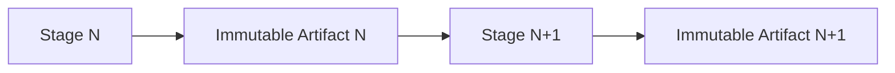
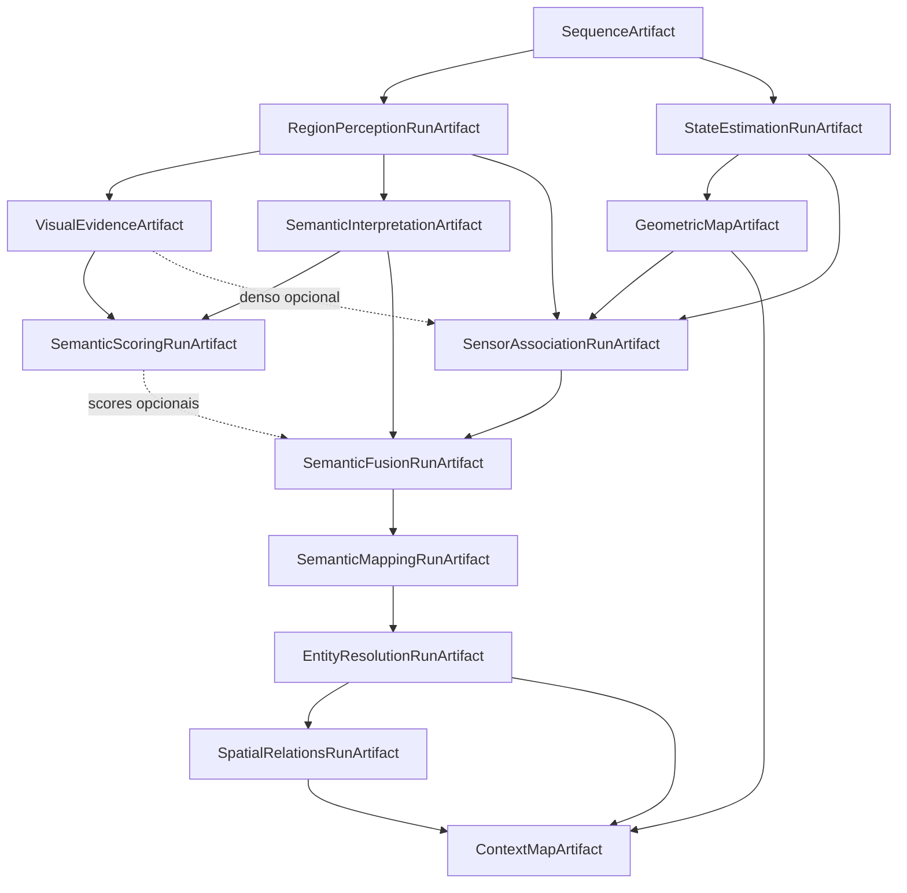
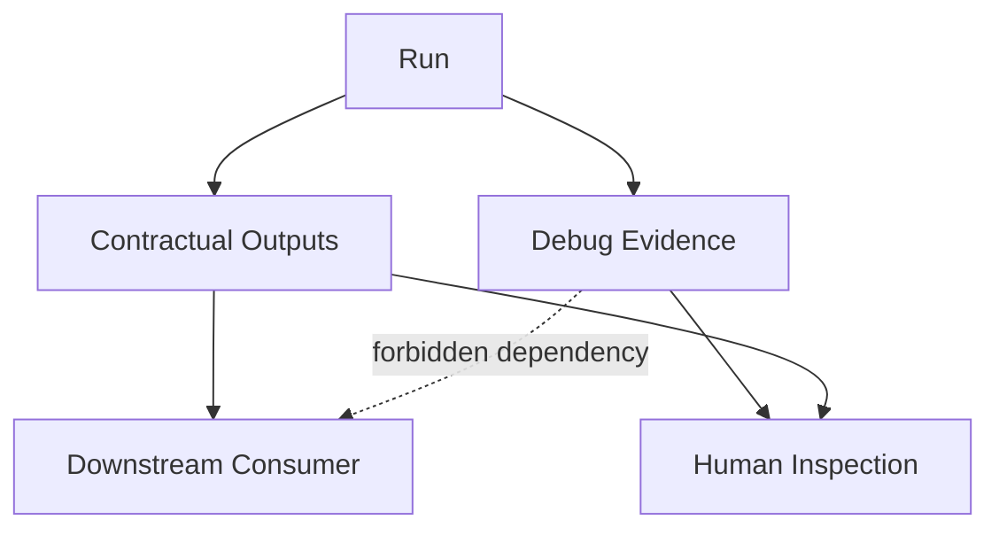
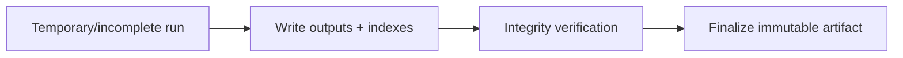
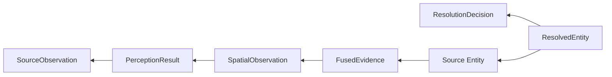
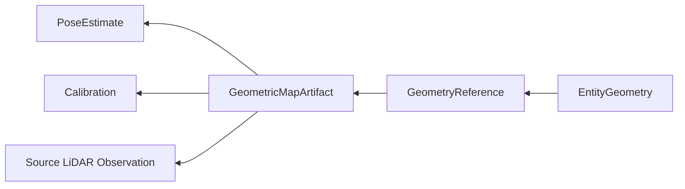
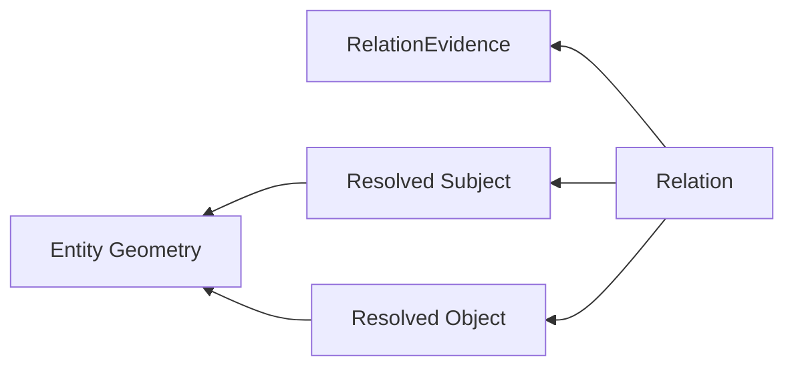

# Artefatos, lineage e reprodutibilidade

Este documento descreve como o ContextMap2 persiste resultados intermediários e o mapa final.

A regra base é simples:

> Cada estágio produz um artefato imutável, versionado e auditável. Reexecutar um estágio gera um novo resultado, não sobrescreve o anterior.

Para o fluxo que produz esses artefatos, consulte [PIPELINE.md](PIPELINE.md). Para os contratos armazenados neles, consulte [CONTRACTS.md](CONTRACTS.md).

## Por que artifacts são parte da arquitetura

O projeto é uma pipeline de pesquisa. É necessário conseguir:

- executar percepção várias vezes sobre os mesmos frames;
- trocar um backend sem destruir o baseline;
- reutilizar state estimation e geometria quando apenas a semântica mudou;
- comparar outputs antigos e novos;
- localizar a origem de um erro downstream;
- abrir resultados sem reinstalar todos os modelos que os produziram.

Artifacts são, portanto, fronteiras de execução e de auditoria.



## Workspace local

O canonical pipeline usa filesystem local como storage primário. O storage tem **dois roots
distintos**: o **run store** (`resources.workspace`), organizado por **dataset** e por **run**,
que guarda tudo que é interno; e o **maps root** (`resources.maps_root`), que guarda **apenas**
o `ContextMapArtifact` final de cada mapa, para um viewer escanear só ele.

```text
<run store>/                         # resources.workspace: tudo que é interno
├── <dataset>/                       # a sequência física (`inputs.sequence`), por exemplo `corridor-02`
│   ├── <run>/                       # o diário de um run do runtime: `run-NNNN`, numerado
│   │   ├── effective_config.json    # ┐ globalmente no workspace, não dentro do dataset
│   │   ├── plan.json                # │ o diário do run, na raiz do run
│   │   ├── status.json              # │ (ver "Registros de execução do runtime")
│   │   ├── events.jsonl             # │
│   │   ├── execution.json           # │
│   │   ├── run.lock                 # ┘
│   │   ├── context_run.json         # registro de uma ContextRun concluída (contexto incremental)
│   │   └── context_build.json       # entrada congelada de um ContextBuild, antes dos estágios
│   │   # o diário não guarda artifact nenhum: eles vivem todos sob `artifacts/`
│   └── branches/<map_id>/           # uma ContextBranch (o "mapa"): `branch.json`,
│       ├── branch.json              #   `members/<revisão>.json` (ContextRuns acrescentadas) e
│       ├── members/<revisão>.json   #   `builds/<NNNNNN>.json` (o índice imutável dos builds:
│       └── builds/<NNNNNN>.json     #   linhagem de cada build → o mapa publicado, por ArtifactRef)
├── artifacts/                       # todo artifact de estágio, agrupado por estágio
│   ├── ingestion/<run>/             # ┐
│   ├── visual_perception/<run>/     # │
│   ├── semantic_scoring/<run>/      # │ (opcional)
│   ├── state_estimation/<run>/      # │
│   ├── geometric_mapping/<run>/     # │ um diretório por estágio, e dentro dele um
│   ├── sensor_association/<run>/    # │ diretório por run que o executou
│   ├── point_representation/<run>/  # │ (opcional)
│   ├── semantic_fusion/<run>/       # │
│   ├── semantic_mapping/<run>/      # │
│   ├── entity_resolution/<run>/     # │
│   ├── spatial_relations/<run>/     # ┘
│   ├── context_map/<run>/           # num run comum; num build ele vai para o maps root
│   └── ingestion-<dataset-name>/    # SequenceArtifact substituível do comando `ingest`
├── experiments/                     # relatórios e manifests de avaliação, fora de qualquer run
└── tmp/                             # conteúdo efêmero

<maps root>/                         # resources.maps_root: só mapas, nada mais
└── <map_id>/                        # um diretório por mapa (reservado ao criar a branch)
    ├── 000001/                      # o `ContextMapArtifact` imutável de um build
    └── 000002/                      # o build seguinte (exploração incremental do mesmo mapa)
```

O maps root é deliberadamente separado do run store para que um viewer o escaneie sozinho:
nada além dos mapas publicados é escrito nele. Um `contextmap context build` **sempre** publica o
seu `context_map` terminal por `map_id` em `<maps root>/<map_id>/<NNNNNN>`, um diretório imutável
por build, e grava a linhagem em `branches/<map_id>/builds/`. O `map_id` é o nome da branch (um
slug) e é único no maps root: criar a branch reserva `<maps root>/<map_id>`. O maps root vem de
`resources.maps_root` (ou `--maps-root`); quando o config o deixa ausente, a CLI usa o default
`<workspace>/../maps`, um irmão limpo do run store — então o build publica por `map_id` mesmo sem
configuração explícita, e recomenda-se apontar `workspace` e `maps_root` para caminhos distintos
(o run store interno e a pasta de mapas). Um `contextmap run` comum não tem `map_id` e mantém o
seu `context_map` sob o run, no run store.

O comando independente `contextmap ingest` não cria um diário de run. Ele guarda cada
`SequenceArtifact` em `<run store>/artifacts/ingestion-<dataset-name>/`.
Esse namespace permite preparar sequências antes de um run do DAG sem misturá-las aos
registros de execução. A ingestão independente é uma exceção deliberada ao versionamento dos
artifacts de run: ao receber a mesma fonte completa e configuração, ela substitui o diretório
local depois de conferir a equivalência. Uma fonte ou configuração diferente é recusada nesse
mesmo nome; use outro `--sequence-name` (nome lógico do dataset) para mantê-la separada.

Regras do layout:

- **Diário e artifact são coisas distintas, e moram em lugares distintos.** O **run journal** (`<workspace>/<dataset>/run-NNNN/`) guarda a identidade e o ciclo de vida de uma execução: `effective_config.json`, `plan.json`, `status.json`, `events.jsonl`, `execution.json` e `run.lock`. O **stage artifact** (`<workspace>/artifacts/<estágio>/run-NNNN/`) guarda o resultado imutável de uma capability: `manifest.json`, `outputs/`, `metrics/` e `__DEBUG__/`. O diário muda enquanto o run executa; o artifact é publicado atomicamente uma única vez e nunca mais muda. Separá-los deixa o conjunto de runs de um estágio inspecionável e comparável sem varrer dataset por dataset.
- **Um diretório por estágio, nomeado pelo id do estágio da runtime**, e dentro dele um diretório por run que o executou. O diretório do run é o artifact: `manifest.json`, `outputs/`, `metrics/` e `__DEBUG__/` ficam direto dentro dele. O estágio final se chama `context_map` mesmo sendo implementado pela capability `artifact`.
- **O número do run é global ao workspace, não do dataset.** Como todos os datasets dividem `artifacts/<estágio>/`, `run-NNNN` precisa ser único no workspace inteiro; a varredura e a alocação acontecem sob um lock do workspace. O nome `artifacts` é reservado e recusado como nome de dataset.
- **O run é dono do que executou.** Um estágio reutilizado de um run anterior **não tem pasta** no run novo: ele é **referenciado** por `ArtifactRef` (identidade e hash de conteúdo), nunca copiado. A sequência ingerida pode ter dezenas de GB; copiar seria um erro, e a referência é o que torna a cadeia de reuso auditável.
- **Não há contadores nem registros por capability.** Não existem `runs/<capability>/<sequência>/run-NNNN__...` nem `runs.json`: o único índice de runs é a própria listagem dos diretórios `<dataset>/run-NNNN` (`Runtime.list_runs()`).
- **Um artifact nunca é modificado depois de finalizado**, e um run reexecutado é outro `run-NNNN`.
- `tmp/` nunca é dependência contratual de um artifact válido, e o debug de um artifact nunca é dependência de outro estágio.
- **Os registros do contexto incremental são do runtime, não de uma capability.** `context_run.json`, `context_build.json` e `branches/` só referenciam artifacts por `ArtifactRef` e identidade de conteúdo; nunca copiam evidência, e o `ContextMapArtifact` continua sendo o único produto público. Ver [runtime-composition.md](runtime-composition.md#contexto-incremental-v011-decisão-de-arquitetura).

### `experiments/`

Contém os manifests/reports que referenciam runs imutáveis usados em comparações e ablations: o run de um experimento (`experiment.json`, um run manifest e um relatório por arm e `comparison.json`) e a evidência/decisão sobre uma técnica opcional. Os formatos estão em [Artefatos de avaliação](#artefatos-de-avaliação).

O registro **versionado** de uma execução real fica no repositório, em `experiments/<experimento>/` (diretório de topo, fora de `src/` e `tests/`): um bundle leve com o manifest do experimento (identidades e SHA-256 completos das runs de entrada), a seleção, a configuração, os drivers e os relatórios finais, **sem** o dataset nem os artifacts grandes, que continuam fora do Git e são regenerados localmente. Os drivers ficam fora de `src/` e de `tests/` porque são scripts de pesquisa, não código do pacote nem testes, e alterá-los para passar nos gates do pacote quebraria o hash do que foi executado. O teste `tests/evaluation/test_experiment_bundles.py` confere cada bundle contra o próprio manifest (hashes completos, todo arquivo listado, menos de 1 MB, sem caminhos pessoais nem segredos). Exemplo: [`experiments/semantic-fusion-corridor-02-20260921/`](../experiments/semantic-fusion-corridor-02-20260921/README.md).

Os artifacts que os drivers de um experimento produzem, inclusive os de cada braço, ficam **retidos** sob o `outputs/` do checkout, fora do Git, no layout `<experimento>/run-NNNN/<estágio ou braço>`, e o report os cita por caminho relativo a essa raiz: o experimento pode ser reinspecionado sem ser reexecutado. A convenção e o esqueleto comum dos drivers estão em [`src/contextmap/evaluation/docs/experiments.md`](../src/contextmap/evaluation/docs/experiments.md#drivers-de-experimento-e-retenção-dos-braços).

Remote storage, S3, MinIO, database ou distributed registry não são requisitos do canonical pipeline.

### Contrato dos writers de estágio

Todo writer de artifact de capability segue o mesmo contrato; o runtime só decide **onde** o estágio grava e o writer nunca calcula um caminho.

**Assinatura.** `output_dir` é o diretório final do artifact, obrigatório e *keyword-only*. Ficam na assinatura o que é identidade ou entrada da capability (`sequence_name`, `run_id`, `run_index`, `debug_level` e os parâmetros próprios, como a linhagem da fusão ou o `artifact_id` da ingestion). Saem `workspace_root` e todo rótulo que só existia para montar o nome do diretório (`selection_label`, `backend_label`, `profile_label`, `channel_label`, `policy_label`):

```python
class StateEstimationRunWriter:
    def __init__(self, *, output_dir: Path, sequence_name: str, run_id: StateEstimationRunId,
                 run_index: int, debug_level: StateEstimationDebugLevel = ...) -> None: ...
```

**Finalização.** O writer cria `output_dir` com `AtomicRunDirectory` (diretório temporário irmão, publicado por rename depois da checagem do inventário), recusa um `output_dir` que já exista e não deixa nada em caso de falha. Ele não cria registro, não escreve `runs.json` e não toca em nenhum outro diretório.

**Identidade.** O writer **nunca aloca** identidade: `run_id` e `run_index` são entregues pelo chamador e gravados como recebidos. `run_index` é um ordinal do chamador (a runtime usa o número de `run-NNNN`) que serve para ordenar candidatos, por exemplo na seleção `latest`; não substitui identidade nem hash. Ids derivados do `run_id`, como `map_id = <sequência>--<run_id>`, continuam iguais, então manifests, leitores e linhagem não mudam. Um executor da runtime deriva `run_id` da identidade do estágio (id do estágio, `config_digest` e hashes de conteúdo das entradas), de modo que execuções idênticas produzem o mesmo id e o mesmo conteúdo, o que mantém o reuso válido entre runs. Um estágio-fonte (`ingestion`, `pose_ingestion`) não tem entradas, então a identidade dele inclui também a da fonte que lê (`IngestionRequest.identity`: gravação, tópicos, janela, sincronização e política de timestamps); sem isso, dois bags diferentes com a mesma configuração receberiam o mesmo id. Nos testes, o id é um texto fixo e legível.

**O que foi removido** de todas as capabilities: `_sequence_dir`, `allocate_*_run_index`, `rebuild_*_registry`, os helpers que só serviam a eles (`_valid_run_index`, `_registry_record`), a chamada do registro dentro de `finalize()` e os símbolos do `__init__` e do `__all__`. `contextmap.shared.run_directory` também perdeu `next_run_index` e `write_run_registry`, sem nenhum uso restante.

**Cardinalidade.** Um diretório de estágio guarda **um** artifact, e um pedido de estágio produz um. Entradas declaradas `multiple` preservam cada artifact selecionado: um `ContextBuild` pode reunir vários runs regionais, visuais, semânticos e de associação. A fusão registra as seleções separadamente e evita contar duas inferências do mesmo frame como duas observações físicas. Um estágio que exige um produtor único recusa vários, sem escolher um em silêncio. Comparar backends ou braços de ablação requer runs distintos, com identidades e hashes próprios.

**Leitura.** Os leitores abrem o diretório do artifact diretamente e não mudam: manifests, `manifest.json` e o schema continuam iguais.

**Padrão de teste.** O teste escolhe `output_dir` sob `tmp_path` (por exemplo `tmp_path / "run-0001"`, ou `tmp_path / "state_estimation"`) e abre o leitor **nesse mesmo caminho**, sem procurar `run-0001__...` por glob. Um helper `_run_dir(workspace, index)` centraliza o caminho quando o teste grava vários runs. Testes de alocação de índice e de registro são substituídos por testes de que (1) o artifact aparece exatamente em `output_dir` e nada mais é criado ao redor, (2) `run_id` e `run_index` são gravados como recebidos, (3) um segundo run no mesmo `output_dir` é recusado sem alterar o primeiro.

## Artefatos principais



O `PerceptionResult` não é artifact. É uma view de leitura de um conjunto explícito de runs
regional, visual, semântico e, opcionalmente, de scoring. Um consumidor não pode derivar um
produtor a partir de um `perception_result_id`: cada manifest e cada registro downstream
preservam as identidades relevantes dos artifacts de origem.

## Artefatos materializados de percepção

### `SequenceArtifact`

Identifica observações físicas canônicas, payloads, timestamps e calibração. A seleção de
observações é registrada por cada produtor que a consome; reprocessar o mesmo frame não muda
a identidade física dele.

### `RegionPerceptionRunArtifact`

Publica uma região final por registro em `outputs/regions.jsonl`, máscaras referenciadas por
`outputs/masks/`, frames preparados e auditorias de descoberta. Grounding e refinamento,
quando selecionados, têm streams contratuais com request, resposta e decisões. O manifest
registra sequência, seleção, backend de descoberta e, quando aplicável, os backends de
grounding/refinamento. O reader verifica inventário e máscaras antes de fornecê-las ao
consumidor. O artifact é o único dono das identidades de região.

### `VisualEvidenceArtifact`

Publica features por observação e seus payloads, geometria de amostragem densa, espaço de
embedding, provenance, diagnostics e cobertura de frames. Seu manifest cita o artifact
regional escolhido. Uma feature não duplica máscara ou claim. O feature store lê payloads
lazy com shape, dtype e hash validados.

### `SemanticInterpretationArtifact`

Publica claims e `SceneContext` por observação, além das requests, views exatas, prompt,
respostas brutas, parsing e falhas. Seu manifest cita o artifact regional escolhido. Um frame
sem claims ainda tem um registro explícito de sucesso, falha ou skip. Uma reexecução cria
outra identidade sem alterar o run anterior.

### `SemanticScoringRunArtifact`

Publica scores sem copiar claims, features ou regiões. Sua linhagem cita separadamente os
artifacts regional, visual e semântico selecionados, além do scorer e espaço de embedding.

### `StateEstimationRunArtifact` atual

```text
<run>/state_estimation/            # o output_dir entregue ao writer
├── README.md
├── manifest.json
├── outputs/
│   ├── trajectory.json        # metadados da trajetória
│   ├── poses.jsonl            # uma pose por linha
│   ├── pose-index.jsonl       # leitura de uma pose por identidade ou tempo
│   ├── frame-summary.json
│   └── quality.json
├── metrics/
│   ├── preflight.json
│   ├── motion.json
│   ├── runtime.json           # somente quando medido
│   └── diagnostics.jsonl      # somente quando há eventos
└── __DEBUG__/                     # somente standard/full; nunca inventariado
```

`manifest.json` traz a linhagem (sequência, seleção, backend e fingerprint de configuração, identidade da calibração, versão do código, frames, clock, contagens) e o inventário dos arquivos contratuais. `__DEBUG__/` fica fora do inventário, então removê-lo não invalida o run. Um run com preflight de geometria `BLOCKED` nunca é persistido. Detalhes: [State Estimation artifact](../src/contextmap/state_estimation/docs/artifact.md).

### `GeometricMapArtifact` atual

```text
<run>/geometric_mapping/            # o output_dir entregue ao writer
├── README.md
├── manifest.json
├── lineage.json
├── config.json
├── environment.json
├── outputs/
│   ├── geometry.bin           # payload empacotado, lido por mapeamento em memória
│   ├── source-index.jsonl     # um registro por scan: origem → geometria, cadeia e limites
│   └── map-metadata.json      # GeometricMap: identidade, frame, limites, tempo, proveniência
├── metrics/
│   ├── input-plan.json        # scans selecionados, aceitos e recusados, com o motivo
│   ├── mapping.json
│   └── runtime.json           # somente quando medido
└── __DEBUG__/                     # somente standard/full; nunca inventariado
```

A identidade do mapa é `<sequência>--<run_id>` e toda `GeometryReference` a carrega; as referências são locais ao artifact. O `manifest.json` inventaria os arquivos contratuais com tamanho e SHA-256, e `__DEBUG__/` fica fora do inventário. O leitor abre sem ROS, sem FAST-LIO, sem biblioteca de modelo e sem NumPy, e `geometry()` devolve um `GeometrySource` sobre o payload mapeado, sem lê-lo. A configuração é JSON (`config.json`), não YAML. Detalhes: [Geometric Mapping artifact](../src/contextmap/geometric_mapping/docs/artifact.md).

Com o deskew opcional (C3, `pose-interpolation-deskew-v1`), cada scan entra no mapa já corrigido para o movimento da plataforma: o registro de origem do scan diz `corrected`, o `source xyz` de cada ponto do `geometry.bin` é a coordenada do sensor corrigida no timestamp do scan (o payload bruto continua na `SequenceArtifact`, pelo scan e pelo índice), e a política entra em `config.json` e no fingerprint de configuração. Sem deskew, o `config.json` não tem a chave e o mapa é o de antes.

### `VoxelAggregationArtifact` (derivado, experimental)

```text
<dir>/                                  # separado do GeometricMapArtifact; nunca dentro dele
├── README.md
├── manifest.json
├── lineage.json                        # identidade exata do bruto: digest do inventário e hashes lidos
├── config.json                         # política (grade inclusa), fingerprint e tamanho de bloco
├── environment.json
├── outputs/
│   ├── aggregates.bin                  # um registro de 148 bytes por voxel ocupado
│   ├── contributions.bin               # um (scan, pontos) de 8 bytes por par voxel × scan
│   ├── aggregation.json
│   └── map-metadata.json               # GeometricMap derivado, com identidade própria
└── metrics/aggregation.json            # escala e custo de provenance
```

Uma agregação voxel **entre scans** derivada de um `GeometricMapArtifact` bruto já finalizado, que ela só lê. Nenhum estágio canônico a consome: ela existe para medir, na issue #624, se uma representação agregada pode acompanhar ou substituir a geometria bruta. Detalhes: [agregação inter-scan](../src/contextmap/geometric_mapping/docs/inter-scan-aggregation.md).

### `SemanticSpatialSupportArtifact` (derivado)

```text
<dir>/                                  # separado do ContextMap e da agregação; nunca dentro deles
├── README.md
├── manifest.json
├── lineage.json                        # identidades dos três artefatos de origem
├── config.json                         # schema, documento e fingerprint da política, grade e regra
├── environment.json
├── outputs/
│   ├── cells.jsonl                     # uma SpatialCell por linha, ordenada por chave de voxel
│   └── support.json                    # cabeçalho: mapa bruto, frame, fingerprint, contagem
└── metrics/support.json                # contagens: células, entidades, peso total de suporte
```

O suporte espacial semântico junta as entidades de um `ContextMapArtifact` à agregação voxel do seu mapa bruto (`VoxelAggregationArtifact`), usando o `membership()` da agregação para atribuir cada ponto de uma entidade ao voxel em que cai. Cada `SpatialCell` é um **endereço espacial** cuja identidade (`spatial-cell:<fingerprint>:<kx>_<ky>_<kz>`) é função pura da grade, **nunca** do índice de um ponto da nuvem: é essa propriedade que faz os atributos semânticos sobreviverem à simplificação da geometria para centroides de voxel na apresentação. Um voxel não vira entidade; ele acumula suporte (`entity_support[]`), e `support_weight` é contagem de medições, nunca probabilidade nem score.

Schema `0.2.0`. O manifest registra, além das três contagens, o `grid_fingerprint` emprestado da agregação e o `policy_fingerprint` da regra de junção (`EntityVoxelSupportPolicy`), de modo que dois runs se distinguem sem abrir payload. Um run de schema anterior é recusado ao abrir: durante `v0.x` não há camada de migração, e o caminho suportado é derivar outro run. A derivação não é estágio do DAG — o caminho de produção é `contextmap derive-spatial-support`. Detalhes: [spatial_support](../src/contextmap/spatial_support/docs/README.md).

### `SensorAssociationRunArtifact` atual

```text
<run>/sensor_association/            # o output_dir entregue ao writer
├── README.md
├── manifest.json
├── outputs/
│   ├── spatial-observations.jsonl     # um SpatialObservation por linha
│   ├── observation-index.jsonl        # id, frame, região e offsets
│   ├── geometry-support.u32           # região → geometria, tabela colunar de uint32
│   ├── observation-quality.jsonl      # ObservationQuality por observação
│   ├── projection-records.jsonl       # por frame: câmera, pose, extrínseco, cadeia de imagem
│   ├── visibility-records.jsonl       # por frame: política, contagens, pertencimento
│   ├── dense-feature-associations.jsonl
│   └── dense-feature-cells.bin        # índices e pesos, sem vetores de feature
├── metrics/
│   ├── frame-diagnostics.jsonl
│   ├── summary.json
│   └── runtime.json                   # somente quando medido
└── __DEBUG__/                             # somente standard/full; nunca inventariado
```

O run não repete XYZ nem vetores de embedding: a geometria é referenciada por posição (a identidade do mapa é posicional) e a amostragem densa guarda índices e pesos. `manifest.json` carrega a linhagem exata (sequência, seleção, mapa geométrico, trajetória, calibração, runs de percepção, políticas, fingerprint, código, canais de features com as fontes exatas) e o inventário; `__DEBUG__/` fica fora dele, e o run não escreve `README.md`. Uma execução nativa e uma melhorada de features compartilham os mesmos artifacts a montante e continuam identificáveis de forma independente. O leitor abre sem ROS, sem modelos e sem NumPy. Detalhes: [Sensor Association artifact](../src/contextmap/sensor_association/docs/artifact.md).

### `SemanticScoringRunArtifact` atual

```text
<run>/semantic_scoring/                # o output_dir entregue ao writer (estágio opcional)
├── README.md
├── manifest.json                       # linhagem, scorer, espaço, template, semântica, contagens
└── outputs/
    └── scores.jsonl                    # SemanticScore canônico, um por linha
```

Os scores CLIP ou AlphaCLIP comparam claims e features de região de uma seleção explícita dos artifacts regional, visual e semântico. O manifest registra `region_artifact_id`, `visual_evidence_artifact_id` e `semantic_interpretation_artifact_id`, sequência, seleção, provenance do scorer, modelo, revisão ou fingerprint dos pesos, fingerprint da configuração, `EmbeddingSpace` completo, template e a semântica do valor (cosseno bruto, nunca uma probabilidade), além das contagens de claims pontuadas e não pontuadas. Os artifacts upstream permanecem imutáveis; uma claim sem score não pontuou zero. Vários scorers podem usar os mesmos produtores. Não há `__DEBUG__/` contratual. Detalhes: [Semantic Scoring](../src/contextmap/semantic_scoring/docs/README.md).

### `PointRepresentationRunArtifact` atual

```text
<run>/point_representation/            # o output_dir entregue ao writer
├── README.md
├── manifest.json                       # identidade, linhagem e inventário
├── outputs/
│   ├── representations.jsonl           # PointRepresentation canônica, uma por linha
│   ├── representation-index.jsonl      # representation_id → deslocamento e tamanho
│   ├── representation-spaces.json      # RepresentationSpace do run + fingerprint
│   ├── geometry-representation-index.jsonl
│   ├── failed-supports.jsonl           # suportes que não produziram representação
│   └── payloads/vectors.f32|f64        # vetores, uma linha de tamanho fixo cada
├── metrics/
│   └── counts.json  support-size.json  norms.json  runtime.json
└── __DEBUG__/                              # somente standard/full; nunca inventariado
```

O `manifest.json` (schema `0.2.0`) traz a linhagem (mapa geométrico consumido, seleção dos centros independente da ordem e a política versionada que os escolheu, `observation-support-anchor-v1` quando o runtime executa o estágio, política de suporte, espaço, encoder e hash do checkpoint, código, contexto de associação **opcional e explícito**) e o inventário. Um suporte que falhou vai para `failed-supports.jsonl` com o motivo; um run só de falhas é um run válido e explícito, e um vetor nunca é inventado. O run abre sem NumPy, sem biblioteca de modelo e sem o mapa geométrico, e os vetores são lidos sob demanda. O escritor ainda acumula em memória; a escrita em fluxo de `shared.run_directory` ainda não foi adotada por ele. Detalhes: [Point Representation artifact](../src/contextmap/point_representation/docs/artifact.md).

### `SemanticFusionRunArtifact` atual

```text
<run>/semantic_fusion/            # o output_dir entregue ao writer
├── README.md
├── manifest.json                          # identidade, linhagem explícita, políticas e inventário
├── outputs/
│   ├── fusion-supports.jsonl              # um FusionSupport por linha
│   ├── fused-evidence.jsonl               # um FusedEvidence por linha (autocontido)
│   ├── support-observation-index.jsonl    # suporte → observações, offsets nos dois arquivos
│   ├── hypothesis-evidence-index.jsonl    # hipótese → evidência exata
│   ├── physical-observation-groups.jsonl  # grupos por frame físico de cada suporte
│   ├── contribution-index.jsonl           # contribuição → suporte, observação, resultado, run
│   └── excluded-observations.jsonl        # evidência pulada, com o motivo
├── metrics/
│   ├── counts.json  distributions.json  payload.json
│   └── runtime.json                       # somente quando medido
└── __DEBUG__/                              # somente standard/full; nunca inventariado
```

O artifact guarda **todas** as hipóteses, com alternativas, conflitos, abstenções e evidência não pontuada (`None`, nunca zero), e mantém frames físicos e resultados de inferência distintos. Nada a montante é duplicado: claims, scores, features, qualidade e estrutura 3D são referenciados, e a geometria é guardada como deltas posicionais. `manifest.json` traz a linhagem **explícita** (sequência, mapa, runs de associação, percepção e Point Representation), as políticas com fingerprint e as identidades que alimentaram cada canal. Um score bruto é identificado também pela run de scoring que o produziu; portanto scores com o mesmo identificador em runs diferentes não se confundem. Um run é escrito em fluxo e publicado de forma atômica, e o leitor abre sem NumPy, sem runtime de percepção e sem biblioteca de modelo, lendo um suporte sem carregar os outros. Semantic Mapping não pode depender de `__DEBUG__/`. A `schema_version` atual é `0.3.0`: a `0.2.0` não preservava a identidade da run de scoring em cada contribuição bruta; a `0.1.0` somava `inference_results` por suporte (o mesmo campo com outro denominador). As versões anteriores são recusadas ao abrir. Na `0.3.0` ainda não lançada, cada hipótese pode trazer também `interaction_factor` (objeto que cita só as claims e observações físicas que o declararam) e `observed_attributes` (a categoria e os atributos que as claims de suporte declararam, cada par `(nome, valor)` com as claims exatas, sem agregação); os dois são omitidos quando ausentes. Detalhes: [Semantic Fusion artifact](../src/contextmap/semantic_fusion/docs/artifact.md).

### `SemanticMappingRunArtifact` atual

```text
<run>/semantic_mapping/            # o output_dir entregue ao writer
├── README.md
├── manifest.json                          # identidade, linhagem do run de fusão, política e inventário
├── outputs/
│   ├── entities.jsonl                     # uma Entity canônica por linha (autocontida, autoritativa)
│   ├── entity-index.jsonl                 # entidade → deslocamento e tamanho
│   ├── entity-geometry-index.jsonl        # entidade → mapa, frame, pontos, limites, centroide, diagnósticos
│   ├── entity-evidence-index.jsonl        # entidade → evidência fundida e contagens
│   ├── entity-observation-index.jsonl     # uma linha por (entidade, frame físico)
│   ├── entity-semantic-state.jsonl        # entidade → ambiguidade, primária, labels, atributos, incerteza
│   ├── entity-temporal-state.jsonl        # entidade → first/last seen, contagens, ciclo de vida
│   └── rejected-candidates.jsonl          # candidatos que não viraram entidade, com o motivo
├── metrics/
│   ├── counts.json  distributions.json  payload.json
│   └── runtime.json                       # somente quando medido
└── __DEBUG__/                                 # somente standard/full; nunca inventariado
```

O artifact guarda **todas** as hipóteses, conflitos, abstenções e sinais sem score de cada entidade, mantém frames físicos e resultados de inferência distintos e **não** contém estado de merge, split ou resolução. Nada a montante é duplicado: a evidência é referenciada com a identidade, a versão do schema, o digest do inventário e a sequência canônica do artifact de fusão; features visuais preservam a identidade completa `(visual_artifact_id, source_observation_id, feature_id)`, e a geometria é guardada como deltas posicionais. `manifest.json` traz a linhagem **explícita** (sequência, run de fusão selecionado, mapa geométrico e, pela linhagem da fusão, as runs de associação e os artifacts regionais, visuais e semânticos selecionados), a política de materialização e o fingerprint da configuração. Também separa `schema_version` de `entity_schema_version` e registra `code_version`/`code_digest`; um run guarda uma política. A `entity_schema_version` atual é `0.2.0`: o estado semântico registra o mínimo de suporte da política da primária e, quando a `unambiguous-single-hypothesis-v2` retém a primária, o motivo (`withheld_primary`); os atributos incluem os pares `(nome, valor)` declarados pelas claims (`observed`, `claim-attribute-v1`), e cada hipótese lista os frames físicos distintos que a sustentam (omitido quando não registrado); a `0.1.0` é recusada ao abrir. O leitor abre sem NumPy, sem runtime de percepção, de fusão ou de modelo, resolve uma `EntityReference` sem carregar as demais e recusa uma referência de outro semantic map. Entity Resolution e Spatial Relations não podem depender de `__DEBUG__/`. Detalhes: [Semantic Mapping artifact](../src/contextmap/semantic_mapping/docs/artifact.md).

### `EntityResolutionRunArtifact` atual

```text
<output_dir>/
├── README.md
├── manifest.json                          # identidade, linhagem do run de Semantic Mapping, políticas por papel e inventário
├── outputs/
│   ├── candidate-sets.jsonl               # um EntityCandidateSet por linha
│   ├── match-evidence.jsonl               # a evidência tipada de cada par comparado
│   ├── resolution-decisions.jsonl         # MATCH, DISTINCT e UNRESOLVED
│   ├── resolved-entities.jsonl            # uma ResolvedEntity por linha
│   ├── resolved-entity-index.jsonl        # id resolvido → deslocamento e tamanho
│   ├── source-to-resolved-index.jsonl     # entidade de origem → entidade resolvida
│   ├── merge-lineage.jsonl                # membros, decisões e contradições por entidade resolvida
│   ├── unresolved-entities.jsonl          # entidades de origem que uma decisão deixou em aberto
│   ├── transitivity-contradictions.jsonl
│   └── split-candidates.jsonl             # vazio se a detecção opcional não rodou
├── metrics/
│   ├── counts.json  distributions.json  payload.json
│   └── runtime.json                       # somente quando medido
└── __DEBUG__/                                 # somente standard/full; nunca inventariado
```

Como todo writer de estágio, o escritor recebe o **diretório final** (`output_dir`) e não aloca índice de execução nem mantém `runs.json`; o `run_id` (o escopo de todo id resolvido) vem de quem chama, e o diretório é finalizado de forma atômica (`AtomicRunDirectory`). O artifact guarda **todas** as decisões, não só as `MATCH`, e as contradições de transitividade e os pares deixados em aberto, porque uma fusão nunca substitui a evidência de que veio. Um run nunca é reescrito e uma escrita interrompida não deixa run.

Política e linhagem ficam em `manifest.json` (uma política por papel: recuperação, resolução, materialização, divisão e cada canal), como nos artifacts irmãos; não há `config.yaml`, `lineage.json`, `environment.json` nem `events.jsonl`. A linhagem nomeia o run de Semantic Mapping selecionado com a **identidade, a versão do schema e o digest do inventário**, e a partir dela o mapa geométrico e os runs de percepção e de Point Representation. Quem consome o run (Spatial Relations) fixa a versão do schema e o `resolution_artifact_digest`, calculado por Entity Resolution com a mesma regra dos artifacts anteriores. Todo registro é reconstruído pelo construtor do contrato na leitura, então uma linha adulterada é recusada; `verify_integrity()` acusa arquivo faltando, tamanho ou hash diferentes; o leitor abre sem NumPy nem qualquer runtime. A `schema_version` é `0.2.0` quando o run usa um acréscimo desta versão (a crença pós-resolução `resolved-belief-min-support-v1` em `semantic_state.belief`, ou os frames que sustentam cada hipótese) e `0.1.0` quando não usa: um run sem acréscimo é, byte a byte, um run `0.1.0`. O leitor abre as duas. Detalhes: [artifact de Entity Resolution](../src/contextmap/entity_resolution/docs/artifact.md).

### SpatialRelationsRunArtifact

O `SpatialRelationsRunArtifact` guarda as relações de um run com a evidência de cada uma, a decisão por trás dela, os candidatos avaliados e descartados e um índice das relações de cada entidade resolvida, para a montagem do Context Map reutilizá-las sem recalcular avaliações de par. O escritor grava num **`output_dir` explícito** (o diretório final, com `AtomicRunDirectory`): não há contador de runs, `runs.json` nem caminho `run-NNNN` calculado dentro, e a identidade do run vem de quem chama. `outputs/` traz `relations`, `relation-evidence`, `relation-candidates`, `relation-decisions` e `entity-relation-index`; `manifest.json` traz a linhagem (run de Entity Resolution, versão e digest, e o mapa geométrico), a versão da taxonomia, cada política efetiva com id, fingerprint e parâmetros, os eixos declarados e o inventário com SHA-256. Relações `SUPPORTED`, `REJECTED` e `UNRESOLVED` são todas persistidas e distinguíveis, e nada de entidade ou geometria é copiado. O leitor só precisa do diretório do run, lê por identidade e pelo índice, detecta corrupção e recusa `__DEBUG__/` como fonte. A `schema_version` atual é `0.2.0`: um grupo `(predicado, razão)` com mais de 32 exclusões de candidatos lista só as mais próximas e as resume num registro `exclusion_summary` (contagem, distâncias extremas e digest); o leitor ainda abre runs `0.1.0`, que listam todas. A linhagem, as políticas e a configuração ficam no manifest, seguindo os artifacts irmãos, em vez de `config.yaml`, `lineage.json`, `environment.json` e `events.jsonl` separados. Detalhes: [Spatial Relations artifact](../src/contextmap/spatial_relations/docs/artifact.md).

### `ContextMapArtifact` atual

```text
<diretório do artifact>/                # escolhido por quem chama (a runtime); nunca é identidade
├── README.md
├── manifest.json                       # identidade, versões, payloads, dependências e inventário SHA-256
├── map-metadata.json                   # ContextMapMetadata
├── geometry/geometry-reference.json    # GeometricMapLink: a geometria fica no GeometricMapArtifact
├── entities/entities.jsonl             # uma ContextEntity por linha, ordenadas por id
├── relations/relations.jsonl           # uma ContextRelation por linha, ordenadas por id
├── indexes/                            # entity-index, relation-index e entity-relation-index (derivados)
└── lineage/lineage.json                # os artifacts a montante que o mapa cita
```

O diretório é o artifact canônico; um arquivo compactado seria só transporte. Os formatos são JSON e JSON Lines com índice de deslocamentos, sem dependência além da instalação base, e a geometria nunca é copiada: é referenciada pelo `GeometricMapArtifact`, fixado pelo digest de artifact que os irmãos já usam (identidade, versão do schema e hash de cada arquivo). O manifest separa a `format_version` (layout) da `schema_version` (semântica), classifica cada dependência como `required` (as estruturais do schema: mapa geométrico e runs de Entity Resolution e Spatial Relations) ou `optional` (evidência), e sua `content_identity` ignora o horário de escrita e as dicas de localização, então o mesmo mapa escrito duas vezes tem a mesma identidade. Não há `__DEBUG__/`, `runs.json` nem índice de run: quem chama informa o diretório final, publicado por `AtomicRunDirectory`. Num `context build`, quem chama é o runtime e o diretório final fica no **maps root**, em `<maps root>/<map_id>/<NNNNNN>`, fora do run store: o mapa é publicado isolado, um por build, e a linhagem fica em `branches/<map_id>/builds/` (ver [Workspace local](#workspace-local)).

Cada entidade guarda todas as labels (`ContextSemanticState`); desde o schema `0.2.0`, e só quando existem, também a **crença pós-resolução** de Entity Resolution (`support_status`: `tentative`, `supported`, `contested` ou `insufficient_evidence`; `primary_label` só quando `supported`; e, por label, `supporting_physical_observation_count`, uma contagem de observações físicas distintas, nunca um score) e os **atributos declarados pelos claims** (`attributes`: `category`, `color`, `material`…, cada valor verbatim com uma origem que cita a evidência fundida; valores divergentes coexistem). Ausentes, esses campos não são escritos: um mapa sem crença e sem atributos tem os mesmos bytes da `0.1.0`, e o leitor `0.2.0` continua abrindo mapas `0.1.0` (consumidores: o demo de `examples/v0.1.0` e os runs de baseline). Detalhes: [composição](../src/contextmap/artifact/docs/composition.md) e [versionamento](../src/contextmap/artifact/docs/versioning.md).

O `ContextMapArtifactReader` abre pelo próprio diretório, lê metadados, entidades e relações um registro por vez e abre a geometria só sob demanda (por `mmap`), sem mutação e sem fallback para `__DEBUG__/`. O `validate_context_map_artifact` devolve um relatório determinístico legível por máquina, em nível estrutural (`structurally_valid` no máximo) ou completo (hashes, registros, referências, índices reconstruídos e arquivos a montante; só ele responde `verified`). `export_bundle` gera um diretório portátil com a política de fechamento explícita (`core-only`, `core+required`, `core+selected-evidence`). Detalhes: [Layout e formatos](../src/contextmap/artifact/docs/storage-layout.md), [writer](../src/contextmap/artifact/docs/writer.md), [leitor](../src/contextmap/artifact/docs/reader.md), [validação de integridade](../src/contextmap/artifact/docs/integrity-validation.md) e [bundle](../src/contextmap/artifact/docs/bundle.md).

### Evidência de percepção e leitura derivada

As auditorias e máscaras de região pertencem ao `RegionPerceptionRunArtifact`; os payloads de feature pertencem ao `VisualEvidenceArtifact`; views, respostas e claims pertencem ao `SemanticInterpretationArtifact`. `PerceptionEvidenceSet` valida a seleção desses produtores e oferece `PerceptionResult` apenas como projeção em memória. Nenhum artifact copia o stream contratual de outro produtor.

### Auditoria de Region Discovery

O executor regional entrega `RegionDiscoveryAudit` ao `RegionPerceptionRunWriter`. `outputs/region-discovery-audit.jsonl` registra por frame passes e diagnostics do backend, candidatos rejeitados e seus motivos, decisões de merge, identidade efetiva do discovery, hints nativos e provenance do backend. Os IDs de candidatos se reconciliam com `Region2D.contributor_candidate_ids` em `outputs/regions.jsonl`; as máscaras ficam no mesmo artifact regional, em `outputs/masks/`. A tabela é inventariada mesmo vazia, distinguindo uma execução auditada sem rejeições da ausência de auditoria. Overlays e outros diagnósticos humanos, quando produzidos, ficam em `__DEBUG__/`. Detalhes: [Region Discovery](../src/contextmap/region_perception/docs/region-discovery.md#evidência-persistida-a-auditoria-de-cada-frame).

### Feature Extraction no artifact visual

`VisualEvidenceRunWriter` publica envelopes de features em `outputs/results.jsonl`, payloads numéricos em `outputs/features/` e o índice em `feature-index.jsonl`. `finalize()` cruza payloads e diagnostics com a feature, o produtor regional e a observação física selecionados; valida scope, embedding space, shape, dtype, normalização e hash antes de publicar. `metrics/feature-extraction.jsonl` conserva a geometria de amostragem densa, que o `VisualEvidenceRunReader.dense_feature_map()` reconstrói sem depender de debug. Previews opcionais ficam em `__DEBUG__/`. Detalhes: [artifact visual](../src/contextmap/visual_perception/docs/visual-evidence-artifact.md), [feature store](../src/contextmap/visual_perception/docs/feature_store.md) e [diagnostics](../src/contextmap/visual_perception/docs/feature_diagnostics.md).

### Semantic Interpretation no artifact semântico

`SemanticInterpretationArtifact` persiste requests, views com SHA-256, prompt renderizado, resposta bruta, parsing, claims, contexto de cena, diagnostics e configuração efetiva. Os três streams de desfecho — `outputs/semantic-interpretations.jsonl`, `outputs/semantic-interpretation-failures.jsonl` e `outputs/semantic-backend-call-failures.jsonl` — compartilham `request_id`: cada request emitido tem exatamente um desfecho. Uma chamada sem resposta utilizável tem registro próprio; uma resposta rejeitada conserva seus bytes brutos. As views exatas enviadas ao backend ficam inventariadas abaixo de `outputs/semantic-views/`. Cópias para inspeção em `__DEBUG__/` nunca são referências contratuais. Detalhes: [Semantic Interpretation](../src/contextmap/semantic_interpretation/docs/semantic-interpretation.md) e [artifact semântico](../src/contextmap/semantic_interpretation/docs/README.md).

Detalhes dos demais artifacts: [Ingestion](../src/contextmap/ingestion/docs/artifact.md), [Region Perception](../src/contextmap/region_perception/docs/README.md), [Visual Perception](../src/contextmap/visual_perception/docs/visual-evidence-artifact.md) e [Semantic Interpretation](../src/contextmap/semantic_interpretation/docs/README.md).

### Artefatos de avaliação

A capability `evaluation` persiste documentos JSON imutáveis, escritos por publicação atômica e durável (recusam sobrescrever; ver [Durabilidade](#durabilidade)) e com digest `sha256` verificado na leitura. Não são artifacts de run do pipeline e não alteram nenhum artifact avaliado.

```text
<reference-set>/<versão>/
├── manifest.json            # ReferenceSetManifest (contextmap.reference-set/v1), com digest
└── annotations/<família>.json  # contextmap.reference.<família>/v1, hash declarado no manifesto

<experimento>/<run>/         # diretório novo por execução
├── experiment.json          # ExperimentManifest (contextmap.experiment/v2)
├── arms/<arm>/run.json      # topologia resolvida, artifacts por estágio, resultado (…-arm-run/v1)
├── arms/<arm>/report.json   # EvaluationReport (contextmap.evaluation-report/v1), só arms concluídos
└── comparison.json          # ComparisonManifest (…-comparison/v1): métricas lado a lado, artifacts compartilhados, pareamento de cada arm com o baseline

evidence.json                # TechniqueEvidence por métrica e estrato (contextmap.technique-evidence/v1)
decision.json                # TechniqueDecision, presa ao digest da evidência (…-decision/v1)
```

- `ReferenceSetManifest` amarra fontes, amostras (por `SourceObservationId`, nunca por saída de percepção), calibrações, anotações com `trust` e proveniência declarados, estratos e splits; a versão muda quando o conteúdo muda.
- Um arm indisponível ou com resultado inconsistente é registrado como tal e não tem `report.json`; a comparação fica `complete: false`.
- Um arm concluído cujas entradas executadas diferem do baseline fora dos fatores declarados (estágio não afetado com outro conteúdo, outro evaluator, código ou schemas de anotação) mantém `report.json`, mas fica `invalid` em `comparison.json`, fora das métricas, com as identidades divergentes.
- Reexecutar um experimento cria outro diretório de run; nunca sobrescreve.
- Há um subconjunto sintético de CI versionado em `tests/fixtures/ci_subset/<versão>/` (manifesto, anotações e catálogo). Não existe reference set real versionado nem execução real de experimento registrada.

Detalhes: [reference set](../src/contextmap/evaluation/docs/reference-set.md), [experimentos](../src/contextmap/evaluation/docs/experiments.md) e [técnicas opcionais](../src/contextmap/evaluation/docs/optional-techniques.md).

### Registros de execução do runtime

Uma execução do runtime deixa um registro em `<workspace>/<dataset>/run-NNNN/`, o diretório do run, e cada estágio que ela executa grava o seu artifact fora dele, em `<workspace>/artifacts/<estágio>/run-NNNN/`. O diário não é um artifact de capability (tem formato próprio e não passa por `contextmap.shared.run_directory`), mas registra a linhagem exata da execução. O número é alocado de forma atômica e é único no workspace inteiro, então execuções concorrentes — mesmo de datasets diferentes — nunca compartilham um diretório.

```text
<dataset>/run-0001/
├── effective_config.json   # configuração efetiva, digest e camadas; sem segredos
├── plan.json               # topologia resolvida, com digest (só sem problema estrutural)
├── status.json             # estado atual, reescrito atomicamente
├── events.jsonl            # eventos append-only, numerados sem lacuna
├── execution.json          # entradas e saídas exatas por estágio (só run concluído)
└── run.lock                # pid do processo dono, só enquanto o run está vivo
```

O diário não contém artifact nenhum. O que o run produziu está em `artifacts/<estágio>/run-0001/`, e um estágio reutilizado de um run anterior não ganha diretório: ele é referenciado por `ArtifactRef`, nunca copiado.

`status.json` e `events.jsonl` mudam enquanto o run executa; depois de um estado terminal nada é reescrito, e retomar um run cria um run **novo**. Um processo que morre deixa um registro consistente e inspecionável (`interrupted`). O registro é a autoridade sobre a linhagem de uma execução: os estágios são referenciados por `ArtifactRef` (id e hash) e a inspeção nunca infere o que o registro não contém.

Além do diretório do run, o runtime usa dois insumos explícitos: o **índice de reuso** (um JSON imutável por identidade de estágio, escrito só depois que o estágio conclui) e o **catálogo de runs** para seleção (`{"schema_version": "0.1.0", "entries": [...]}`). Nenhum dos dois é descoberto por varredura de diretório. Detalhes em [lifecycle.md](../src/contextmap/runtime/docs/lifecycle.md), [reuse.md](../src/contextmap/runtime/docs/reuse.md) e [selection.md](../src/contextmap/runtime/docs/selection.md).

## Immutability

Depois da finalização bem-sucedida de um artifact:

- arquivos contratuais não são alterados;
- IDs não são reciclados;
- evidence não é apagada porque uma interpretação posterior mudou;
- reexecução cria outro artifact/run;
- cache/reuse referencia um artifact anterior, nunca o modifica.

Exemplo:

```text
run-0003  # immutable
run-0004  # nova execução com configuração diferente
```

## Identidade de run

A identidade de um artifact de estágio é entregue pelo chamador (`run_id`), nunca alocada pelo writer ([Contrato dos writers de estágio](#contrato-dos-writers-de-estágio)). Cada execução da runtime é um `run-NNNN` próprio, numerado globalmente no workspace, e cada estágio executado vive em `artifacts/<estágio>/<run>/`:

```text
workspace/artifacts/state_estimation/
├── run-0001/                     # ExternalPose, versão A
└── run-0002/                     # ExternalPose, versão B da configuração
                                  # run-0003 não aparece: reutilizou tudo por ArtifactRef
```

O `run_index` gravado no manifest é um ordinal legível fornecido pelo chamador, mas não substitui artifact identity, hashes e manifest.

Timestamp de criação pertence ao manifest. Ele não precisa ser o identificador principal do diretório.

## Estrutura comum de run

Cada capability pode ter payloads diferentes, mas a organização conceitual deve permanecer previsível:

```text
artifacts/<estágio>/<run>/
├── manifest.json
├── config.yaml
├── lineage.json
├── environment.json
├── events.jsonl
├── outputs/
├── metrics/
└── __DEBUG__/
```

Nem todo artifact precisa de todos os arquivos físicos acima, mas os conceitos devem estar representados quando relevantes.

Essa árvore é uma **estrutura conceitual**, não uma obrigação física. Os artifacts implementados hoje são deliberadamente menores: Ingestion concentra metadata em `manifest.json` e arquivos opcionais próprios; Visual Perception v0 não escreve `config.yaml`, `lineage.json`, `environment.json` ou `events.jsonl` separados porque ainda não existem produtores reais para esses arquivos. Criá-los vazios violaria YAGNI.

O diretório de diagnóstico humano se chama `__DEBUG__/`, definido uma única vez em `contextmap.shared.DEBUG_DIRECTORY` e garantido mecanicamente pelo `AtomicRunDirectory`. Sensor Association é a primeira capability que também **não** escreve `README.md`: o `manifest.json` é a autoridade sobre o run, e a documentação do formato vive no repositório, não dentro de cada execução. As demais ainda renderizam um README e migram uma a uma.

## `manifest.json`

É o ponto autoritativo de metadata do artifact.

Deve permitir responder:

```text
quem sou eu?
qual schema/version uso?
quais inputs consumi?
qual selection processei?
qual código/configuração/backend produziu o resultado?
quais outputs existem?
quais hashes garantem integridade?
quais warnings/errors ocorreram?
```

Metadata mínima conceitual:

```text
artifact_id
artifact_type
schema_version
run_index, when applicable
created_at
repository / commit SHA
effective configuration reference/hash
selected upstream artifacts
source sequence/selection
backend/model/policy identities
output inventory
content hashes
warnings/errors summary
```

## `config.yaml`

Registra a configuração efetivamente resolvida para o estágio.

Não deve conter secrets.

Exemplos que precisam ser persistidos como valores efetivos quando relevantes:

```text
backend selection
model/checkpoint
thresholds
prompt/template version
sampling policy
fusion policy
relation thresholds
debug level
```

API keys, bearer tokens e credentials nunca devem ser persistidos.

## `lineage.json`

Explicita de quais artifacts e observações o artifact atual depende.

Lineage não é uma descrição textual vaga. Ele deve apontar para identities/hashes suficientes para validar as dependências.

Exemplo conceitual:

```text
SensorAssociationRunArtifact
├── SequenceArtifact
├── RegionPerceptionRunArtifact
├── VisualEvidenceArtifact (somente quando consome features densas)
├── StateEstimationRunArtifact
├── GeometricMapArtifact
└── Calibration identity
```

## `environment.json`

Quando necessário para reprodução, pode registrar metadata como:

```text
Python/runtime version
platform
relevant package versions
GPU/device identity
precision mode
backend runtime version
```

Evitar despejar informações sem utilidade para a reprodução.

## `events.jsonl`

Registro estruturado de eventos de execução quando necessário:

```text
stage started
stage completed
warning
recoverable failure
retry
artifact finalized
```

Logs de console não substituem outputs contratuais.

## `outputs/`

Contém o resultado contratual consumido downstream.

Exemplos:

```text
RegionPerceptionRunArtifact (schema 0.2.0)
outputs/                       # frames, regiões finais, máscaras e auditorias regionais

VisualEvidenceArtifact (schema 0.1.0)
outputs/
├── results.jsonl              # envelopes por observação, somente features
├── ineligible-regions.jsonl   # quando existem skips explícitos
└── features/
    ├── feature-index.jsonl
    └── <observation-scope>/*.npy

SemanticInterpretationArtifact (schema 0.1.0)
outputs/                       # observações, requests, respostas e views semânticas exatas
```

Os três layouts são definidos pelos respectivos writers. A view `PerceptionResult` é
construída a partir de uma seleção explícita dos produtores e não é serializada como
artifact integrado. Métricas contratuais preservam outcomes e geometria densa; debug
não é uma dependência downstream.

```text
SensorAssociationRunArtifact
outputs/
├── spatial-observations.*
├── projection-records.*
├── visibility-records.*
└── geometry-region-index.*
```

```text
SemanticFusionRunArtifact
outputs/
├── fusion-supports.*
├── fused-evidence.*
├── physical-observation-groups.*
└── contribution-index.*
```

Um módulo downstream pode depender de `outputs/`, nunca de `__DEBUG__/`.

## `metrics/`

Métricas de execução e qualidade ficam separadas dos outputs de domínio.

Exemplos:

```text
latency
memory
counts
reprojection error
ambiguity rate
artifact size
```

Quality e performance devem permanecer semanticamente separadas. Um backend mais rápido não se torna automaticamente melhor semanticamente.

## `__DEBUG__/`

Contém evidência auxiliar para investigação humana.

O nome do diretório é **`__DEBUG__`**, em maiúsculas e cercado por sublinhados, para que
seja impossível confundi-lo com um diretório contratual (`outputs/`, `metrics/`) numa
listagem, num `rsync` ou num `.gitignore`.

Esse nome tem um dono único: `contextmap.shared.DEBUG_DIRECTORY`. Um writer novo usa a
constante em vez de repetir o literal, e `AtomicRunDirectory` verifica a colocação nas duas
rotas de escrita (`write_bytes` e `open_binary`): um arquivo não contratual **tem** de ficar
sob `__DEBUG__/`, e um arquivo contratual **não pode** ficar. As duas violações são recusadas
com `RunDirectoryError`, então a regra não depende de quem escreve lembrar dela.

Exemplos:

- RGB overlays;
- masks;
- crops;
- projection visualizations;
- trajectory plots;
- selected transform traces;
- prompt snapshots;
- raw model responses;
- contribution traces;
- relation measurement summaries.

### Regra

Excluir `__DEBUG__/` não pode tornar `outputs/` ilegíveis ou inutilizáveis. O diretório nunca
entra no inventário do manifest, então removê-lo não invalida um run, e nenhum estágio a
jusante pode depender do que está dentro.

Artifacts gravados antes desta regra usavam `debug/`. As notas de schema histórico que citam
aquele caminho continuam dizendo `debug/`: elas descrevem o que aqueles runs realmente
gravaram.

## Debug levels

A política global usa níveis conceituais:

```text
none
    outputs contratuais + lineage + metadata + métricas requeridas

standard
    principais visualizações e diagnósticos

full
    evidência intermediária detalhada
```

O conteúdo exato de cada nível pertence à capability.

## Artifact vs debug

A distinção precisa ser explícita:



## Payloads grandes

Features densas, point representations e outras matrizes grandes não precisam ficar inline em JSON/Parquet principal.

Preferir metadata leve + `payload_reference`.

Exemplo:

```text
VisualFeature metadata
├── feature_id
├── shape
├── dtype
├── embedding_space_id
├── normalization
├── payload path/reference
└── content hash no índice do payload
```

O payload pode ser lazy-loaded sem carregar todo o artifact.

## Integridade

Um artifact válido precisa detectar, conforme seu schema:

- arquivos obrigatórios ausentes;
- payload referenciado ausente;
- content hash incorreto;
- schema incompatível/desconhecido;
- cross-reference inválida;
- identity de upstream incompatível;
- artifact parcialmente criado.

Uma escrita interrompida não pode parecer um artifact finalizado válido.

## Finalização atômica

A implementação deve preferir um processo conceitual como:



Somente depois da verificação o run entra no conjunto de artifacts válidos.

### Durabilidade

O `rename` atômico protege contra a morte do processo, não contra uma queda de energia: sem sincronização, o sistema de arquivos pode persistir o `rename` antes dos blocos de dados e deixar um run "publicado" com arquivos vazios ou truncados. O inventário com SHA-256 detectaria a corrupção depois, mas o run já pareceria válido. Por isso a publicação de `contextmap.shared.run_directory` segue a sequência durável:

1. cada arquivo é sincronizado em disco (`fsync`) ao ser escrito (`write_bytes`, ou ao fechar o fluxo de `open_binary`);
2. `publish` escreve e sincroniza o manifest e o README e, depois de conferir o inventário, sincroniza cada diretório do run temporário;
3. o `rename` sem substituição (ver abaixo) torna o run visível;
4. o diretório pai é sincronizado.

Depois de uma queda, o caminho final ou não existe ou contém o run completo. Os documentos JSON do runtime (`effective_config.json`, `plan.json`, `status.json`, `execution.json` e as entradas do índice de reuso) seguem a mesma regra: o conteúdo é sincronizado antes do `link`/`replace` que lhe dá o nome, e o diretório logo depois (dois `fsync` por documento, ~0,8 ms a mais no ambiente medido abaixo).

O custo é um `fsync` por arquivo e por diretório do run, mais um para o pai; cada um espera o dispositivo de armazenamento, então cresce com o número de arquivos, não com o que a capability calcula. Medido no ambiente de desenvolvimento (ext4 sobre disco virtual), cada `fsync` custou entre 0,5 e 0,8 ms: um run de 5 arquivos pequenos passou de ~1 ms para ~6 ms, um de 200 arquivos pequenos de ~40 ms para ~150–170 ms, e um payload de 100 MiB ficou ~10% mais lento. Sincronizar um diretório exige abri-lo só para leitura, comportamento POSIX (a plataforma do projeto é Linux). Não há alternativa silenciosa: uma sincronização que falha levanta o erro, e um run cujos dados não chegaram ao disco não é publicado.

Os writers de Region Perception, Visual Perception e Semantic Interpretation montam seus próprios artifacts (máscaras no produtor regional, features no visual, views e auditoria no semântico), então publicam com `publish_run_directory`, a mesma sequência aplicada ao temporário que ele montou: cada arquivo e cada diretório é sincronizado na publicação, e não ao ser escrito, o `rename` não substitui nada (ver abaixo) e o pai é sincronizado depois (#640). Os documentos JSON de `evaluation` (`write_immutable_json`, usado também pelos relatórios e conjuntos de referência de Region Discovery, que tinham uma cópia própria) seguem a regra dos documentos do runtime: `fsync` do conteúdo antes do `link` e do diretório depois (#640). O `SequenceArtifactWriter` de Ingestion escreve e publica pelo próprio `AtomicRunDirectory`, sem `README.md` (#622). Nenhum writer de artifact contratual publica mais só de forma atômica.

### Publicação sem substituição

Um run finalizado nunca é sobrescrito, e a recusa não pode depender de uma checagem feita antes do `rename`: no Linux, `rename(2)` de um diretório substitui em silêncio um diretório **vazio** no destino, então um diretório criado por outro processo entre a checagem e o `rename` seria perdido. `AtomicRunDirectory.publish` e `publish_run_directory` publicam com `renameat2(..., RENAME_NOREPLACE)`, que o kernel recusa (`EEXIST`) quando o destino existe em qualquer forma (diretório vazio ou não, arquivo); a recusa vira `RunDirectoryError`, o que já estava no destino fica intacto e o temporário é descartado. A checagem de `__init__` continua existindo só para recusar cedo, antes de qualquer escrita; um owner que documenta a colisão só no fim, como o `SequenceArtifactWriter`, a dispensa com `refuse_existing_early=False`, e a publicação recusa do mesmo jeito.

Limite de plataforma: `renameat2` é Linux (kernel 3.15, glibc 2.28) e exige um sistema de arquivos que implemente a flag (ext4, xfs, btrfs, tmpfs e overlayfs implementam; NFS e 9p recusam com `EINVAL`). Fora do Linux, sem o símbolo na libc ou num sistema de arquivos que recuse a flag, `publish` levanta `RunDirectoryError` e não publica. Não há alternativa silenciosa: reservar o destino com `mkdir` deixaria o caminho final visível vazio durante a publicação (e depois de uma queda), e um `rename` comum reabriria a janela.

## Reprodutibilidade

Um artifact deve registrar metadata suficiente para reproduzir suas decisões principais.

A reprodução exata pode depender de fatores não determinísticos de modelos, mas o sistema precisa preservar ao menos:

```text
source content identity
selection
backend/model/checkpoint identity
policy versions
prompt/template version
configuration digest
code commit
schema versions
upstream artifact identities
```

## Seleção explícita de runs

A existência de vários runs não significa que todos devem ser combinados.

Exemplo:

```text
run-0001  perception baseline
run-0002  different VLM
run-0003  known bad experiment
```

Um Semantic Fusion run deve receber uma lista/seleção explícita de artifacts.

Não existe comportamento implícito:

```text
use every run found in the directory
```

A menos que uma policy futura defina isso explicitamente, versione a decisão e registre a resolução.

## Overlapping selections

Runs podem processar selections diferentes e parcialmente sobrepostas.

```text
run-0001 -> frames 0000..1000
run-0005 -> frames 0430..0480
run-0007 -> frames 0430..0480
```

A leitura multi-run deve preservar que os results em `frame-0450` pertencem à mesma observação física, mesmo vindo de três inferências.

Nenhum payload precisa ser copiado para construir essa view.

## Registry local

Não há registro por capability: o discovery é a listagem dos diretórios `<dataset>/run-NNNN` (`Runtime.list_runs()`), e o índice de reuso e o catálogo de seleção da runtime são insumos explícitos e reconstruíveis.

O artifact individual é self-describing através do próprio manifest.

Consequências:

- um run pode ser aberto apenas pelo seu diretório, sem registry algum;
- não existe registry que possa ficar stale: o discovery é a listagem de `<dataset>/run-NNNN`;
- diretórios incompletos nunca aparecem como runs, porque o diretório final só existe depois da finalização atômica.

## Reuso e cache identity

Reuso de um artifact exige compatibilidade real, não apenas filename semelhante.

A identity de cache/reuse pode considerar, conforme a capability:

```text
upstream artifact IDs/hashes
selection
schema versions
backend/model/checkpoint
policy versions
relevant effective configuration
code/policy identity
```

### Exemplo

Se somente o prompt semântico muda:

```text
SequenceArtifact      reusable
StateEstimationRunArtifact    reusable
GeometricMapArtifact          reusable
RegionPerceptionRunArtifact   reusable
VisualEvidenceArtifact        reusable
SemanticInterpretationArtifact recompute
SensorAssociationRunArtifact  reusable
SemanticFusion+               recompute
```

Se a trajetória muda:

```text
RegionPerceptionRunArtifact   potentially reusable
VisualEvidenceArtifact        potentially reusable
SemanticInterpretationArtifact potentially reusable
StateEstimationRunArtifact    recompute
GeometricMapArtifact          recompute
SensorAssociationRunArtifact  recompute
all geometry-dependent stages recompute
```

O DAG determina downstream invalidation.

## Provenance closure

O mapa final deve indicar quais dependencies são necessárias para entender sua estrutura e quais são opcionais para inspeção profunda.

Distinguir:

```text
required structural dependency
    necessária para resolver o mapa/entidade/relação

optional evidence dependency
    necessária apenas para inspeção detalhada da evidência

debug dependency
    nunca contratual
```

## Lineage de entidade

Esta seção e as seções de lineage de relação e `ContextMapArtifact` abaixo
descrevem artifacts **planejados**, exceto pelo trecho de entidade
(`Source Entity → FusedEvidence → SpatialObservation → PerceptionResult →
SourceObservation`), que o `SemanticMappingRunArtifact` já persiste e que
`trace_entity_evidence` percorre por identidade, e pelo de resolução
(`ResolvedEntity → ResolutionDecision → Source Entity`), que o
`EntityResolutionRunArtifact` já persiste (`merge-lineage.jsonl`).
`spatial_relations` já persiste o `SpatialRelationsRunArtifact`. Da
capability `artifact` já existem o **schema** `ContextMap`, a montagem real a
partir de runs de Entity Resolution e Spatial Relations
(`assemble_context_map`) e o `ContextMapArtifact` persistido (escrita,
leitura, validação de integridade e bundle) — ver [`ContextMapArtifact`
atual](#contextmapartifact-atual) abaixo.



## Lineage geométrico



## Lineage de relação



## ContextMapArtifact

O artifact final deve compor ou referenciar:

```text
ContextMap
├── metadata
├── GeometricMap identity/reference
├── resolved entities
├── spatial relations
├── indexes
└── lineage/provenance closure
```

Ele deve permanecer legível sem model runtimes.

O schema `ContextMap` ([contratos](../src/contextmap/artifact/docs/contracts.md), [linhagem](../src/contextmap/artifact/docs/lineage.md)) já define esse fechamento: `lineage` lista todo artifact a montante que o mapa cita, com identidade de conteúdo, configuração, código e modelos, e cada referência do mapa resolve a essa tabela com o tipo certo. `GEOMETRIC_MAP`, `ENTITY_RESOLUTION_RUN` e `SPATIAL_RELATIONS_RUN` são dependências estruturais; os demais são evidência opcional; saída de debug e conjuntos de referência de avaliação não têm tipo e nunca podem ser citados. O layout em disco, os hashes do inventário, a escrita atômica, a leitura, a validação de integridade e o bundle portátil são do serializador em `contextmap.artifact.serialization`, descrito em [Layout e formatos](../src/contextmap/artifact/docs/storage-layout.md).

Um consumidor que só precisa de entidades/relações não deve precisar baixar raw bags, checkpoints ou debug artifacts.

## Política de não duplicação

Evitar copiar grandes payloads entre artifacts apenas por conveniência.

Preferir references estáveis:

```text
Entity
→ GeometryReference
```

em vez de:

```text
Entity
→ duplicated XYZ array
```

Preferir:

```text
SpatialObservation
→ SemanticClaim reference
```

em vez de copiar a claim para cada geometry point.

## Warnings e failures

Failures não devem desaparecer do lineage.

Artifacts devem preservar quando aplicável:

```text
warnings
recoverable failures
skipped observations
unsupported evidence
retries
timeouts
invalid inputs
partial stage state
```

O consumidor precisa distinguir output completo, parcial e bloqueado.

## Regras de segurança

Artifacts nunca devem persistir:

- API keys;
- bearer tokens;
- credentials;
- secrets de providers.

Provider/model identity, request metadata não sensível, latency, retry count e usage podem ser preservados quando necessários para auditoria.

## Invariantes

1. Artifacts finalizados são imutáveis.
2. Reexecução gera nova identity.
3. `outputs/` é contratual, `__DEBUG__/` não é.
4. Um run pode ser aberto pelo seu diretório, sem registry.
5. Runs upstream são selecionados explicitamente.
6. Identity depende de conteúdo/configuração relevante, não apenas path.
7. Reuso nunca altera o artifact reutilizado.
8. Lineage deve chegar até observações físicas e artifacts upstream.
9. Payloads grandes podem ser lazy, mas precisam de metadata/hash.
10. Secrets nunca fazem parte de artifact provenance.
