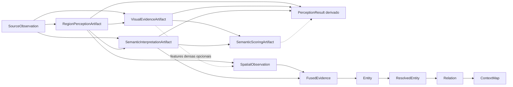

# Contratos e identidades

Este documento descreve os principais contratos públicos que atravessam boundaries do ContextMap2 e as regras de identidade necessárias para evitar confusão entre dados físicos, inferências, geometria, evidência fundida e objetos persistentes.

Para o fluxo completo, consulte [PIPELINE.md](PIPELINE.md). Para ownership, consulte [architecture.md](architecture.md).

## Princípio central

Um contrato público deve dizer **o que o dado significa**, não qual biblioteca o produziu.

Consequências:

- nenhum tipo público exige objetos ROS;
- nenhum tipo público exige `torch.Tensor`;
- SAM, DINO, Gemini, Qwen, FAST-LIO, PTv3 e similares ficam atrás de adapters;
- downstream consome tipos canônicos, não outputs nativos de backend.

## Estado dos contratos de percepção

Os produtores persistidos são `RegionPerceptionRunManifest`, `VisualEvidenceRunManifest`
e `SemanticInterpretationRunManifest`. Cada um registra a seleção da sequência e sua
linhagem; visual e semântico declaram o artifact regional que consumiram. Um score declara
os três produtores. `PerceptionResult` agrega uma seleção desses artifacts apenas na leitura.



A seleção de regiões e de interpretações é explícita na fusão. O mesmo frame físico pode
aparecer em mais de uma inferência sem virar duas observações físicas. Nenhum artifact persiste
`PerceptionResultId` ou uma cópia do resultado fundido. Os contratos das demais capabilities
estão nas APIs públicas e na documentação de cada uma. `SpatialCell` e `EntitySupport` são
derivados de `ContextMapArtifact` e geometria, fora da cadeia canônica.

A última aresta está fora da cadeia canônica: `SpatialCell` e `EntitySupport` são **derivados**
do `ContextMapArtifact` já finalizado, não produzidos no caminho que o produz (§28).

## 1. `SourceObservation`

Representa uma observação física/canônica originada de uma sequência ingerida.

Exemplos de conteúdo associado:

```text
RGB frame
LiDAR scan
IMU measurement
external pose measurement
```

### Identidade

A identidade pertence à observação física, não ao modelo que a processou.

```text
frame-0124
```

continua a mesma observação mesmo quando processada por diferentes perception runs.

### Invariante

Reprocessar `SourceObservation` não modifica o objeto original.

## 2. `PreparedImage`

Contrato canônico de imagem pronta para os backends de percepção consumirem.

Campos implementados:

```text
source_observation_id
payload_reference
width
height
transformations[]
```

`transformations` registra, em ordem legível, os passos aplicados. O contrato não define ainda uma implementação concreta de resize/rectification/crop.

## 3. Runs independentes de percepção

`region_perception` possui `Region2D` e publica as regiões finais, máscaras e o rastro da
normalização, grounding e refinamento. `visual_perception` possui as features e seus payloads;
`semantic_interpretation` possui claims, contexto de cena, requests, views, respostas e falhas.
Cada run tem `run_id`, seleção de observações, configuração e provenance próprios. A
identidade de região deriva do produtor regional e é local a ele: não afirma identidade de
objeto 3D nem correspondência entre runs.

## 4. `PerceptionResult`

É uma view imutável e derivada para uma observação de uma seleção explícita de artifacts. Ela
contém `source_observation_id`, `sequence_artifact_id`, `region_artifact_id` e, quando
selecionados, `visual_evidence_artifact_id`, `semantic_interpretation_artifact_id` e
`semantic_scoring_artifact_ids`. As coleções `regions`, `features`, `claims`, `scene_context` e
`semantic_scores` apenas referenciam evidência dos produtores. A view não tem `result_id`,
`run_id` ou `created_at` próprios e nunca é escrita como artifact.

O construtor rejeita IDs locais duplicados, observações divergentes e referências de feature,
claim ou score que não se resolvem na seleção. A composição multi-run mantém cada seleção
separada, inclusive quando duas interpretações analisaram o mesmo frame.

## 5. `Region2D`

É a região 2D final de `region_perception`, com caixa, máscara inline na execução ou referência
lazy no artifact, dimensões e convenção de imagem, provenance e estado de aceitação. O
`RegionId` vale dentro do run regional. `RegionCandidate` continua sendo evidência de proposta;
normalização e merge não criam uma entidade persistente. A associação 2D↔3D posterior cita
explicitamente o artifact regional e pode rejeitar uma região inválida ou não visível. Veja
[Region Perception](../src/contextmap/region_perception/docs/README.md).

## 6. `VisualFeature`

Representa evidência visual numérica. O contrato atual possui:

```text
feature_id
source_observation_id
scope = DENSE | GLOBAL | REGION
embedding_space_id
shape
dtype
payload_reference
provenance
region_id?
normalization?
```

`embedding_space_id` continua opaco dentro do `VisualFeature`, mas o contrato que ele identifica já existe como `EmbeddingSpace`. O fingerprint inclui família, modelo, versão, checkpoint, layer, dimensão e normalização. Duas features só são comparáveis quando seus fingerprints são exatamente iguais; dimensão igual nunca é suficiente.

Para features densas, `DenseFeatureMap` associa o `VisualFeature` a uma `DenseFeatureSampling` explícita e ao artifact de origem. Isso impede consumers de inferir patch size, stride ou transformação a partir do backend. Payloads numéricos podem ser persistidos separadamente pelo feature store e resolvidos pela chave `(source_observation_id, feature_id)`.

## 7. `SemanticClaim`

Hipótese semântica imutável produzida por inferência.

```text
claim_id
source_observation_id
semantic_interpretation_run_id
hypothesis
role = PRIMARY | ALTERNATIVE
provenance
category?
region_kind? = THING | STUFF
attributes[]
confidence?
region_id?
evidence_references[]
```

`confidence=None` significa explicitamente não pontuado. `PRIMARY` não significa probabilidade calibrada nem truth persistente. `region_id` referencia a geometria 2D congelada sem modificá-la. A provenance semântica registra backend/modelo, tarefa, template de prompt, schema de saída e referência opcional à resposta bruta.

## 8. `SceneContext`

Evidência semântica de nível de cena. O contrato registra `context_id`, `source_observation_id`, `semantic_interpretation_run_id`, `claims[]` com `region_id=None`, referências de evidência, provenance e campos opcionais `scene_type`, `environment`, `layout`, `lighting`, `visibility` e `navigability`. Claims internas devem pertencer à mesma observação e ao mesmo produtor semântico.

## 8.1. `SemanticInterpretationRequest`

Boundary canônico de uma chamada semântica de cena ou região. Ele não é uma
claim nem estado persistente; representa a seleção exata de evidência fornecida
a um backend.

```text
request_id
source_observation_id
semantic_interpretation_run_id
mode = SCENE | REGION
region_id?
visual_views[]
visual_features[]
scene_context_reference?
scene_context?
supporting_metadata[]
prompt_template_id
requested_output_schema
configuration_fingerprint
```

Cada `SemanticVisualView` possui `view_id`, kind, referência segura abaixo de
`outputs/semantic-views/`, SHA-256 obrigatório, observação de origem, região
quando aplicável e, quando uma `SemanticViewPolicy` a construiu, o registro
`construction` (fingerprint da política, SHA-256 da imagem de origem e janela de
pixels usada). A política de views declara quais views um request de região
carrega e em que ordem; nada além delas é acrescentado. O SHA-256 identifica os bytes exatos entregues ao modelo: os
runtimes o verificam antes de abrir a imagem ou enviar bytes a um provider, e um
payload divergente é falha explícita, não inferência sobre outra evidência.
Features opcionais preservam `feature_id`,
`embedding_space_id`, scope e região. Evidência não suportada por um backend é
rejeitada pela declaração `SemanticInterpreterCapabilities`, em vez de ser
descartada silenciosamente.

`scene_context_reference` e `scene_context` vêm juntos: o request de região
condicionado carrega exatamente o `SceneContext` que nomeia, da mesma observação,
e um template que não renderiza contexto o recusa em vez de descartá-lo. Um
request de cena nunca é condicionado a contexto de cena (#529).

`prompt_template_id` é a política de prompt selecionada antes da inferência, não
um rótulo: o interpretador renderiza exatamente essa política (um template do
catálogo versionado `SEMANTIC_PROMPT_TEMPLATES` em Qwen/Gemini, ou o prompt nativo
da task no Florence-2) ou recusa o request antes de chamar o modelo. Nenhum
backend a substitui por um padrão interno.

## 8.2. `SemanticInterpretationExecution`

Registro de uma inferência semântica individual, mantendo camadas que não devem
ser colapsadas:

```text
request
rendered_prompt
raw_response
parsed claims / scene_context / abstention
diagnostics
effective_configuration
```

`rendered_prompt` é sempre a política que o request selecionou (mesmo
`template_id` e schema de saída), com fingerprint SHA-256 do texto efetivamente
consumido; a execução recusa qualquer outro.

O run artifact persiste o request e a execution, materializa as views exatas,
exige payload de qualquer feature efetivamente consumida, resolve contexto de
cena/região e reconcilia o parsing com a `SemanticObservation` do produtor semântico. Qwen/Gemini usam
`SemanticConfidencePolicy.UNSCORED_ONLY`; um backend com score realmente
medido pode usar a policy `MEASURED`.

## 9. `SemanticScore`

Julgamento separado produzido por `SemanticScorer` sobre uma `SemanticClaim`:

```text
score_id
claim_id
feature_id
score_type = cosine_similarity
value ∈ [-1, 1]
calibrated_probability?
embedding_space_id
source_observation_id
region_id?
provenance
```

`SemanticScore` não muta a claim, não substitui `SemanticClaim.confidence` e
não é suporte acumulado de Semantic Fusion. Cosine similarity preserva sua
escala original e não é apresentada como probabilidade. Uma claim sem feature
compatível continua válida e permanece sem records de score; ausência não vira
zero. O DAG conhece `semantic_scorer`, mas `CANONICAL_PRESET_V1` não seleciona
silenciosamente um scorer/modelo. No runtime, os scorers de região rodam no estágio opcional
`semantic_scoring`, sobre uma seleção explícita dos artifacts regional, visual e semântico. Os scores ficam num `SemanticScoringRunArtifact` próprio e preservam essa seleção na lineage. A fusão pode consumir esses scores como canal opcional, mantendo sua semântica original.

## 10. `PoseEstimate`

Representa pose dinâmica canônica em um timestamp.

Deve declarar source/target frame explicitamente.

Campos implementados:

```text
PoseEstimate
├── estimate_id
├── timestamp / clock_id
├── parent_frame
├── child_frame
├── translation_m
├── orientation              # quaternion unitário (x, y, z, w)
├── validity                 # VALID | DEGRADED
├── provenance               # source_observation_ids + conversions_applied
└── covariance?              # 6x6; None quando o backend não reporta incerteza
```

### Regra de transform

Uma transformação nunca deve ser uma matriz sem semântica de frames.

Quando a notação `T_A_B` for usada, sua direção deve estar documentada no contrato e validada em testes. O importante é que source e target nunca sejam inferidos pelo nome do arquivo ou por convenção implícita.

## 11. `Trajectory`

Representa uma sequência canônica de poses.

Campos implementados:

```text
trajectory_id
reference_frame
body_frame
poses[]                  # timestamps estritamente crescentes, um único clock_id
gaps[]                   # intervalos onde a interpolação não é confiável
provenance               # backend/configuração, sequência, seleção, calibração, código
```

`time_bounds` e `quality_summary()` são derivados das poses.

Lookup derivado preserva quais poses deram origem ao resultado: `TrajectoryLookup` resolve `T_map_body(t)` por política explícita (`EXACT`, `NEAREST`, `INTERPOLATED`), devolve `ResolvedPose` com poses de origem, delta temporal e tolerância, ou `RejectedLookup` com o motivo. Uma pose interpolada carrega `provenance.derived_from` e nunca é confundida com uma pose estimada. Ver [lookup](../src/contextmap/state_estimation/docs/lookup.md).

## 12. `GeometryPoint`

Representa geometria persistente no frame global do mapa.

Conceitualmente:

```text
GeometryPoint
├── geometry_id
├── map_id
├── map_frame
├── coordinates_m
├── source_frame
├── source_coordinates_m
├── source_observation_id
├── source_point_index?
├── acquisition_timestamp
├── transform_lineage
└── provenance
```

`coordinates_m` no map frame é a coordenada persistente autoritativa.

## 13. `GeometryReference`

Referência compacta para geometria persistente.

```text
GeometryReference
├── map_id
└── geometry_id
```

Downstream deve preferir references a duplicar XYZ e provenance em cada estrutura.

### Escopo

A referência é, por padrão, local ao immutable `GeometricMapArtifact` identificado por `map_id`.

## 14. `GeometricMap`

Representa a base espacial persistente.

Inclui conceitualmente:

```text
map_id
frame_id
geometry storage/references
bounds
source observation set
selection/time bounds
spatial index metadata
provenance
```

Não possui semantic labels, entities ou relations.

## 15. `SpatialObservation`

É a ponte entre percepção e geometria.

```text
SpatialObservation
├── spatial_observation_id
├── source_observation_id
├── association_run_id
├── region_artifact_id
├── region_id
├── geometry_support[]
├── projection_summary
├── calibration_ref
├── pose_ref
├── visibility diagnostics
└── provenance
```

### Significado

Representa:

> Evidência regional de uma observação física ancorada em geometria persistente. Features e claims permanecem em seus artifacts e são selecionadas separadamente pelos consumidores.

Não representa:

- fused belief;
- final point label;
- entity identity.

A qualidade mensurável da observação (alcance, visibilidade, densidade de suporte, posição na imagem, alinhamento temporal e, quando há referência confiável, reprojeção) é um contrato separado, `ObservationQuality`, ligado à observação por identidade. Ela **não** é confiança semântica, similaridade de scorer nem peso de fusão, e não há um escalar combinado ([qualidade da observação](../src/contextmap/sensor_association/docs/quality.md)).

## 16. `PointRepresentation`

Representa estrutura geométrica local em um `RepresentationSpace` explícito.

```text
PointRepresentation
├── representation_id
├── geometry_reference
├── support
├── representation_space
├── shape
├── dtype
├── normalization
├── payload_reference
└── provenance
```

O suporte deve permitir reconstruir quais geometry refs participaram.

`PointRepresentation` é um canal 3D, não `VisualFeature` e não `SemanticClaim`.

Duas representações só são comparáveis quando o `representation_space_id` (o fingerprint do `RepresentationSpace`, que inclui checkpoint, normalização e a política de suporte) é igual; comparar espaços diferentes é um erro explícito.

## 17. `FusionSupport`

Representa suporte espacial sobre o qual evidências podem ser acumuladas.

```text
FusionSupport
├── fusion_support_id
├── geometric_map_id
├── geometry_support[]
├── spatial_observation_ids[]
├── bounds / centroid_m
├── time_bounds
└── provenance
```

### Regra crítica

`FusionSupport` não implica same-object identity.

Ele apenas afirma que as observações possuem suporte espacial compatível para uma policy de fusion. Não há campo de label, classe, confiança nem identidade de objeto.

Ver [`semantic_fusion/docs/contracts.md`](../src/contextmap/semantic_fusion/docs/contracts.md).

## 18. Evidence grouping

Semantic Fusion deve distinguir:

```text
physical observation
    dado capturado do ambiente

inference result
    processamento de uma observação física
```

Exemplo:

```text
physical frame A
├── Qwen run 1
├── Gemini run 2
└── Gemini prompt-v2 run 3
```

Isso continua sendo **uma** observação física.

Consequentemente:

```text
physical_observation_count = 1
inference_result_count = 3
```

No contrato, essa distinção é `EvidenceContribution.physical_observation_id` (chave de correlação) e `PhysicalObservationGroup`, que lista os resultados e execuções correlacionados de um frame. `FusedEvidence` expõe `physical_observation_count` e `inference_result_count` separadamente.

## 19. `FusedEvidence`

Acumula evidências preservando hipóteses e conflitos.

```text
FusedEvidence
├── fused_evidence_id
├── fusion_support_id
├── physical_observation_groups[]
├── contributions[]          (EvidenceContribution)
├── hypotheses[]             (FusedHypothesis)
├── point_representation_refs[]
├── uncertainty[]            (UncertaintyRecord)
├── temporal_summary
├── provenance
├── channels[]               (ChannelProvenance)
└── weighting                (QualityWeighting, só na política ciente de qualidade)
```

Uma `EvidenceContribution` é uma vista: uma região de um frame físico interpretada por uma execução, com referências para claims, scores de scorer, features visuais, geometria e qualidade de observação. Não carrega `PointRepresentation`: estrutura estática pertence ao suporte e é listada uma vez em `point_representation_refs`, nunca por vista.

Uma hypothesis fundida mantém references para claims e observações que a sustentam, contradizem ou deixam ambíguas (`HypothesisEvidence`, com `stance`, `role` e `SupportSignal` tipados). Um `SupportSignal` com `value=None` é evidência não pontuada, nunca zero. Ela também guarda o que as claims de suporte **declararam** sobre o objeto (`observed_attributes`: a `category` e cada atributo nomeado, um `FusedAttribute` por par `(nome, valor)` com as claims exatas; nada é agregado para um valor único), sem mudar a chave de agrupamento, que continua sendo o texto do label.

Qualidade de observação é uma dimensão de evidência separada, referenciada por `ObservationQualityRef`; ela não é confiança semântica, similaridade CLIP nem peso de fusão. `FusedEvidence` não tem vencedor, hipótese primária nem confiança combinada: ambiguidade, contradição, empate e evidência insuficiente são `UncertaintyRecord` com a evidência exata que os produziu, e uma abstenção (`unknown`) é um stance `ABSTAINING`, nunca evidência negativa.

`channels` lista os canais de evidência que a política declarou, com as identidades que os alimentaram; dados de um canal só existem se o canal foi declarado. `weighting`, quando existe, traz os fatores por componente e por contribuição e, por hipótese, o suporte antes e depois da ponderação: é um peso de fusão, não uma confiança semântica nem uma probabilidade.

## 20. `Entity`

Representa uma entidade semântica persistente dentro de um semantic map artifact.

```text
Entity
├── entity_id
├── semantic_map_id
├── geometry
├── semantic_state
├── evidence_refs[]
├── visual_feature_refs[]
├── point_representation_refs[]
├── temporal_state
├── properties[]
└── provenance
```

### Escopo de identidade

`entity_id` é estável dentro do immutable semantic-map artifact correspondente.

Não assume identidade automática entre mapas reconstruídos independentemente.

### Implementação

Implementado em `contextmap.semantic_mapping` ([contratos](../src/contextmap/semantic_mapping/docs/contracts.md)). A referência estável é `EntityReference(semantic_map_id, entity_id)`, e `EntitySet.resolve` recusa uma referência de **outro** semantic map mesmo quando o `entity_id` existe. O contrato implementado agrupa `evidence_refs[]`, `visual_feature_refs[]` e `point_representation_refs[]` em `Entity.evidence` (`EntityEvidenceLinks`, que também carrega a identidade, a versão, o digest e a sequência canônica do artifact de fusão e as observações espaciais e físicas), e `properties[]` são `semantic_state.attributes`, com evidência e regra de derivação. A identidade é alocada pela política de materialização (`entity--<fusion_support_id>`), não pela geometria.

## 21. `EntityGeometry`

Mantém suporte espacial real da entidade.

```text
EntityGeometry
├── geometry_refs[]
├── map_frame
├── centroid
├── bounds
├── extent
├── optional orientation
├── support statistics
└── provenance
```

Centroid e bounds são resumos derivados. Geometry references continuam autoritativas.

Implementado: além desses campos, o contrato traz `SupportStatistics` (pontos, volume, densidade, componentes conexos), diagnósticos explícitos (esparso, desconectado, extensão degenerada, orientação não justificada e conectividade não calculada quando o suporte excede o limite de custo da política) e a proveniência dos resumos (algoritmo versionado, conjunto de entrada por digest, frame, convenções numéricas e política). Suporte vazio não vira uma geometria válida, e a orientação só é derivada quando a política pede e os eixos são bem definidos ([detalhes](../src/contextmap/semantic_mapping/docs/geometry.md)).

## 22. `EntitySemanticState`

Preserva estado semântico sem destruição de incerteza.

```text
EntitySemanticState
├── primary_hypothesis?
├── alternative_hypotheses[]
├── attributes[]
├── ambiguity_state
├── conflicts[]
├── evidence_refs[]
├── fused_evidence_refs[]
└── provenance
```

Unknown, abstention, unscored e conflicting evidence devem permanecer distinguíveis.

Implementado: `alternative_hypotheses[]` é a propriedade derivada das hipóteses que não são a primária, `conflicts[]` são os registros de contradição dentro de `uncertainty` (que também guarda ambiguidade, quase empate e evidência insuficiente), e `evidence_refs[]`/`fused_evidence_refs[]` vivem nas hipóteses e em `Entity.evidence`, uma única fonte de verdade. O `ambiguity_state` é sempre o que os registros implicam, e uma primária só existe quando o estado é não ambíguo. Sob `unambiguous-single-hypothesis-v2` a primária também exige um mínimo de frames físicos distintos; abaixo dele o estado continua não ambíguo, sem primária, e `withheld_primary` registra o motivo ([detalhes](../src/contextmap/semantic_mapping/docs/semantic-state.md), [decisão](../src/contextmap/semantic_mapping/docs/primary-hypothesis-policy.md)). Os atributos incluem, com ou sem primária, os pares `(nome, valor)` que as claims declararam (`observed`, `claim-attribute-v1`), e cada hipótese lista os frames físicos distintos que a sustentam (`supporting_physical_observations`), para que o suporte continue contável depois da resolução.

## 23. `EntityTemporalState`

Resume quando e quantas vezes a entidade foi observada.

```text
EntityTemporalState
├── first_seen
├── last_seen
├── physical_observation_count
├── inference_result_count
├── observation refs/history
├── time_bounds
└── provenance
```

Não implica tracking dinâmico.

Implementado: o histórico é um índice pequeno (`ObservationRef` por frame físico) e `first_seen`, `last_seen` e as duas contagens precisam concordar com ele; o ciclo de vida é conservador (`observed`, `stale`, `uncertain`) e a baseline atribui só `observed` ([detalhes](../src/contextmap/semantic_mapping/docs/temporal-state.md)).

## 24. Entity Resolution contracts

Entity Resolution recebe source entities (`Entity`, de Semantic Mapping) e produz decisões explícitas e entidades resolvidas. Os contratos existem no código; a fonte de cada campo é a [documentação da capability](../src/contextmap/entity_resolution/docs/contracts.md).

Contratos públicos:

```text
EntityCandidateSet
EntityMatchEvidence
ResolutionDecision
ResolvedEntity
ResolvedEntityReference
```

Cada um pertence a um nível semântico diferente e nenhum substitui o anterior:

| Contrato | Nível | O que é |
| --- | --- | --- |
| `EntityCandidateSet` | evidência | Os alvos plausíveis de comparação de uma entidade, de forma permissiva e sem all-pairs; nunca decide nada. |
| `EntityMatchEvidence` | evidência | A evidência de **uma** comparação, um canal tipado por vez, sem score que a resuma. |
| `ResolutionDecision` | crença | O veredito de uma política versionada sobre essa evidência: `MATCH`, `DISTINCT` ou `UNRESOLVED`. |
| `ResolvedEntity` | crença | A materialização determinística dos grupos de `MATCH`, com linhagem de fusão. |

### `EntityMatchEvidence`

Um par de `EntityReference` em ordem canônica, o identificador derivado da comparação (`ComparisonId`) e a evidência de cada canal:

```text
geometry        # sinais geométricos com unidade e frame
semantic        # compatibilidade de labels, hipóteses e atributos
appearance      # similaridade de features visuais, um voto por observação física
temporal        # compatibilidade do histórico de observações
point_representation   # opcional: estrutura 3D num RepresentationSpace compatível
```

Cada canal é **medido ou indisponível** (com o motivo): a falta de evidência nunca vira zero nem voto por `DISTINCT`, e um canal `None` significa que não foi avaliado. Os sinais de canais diferentes (metros, cosseno, relação entre labels) não se somam, não se fazem média e não recebem um limiar conjunto. Gates duros (entidades distintas, mesmo mapa geométrico, mesmo frame do mapa) bloqueiam a comparação quando reprovam, e uma comparação bloqueada só contém canais indisponíveis; um espaço de embedding ou de representação incompatível torna indisponível o canal correspondente.

### `ResolutionDecision`

```text
decision_id            # derivado da comparação e da política
entity_a_ref, entity_b_ref
decision               # MATCH | DISTINCT | UNRESOLVED
evidence_ref           # ComparisonId de onde saiu
policy                 # PolicyRef(policy_id, configuration_fingerprint)
triggered_rules[]      # estágios: gate, eligibility, evidence, rule, decision
channels_used[], channels_ignored[]
unresolved_reason      # presente exatamente quando UNRESOLVED
provenance
```

`UNRESOLVED` é resultado válido, nunca forçado a match nem a não-match. Uma decisão `MATCH` ou `DISTINCT` precisa se apoiar em pelo menos um canal e em uma regra do estágio `decision` que conclua o mesmo resultado, o que a torna reconstruível. A política baseline (`conservative-staged-resolution-v1`) trabalha sobre o **estado** de cada canal, sem soma ponderada, e prefere `UNRESOLVED` a um `MATCH` sem explicação.

### `ResolvedEntity`

Preserva:

```text
resolved_entity_id
resolution_run_id
members[]                      # EntityReference de origem + decisões MATCH que as ligam
geometry                       # união exata das referências de geometria e das caixas
semantic_state                 # hipóteses e atributos dos membros, verbatim, sem primária na união;
                               # belief? (resolved-belief-min-support-v1): support_status, primary_label
temporal_state                 # recalculado da união das observações físicas
evidence                       # união dos vínculos de evidência
resolution_decision_refs[]
unresolved_neighbor_refs[]
contradiction_ids[]
provenance
```

Existência não é crença: a união das hipóteses nunca fica mais certa que os membros, mas, quando uma `ResolvedBeliefPolicy` é configurada, a regra versionada `resolved-belief-min-support-v1` conta as observações físicas **distintas** por label (chave tipográfica da fusão) sobre a união e registra `tentative`, `supported` (a única label que atinge o mínimo é a primária), `contested` ou `insufficient_evidence`, com a entropia das contagens; nenhum score é lido ([detalhes](../src/contextmap/entity_resolution/docs/resolved-entities.md#crença-pós-resolução-resolved-belief-min-support-v1)). Toda entidade de origem pertence a **exatamente uma** entidade resolvida (uma entidade que nada casou vira uma resolvida de um membro), e Spatial Relations consome só entidades resolvidas. Um componente ligado por `MATCH` que contém um par `DISTINCT` **não é fundido** e expõe uma `TransitivityContradiction` por par `DISTINCT` (um componente pode ter várias, e cada entidade retida guarda todos os seus `contradiction_ids`): um falso merge é pior que uma duplicata visível e rastreada. Source entities não são mutadas ou apagadas.

### Escopo de identidade

`ResolvedEntityId` só faz sentido dentro do artifact que o alocou; o handle estável é `ResolvedEntityReference(resolution_run_id, resolved_entity_id)`. O id é derivado do hash das referências ordenadas dos membros: as mesmas entradas imutáveis dão o mesmo id, e uma nova execução nunca herda identidade.

| Tipo | Escopo |
| --- | --- |
| `EntityResolutionRunId` | global: a identidade do artifact de resolução, escopo dos ids resolvidos |
| `ResolvedEntityId` | um artifact de resolução |
| `ResolvedEntityReference` | global: `(resolution_run_id, resolved_entity_id)` |
| `ComparisonId`, `ResolutionDecisionId` | derivados do par e da política |

### O que quem consome fixa

O artifact publica a versão do seu schema e o digest do seu inventário (`resolution_artifact_digest`, calculado por Entity Resolution) e devolve, para uma observação espacial, as entidades resolvidas que ela sustenta; a identidade física de cada entidade resolvida só vem da avaliação contra uma referência anotada ([detalhes](../src/contextmap/entity_resolution/docs/artifact.md)).

## 25. `RelationEvidence`

Representa medições/evidências para uma relação candidata.

Pode incluir:

```text
candidate subject/object
geometric measurements
optional semantic evidence refs
rule/policy identity
support/conflict state
provenance
```

A presença de uma candidate relation não significa relação confirmada.

Implementado em `contextmap.spatial_relations` ([contratos](../src/contextmap/spatial_relations/docs/contracts.md)). `RelationEvidence` registra o que **um canal** (`GEOMETRY`, `CONTACT` ou `OBSERVATION`) mediu ou afirmou sobre **um candidato dirigido**: `measurements` com unidade, `thresholds`, a geometria medida (por digest e, quando pequena, por referência), `caveats` declaradas e a proveniência (regra versionada, fingerprint da configuração, frame e mapa das coordenadas). Os status `SUPPORTS`, `CONFLICTS`, `AMBIGUOUS` e `UNAVAILABLE` mantêm o desconhecido separado do negativo. A evidência de observação carrega as afirmações upstream com vínculo explícito às entidades e nunca decide sozinha ([detalhes](../src/contextmap/spatial_relations/docs/observation-evidence.md)).

## 26. `Relation`

Representa relação entre `ResolvedEntity` references.

```text
Relation
├── relation_id
├── subject_entity_ref
├── predicate
├── object_entity_ref
├── relation_evidence_refs[]
├── state / uncertainty
└── provenance
```

Implementado: `Relation` guarda `subject_entity_ref` e `object_entity_ref` como `ResolvedEntityReference`, `relation_evidence_refs`, o estado `SUPPORTED`, `REJECTED` ou `UNRESOLVED` com a incerteza declarada, `derived_from` (quando é o inverso ou a gêmea simétrica de outra) e a proveniência da política de decisão. As entidades resolvidas são referenciadas, nunca copiadas ou alteradas.

Predicate precisa definir:

- direção;
- simetria quando aplicável;
- inverse predicate quando aplicável;
- frame assumptions;
- policy/taxonomy version.

## 27. `ContextMap`

Contrato público de alto nível do produto final.

```text
ContextMap
├── context_map_id
├── schema_version
├── metadata
├── geometry_ref
├── entities / refs
├── relations / refs
├── provenance / lineage refs
└── indexes / capabilities metadata
```

O schema deve ser independente do filesystem layout.

O **schema** já existe em `contextmap.artifact` ([contratos](../src/contextmap/artifact/docs/contracts.md)): `geometry_ref` referencia o `GeometricMapArtifact` por identidade e tamanho (nunca copia pontos); `entities` e `relations` são compostas por referência, com escopo de identidade próprio do mapa e mapeamento explícito para as identidades de origem; `lineage` lista todo artifact a montante citado, e cada resultado carrega uma `EvidenceOrigin` (`SENSOR_OBSERVED`, `MODEL_INFERRED`, `GEOMETRY_DERIVED`, `MULTIVIEW_FUSED`, `HUMAN_ANNOTATED`, `PRIOR_KNOWLEDGE`), que é proveniência e **nunca** confiança; `indexes` são derivados; `capabilities` ficam nos metadados junto com frame, unidades, âncora e extensão. Entidades e relações usam os contratos reais (`ResolvedEntityReference`, `EntityReference`, `RelationPredicate`, `RelationState`), sem registros de referência próprios. O estado semântico de uma entidade guarda todas as labels e, desde o schema `0.2.0` e só quando existem, a crença pós-resolução (`support_status`, `primary_label` só quando `supported` e a contagem de observações físicas por label) e os atributos declarados pelos claims (`ContextAttribute`, com origem citável); sem eles o registro é o da `0.1.0`. Ver também [versionamento do schema](../src/contextmap/artifact/docs/versioning.md).

## 28. `SpatialCell`, `EntitySupport` e `SemanticSpatialSupport` (derivados)

Contratos **derivados**, fora da cadeia principal: eles são produzidos a partir de um
`ContextMapArtifact` já finalizado e de uma agregação voxel do seu mapa bruto, nenhum estágio
canônico os consome, e o consumidor é um viewer fora deste repositório.

```text
SemanticSpatialSupport
├── source_map_id
├── frame_id
├── grid_fingerprint        # emprestado da agregação voxel
├── aggregation_rule        # emprestado da agregação voxel
└── cells[]
    └── SpatialCell
        ├── cell_id         # spatial-cell:<grid_fingerprint>:<kx>_<ky>_<kz>
        ├── aggregate_index # índice de transporte da apresentação, não identidade
        ├── key, centroid_m, bounds, point_count
        └── entity_support[]
            └── EntitySupport(entity_id, support_weight)
```

A regra que justifica o contrato: **nenhuma informação semântica persistente depende
exclusivamente do índice de um ponto de uma point cloud concreta.** O `cell_id` é função pura
da grade e da chave do voxel, então os atributos semânticos sobrevivem à simplificação da
geometria para centroides na apresentação. Uma célula é um **endereço espacial**, nunca uma
entidade: a entidade é referenciada por `ContextEntityId` e jamais substituída.

`support_weight` é uma **contagem de medições** — quantos pontos brutos daquela entidade caem
na célula. Não é probabilidade, não é score e não é combinada com nenhum dos dois; a semântica
do peso entra no `fingerprint()` de `EntityVoxelSupportPolicy`, de modo que mudá-la obriga uma
versão nova de política em vez de passar silenciosamente.

Implementado em `contextmap.spatial_support`
([documentação](../src/contextmap/spatial_support/docs/README.md)); o artifact persistido está
em [ARTIFACTS.md](ARTIFACTS.md).

## Contratos de execução do runtime

O runtime não define semântica científica. Os contratos abaixo descrevem **como uma execução é identificada, referenciada e inspecionada**. Todos existem em `contextmap.runtime`, são serializáveis e não expõem tipo ROS, `torch.Tensor` nem classe de backend. Detalhes em [runtime/docs](../src/contextmap/runtime/docs/README.md).

- `EffectiveConfig`: a configuração que uma execução realmente usa. Schema `0.1.0`, digest `sha256:` da forma canônica (os mesmos valores dão o mesmo digest, qualquer que seja o arquivo ou override que os produziu), as camadas aplicadas (perfil < arquivos < overrides) e nenhum segredo nem valor de override. Os parâmetros pertencem ao backend selecionado e são interpretados pela capability que o possui.
- `ArtifactRef`: o handle de um artifact imutável de um estágio, com `stage_id`, `contract` (o tipo do artifact, por exemplo `SequenceArtifact`), `artifact_id` (a identidade exata do run, nunca um nome de diretório) e `content_hash`. O hash de conteúdo é o que torna o reuso seguro: dois artifacts com o mesmo hash são intercambiáveis, e um artifact sem hash pode ser consumido, mas nunca é reutilizado. O `location` (opcional) é o diretório do artifact relativo ao workspace, `artifacts/<estágio>/<run>`: é o que permite referenciar e ainda abrir um artifact reutilizado de outro run, sem copiá-lo.
- `PipelinePlan` e `ExecutionPlan`: a topologia resolvida (estágios, entradas tipadas ligadas ao produtor, saída, backend de cada ponto de variação, digest de cada estágio e ordem de execução) e o escopo de uma execução. Um estágio de capability inexistente é declarado indisponível com o motivo, nunca omitido.
- `ReuseKey` e `ReuseDecision`: a identidade de reuso (configuração própria do estágio, hashes de conteúdo das entradas, identidade do código e identidades extras) e a decisão registrada por estágio, `reused` (com o artifact anterior exato) ou `recomputed` (com o motivo).
- `Lineage`, `CatalogEntry` e `ResolvedSelections`: o que cada artifact declara sobre sua origem (sequência física, seleção de observações, calibração, schema e upstream exato), um run disponível para seleção e a seleção resolvida (id exato, `named:<nome>` ou `latest` como opt-in explícito). Uma seleção incompatível falha antes de qualquer execução, e nada é inferido por nome.
- `ExecutionEvent`, `RunStatus` e `FailureRecord`: o ciclo de vida de um run (`planned`, `running`, `completed`, `failed`, `blocked`, `cancelled`), eventos numerados sem lacuna e a falha com categoria (`dependency`, `resource`, `contract`, `execution`, `unexpected` ou a do próprio executor). Segredos nunca aparecem.
- `IngestionRequest` e `IngestionResult`: o pedido e o resultado do serviço público de ingestion. O pedido é composto com os tipos da própria capability (`SourceTopicMapping`, `SynchronizationConfig`, `CalibrationSet`, `SourceWindow` opcional) e sua identidade exclui o workspace. Uma janela configurada (issue #506) muda a identidade do pedido e é registrada na provenance persistida (`ingestion_config["window"]`).
- `Runtime`, `RuntimeStatus`, `RuntimeCapability`, `ResolvedPipelinePlan`, `RuntimePreflightReport`, `RuntimeExecutionResult`, `RuntimeRunRecord` e os demais contratos da API pública de aplicação para frontends. A inspeção de um run devolve o que o registro persistido contém: o que ele não tem fica `None`, com uma nota, e nunca é deduzido.

Esses contratos referenciam artifacts por id e por hash; não copiam o conteúdo de nenhum artifact.

## Escopos de identidade

A tabela resume onde uma identidade é válida por padrão.

| Identidade | Escopo |
| --- | --- |
| `SourceObservation` | canonical sequence |
| Artifact regional | execução regional + sequência + seleção |
| Artifact visual | execução visual + observação + produtor de features |
| Artifact semântico | execução semântica + observação + request |
| `PerceptionResult` | view derivada de uma seleção explícita de produtores, sem identidade própria |
| `Region2D` | artifact regional + observação física |
| `VisualFeature` | artifact visual + observação física + produtor de features |
| `SemanticClaim` | artifact semântico + observação física + request |
| `SemanticScore` | julgamento do scorer referenciando uma claim |
| `PoseEstimate` | state-estimation artifact |
| `GeometryReference` | geometric-map artifact |
| `SpatialObservation` | association artifact |
| `PointRepresentation` | point-representation artifact |
| `FusionSupport` | semantic-fusion artifact |
| `FusedEvidence` | semantic-fusion artifact |
| `EntityReference` | semantic-map artifact |
| `ResolvedEntity` | entity-resolution artifact |
| `Relation` | spatial-relations artifact |
| `ContextMap` | final map artifact |

Cross-artifact equivalence nunca deve ser inferida apenas porque IDs locais possuem o mesmo texto/número.

## Missing, unknown e negative evidence

Esses estados precisam permanecer separados:

```text
missing
    dado não disponível

unscored
    evidência existe, mas não possui score

unknown / abstain
    modelo não afirma uma hipótese

low support
    scorer/policy produziu suporte baixo

negative/conflicting evidence
    há evidência explicitamente incompatível
```

Converter todos para zero destrói semântica e prejudica fusion.

## Public contract vs backend metadata

Contracts podem manter provenance de backend:

```text
backend id
model/checkpoint
version
config fingerprint
prompt/template version
```

Mas não podem exigir o tipo nativo do backend para serem lidos.

## Regra de serialização

Todo contrato que atravessa uma boundary persistida deve possuir representação serializável/inspectável ou metadata suficiente para resolver seu payload.

Payloads grandes, como dense features, podem ser externos ao registro principal através de `payload_reference`, com shape, dtype, hash e space identity registrados separadamente. No `VisualEvidenceArtifact`, `FeatureStoreReader` valida hash, shape e dtype antes do carregamento lazy. O `SemanticInterpretationArtifact` possui as views materializadas e content-addressed, requests, prompts, respostas brutas, parsing e diagnostics semânticos. O artifact regional possui máscaras e regiões finais. Nenhum desses produtores replica o artifact vizinho.
