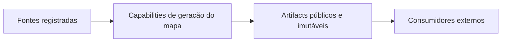
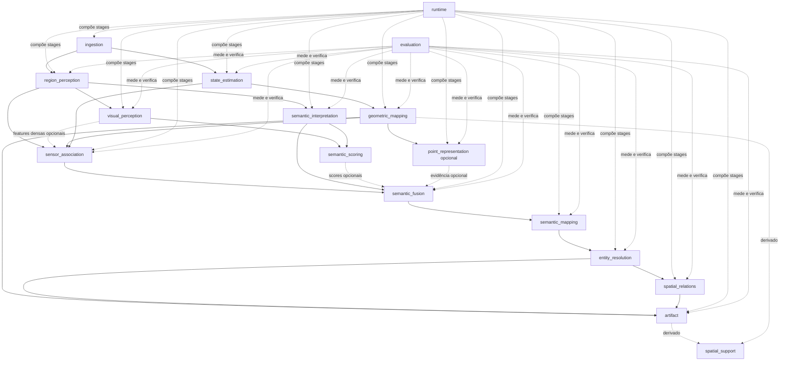
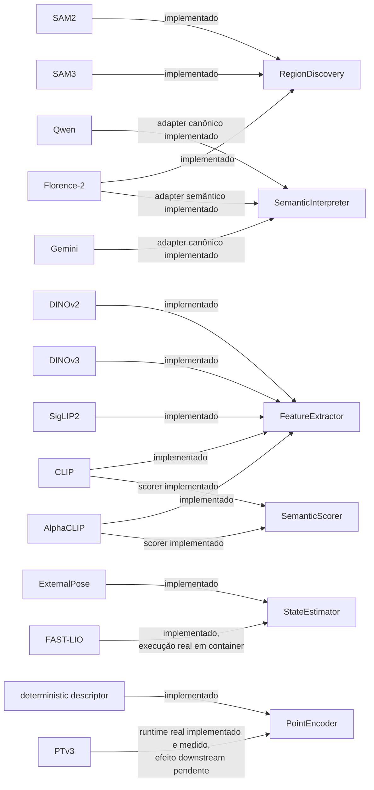
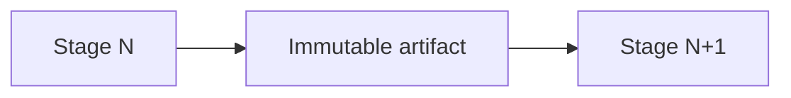
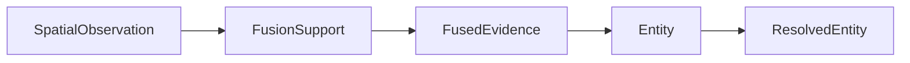

# Arquitetura do Canonical Pipeline

Este documento descreve a arquitetura estática alvo do ContextMap2: boundaries, ownership, dependências entre capabilities e regras que devem permanecer verdadeiras independentemente do backend escolhido.

O fluxo operacional detalhado está em [PIPELINE.md](PIPELINE.md). A semântica dos contratos está em [CONTRACTS.md](CONTRACTS.md). Persistência e lineage estão em [ARTIFACTS.md](ARTIFACTS.md).

> Esta é a arquitetura alvo do canonical pipeline. Uma capability documentada aqui pode ainda estar planejada ou em implementação.

## Objetivo arquitetural

O ContextMap2 deve produzir um mapa contextual 3D reproduzível sem acoplar o domínio a ROS, bibliotecas de modelos, um dataset específico ou aplicações consumidoras.

A arquitetura é organizada por **capability**, não por tecnologia.



## Limite do repositório

O repositório possui responsabilidade por:

- ingestão e normalização de observações robóticas;
- percepção visual;
- state estimation;
- geometria persistente;
- associação 2D↔3D;
- representações 3D opcionais;
- fusão de evidências;
- entidades semânticas e resolução de identidade;
- relações espaciais;
- montagem, validação e serialização do mapa contextual.

Estão fora do limite:

- viewer web/desktop;
- natural-language search/query;
- navigation stacks;
- planning;
- agents;
- dashboards;
- interfaces de operação.

Esses sistemas consomem `ContextMapArtifact`. Eles não devem importar internals do pipeline.

## Capabilities principais



`region_perception` possui a geometria 2D final, grounding, refinamento e suas máscaras;
`visual_perception` possui features e seus payloads; `semantic_interpretation` possui claims e
contexto de cena. São três produtores independentes. `semantic_scoring` depende de uma seleção
explícita deles; associação não depende de claims. O `PerceptionResult` é uma view derivada,
sem identidade persistida. As setas pontilhadas representam entradas opcionais, cuja
seleção e linhagem ainda devem ser verificadas pelo consumidor.

## Estado implementado e fronteira atual

Na `dev`, `ingestion`, `visual_perception`, `state_estimation`, `geometric_mapping`, `sensor_association`, `point_representation`, `semantic_fusion`, `semantic_mapping`, `entity_resolution` e `spatial_relations` já materializam os dez primeiros boundaries de domínio da arquitetura; `evaluation` materializa os harnesses de qualidade, regressão e custo dessas capabilities, o reference set versionado com suas anotações, integridade e QA, o registro de métricas, os manifestos de experimento e os protocolos das técnicas opcionais (sem execução real). Region Perception possui os backends de discovery, grounding e refinamento; Visual Perception possui o core de Feature Extraction de contratos, persistência, associação espacial, diagnostics e avaliação, além dos adapters DINOv2, DINOv3, CLIP e AlphaCLIP, e a capability independente Semantic Interpretation possui contratos de evidência e request, prompt/parser versionados, execução auditável e adapters canônicos Qwen/Gemini/Florence-2. `SemanticScorer` possui adapters CLIP/AlphaCLIP separados. DINOv2, DINOv3 e CLIP possuem execuções reais registradas em `corridor-02`; AlphaCLIP ainda não possui checkpoint de origem e integridade verificáveis, e nenhuma dessas execuções constitui uma avaliação científica comparativa comum. Semantic Mapping possui as entidades persistentes, a materialização sem resolução entre suportes, o `SemanticMappingRunArtifact` e o harness de validação. Ela **executou sobre o `corridor-02` real** no run canônico end-to-end; o que continua sem medição é **qualidade**, porque não existe reference set anotado para esse dataset. Entity Resolution possui a recuperação de candidatos, a evidência tipada por canal, a política de resolução baseline, as entidades resolvidas com linhagem de fusão, a detecção opcional de candidatos a divisão, o `EntityResolutionRunArtifact` e, em `evaluation`, o harness de fusão falsa, duplicata e falha de recuperação. Ela **executou sobre dados reais** no run canônico (170 entidades resolvidas) e o gate de linhagem de identidade foi cumprido com evidência real; os gates de **qualidade** (fusão falsa, duplicata, acurácia semântica) seguem bloqueados por falta de anotações de identidade. Spatial Relations possui as relações e a evidência entre entidades resolvidas, a taxonomia de predicados, os avaliadores geométricos e de contato, a política de decisão e o `SpatialRelationsRunArtifact`, lendo o run de Entity Resolution pela API pública dela. Ela **executou sobre dados reais** no mesmo run (10852 relações) com o gate de integridade de referências cumprido; a qualidade das relações segue bloqueada por falta de anotações. Runtime global e o artifact final **deixaram de ser arquitetura alvo**: `runtime` possui a configuração efetiva, o catálogo, a composition root, o DAG com preflight, o reuso, o ciclo de vida e a CLI, e `artifact` possui o schema, a montagem, a escrita atômica, o leitor e o validador do `ContextMapArtifact`. Os doze estágios foram executados sobre o `corridor-02` real até um `ContextMapArtifact` verificado por hash. O que **não** foi exercido com dados reais é uma única invocação de `run_plan` sobre um plano resolvido: aquele run encadeou os mesmos executores reais estágio a estágio, e o `run_plan` tem evidência de contrato sobre a cadeia sintética. Ver [release-v0.1.0.md](release-v0.1.0.md).

```mermaid
flowchart LR
    SRC["Fonte registrada"] --> ING["contextmap.ingestion<br/>implementado"]
    ING --> SA["SequenceArtifact"]
    SA --> RP["contextmap.region_perception"]
    RP --> RPA["RegionPerceptionRunArtifact"]
    SA --> VP["contextmap.visual_perception<br/>features visuais"]
    RPA --> VP
    VP --> VEA["VisualEvidenceArtifact"]
    SA --> SI["contextmap.semantic_interpretation"]
    RPA --> SI
    SI --> SIA["SemanticInterpretationArtifact"]
    SA --> ST["contextmap.state_estimation<br/>contratos + lookup + preflight +<br/>ExternalPose / FAST-LIO"]
    ST --> TRA["StateEstimationRunArtifact"]
    SA --> GM["contextmap.geometric_mapping<br/>contratos + transformação + acumulação +<br/>acesso espacial"]
    TRA --> GM
    GM --> MAPA["GeometricMapArtifact"]
    RPA --> SEN["contextmap.sensor_association<br/>SpatialObservation + câmera + visibilidade +<br/>máscara + features densas + qualidade"]
    VEA -. features densas opcionais .-> SEN
    MAPA --> SEN
    TRA --> SEN
    SEN --> ASA["SensorAssociationRunArtifact"]
    MAPA --> PTR["contextmap.point_representation<br/>contratos + suporte + PointEncoder +<br/>descritor determinístico + fronteira PTv3 +<br/>seleção de centros"]
    ASA -. centros .-> PTR
    PTR --> PTRA["PointRepresentationRunArtifact"]
    RPA --> FUS
    SIA -. claims opcionais .-> FUS
    VEA -. features opcionais .-> FUS
    ASA --> FUS["contextmap.semantic_fusion<br/>suporte + agrupamento + acumulação +<br/>incerteza + canais + qualidade"]
    PTRA -.-> FUS
    FUS --> FUSA["SemanticFusionRunArtifact"]
    FUSA --> SMP["contextmap.semantic_mapping<br/>Entity + materialização +<br/>evidência + estado temporal"]
    SMP --> SMPA["SemanticMappingRunArtifact"]
    SMPA --> ER["contextmap.entity_resolution<br/>candidatos + evidência por canal +<br/>decisão + entidades resolvidas"]
    ER --> ERA["EntityResolutionRunArtifact"]
    ERA --> SR["contextmap.spatial_relations<br/>candidatos + avaliadores +<br/>decisão + relações"]
    SR --> SRA["SpatialRelationsRunArtifact"]
    SA --> CM["contextmap.artifact<br/>montagem + validação"]
    MAPA --> CM
    ERA --> CM
    SRA --> CM
    CM --> CMA["ContextMapArtifact"]
```



A integração entre os módulos é feita exclusivamente pelas APIs públicas. `visual_perception` e `state_estimation` referenciam identidades de observação, calibração e sequência possuídas por Ingestion, sem importar adapters ROS ou detalhes de `sequence_artifact.py`. `geometric_mapping` consome `SequenceArtifact`, calibração e a trajetória de `state_estimation` pelas APIs públicas e devolve geometria por referência: nada a jusante copia XYZ. `sensor_association` consome a percepção, a trajetória e a geometria pelas APIs públicas e devolve `SpatialObservation`, que referencia geometria, features e claims por identidade em vez de copiá-los. `semantic_fusion` consome `SpatialObservation`, as claims e a estrutura 3D opcional pelas APIs públicas e devolve `FusedEvidence`, que mantém todas as hipóteses e a incerteza sem criar identidade de objeto; suas dependências diretas de `ingestion`, `geometric_mapping` e `state_estimation` são só identidades e o intervalo temporal, e estão declaradas em `tests/architecture/test_boundaries.py`. `semantic_mapping` consome `FusedEvidence`, o run de fusão e a geometria pelas APIs públicas e devolve `Entity`, que referencia a evidência por identidade, versão e digest do artifact em vez de copiá-la; suas dependências diretas de `ingestion`, `visual_perception`, `sensor_association`, `point_representation` e `state_estimation` são só identidades e tipos que a evidência fundida já carrega, e também estão declaradas em `tests/architecture/test_boundaries.py`. Ele não decide se duas entidades são o mesmo objeto. `entity_resolution` consome as `Entity` e o run de Semantic Mapping pela API pública e devolve `ResolvedEntity`, `ResolutionDecision` e a evidência de cada comparação, sem mutar nenhuma entidade de origem e sem substituir a evidência por uma decisão; usa, também pela API pública, referências e limites de `geometric_mapping`, features e compatibilidade de embedding de `visual_perception` e a leitura de runs de `point_representation` para o canal opcional de representação 3D. Sua dependência direta de `ingestion` é só a identidade `SourceObservationId` como tipo (as entidades listam os frames físicos que as observaram), declarada em `tests/architecture/test_boundaries.py` com o teste de fixture correspondente. `spatial_relations` consome o run de Entity Resolution pela API pública dela (as entidades resolvidas, a linhagem derivada do manifest e a geometria dessas entidades conferida com a persistida), `EntityGeometry` de `semantic_mapping` e `GeometrySource` de `geometric_mapping`, e devolve `Relation` e `RelationEvidence` com estado explícito e o rastro da evidência, sem corrigir nenhuma entidade. `artifact` abre o `GeometricMapArtifact` e os runs de Entity Resolution e de Spatial Relations pelos leitores públicos das capabilities donas e só traduz o que elas já decidiram para o schema `ContextMap` (`assemble_context_map`): referencia a geometria por identidade, sem copiar pontos, e não resolve entidades nem decide relações. `runtime` compõe esses estágios e encadeia seus artifacts sem possuir a lógica científica de nenhum deles ([runtime-composition.md](runtime-composition.md)).

Documentação implementacional:

- [Ingestion](../src/contextmap/ingestion/docs/README.md);
- [Visual Perception](../src/contextmap/visual_perception/docs/README.md);
- [Region Discovery](../src/contextmap/region_perception/docs/region-discovery.md);
- [Feature Extraction](../src/contextmap/visual_perception/docs/feature-extraction.md);
- [Semantic Interpretation](../src/contextmap/visual_perception/docs/semantic-interpretation.md);
- [State Estimation](../src/contextmap/state_estimation/docs/README.md);
- [Geometric Mapping](../src/contextmap/geometric_mapping/docs/README.md);
- [Sensor Association](../src/contextmap/sensor_association/docs/README.md);
- [Point Representation](../src/contextmap/point_representation/docs/README.md);
- [Semantic Fusion](../src/contextmap/semantic_fusion/docs/README.md);
- [Semantic Mapping](../src/contextmap/semantic_mapping/docs/README.md);
- [Entity Resolution](../src/contextmap/entity_resolution/docs/README.md);
- [Spatial Relations](../src/contextmap/spatial_relations/docs/README.md);
- [Artifact](../src/contextmap/artifact/docs/README.md);
- [Spatial Support](../src/contextmap/spatial_support/docs/README.md) (derivado, fora da cadeia canônica);
- [Runtime](../src/contextmap/runtime/docs/README.md);
- [Evaluation](../src/contextmap/evaluation/docs/README.md).


## Ownership

Uma capability possui o conceito que ela introduz semanticamente. O consumidor depende da API pública desse módulo, não de uma estrutura global de contratos.

| Capability | Responsabilidade primária | Conceitos que possui | Não possui |
| --- | --- | --- | --- |
| `ingestion` | Normalizar fontes registradas | source observations, sequence, calibration metadata | pose canônica, semântica, mapa |
| `visual_perception` | Extrair evidência visual/semântica por inferência | prepared image, regions, visual features, semantic claims | projeção 3D, fusão multi-view, entity ID |
| `state_estimation` | Produzir pose dinâmica e trajetória | `PoseEstimate`, `Trajectory`, lookup temporal | camera projection, semantic state |
| `geometric_mapping` | Produzir geometria 3D global persistente | `GeometryPoint`, `GeometryReference`, `GeometricMap` | labels, entities, relations |
| `sensor_association` | Ancorar evidência visual em geometria | `SpatialObservation`, projection/visibility association | semantic fusion, entity identity |
| `point_representation` | Representar estrutura 3D local | `PointRepresentation`, `RepresentationSpace` | visual embedding, semantic label |
| `semantic_fusion` | Acumular evidência em suporte espacial | `FusionSupport`, `FusedEvidence` | persistent entity identity |
| `semantic_mapping` | Materializar entidades semânticas persistentes | `Entity`, `EntityReference`, semantic/geometry/temporal state, evidence links | same-object merge logic, relations |
| `entity_resolution` | Resolver duplicação/identidade entre entidades | `EntityCandidateSet`, `EntityMatchEvidence`, `ResolutionDecision`, `ResolvedEntity`, `ResolvedEntityReference` | relation extraction, mutação de entidade de origem |
| `spatial_relations` | Inferir relações entre entidades resolvidas | `Relation`, `RelationEvidence`, `RelationPredicate` (taxonomia), `FrameConventions` | entity correction, natural-language query, planning |
| `artifact` | Compor o produto público final | `ContextMap`, metadata, final artifact schema | domain inference |
| `spatial_support` | Derivar do produto público um suporte semântico endereçado pelo espaço | `SpatialCell`, `SpatialCellId`, `EntitySupport`, `SemanticSpatialSupport`, `EntityVoxelSupportPolicy` | a entidade, a grade, a agregação voxel, hipótese semântica por célula |
| `runtime` | Compor e executar implementations | configuração efetiva, execution plan, selection, composition, lifecycle, API pública de aplicação (`Runtime`) | lógica científica das capabilities |
| `evaluation` | Medir qualidade e regressões | reference set, anotações, registro de métricas, relatórios, manifestos de experimento e evidência, cenário end-to-end, matriz de aceitação e invariantes entre estágios | alterar resultados do pipeline |

## Regra de ownership de contratos

O módulo que introduz e possui semanticamente um conceito possui seu tipo público.

Exemplos:

```text
visual_perception.SemanticClaim
state_estimation.PoseEstimate
geometric_mapping.GeometryReference
sensor_association.SpatialObservation
semantic_fusion.FusedEvidence
semantic_mapping.Entity
spatial_relations.Relation
artifact.ContextMap
```

Evitar um package global como:

```text
contracts/everything.py
shared/models.py
common/domain.py
```

usado apenas para contornar boundaries. `shared` deve conter apenas primitives realmente transversais sem owner de domínio claro.

## Dependência pública e internals

Cross-module imports só podem depender da superfície pública do módulo produtor.

Permitido:

```python
from contextmap.visual_perception import SemanticClaim
```

Não permitido:

```python
from contextmap.visual_perception.backends.sam3._internal import SamNativeMask
```

Backends, SDK objects, tensors nativos e helpers privados permanecem internos à capability.

## Direção das dependências

A arquitetura deve permanecer acíclica no nível das capabilities de domínio.

Um modelo conceitual é:

```text
ingestion
├── visual_perception
└── state_estimation

state_estimation
└── geometric_mapping

visual_perception ─┐
geometric_mapping ─┴── sensor_association

sensor_association ─── semantic_fusion
geometric_mapping ─── point_representation ─── semantic_fusion

semantic_fusion
└── semantic_mapping
    └── entity_resolution
        └── spatial_relations

geometric_mapping ─────────────┐
entity_resolution ─────────────┼── artifact / ContextMap
spatial_relations ─────────────┘

artifact / ContextMap ─────────┐
geometric_mapping ─────────────┴── spatial_support   (derivado, fora da cadeia canônica)
```

O grafo acima é conceitual e transitivo. O que o teste `tests/architecture/test_boundaries.py` autoriza são imports diretos da API pública do produtor. `semantic_fusion` importa, além de `sensor_association`, `point_representation` e `visual_perception`, identidades de `geometric_mapping` (`GeometryReference`, `Bounds3D`) e `ingestion` (`SourceObservationId`) e o intervalo temporal `TimeBounds` de `state_estimation`, apenas como tipos: não usa a lógica dessas capabilities. `spatial_relations` importa `entity_resolution` (`ResolvedEntityReference`, o manifest, o leitor do run e `ResolvedEntitySet`), `semantic_mapping` (`EntityGeometry`) e `geometric_mapping` (`GeometrySource` e referências de geometria), apenas pelas APIs públicas; a evidência de observação usa identidades upstream opacas em vez de importar `visual_perception` ou `ingestion`.

`artifact` depende de `shared`, `geometric_mapping` (`MapId`, `GeometryReference`, `Bounds3D`, `geometry_index_of`), `semantic_mapping` (`EntityReference`), `entity_resolution` (`ResolvedEntityReference`, `ResolutionDecisionId`) e `spatial_relations` (`RelationPredicate`, `RelationState`, `RelationUncertaintyKind`, `RelationId`, `SpatialRelationsRunId`), todos pela API pública e dentro da fronteira já declarada em `tests/architecture/test_boundaries.py`. Por isso não importa `TimeBounds` de `state_estimation` nem identidades de `ingestion`: `ObservationWindow` repete a regra do intervalo fechado em um relógio e as identidades de artifacts a montante são textos opacos (`UpstreamRecordRef`). Promover `TimeBounds` a `shared` é o caminho limpo se preferirem reutilizá-lo.

`spatial_support` é uma consumidora **derivada** do produto público: depende de `shared`, `artifact` (`ContextEntityId`, `ContextMapArtifactReader`), `geometric_mapping` (grade, agregação voxel, geometria bruta) e `ingestion` (`FrameId`, só como tipo). Nada em `src/contextmap/` depende dela, e é isso que garante que não há ciclo com `artifact`. Ela não é estágio do DAG: o seu caminho de produção é o comando `contextmap derive-spatial-support`, cujo handler importa a raiz pública dentro da própria função.

`runtime` depende das capabilities para compô-las. Capabilities nunca dependem de `runtime`.

## Data dependency não é import de backend

Uma etapa pode precisar de dados produzidos por outra capability sem conhecer seu backend.

Exemplo, Sensor Association precisa de:

```text
RegionPerceptionRunArtifact
VisualEvidenceArtifact (features densas opcionais)
GeometricMapArtifact
StateEstimationRunArtifact
canonical calibration
```

Isso não significa que ela conheça SAM, DINO, FAST-LIO ou ROS. Ela conhece apenas contratos públicos e artifacts.

## Ports e adapters

Uma interface/Protocol deve existir quando há um ponto real de substituição.

Variation points atuais e planejados:



Um backend pode atender mais de uma capability através de adapters distintos. Florence-2 usado para Region Discovery não é o mesmo contrato que Florence-2 usado para Semantic Interpretation.

No estado atual, os ports `RegionDiscovery`, `FeatureExtractor`, `FeatureResolutionEnhancement`, `SemanticInterpreter` e `SemanticScorer` já existem em `visual_perception`. Region Discovery possui adapters concretos SAM2, SAM3 e Florence-2. Feature Extraction possui adapters DINOv2, DINOv3, CLIP e AlphaCLIP atrás do mesmo port; eles não são selecionados implicitamente pelo preset e o enhancement não possui backend aprendido nem faz parte do preset canônico. Semantic Interpretation possui `QwenSemanticInterpreter`, `GeminiSemanticInterpreter` e `Florence2SemanticInterpreter` implementando o mesmo boundary canônico, com runtime/client injetáveis, parsing/provenance compartilhados e testes determinísticos; Qwen (`HuggingFaceQwenRuntime`, com quantização NF4/int8 aplicada e verificada) e Florence-2 (`HuggingFaceFlorence2SemanticRuntime`, que mapeia o texto da task para uma única claim verbatim pelo parser compartilhado) têm runtimes transformers reais e execução controlada sobre os 20 frames de corridor-02, sem anotações; o Gemini possui o cliente `google-genai` validado apenas com transporte simulado; não há comparação de qualidade entre os três backends. `visual_perception.pipeline` conhece a capability `semantic_interpreter`, mas `CANONICAL_PRESET_V1` ainda usa temporariamente as operações legadas `scene_interpretation`/`region_interpretation` até existir uma política explícita de construção de request. `SemanticScorer` possui adapters CLIP/AlphaCLIP e está disponível como capability explícita do DAG, mas não integra `CANONICAL_PRESET_V1` automaticamente. Ingestion possui adapters concretos ROS 1 e ROS 2 atrás de `SourceAdapter`. `state_estimation` possui o port `StateEstimator` com os adapters `ExternalPose` e FAST-LIO, este com o processo isolado atrás de um `FastLioRunner` e de um wrapper de implantação que roda no container do FAST-LIO; a construção concreta é feita pela composition root do runtime (`compose()`), que recusa explicitamente um backend indisponível ou sem runtime. `point_representation` possui o port `PointEncoder`, o descritor geométrico determinístico e a fronteira PTv3 atrás de `PTv3Runtime`; o runtime real `PointceptPTv3Runtime` está implementado e foi medido sobre geometria real do `corridor-02`, sem vantagem demonstrada de discriminação de lugar sobre o descritor e com custo maior. O backend continua opcional, nunca substitui o baseline por fallback silencioso, e sua seleção e construção no pipeline global são feitas pela composition root do runtime. Detalhes: [Region Discovery](../src/contextmap/region_perception/docs/region-discovery.md), [Feature Extraction](../src/contextmap/visual_perception/docs/feature-extraction.md) e [Semantic Interpretation](../src/contextmap/visual_perception/docs/semantic-interpretation.md).

## Composition root

A construção de implementações concretas pertence ao runtime: `contextmap.runtime.compose()` é a composition root, que constrói a partir da configuração efetiva as implementações de Ingestion, Visual Perception, State Estimation, Geometric Mapping, Sensor Association, Point Representation, Semantic Fusion, Semantic Mapping, Entity Resolution e Spatial Relations atrás dos ports das capabilities; `context_map` não tem ponto de variação, então não há o que construir para ele. `compose_executors()` monta, da mesma configuração, os executores reais que o DAG do runtime executa para `state_estimation`, `geometric_mapping`, `sensor_association`, `entity_resolution`, `spatial_relations` e `context_map`; `semantic_fusion` só quando a acumulação selecionada é a baseline; `visual_perception` quando seus quatro pontos de variação estão selecionados e cada backend sem loader empacotado tem um `RuntimeProvider`; `semantic_mapping` só quando o chamador também fornece `semantic_map_id` e `code_digest`; e `point_representation` só quando o estágio opcional está habilitado (#663); `point_representation`, a fusão, `semantic_mapping`, `entity_resolution` e `spatial_relations` exigem a identidade do código que gravam, que a CLI e `Runtime` passam, com as identidades derivadas dela (`executor_identities`). `ingestion` e `pose_ingestion` nunca são compostos ali: precisam de um `IngestionRequest` da execução. Só ela importa backends concretos, e apenas dentro da factory que os usa; o serviço público de ingestion importa somente a raiz pública de `contextmap.ingestion`, os executores de estágio (`executors.py`) importam somente a raiz pública de cada capability que executam, nunca um adapter ou backend, a CLI importa, de forma tardia, somente a raiz pública de `contextmap.artifact` (`validate` e `inspect artifact` entregam um `ContextMapArtifact` ao validador do dono, issue #603), e nenhum outro módulo do runtime importa uma capability (`tests/architecture/test_runtime_boundaries.py`). Importar o runtime não carrega backend nem SDK pesado. Um frontend (uma TUI, por exemplo) consome a API pública `contextmap.runtime.Runtime`, nunca os módulos internos do runtime, um backend ou uma capability. A CLI ainda não usa essa fachada: chama diretamente os mesmos serviços do runtime (`resolve_effective_config`, `run_plan`, `RunJournal`…), então não há uma segunda especificação do pipeline, e sua única dependência de capability é a validação do `ContextMapArtifact`; migrá-la para `Runtime` é trabalho futuro ([api.md](../src/contextmap/runtime/docs/api.md)). Capabilities continuam testáveis sem construir o runtime, e nenhuma o importa. Detalhes em [runtime-composition.md](runtime-composition.md).


Runtime pode:

- escolher backend;
- construir dependencies;
- carregar config;
- selecionar run/artifact upstream;
- validar DAG;
- decidir reuse/recompute;
- coordenar lifecycle.

Runtime não pode:

- decidir masks;
- calcular projection math que pertence a Sensor Association;
- definir fusion semantics;
- criar heurística de entity resolution;
- definir spatial predicates.

## Serviços de aplicação

Cada capability pode possuir um service responsável por coordenar seu comportamento interno sem conhecer infraestrutura concreta.

Exemplo conceitual:

```text
VisualPerceptionService
SensorAssociationService
SemanticFusionService
```

Esses services trabalham com ports e contratos públicos. Instanciação de backends fica fora deles.

## Artefatos como fronteiras

O canonical pipeline usa artifacts imutáveis como fronteiras explícitas entre execuções.



Benefícios arquiteturais:

- estágio downstream pode ser reexecutado sem repetir upstream caro;
- experimentos preservam baseline;
- cada resultado possui lineage;
- modelo/SDK não precisa permanecer carregado para ler o resultado;
- regressões podem ser isoladas por etapa.

Detalhes estão em [ARTIFACTS.md](ARTIFACTS.md).

### Capability, stage, artifact, evidence, view e cache

Estes seis conceitos são distintos, e tratá-los como um só foi a origem da fronteira errada que
[perception-dag-decomposition.md](perception-dag-decomposition.md) corrige. Em particular, **não
vale a convenção implícita de que um pacote na raiz de `src/contextmap/` produz artifact**: o
próprio repositório a contradiz, porque `shared` e `model_runtime` são pacotes de topo e não
produzem artifact nenhum.

```text
Capability   ownership de conceitos e API pública. É o que justifica o pacote na raiz.
Stage        unidade de execução cuja saída precisa ser selecionável no DAG.
             Decisão de catálogo, não de layout de diretório.
Artifact     identidade imutável e endereçável da saída de uma execução de stage.
Evidence     dado observacional com provenance, que pode estar dentro de um artifact
             sem ser ele próprio um artifact.
View         composição derivada de artifacts/evidence; não cria verdade nova
             e não tem produtor.
Cache        otimização abaixo do contrato do DAG; nunca é dependência downstream.
```

Uma capability vira stage quando **as quatro** condições valem:

1. um consumidor precisa **selecionar** aquela saída explicitamente como upstream;
2. a saída precisa ser **variada ou pinada independentemente** de outra que varia;
3. reexecutar **não é equivalente** a reutilizar — produtor não-determinístico, caro ou
   externamente dependente;
4. existe consumidor **hoje**.

Uma capability de topo que falha essas condições é uma capability sem stage. É um estado válido e
deve ser declarado, não escondido.

A escolha entre artifact e cache não é determinismo — que é propriedade do ambiente, não do
contrato. É **artifact** quando a identidade daquela execução precisa ser selecionada, citada ou
pinada por um consumidor; é **cache** quando só queremos evitar recomputação sem tornar o
resultado parte do contrato do DAG. Determinismo entra como pré-condição de cache: um cache só é
sadio se recomputar fosse equivalente.

## Separação entre geometria e semântica

Geometric Mapping é autoridade da geometria persistente.

```text
GeometryReference
    = onde algo está
```

Visual/semantic evidence permanece separada:

```text
VisualFeature
    = como a evidência visual é representada

SemanticClaim
    = o que uma inferência propõe semanticamente

PointRepresentation
    = como a estrutura 3D local é representada
```

Sensor Association conecta evidência à geometria sem transformar o ponto 3D em um registro mutável cheio de labels.

## Separação entre fusion support e entity identity

`FusionSupport` agrupa observações sobre suporte espacial compatível para acumular evidência.

Ele não significa que o suporte seja uma identidade persistente de objeto.



Essas fronteiras existem para evitar que uma heurística de fusão se torne implicitamente a definição de object identity.

## Immutability

Objetos e artifacts persistidos não são corrigidos in-place por estágios downstream.

Exemplos:

- `SourceObservation` não muda quando percepção roda novamente;
- `Region2D` não muda depois de Geometry Freeze;
- `GeometricMapArtifact` não recebe embeddings adicionados por outro estágio;
- source entities não são apagadas quando Entity Resolution faz merge;
- um novo experimento gera novo artifact/run.

## Auditabilidade como requisito arquitetural

Qualquer resultado relevante deve responder:

1. qual input entrou;
2. qual configuração/policy foi aplicada;
3. qual backend/model/code produziu;
4. qual output foi gerado;
5. quais artifacts e observações upstream sustentam esse output.

Auditabilidade não é apenas uma opção de debug.

## Debug não é contrato

Artifacts separam:

```text
outputs/
    dados contratuais consumidos downstream

__DEBUG__/
    visualizações, overlays, crops, traces e diagnósticos humanos
```

Nenhum módulo downstream pode depender de `__DEBUG__/`.

## Configuração, policy e schema são diferentes

Manter separadas as seguintes dimensões:

```text
schema
    formato/semântica do contrato público

policy
    regra científica/algorítmica versionada

backend
    implementação substituível de uma capability

configuration
    parâmetros efetivos de uma execução
```

Mudar backend não deve necessariamente mudar schema. Mudar semântica de um contrato requer versionamento explícito.

## Required vs optional

O caminho end-to-end do canonical pipeline requer as capabilities necessárias para produzir geometria, entidades resolvidas, relações e `ContextMapArtifact`.

Alguns canais permanecem opcionais quando o downstream selecionado não depende deles, por exemplo:

- PTv3/learned Point Representation;
- semantic scoring;
- visual feature channels específicos;
- semantic relation evidence;
- debug levels detalhados;
- o suporte espacial semântico de `spatial_support`, derivado do `ContextMapArtifact` depois do pipeline e consumido fora do repositório.

Optional não significa implícito. Estado habilitado/desabilitado precisa constar da configuração e dos manifests.

## Princípios de design

As decisões de código seguem [development.md](development.md):

- Clean Code;
- SOLID;
- KISS;
- DRY;
- YAGNI.

Aplicação prática:

- não criar abstração sem variation point real;
- não adicionar plugin framework quando factories pequenas resolvem;
- não centralizar domínio em `shared`;
- não generalizar um workaround de dataset como arquitetura universal;
- preservar ownership mesmo quando outro módulo possui os dados necessários para executar a lógica.

## Documentação por capability

Documentação global explica como as capabilities se conectam. Detalhes internos devem ficar em:

```text
src/contextmap/<module>/docs/
```

O módulo pode documentar pipeline interno, contracts, backends e evaluation sem repetir regras globais. O índice central permanece em [README.md](README.md).
