# Canonical/2 — memória espacial rica em contexto

`canonical/2` é um perfil novo do runtime. Ele não altera `canonical/1`, que
continua sendo a linha de base histórica e deve permanecer legível.

```mermaid
flowchart LR
    I[PreparedImage] --> D[SAM2 automatic discovery\nfull frame]
    D --> R[Normalized Region2D masks]
    R --> V[Region-filling visual view]
    V --> Q[Qwen region interpretation]
    R --> N[DINO region appearance]
    Q --> C[CLIP semantic compatibility]
    Q --> A[2D to 3D association]
    N --> A
    C --> F[Semantic fusion]
    A --> F
    F --> M[Semantic mapping]
    M --> E[Entity resolution]
    E --> G[Spatial relations]
    G --> CM[ContextMap]
    I -. optional targeted search .-> TG[Florence-2 or LocateAnything]
    TG -. box refinement .-> SR[SAM2 refinement]
    SR -. Region2D .-> R
```

## Invariantes

- A descoberta usa uma única passagem SAM2 de quadro inteiro. Tiling continua
  disponível para experimentos, mas não pertence a este perfil.
- Máscaras são propostas de região, não labels. Qwen produz claims auditáveis por
  região; uma falha ou abstenção é evidência ausente, nunca um label inventado.
- O perfil fixa Qwen como intérprete regional e SAM2 como descoberta automática;
  comparações com outro VLM ou descoberta pertencem a uma configuração experimental.
- CLIP/AlphaCLIP é compatibilidade semântica com score bruto e espaço de embedding
  declarado. Não é probabilidade, não substitui um claim e não é somado a confiança.
- DINO é evidência de aparência: a `canonical/2` **produz e preserva** essa evidência
  por região através de Sensor Association, Semantic Fusion e Semantic Mapping (como
  `visual_features`). O pooling é média ponderada pela máscara, com identidade do espaço
  de embedding preservada; o runtime reutiliza o mapa denso e sua geometria já persistidos
  no mesmo frame e não executa DINO uma segunda vez. Regiões somente com caixa não recebem
  este canal. A **associação por aparência** (`entity_resolution.appearance`) fica
  **desligada** neste perfil: `AppearanceComparisonPolicy` exige um threshold dependente do
  espaço de embedding que precisa ser medido experimentalmente. Até essa calibração existir,
  a aparência não decide identidade; ela pode entrar depois em uma revisão versionada do perfil.
- Grounding é aditivo. A política de validação `human-presence-direct/1` consulta
  apenas `person`; Florence-2 box-only passa por refinamento SAM2 antes de associação.
- Uma hipótese contextual determinística requer múltiplas pistas físicas
  independentes. Ela nunca afirma `person_present` e permanece distinta de entidades
  e relações.

## Proveniência

Uma entidade ou região apoiada por busca dirigida precisa permitir a travessia:

`entidade -> evidência fundida -> SpatialObservation -> Region2D -> refinamento
opcional -> grounding -> request/query -> backend/revisão -> frame`.

Referências e hashes são persistidos; respostas brutas e bytes de views permanecem
nos artifacts de percepção, sem duplicação no mapa final.

## Execução de validação posterior

Após a aprovação do código, a execução real selecionará as primeiras oito imagens a
partir de 2:30 da sequência ingerida, tomando cada sexta imagem. A seleção materializa
os IDs e timestamps antes de carregar modelos. A publicação no viewer é posterior à
validação de integridade e deve renderizar cor semântica como camada derivada, mantendo
relações e evidência de busca em camadas separadas.
