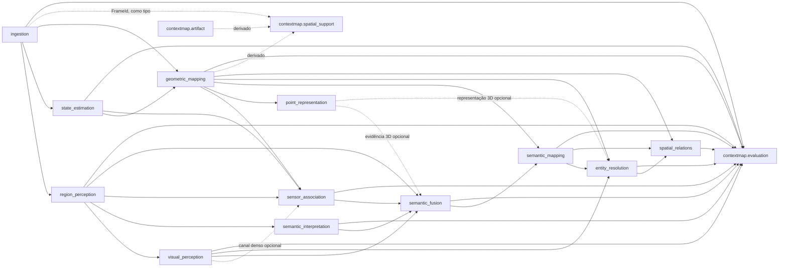

# APIs públicas e encapsulamento de capabilities

Este documento define como uma capability do ContextMap2 expõe sua superfície pública e como outras capabilities podem consumi-la sem depender de detalhes internos.

A regra base é:

> Uma capability consumidora importa conceitos de domínio e ports somente pela API pública do módulo produtor. Backends, infrastructure, helpers privados e tipos nativos de SDK não fazem parte desse contrato.

As regras de ownership e direção de dependências continuam definidas em [architecture.md](architecture.md).

## Superfície pública autoritativa

O `__init__.py` na raiz de cada capability é a superfície pública autoritativa para imports entre capabilities.

Exemplo:

```python
from contextmap.semantic_interpretation import SemanticClaim
```

A raiz deve reexportar **somente** os símbolos que constituem contrato público real e declarar `__all__` explicitamente.

```python
from .semantic_claims import SemanticClaim
from .ports import SemanticInterpreter

__all__ = ["SemanticClaim", "SemanticInterpreter"]
```

`__all__` não é usado para reexportar tudo que existe no módulo. Ele torna a superfície intencional e revisável.

## Integração pública implementada

As capabilities implementadas expõem contratos de domínio e artifacts por suas próprias raízes públicas. A regra continua sendo a mesma em todas elas: o consumer importa o producer pela raiz pública `contextmap.<capability>`; backends, adapters e submódulos internos não atravessam o boundary. O diagrama resume relações de consumo dos contratos; a matriz de arquitetura verifica os imports diretos permitidos. `spatial_support` é uma consumidora derivada do produto público, fora do DAG canônico.




Exemplos concretos dessa integração:

- `geometric_mapping` consome `Trajectory` e contratos de pose pela raiz `contextmap.state_estimation`;
- `sensor_association` consome regiões e metadados de imagem selecionados explicitamente, trajetória e geometria; canais densos opcionais acrescentam evidência visual;
- `point_representation` consome `GeometrySource`; seu manifest registra uma identidade opaca de contexto de associação, e `center_selection.py` consome `SpatialObservation` de `sensor_association` para ancorar os centros na evidência espacial;
- `semantic_fusion` consome `SpatialObservation`, regiões, evidência semântica e visual de produtores independentes, além de `PointRepresentation` opcional; o join preserva producer, região e observação física;
- `semantic_mapping` consome `FusedEvidence`, o run de fusão e a geometria pelas APIs públicas e devolve `Entity` com a evidência referenciada por identidade;
- `entity_resolution` consome as `Entity` de Semantic Mapping e devolve `ResolvedEntity`, `ResolutionDecision` e a evidência de cada comparação; `geometric_mapping` (referências e limites), `visual_perception` (features e compatibilidade de embedding) e `point_representation` (leitura dos runs, para o canal opcional) chegam pelas raízes públicas, e `ingestion` entra só como identidade (`SourceObservationId`) usada como tipo;
- `spatial_relations` consome `ResolvedEntityReference`, o leitor do run e `ResolvedEntitySet` (Entity Resolution), `EntityGeometry` (Semantic Mapping) e `GeometrySource` (Geometric Mapping) pelas APIs públicas e devolve `Relation` e `RelationEvidence`;
- `spatial_support` consome `ContextEntityId` e `ContextMapArtifactReader` (`contextmap.artifact`), a grade, a agregação voxel e a geometria bruta (`contextmap.geometric_mapping`) e `FrameId` (`contextmap.ingestion`, só como tipo), e devolve `SemanticSpatialSupport`. Nada em `src/contextmap/` depende dela, por desenho: é uma consumidora **derivada** do produto público, fora da cadeia canônica. O seu subpacote `run_artifact/` é interno; a superfície cross-capability são os quinze nomes de `contextmap.spatial_support` ([documentação](../src/contextmap/spatial_support/docs/README.md)). Ela não é estágio do DAG: a produção é o comando `contextmap derive-spatial-support`, e só o handler desse comando importa a capability na CLI;
- `evaluation` mede as capabilities implementadas sem acessar seus backends ou mutar seus artifacts.

A matriz mecanicamente verificável de dependências permitidas está em `tests/architecture/test_boundaries.py`. Ela é a referência executável para imports cross-capability; [architecture.md](architecture.md) continua sendo a referência conceitual de ownership e direção de dados.

## Produtores de percepção independentes

| Capability | Contratos consumidos publicamente | Artifact produzido |
|---|---|---|
| `region_perception` | `Region2D`, `RegionId`, `RegionDiscovery`, `RegionGrounding`, `RegionRefinement`, `namespace_regions`, `assemble_regions` | `RegionPerceptionRunManifest`, writer e reader regionais |
| `visual_perception` | `PreparedImage`, `VisualFeature`, `FeatureId`, `FeatureExtractor`, `VisualEvidenceResult`, espaços de embedding e mapas densos | `VisualEvidenceRunManifest`, writer e reader visuais |
| `semantic_interpretation` | `SemanticClaim`, `ClaimId`, `SemanticInterpreter`, `SemanticObservation`, requests e execuções semânticas | `SemanticInterpretationRunManifest`, writer e reader semânticos |

Cada produtor tem identidade e schema próprios. Regiões publicadas pertencem ao run regional e
à observação física; features pertencem ao produtor visual; claims e contexto de cena pertencem
ao produtor semântico. Escolher features ou interpretação de outro run não substitui as regiões.
`PreparedImage` continua como contrato público de preparo de imagem em `visual_perception`;
sua utilização em requests regionais e semânticos não transfere ownership da evidência produzida.

`PerceptionResult` é uma view de leitura para uma observação. Recebe seleção explícita de
`region_artifact_id`, `visual_evidence_artifact_id` e `semantic_interpretation_artifact_id`, reúne evidências
já produzidas e não possui identidade de produtor ou execução. Persistência, lineage e IDs
continuam com os artifacts selecionados. `SensorAssociation` usa diretamente a seleção regional;
`SemanticFusion` recebe canais semânticos e visuais separados quando aplicáveis.

## Estrutura interna

A organização interna cresce quando há conteúdo real. Na implementação de percepção,
`region_perception/adapters/` contém SAM2, SAM3, Florence-2 de descoberta e LocateAnything;
`visual_perception/adapters/` contém os extratores de features; e
`semantic_interpretation/adapters/` contém intérpretes como Qwen e Gemini. Scoring é produzido
por `semantic_scoring`. Nenhum desses adapters é importado por consumidores de domínio.
O runtime seleciona implementações concretas e coordena seus artifacts; regras científicas
permanecem com cada capability.

`__init__.py` declara os contratos públicos, enquanto codecs, stores, serviços e portas internos
seguem a organização real de cada owner. Não é obrigatório criar `models.py`, `ports.py`,
`service.py`, `backends/` ou `_internal/` antecipadamente. KISS e YAGNI continuam válidos.

## O que pode ser público

Podem ser exportados pela raiz quando um consumidor realmente precisa deles:

- modelos/contratos de domínio possuídos pela capability;
- Protocols/ports que representam variation points reais;
- exceções que callers precisam capturar semanticamente;
- configurações públicas que callers precisam fornecer sem conhecer backend concreto;
- serviços de aplicação que constituem uma operação pública da capability.

## O que permanece interno

Não deve ser exportado como API cross-module:

- classes concretas de SAM, DINO, Qwen, Gemini, FAST-LIO, PTv3 ou outros backends;
- `torch.Tensor`, objetos ROS, mensagens de SDK ou estruturas nativas de providers;
- helpers e funções de transformação internas;
- loaders de checkpoint/modelo;
- detalhes de serialização privados ao módulo;
- configurações que só fazem sentido para um backend concreto;
- tipos temporários usados somente durante uma etapa interna.

Exemplo proibido para uma capability consumidora:

```python
from contextmap.region_perception.adapters.sam3 import Sam3NativeProposal
```

## Privacidade em Python

Python não oferece encapsulamento rígido no nível do package. O projeto usa uma combinação simples:

1. a raiz da capability + `__all__` define o contrato público;
2. símbolos não exportados não são contrato cross-module;
3. prefixo `_` é usado quando ajuda a sinalizar intenção privada;
4. `_internal/` só deve existir quando o módulo realmente possui um conjunto relevante de internals; não é um diretório obrigatório.

A possibilidade técnica de importar um arquivo interno não transforma esse import em arquitetura permitida.

## Ports e Protocols

Um port público deve existir somente para um ponto real de substituição.

Quando o port é usado por runtime ou por outro componente autorizado, ele é exportado pela raiz da capability:

```python
from contextmap.region_perception import RegionDiscovery
```

Implementações concretas continuam internas:

```python
# composição concreta no runtime
from contextmap.region_perception.adapters.sam3 import Sam3RegionDiscovery
```

Essa importação concreta é permitida **somente na composition root/runtime**, porque ali é responsabilidade do sistema selecionar e construir implementations. Capabilities de domínio não recebem essa exceção.

## Exceções e configuração

Uma exceção pertence à API pública quando o caller precisa reagir ao significado dela, e não a um detalhe de backend.

Preferir:

```python
from contextmap.sensor_association import AssociationInputError
```

Evitar expor:

```python
SamCudaOutOfMemoryError
GeminiSdkTimeout
```

Erros concretos devem ser tratados/traduzidos na infraestrutura quando o contrato público exigir uma semântica própria.

Configuração segue a mesma regra: configuração da capability pode ser pública; configuração específica de um backend permanece junto do backend ou da composition root.

## Implementações opcionais e de pesquisa

Uma implementação existir no repositório não a torna parte da API pública nem da pipeline default.

Backends e stages opcionais podem evoluir internamente enquanto obedecerem aos contratos públicos já definidos. Não existe um registry de maturidade separado para isso; seleção e presença no DAG são decisões da `PipelineConfig`/preset.

Se um experimento precisar introduzir um novo contrato cross-module, esse contrato deve ser tratado como mudança arquitetural explícita em vez de ser exposto por conveniência.

## Compatibilidade durante `v0.x`

A série `v0.x` ainda pode alterar APIs públicas, mas mudanças devem permanecer deliberadas e rastreáveis.

Quando uma API pública muda:

- atualizar todos os consumidores internos no mesmo PR quando possível;
- atualizar documentação e testes de arquitetura;
- registrar mudança de schema quando a semântica persistida for afetada;
- não manter wrappers de compatibilidade sem necessidade real;
- não tratar um refactor interno como breaking change se a raiz pública permanecer equivalente.

A política de releases está em [versioning.md](versioning.md).

## Exemplo completo

Considere a capability implementada `semantic_interpretation`:

```text
semantic_interpretation/
├── __init__.py
├── semantic_claims.py
├── ports.py
└── adapters/
    └── qwen.py
```

API pública:

```python
# semantic_interpretation/__init__.py
from .semantic_claims import SemanticClaim
from .ports import SemanticInterpreter

__all__ = ["SemanticClaim", "SemanticInterpreter"]
```

Consumer:

```python
from contextmap.semantic_interpretation import SemanticClaim
```

Composition root:

```python
from contextmap.semantic_interpretation.adapters.qwen import QwenSemanticInterpreter
```

Consumer incorreto:

```python
from contextmap.semantic_interpretation.semantic_claims import SemanticClaim
```

O contrato cross-capability é a raiz do produtor; o layout interno pode mudar sem afetar o
consumidor. O exemplo mostra a fronteira, e não uma lista completa de `__all__`.

## API pública do runtime

O runtime segue a mesma regra da raiz pública. Um frontend (CLI, TUI) importa somente de `contextmap.runtime`, em particular `Runtime` e os contratos que ele devolve (`RuntimeStatus`, `RuntimeCapability`, `ResolvedPipelinePlan`, `RuntimePreflightReport`, `RuntimeExecutionResult`, `RuntimeRunRecord` e os demais), e nunca os módulos internos do runtime, um backend concreto ou uma capability. A única exceção é a verificação de um `ContextMapArtifact` pela CLI (`validate` e `inspect artifact`), que o entrega ao validador público de `contextmap.artifact` (import tardio, issue #603): quem decide se o mapa é válido é o dono do artifact, não o runtime.

`runtime/api.py` depende apenas da biblioteca padrão e do próprio runtime, nenhum módulo do runtime depende de biblioteca de UI e os contratos públicos não expõem tipos ROS nem de backend (`tests/architecture/test_runtime_boundaries.py`). Um teste de consumidor exercita a API usando apenas imports públicos. Detalhes em [API pública do runtime](../src/contextmap/runtime/docs/api.md).

## Revisão e enforcement

Em code review, todo novo import `contextmap.<outra_capability>.<submodule>` deve ser tratado como suspeito. As regras mecanicamente verificáveis são cobertas por `tests/architecture/test_boundaries.py`.

A intenção é preservar refactors internos baratos sem criar facades artificiais ou um package global de contratos.
