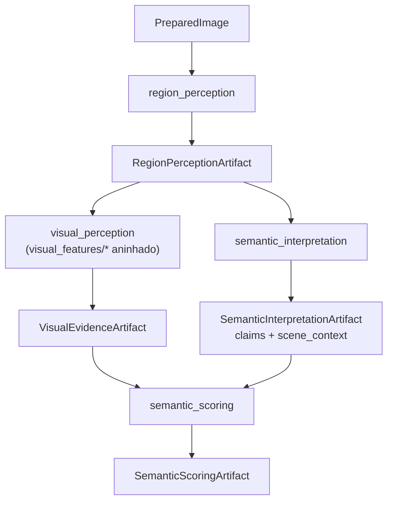

# Decomposição do DAG de percepção: decisão arquitetural

> Status: **decisão fechada; decomposição materializada nesta branch.**
>
> Este documento registra o motivo, as fronteiras e a migração da percepção. Os perfis
> históricos 1.0.5 e 1.0.6 continuam imutáveis; a topologia nova pertence ao cenário 1.0.7.
>
> A decisão **substitui** a convenção implícita "pacote na raiz gera artifact", que o próprio
> repositório já contradiz (`shared` e `model_runtime` são pacotes de topo e não produzem
> artifact nenhum).

## Por que esta decisão existe

A decomposição de `visual_perception` (PR #695) separou quatro capabilities por ownership de
código e promoveu duas delas — `region_perception` e `semantic_scoring` — a stages do catálogo.
Ao revisar o resultado, apareceu uma pergunta que a decomposição não respondeu:

> `visual_features` e `semantic_interpretation` são submódulos de `visual_perception`. Isso
> impede comparar três backends de feature sem reexecutar o SAM2 e o VLM?

A resposta curta é que impede, mas que a causa não é o aninhamento. Medindo o digest de stage
com o documento canônico, trocando `visual_features.region` de `clip` para `alphaclip`:

```text
region_perception    digest igual     -> reusável
visual_perception    digest diferente -> reexecuta
ingestion            digest igual     -> reusável
```

O `config_digest` de um stage cobre **todos** os seus componentes
(`contextmap.runtime.pipeline._stage_digest`), então trocar o extrator de features reexecuta o
stage inteiro: descoberta, features densas e o VLM.

Mas o grafo interno do preset canônico mostra que esse reuso perdido é estrutural, não
acidental:

```text
image_preparation          <- {}
region_discovery           <- image
dense_feature_extraction   <- image
region_feature_extraction  <- image, regions
scene_interpretation       <- image
region_interpretation      <- image, regions
```

**A interpretação semântica nunca consome feature.** Ela e as features são ramos irmãos, ambos
filhos de `image` + `regions`. O `PerceptionRunArtifact` funde dois ramos independentes do seu
próprio DAG interno — e isso é um problema de §4 (não colapsar níveis semânticos
prematuramente), não de granularidade de cache.

A confirmação vem do lado dos consumidores. Hoje três stages consomem o
`PerceptionRunArtifact`, e cada um precisa de uma fatia diferente:

| consumidor | precisa de | não precisa de |
|---|---|---|
| `sensor_association` | regiões/máscaras + `PreparedImage` | claims, embeddings |
| `semantic_scoring` | claims + embeddings | geometria de máscara |
| `semantic_fusion` | claims + scores | embeddings |

Nenhum consumidor precisa dos três juntos. Cada um precisa de um par distinto, e a chave que
liga os pares é sempre `region_id` + `source_observation_id`, que claims e features já carregam.
**O join é derivável; ele não é evidência.**

## O critério

Seis conceitos que o repositório vinha tratando como um só. Separá-los é o que torna as decisões
abaixo dizíveis sem contradição:

```text
Capability   ownership de conceitos e API pública.
             É o que justifica um pacote na raiz de src/contextmap/.

Stage        unidade de execução cuja saída precisa ser selecionável no DAG.
             É uma decisão de catálogo, não de layout de diretório.

Artifact     identidade imutável e endereçável da saída de uma execução de stage.

Evidence     dado observacional com provenance, que pode estar dentro de um artifact
             sem ser ele próprio um artifact.

View         composição derivada de artifacts/evidence. Não cria verdade nova
             e não tem produtor.

Cache        otimização abaixo do contrato do DAG. Nunca é dependência downstream.
```

### Quando promover algo a stage

Uma capability vira stage quando **as quatro** condições valem:

1. um consumidor precisa **selecionar** aquela saída explicitamente como upstream (§8);
2. a saída precisa ser **variada ou pinada independentemente** de outra que varia;
3. reexecutar **não é equivalente** a reutilizar — o produtor é não-determinístico, caro ou
   externamente dependente;
4. existe consumidor **hoje** (§14).

Um pacote de topo que falha essas condições é uma capability sem stage. Isso é um estado válido
e deve ser **declarado**, não escondido.

### Artifact ou cache

O critério **não** é determinismo. Determinismo é propriedade empírica do ambiente — hardware,
precisão, kernel, versão de biblioteca — e não serve de base para uma decisão de contrato.

```text
Artifact   quando a identidade daquela execução precisa ser selecionada,
           citada ou pinada por um consumidor.

Cache      quando queremos apenas evitar recomputação, sem tornar aquele
           resultado parte do contrato do DAG.
```

Determinismo reaparece em outro lugar: como **pré-condição de cache**. Um cache só é sadio se
recomputar fosse equivalente. Para o VLM não é — a campanha 1.0.4 mediu 29 de 90 claims
canônicas concordando entre duas execuções idênticas, enquanto a descoberta de região foi
perfeitamente reprodutível (0/20 divergências de frame). Logo o VLM nunca poderia ser cacheado,
mesmo que ninguém precisasse citá-lo. São dois testes independentes, não um.

### Mais stages não é ablação mais barata

Um stage custa entrada de catálogo, executor, identidade de configuração, chave de reuso,
diretório, lineage, preflight, documentação e testes — e acrescenta um round-trip de
serialização que pode mudar comportamento. Três stages não reduzem compute. **Pinar a parte que
não mudou** reduz.

## Estado materializado

```text
region_perception        stage; descoberta, grounding e refinamento; regiões finais e máscaras
visual_perception        stage; somente evidência visual (features densas e por região)
semantic_interpretation  stage; claims, scene_context, requests, respostas e views exatas
semantic_scoring         stage; consome artifacts regionais, visuais e semânticos selecionados
```

Cada stage tem identidade, seleção de observações, configuração, provenance e artifact próprios.
O `PerceptionResult` é construído somente na leitura, a partir dos produtores escolhidos.
`SensorAssociation` consome regiões e pode usar features densas, sem depender de claims.
`SemanticFusion` recebe associações e interpretações selecionadas; inferências repetidas da
mesma observação continuam distinguíveis de observações físicas novas.

## O DAG decidido



### Decisões por componente

| Componente | Decisão | Condições satisfeitas |
|---|---|---|
| `region_perception` | **Stage de topo**, produz `RegionPerceptionArtifact`, com executor próprio | 1,2,3,4 |
| `visual_features` | **Submódulo** de `visual_perception`; embeddings seguem evidence com provenance, sem artifact próprio | falha 3 e 4 como stage |
| `visual_perception` | **Continua stage**, estreitado para produzir somente a evidência visual; deixa de produzir o resultado fundido | 1,2,4 |
| artifact de `visual_perception` | **Renomeado** para `VisualEvidenceArtifact` | — |
| `semantic_interpretation` | **Stage de topo**, produz claims e `scene_context` | 1,2,3,4 |
| `semantic_scoring` | **Stage de topo**, consome explicitamente claims + evidência visual | já é stage |
| `PerceptionResult` | **View derivada**, sem produtor; deixa de ser contrato persistido | — |

### Por que o artifact é renomeado

`visual_perception` continua stage e `visual_features` continua submódulo — mas o artifact deixa
de significar "um run de percepção completo" e passa a significar "a evidência visual extraída
das regiões". Manter o nome economizaria churn de uma vez e cobraria para sempre: `lineage`,
manifests, relatórios e documentação passariam a dizer `PerceptionRunArtifact` significando outra
coisa. Renomear o artifact **não implica** criar um stage novo.

### Por que `visual_features` não vira stage

Os embeddings já são evidence com provenance completa: `FeaturePayloadEntry` persiste
`feature_id`, `source_observation_id`, `scope`, `embedding_space_id`, `shape`, `dtype`,
`normalization`, `payload_reference`, `content_hash` SHA-256, `size_bytes` e `provenance`,
carregada preguiçosamente e nunca inline no contrato — exatamente o que §8 descreve para payload
grande.

O que eles precisam, depois que as claims saem, é estar **contidos na saída selecionável de algum
stage** — e é o que o `VisualEvidenceArtifact` faz. Promover `visual_features` à raiz produziria
o mesmo DAG com um nome a mais (§14).

### Ablação correta por construção

Trocando `CLIP → AlphaCLIP`:

```text
RegionPerceptionArtifact        reutilizado   (SAM2 não roda de novo)
SemanticInterpretationArtifact  reutilizado   (o VLM não roda de novo)
VisualEvidenceArtifact          novo
SemanticScoringArtifact         novo          (um input mudou)
```

Trocando `Qwen A → Qwen B`, o simétrico:

```text
RegionPerceptionArtifact        reutilizado
VisualEvidenceArtifact          reutilizado
SemanticInterpretationArtifact  novo
SemanticScoringArtifact         novo
```

Cada braço experimental invalida exatamente o que depende dele. E não é só economia: dado o
resultado de 29/90, uma ablação de features que reexecutasse o VLM ficaria **confundida** pela
não-determinância dele. Pinar é condição de validade, não otimização.

### Nenhum artifact copia evidência do vizinho

O precedente é de `point_representation`: o manifest referencia o mapa por
`geometric_map_id` e nenhum arquivo do mapa entra no run (verificado em
`tests/end_to_end/test_point_representation_stage.py`). A mesma regra:

```text
VisualEvidenceArtifact
    region_artifact_id
    features[...]

SemanticInterpretationArtifact
    region_artifact_id
    claims[...]
    scene_context

SemanticScoringArtifact
    semantic_interpretation_artifact_id
    visual_evidence_artifact_id
    scores[...]
```

A identidade fica no lineage; o join continua baseado nos identificadores de domínio
(`region_id`, `source_observation_id`). Um `SemanticScoringArtifact` que recopiasse claims e
embeddings criaria a mesma evidência em dois artifacts com dois hashes.

### `PerceptionResult` passa a ser view

Deixa de ser "resultado persistido produzido por `visual_perception`" e passa a ser uma projeção
derivada:

```text
PerceptionResult =
    RegionPerceptionArtifact
    JOIN VisualEvidenceArtifact
    JOIN SemanticInterpretationArtifact
    [JOIN SemanticScoringArtifact]
```

Isso é o que permite `sensor_association`, `semantic_mapping` e ferramentas de inspeção
continuarem trabalhando com uma estrutura conveniente **sem obrigar o pipeline de escrita a
colapsar tudo nela**.

## `scene_context` fica em `semantic_interpretation`

Quatro fatos do código sustentam a decisão:

1. **Mesmo produtor, mesma proveniência.** `SceneContext` carrega `SemanticInferenceProvenance`
   — backend, task, prompt, schema e rastreio da resposta bruta —, o mesmo tipo das claims de
   região. No preset, `scene_interpretation` e `region_interpretation` compartilham
   `backend_id="semantic_interpreter/canonical"`: é um interpretador, duas requisições.
2. **Ele já *é* claims.** `SceneContext.claims` existe e `__post_init__` exige `region_id=None`
   em todas. "Claims + scene_context" não são duas categorias: são hipóteses de um VLM sobre uma
   observação, umas ancoradas em região e outras na cena.
3. **A interpretação de região é condicionada nele** (#529):
   `SemanticInterpretationRequest.scene_context_reference`, com o `SceneContext` carregado junto
   para a requisição ser auditável. Produtor e consumidor vivem dentro de uma capability e de uma
   sequência de chamadas; separá-los colocaria um input de condicionamento atravessando fronteira
   de artifact sem consumidor que peça isso.
4. **Nenhum consumidor o seleciona sozinho hoje.** Fora de `visual_perception`, quem o toca é
   `evaluation` (estratificação e qualidade de campo), sempre junto da execução que o produziu.

### A assimetria, declarada

```text
scene_interpretation    <- {image}
region_interpretation   <- {image, regions}
```

O contexto de cena **não depende de regiões**. Um `SemanticInterpretationArtifact` cujo upstream
é o `RegionPerceptionArtifact` faz o scene context herdar uma dependência que ele não tem: trocar
o backend de descoberta invalida um contexto de cena que nunca viu uma região.

É a mesma fusão indevida em escala menor, e menor de forma mensurável: uma chamada de cena por
frame contra uma chamada por região. O desperdício é aceito e registrado aqui em vez de
descoberto depois.

**Condição que promove `scene_interpretation` a fronteira própria:** alguém precisar variar a
descoberta mantendo o contexto de cena fixo, ou a interpretação de cena deixar de ser o mesmo
modelo. Qualquer uma das duas faz passar as condições (1) e (2) do critério.

## Identidades e ordem da migração

A cadeia de identidades foi resolvida pelo produtor. `RegionId` pertence ao run regional;
`VisualFeature` cita sua observação e a região quando aplicável; `SemanticClaim` cita seu
`semantic_interpretation_run_id`, a observação e a região quando aplicável. Nenhum desses
contratos persiste `perception_result_id`. A associação cita o artifact regional e o seu
próprio run; a fusão registra separadamente as seleções de associação, região, interpretação,
evidência visual e scoring. A chave de encontro é `(region_artifact_id,
source_observation_id, region_id)`; o run semântico discrimina inferências repetidas.

A migração seguiu as dependências do DAG:

1. restaurar os contratos de região e preservar os 173 goldens históricos de normalização;
2. publicar o artifact regional completo, inclusive máscaras e auditoria;
3. congelar o cenário 1.0.7 em novos snapshots, sem alterar 1.0.5/1.0.6;
4. retirar `perception_result_id` dos contratos persistidos e explicitar a linhagem dos
   produtores nos consumidores;
5. separar `VisualEvidenceArtifact` e `SemanticInterpretationArtifact`, com
   `PerceptionResult` como view derivada e seleção explícita dos upstreams.

Os snapshots anteriores são evidência histórica, não formatos aceitos automaticamente pelos
readers novos. A preservação dos goldens regionais verifica a regra de normalização; os novos
testes de artifact verificam os contratos independentes e a cadeia sintética atravessa os
readers públicos até o `ContextMapArtifact`.

## Documentos relacionados

- [architecture.md](architecture.md) — boundaries, ownership e o critério na forma resumida
- [ARTIFACTS.md](ARTIFACTS.md) — persistência, immutability e lineage
- [runtime-composition.md](runtime-composition.md) — catálogo de stages, composition root e reuso
- [`region_perception`](../src/contextmap/region_perception/docs/README.md) — a capability, seu
  executor e o layout do artifact
- [`semantic_interpretation`](../src/contextmap/semantic_interpretation/docs/README.md)
  — a capability que esta decisão promove
- [`visual_features`](../src/contextmap/visual_perception/visual_features/docs/README.md) — a que
  permanece submódulo
