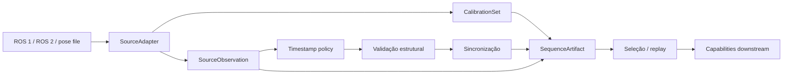

# Ingestion

`contextmap.ingestion` é a capability que transforma fontes gravadas de sensores em evidência
canônica, auditável e independente do backend de aquisição.

A fronteira principal é:

```text
fonte gravada
    -> SourceAdapter
    -> SourceObservation
    -> normalização / validação
    -> sincronização
    -> SequenceArtifact
```

Depois que um `SequenceArtifact` foi publicado, etapas downstream devem conseguir consumir a
sequência sem reabrir o ROS bag, reinstanciar o SDK da fonte ou conhecer estruturas específicas do
dataset.

## Responsabilidade

Ingestion possui:

- contratos canônicos de imagem, LiDAR, IMU e pose externa;
- identidade e provenance de observações;
- normalização e diagnóstico de timestamps;
- calibração canônica, frames estáticos e refinamentos versionados;
- validação estrutural da evidência ingerida;
- sincronização temporal determinística;
- adapters de fontes gravadas;
- persistência, integridade, seleção e replay de `SequenceArtifact`.

Ingestion não possui:

- `PoseEstimate` ou trajetória canônica, que pertencem a `state_estimation`;
- projeção 2D/3D, que pertence a `sensor_association`;
- construção do mapa geométrico;
- percepção visual ou interpretação semântica;
- entidades persistentes, fusão semântica ou relações espaciais.

## Fontes e modalidades atuais

| Fonte / modalidade | Estado | Contrato produzido |
| --- | --- | --- |
| ROS 1 bag | suportado | `SourceObservation` + calibração quando disponível |
| ROS 2 bag | suportado | `SourceObservation` + calibração quando disponível |
| arquivo externo de pose | suportado | `ExternalPoseMeasurement` |
| imagem ROS | suportado | `ImageObservation` |
| PointCloud2 | suportado | `LidarObservation` |
| IMU | suportado | `ImuObservation` |
| Odometry | suportado | `ExternalPoseMeasurement` |
| CameraInfo | suportado | `CalibrationSet` |
| TF / tf_static automático | não implementado no escopo atual | extrínsecos devem ser fornecidos por calibração canônica |

O fato de uma modalidade ser suportada não a torna obrigatória para toda ingestão. A necessidade de
RGB, LiDAR, IMU, pose ou calibração é determinada pela configuração e pelo consumidor da sequência.

## Fluxo principal



A sincronização não substitui as observações originais. O artifact preserva as evidências canônicas
e registra separadamente decisões, offsets e eventos descartados.

## Obrigatório e opcional

No boundary genérico de ingestion, as modalidades são opcionais. Uma execução pode promovê-las a
obrigatórias por meio de `required_topics`.

| Dado / comportamento | Regra |
| --- | --- |
| `source_type` e `source_path` | obrigatórios para uma fonte gravada |
| mapeamento de tópicos | somente os tópicos usados precisam ser configurados |
| `required_topics` | opcional; quando definido, ausência falha antes da leitura |
| `timestamp_clock_id` | opcional; existe identidade determinística quando omitido |
| correção de timestamp | opcional; o default não altera o timestamp |
| `SourceWindow` | opcional; limita adapters que suportam windowing |
| calibração | opcional no contrato de ingestion; pode ser necessária downstream |
| `calibration_id` da observação | opcional enquanto não houver calibração aplicável |
| provenance do artifact | opcional no writer de baixo nível, usado pelo fluxo normal do runtime |
| diagnostics do artifact | opcionais no writer de baixo nível |
| refinamento de calibração | opcional e sempre explícito |

## Organização do código

```text
src/contextmap/ingestion/
├── __init__.py
├── canonical_observations.py
├── recorded_source_adapter.py
├── source_timestamp_normalization.py
├── source_observation_validation.py
├── observation_synchronization.py
├── sequence_observation_selection.py
├── sequence_observation_diagnostics.py
├── sequence_provenance.py
├── calibration/
├── sequence_artifact/
├── adapters/
│   ├── pose_file_source_adapter.py
│   └── ros/
└── docs/
```

A raiz da capability contém os contratos e regras centrais. `calibration/` e
`sequence_artifact/` são subdomínios que ingestion possui. `adapters/` é a borda tecnológica.

Para entender exatamente a responsabilidade de cada arquivo, consulte [code-map.md](code-map.md).

## API pública

Consumidores de outras capabilities devem preferir:

```python
from contextmap.ingestion import ImageObservation, CalibrationSet, SequenceArtifactReader
```

e evitar importar detalhes internos quando o símbolo já está exposto na fachada pública.

Adapters concretos são escolhidos no composition root do runtime e podem ser importados diretamente
por essa camada quando a implementação concreta precisa ser selecionada.

## Como ler esta documentação

Para conhecer a capability pela primeira vez:

1. este `README.md`, para objetivo, entradas, saídas e limites;
2. [architecture.md](architecture.md), para ownership e direção das dependências;
3. [code-map.md](code-map.md), para descobrir qual arquivo possui cada responsabilidade;
4. [data-flow.md](data-flow.md), para seguir os dados da fonte ao artifact;
5. o documento especializado relacionado ao problema em análise.

Documentos de onboarding:

- [architecture.md](architecture.md)
- [code-map.md](code-map.md)
- [data-flow.md](data-flow.md)
- [configuration.md](configuration.md)
- [sequence-artifact.md](sequence-artifact.md)
- [testing.md](testing.md)

Referências detalhadas preservadas:

- [contracts.md](contracts.md)
- [adapters.md](adapters.md)
- [backends.md](backends.md)
- [calibration.md](calibration.md)
- [synchronization.md](synchronization.md)
- [timestamps.md](timestamps.md)
- [validation.md](validation.md)
- [selection.md](selection.md)
- [provenance.md](provenance.md)
- [diagnostics.md](diagnostics.md)
- [artifact.md](artifact.md)

Os documentos de referência descrevem detalhes de contrato e formato. Os documentos de onboarding
explicam como navegar e raciocinar sobre a implementação.

