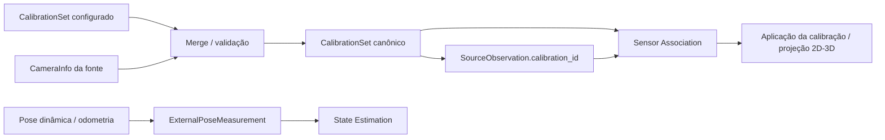

# Calibração e frames de coordenadas

Este documento descreve `src/contextmap/ingestion/calibration/`: o contrato canônico de calibração e as convenções de frame de coordenadas do ContextMap2.

**Ownership**: Ingestion normaliza e possui a calibração canônica (intrínsecos de câmera, extrínsecos estáticos, identidade de frame). Ingestion **não realiza** projeção 2D↔3D — isso pertence a Sensor Association, que consome este contrato sem conhecimento do formato de origem.


## Ownership e fluxo



A separação é intencional: Ingestion preserva intrínsecos, extrínsecos estáticos e frames; Sensor Association aplica esses dados geometricamente. Movimento no tempo não é transform estático de calibração.


## Pinhole, fisheye e MEI sem conversão com perda

`CameraModel = PinholeCameraModel | FisheyeCameraModel | MeiCameraModel` — três tipos distintos, não um único record genérico. `PinholeCameraModel` usa o modelo de distorção radial/tangencial do OpenCV (`none`, `plumb_bob`, `rational_polynomial`); `FisheyeCameraModel` usa o modelo equidistante (Kannala-Brandt) com exatamente 4 coeficientes. Forçar fisheye em uma representação pinhole perderia informação — `MeiCameraModel` descreve o modelo omnidirecional unificado (Geyer-Daniilidis / Mei) na parametrização do CamOdoCal, usada por calibrações com `model_type: MEI`: `xi` (parâmetro do espelho, finito e não negativo), `fx`/`fy` (`gamma1`/`gamma2`), `cx`/`cy` (`u0`/`v0`) e exatamente 4 coeficientes `(k1, k2, p1, p2)`, dois radiais e dois tangenciais aplicados no plano normalizado. Por isso nunca há conversão implícita entre os três; um consumidor precisa tratar cada um explicitamente (`camera_model_kind()` retorna `"pinhole"`, `"fisheye"` ou `"mei"`).

## Convenção de transform: `T_parent_child`

`RigidTransform` segue a notação `T_parent_child`: o transform leva coordenadas expressas em `child_frame` para `parent_frame` — `p_parent = rotate(rotation, p_child) + translation`. `rotation` é sempre um quaternion unitário na ordem `(x, y, z, w)`. Esta convenção é a mesma usada por `ExternalPoseMeasurement` (issue #38: `parent_frame` → `frame_id`) e por `docs/shared-primitives.md`.

## Transforms estáticos vs. dinâmicos

`CalibrationSet.static_transforms` contém **apenas** transforms que não mudam durante a sequência — tipicamente extrínsecos físicos entre sensores rigidamente montados no mesmo corpo (ex.: câmera → base_link). Um frame cuja pose muda ao longo do tempo (ex.: robô no mundo) **não é calibração** — é reportado por timestamp como `ExternalPoseMeasurement` no stream temporal de observações (issue #38). Esta é uma decisão explícita desta issue: calibração é responsável por relações fixas, não por trajetória.

Adapters que não decodificam TF recebem esses extrínsecos como `SourceAdapterConfig.calibration`. A calibração fornecida é mesclada com intrínsecos descobertos na fonte; conflitos por sensor falham explicitamente. Cada observação cujo `sensor_id` tem uma entrada correspondente carrega o respectivo `calibration_id`, preservando a ligação sem estado implícito.

## `CalibrationEntry` e `SourceObservation.calibration_id`

Cada `CalibrationEntry` tem um `calibration_id` (`CalibrationReferenceId`, já definido pela issue #38) que uma `SourceObservation.calibration_id` referencia. Uma entrada pode não ter `camera_model` (ex.: um LiDAR tem identidade de frame e provenance de calibração, mas nenhum modelo de câmera).

## Auditabilidade

`CalibrationProvenance` registra `original_values` (valores brutos da fonte antes de qualquer normalização) e `conversions_applied` (notas legíveis de qualquer normalização real, ex.: `"reordered quaternion from wxyz to xyzw"`) — nenhuma conversão silenciosa. `CalibrationEntry.content_hash` (calculado por `compute_content_hash()`, cobrindo apenas os valores canônicos — não provenance) permite detectar mudança de calibração entre execuções.

## Validação

`validate_calibration_set()` retorna uma lista de problemas (lista vazia = válido); `ensure_valid_calibration_set()` levanta `CalibrationError` se houver algum. Verificações: `width`/`height`/`fx`/`fy` positivos, `fx`/`fy`/`cx`/`cy` e coeficientes de distorção **finitos** em todo modelo, contagem de coeficientes de distorção compatível com o modelo declarado (e `xi` finito e não negativo em MEI), quaternion de cada transform com norma ≈ 1, ausência de transforms duplicados ou com `parent_frame == child_frame`. `SequenceArtifactWriter.set_calibration()` chama `ensure_valid_calibration_set()` automaticamente — não é possível persistir uma calibração inválida.

## Persistência no artefato de sequência

Quando `writer.set_calibration(calibration_set)` é chamado antes de `finalize()`, o artefato passa a incluir `calibration/calibration.json` (formato JSON legível, coberto pelo `file_inventory`/hash do manifest como qualquer outro arquivo — ver [`artifact.md`](artifact.md)). `SequenceArtifactReader.read_calibration()` retorna `None` quando o artefato foi finalizado sem calibração (compatibilidade com sequências da issue #39, anteriores a esta issue).

## Refinamento câmera↔corpo (`CalibrationRefinement`)

Uma extrínseca de câmera do dataset pode estar desalinhada (no corridor-02, `T_epson_d` erra ~4° de yaw e ~2° de pitch, ~24 px; ver `experiments/semantic-geometry-investigation-20260930/REPORT.md`, seção 6). A correção é **dado versionado, aplicado uma vez na ingestão**, nunca um offset no projetor nem uma opção de configuração da associação: o `FrameProjector` exige que mapa, trajetória e associação usem a mesma identidade de calibração, e uma calibração corrigida é outra calibração.

`CalibrationRefinement` declara:

- **alvo**: `parent_frame`/`child_frame` do transform estático corrigido, cujo filho precisa ser o frame óptico de uma entrada com `camera_model`;
- **base**: `base_transform_digest`, o `rigid_transform_digest()` do transform sobre o qual a correção foi estimada (sha256 do registro do transform em `calibration.json`, chaves ordenadas, sem espaços);
- **correção**: `yaw_deg`, `pitch_deg`, `roll_deg` e `convention`, que precisa ser exatamente `CAMERA_OPTICAL_ROTATION_CONVENTION`:
  `p_camera = Rz(roll) @ Rx(pitch) @ Ry(yaw) @ p_camera_base; optical axes x right, y down, z forward`.
  É a convenção do estimador fotométrico da investigação (`p4_calibration_photometric.rotation_correction`) e do manifest do V1 (`camera-lidar-calibration-refinement/1`, `camera_rotation_correction`). Yaw positivo leva a imagem de um ponto para a direita (`+u`); pitch positivo, para cima (`−v`);
- **como foi estimada**: `method`, `estimator` + `code_identity`, `pose_source_kind` + `pose_source_digest`, `source_files` (nome → sha256 dos arquivos de calibração de origem);
- **evidência**: `validation` (`RefinementValidation`: `fit_ids`, `held_out_ids`, `metrics` nomeadas).

### Composição

Com `T_parent_camera` (`p_parent = R·p_camera + t`) e a correção `p_camera = Rcorr·p_camera_base`, a extrínseca refinada é `R' = R·Rcorrᵀ` e `t' = t`: o centro óptico não se move, só os eixos giram. Isso é o mesmo que o V1 faz em `load_calibration` (`T_camera_lidar' = C·T_camera_lidar`) e o mesmo que o p4 mede (`cams @ rot.T`); os três são conferidos em `tests/ingestion/test_calibration_refinement.py`, inclusive o ponto conhecido do teste D da investigação ((120,5; 76,3) → (142,1; 88,6) px com a correção do V1).

`apply_calibration_refinement(base, refinement)` é pura e devolve um novo `CalibrationSet` com o transform corrigido e o refinamento acrescentado a `refinements`. Ela recusa (`CalibrationError`):

- convenção desconhecida, ângulo não finito ou acima de `MAX_ROTATION_CORRECTION_DEG` (10°, o limite do V1);
- `refinement_id` já presente no conjunto;
- transform-alvo inexistente ou filho que não é câmera calibrada;
- digest do transform-alvo diferente de `base_transform_digest` — o que também impede aplicar a mesma correção duas vezes, já que o transform refinado tem outro digest.

`validate_calibration_set()` também confere os refinamentos: ids únicos, convenção, limite de ângulo e transform-alvo existente com câmera no frame filho.

### Identidade

`state_estimation.preflight.calibration_identity` e a identidade de calibração do `IngestionService` passam a cobrir, **só quando há refinamento**, o `identity_record()` de cada um: id, alvo, digest de base e correção (com a convenção). Método, estimador, fonte de pose, arquivos de origem e validação ficam fora de qualquer hash, como `CalibrationProvenance` fica fora de `content_hash`. Consequências:

- uma calibração sem refinamento mantém exatamente a identidade anterior (as identidades do E0 estão fixadas no teste);
- uma extrínseca refinada tem identidade diferente de uma editada à mão com os mesmos números;
- reestimar com outra evidência mas a mesma correção não muda a identidade.

Como a identidade da calibração é global, ingerir com refinamento cria nova linhagem: trajetória e mapa precisam ser reconstruídos a partir da nova sequência (bytes de geometria iguais, identidade nova).

### Serialização

Em `calibration.json`, a chave `refinements` (lista, na ordem de aplicação) só aparece quando o conjunto tem refinamento; um registro sem ela — toda calibração escrita antes desta mudança — decodifica com `refinements == ()`. O documento avulso que declara um refinamento tem `schema: "calibration-refinement/1"` e o mesmo registro:

```json
{
  "schema": "calibration-refinement/1",
  "refinement_id": "corridor-02-camera-body-refinement-v1",
  "target": {"parent_frame": "epson", "child_frame": "d", "base_transform_digest": "sha256:…"},
  "rotation_correction": {"yaw_deg": 4.0, "pitch_deg": -1.75, "roll_deg": 0.0, "convention": "p_camera = …"},
  "method": "…",
  "estimator": {"module": "…", "code_identity": "…"},
  "pose_source": {"kind": "ground_truth_tum", "digest": "sha256:…"},
  "source_files": {"corridor-02-extrinsics.yaml": "sha256:…"},
  "validation": {"fit_ids": ["…"], "held_out_ids": ["…"], "metrics": {"held_out_relative_improvement": 0.31}}
}
```

`load_calibration_refinement(path)` lê o documento e recusa schema diferente, campo ausente, campo desconhecido (um erro de digitação não é ignorado em silêncio) e correção malformada. O documento e o estimador reprodutível do corridor-02 estão em `experiments/correction-benchmark-10_31-20260930/calibration/`.

A versão de schema do `CalibrationSet` continua `0.1.0` nesta mudança: a chave nova é opcional e omitida quando vazia. O bump previsto para `0.2.0` depende do registro da transição no `CHANGELOG.md` e muda a identidade de toda calibração nova sem refinamento, porque `calibration_identity` cobre `schema_version`; ver a decisão registrada no bundle do experimento.

## Exemplo: mapeamento de uma câmera fisheye ROS

```text
sensor_msgs/CameraInfo (modelo "equidistant", D=[k1,k2,k3,k4])
    → FisheyeCameraModel(width=.., height=.., fx=K[0], fy=K[4], cx=K[2], cy=K[5],
                          distortion_coefficients=(k1, k2, k3, k4))

tf_static: base_link -> camera_optical_frame (translation, quaternion xyzw)
    → RigidTransform(parent_frame="base_link", child_frame="camera_optical_frame",
                      translation=(...), rotation=(...))
```
