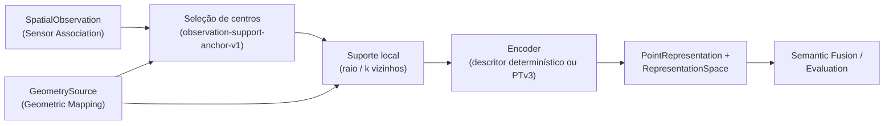

# Point Representation

## Responsabilidade

Produzir uma **descrição numérica da estrutura 3D local** em torno de cada elemento de geometria persistente: qual geometria formou o suporte de cada vetor, em qual espaço de representação ele vive e qual encoder o produziu. A capability é **opcional**: deve justificar seu custo por avaliação controlada (ver `evaluation`) e o pipeline funciona sem ela.



Uma representação é **evidência 3D**: descreve *como a estrutura local se parece*, não *o que ela é*. Fica separada de:

| Canal | Dono | Diz |
| --- | --- | --- |
| `GeometryReference` | Geometric Mapping | **onde** está o suporte |
| `PointRepresentation` | Point Representation | como a estrutura 3D local é representada |
| `VisualFeature` | Visual Perception | como a evidência RGB associada se parece |
| `SemanticClaim` | Visual Perception | o que um backend de percepção hipotetiza |

Nada é concatenado em um vetor único e opaco, e features visuais densas nunca são copiadas para cá só porque estão espacialmente associadas.

## O que este módulo explicitamente não possui

- labels, `SemanticClaim`, embeddings visuais ou qualquer campo semântico;
- fusão entre observações: Semantic Fusion;
- identidade e resolução de entidades;
- geometria e índice espacial: Geometric Mapping (a capability apenas lê pela porta `GeometrySource`);
- projeção 2D↔3D: Sensor Association;
- uma dependência obrigatória de PyTorch, CUDA ou de qualquer biblioteca de modelo no contrato central.

## Estado implementado

Existem os **contratos** (`PointRepresentation`, `RepresentationSpace`, política e suporte espacial, coordenadas preparadas), sua serialização, a **extração de suporte** local sobre `GeometrySource` (`SupportExtractor`) e a porta `PointEncoder` com o serviço de execução independente de backend; o **descritor geométrico determinístico** (`backends/geometric_descriptor.py`, o encoder de controle) implementa a porta sem nenhuma dependência de modelo. A **fronteira do backend opcional PTv3** (`backends/ptv3/adapter.py`) existe e é verificada com um runtime falso; o **runtime real sobre Pointcept** (`backends/ptv3/pointcept_runtime.py`) está implementado, coberto por testes determinísticos e por uma suíte opt-in em GPU, e teve tempo (30 ms por suporte) e memória (pico de 193 MiB de tensores) **medidos em geometria real** (ver [`ptv3.md`](ptv3.md)). O **`PointRepresentationRunArtifact`** persiste os runs de forma imutável, com payload lazy e integridade (ver [`artifact.md`](artifact.md)). A **seleção de centros** que o runtime aplica é a política versionada `observation-support-anchor-v1`, uma âncora por observação espacial (ver [`center-selection.md`](center-selection.md)). O **harness de avaliação** vive em `contextmap.evaluation` (ver [`point_representation.md`](../../evaluation/docs/point_representation.md) na documentação de `evaluation`); a ablação real contra `off` e o descritor está registrada, e o efeito downstream continua pendente.

**Estágio opcional e derivado no runtime.** Com `pipeline.stages.point_representation = true`, um encoder e a política de centros selecionados, o runtime compõe o `PointRepresentationExecutor`: ele lê o mapa geométrico e o run de associação do DAG, escolhe os centros pela política, roda o `RepresentationService` e publica o `PointRepresentationRunArtifact` do run, que referencia o mapa e nunca o copia. `contextmap run` e `contextmap context run` executam o estágio; a `ContextRun` grava o run de representação como membro. O estágio fica desligado no perfil canônico (`canonical/1`), e ligá-lo não muda nenhum outro artifact do run. Como habilitar, e o que o provider do PTv3 precisa devolver, está em [`ptv3.md`](ptv3.md#pelo-runtime).

**Nenhum estágio a jusante consome o run.** A fusão semântica não tem entrada `representation` e a Entity Resolution não tem essa entrada, então o run é saída derivada: não entra na fusão, nas entidades nem no `ContextMap`, e o `context build` só materializa a evidência que a fusão consome. Por isso a comparação "desligado × determinístico × PTv3" até o mapa final continua fora desta campanha: levar a evidência até o mapa exige um contrato novo de consumo na fusão e na Entity Resolution, uma pergunta de pesquisa própria (AGENTS §22). A comparação "Entity Resolution só com geometria × com evidência 3D", que leria esses vetores pelo canal `entity_resolution.representation`, fica fora pelo mesmo motivo. A matriz de capacidades inventaria o estágio e o canal como `out_of_scope`, e a expansão de fases recusa os braços que variam o estágio ou selecionam o canal (ver [`experiment-phases.md`](../../evaluation/docs/experiment-phases.md)): no piloto de ablação o estágio é um controle fixo em todos os braços, não uma variável.

## Contratos públicos

- `PointRepresentation`, `PointRepresentationId`, `PointRepresentationRunId`, `representation_id_for()` — a representação ancorada a uma geometria, com suporte, espaço, forma, dtype, normalização, referência ao payload e proveniência.
- `PointSupport`, `SupportPolicy`, `SupportType`, `NeighborhoodMethod`, `SupportStatistics` — quais elementos de geometria formaram o insumo do vetor e sob qual política.
- `CoordinatePreparation`, `CenteringMode`, `ScaleNormalization`, `PreparedSupport` — a preparação determinística das coordenadas antes do encoder, sempre registrada.
- `RepresentationSpace`, `representation_space_fingerprint()`, `ensure_compatible_representation_spaces()`, `ensure_compatible_representations()`, `RepresentationSpaceMismatchError` — identidade do espaço vetorial e a regra de comparabilidade.
- `EncoderIdentity`, `RepresentationProvenance` — qual implementação e qual código produziram a representação.
- `PointEncoder`, `EncodedVector`, `UnencodableSupportError` — a porta de encoders: um `PreparedSupport` entra, um vetor sai, e uma falha nunca vira vetor padrão.
- `RepresentationService`, `EncodedRepresentation`, `RepresentationMetrics`, `FailedSupport`, `FailureReason` — a execução independente de backend e seus resultados explícitos; ver [`execution.md`](execution.md).
- `PointRepresentationRunWriter`, `PointRepresentationRunReader`, `PointRepresentationRunManifest`, `PointRepresentationDebugLevel`, `RunArtifactError`, `IncompleteRunArtifactError` — o artifact persistido: escrita atômica, leitura lazy de representações e vetores, inventário com hash; ver [`artifact.md`](artifact.md).
- `center_selection_id()`, `encode_support_policy()` — a identidade independente da ordem de um conjunto de centros e a codificação da política de suporte, usadas pelo manifest e pela avaliação.
- `ObservationSupportAnchorPolicy`, `OBSERVATION_SUPPORT_ANCHOR_POLICY_ID` — a política versionada que escolhe os centros de um run a partir das observações de um run de associação: uma âncora por observação, o membro do suporte mais próximo do centróide; ver [`center-selection.md`](center-selection.md).
- `SupportExtractor` — seleciona o suporte (raio ou k vizinhos) de um elemento pela porta `GeometrySource` e prepara suas coordenadas; ver [`support-extraction.md`](support-extraction.md).

Ver [`contracts.md`](contracts.md) para a referência de campos, as convenções e as invariantes.

## Estrutura do código

```text
point_representation/
├── __init__.py            # fachada pública: 38 nomes, nenhum backend
├── models.py              # contratos canônicos
├── ports.py               # a porta PointEncoder
├── comparability.py       # identidade do espaço e a regra de comparabilidade
├── center_selection.py    # política versionada de quais geometrias um run representa
├── support.py             # extração do suporte local e preparação de coordenadas
├── service.py             # execução independente de backend, falha explícita
├── serialization.py       # contratos ↔ registros JSON primitivos
├── run_artifact/          # o run persistido: layout, manifest, writer, reader, metrics
├── backends/              # encoders concretos; não exporta nada
│   ├── geometric_descriptor.py   # a linha de base determinística
│   └── ptv3/                     # o encoder aprendido opcional
└── docs/
```

Qual arquivo possui cada responsabilidade está em [`code-map.md`](code-map.md).

## Módulos consumidos

- `contextmap.geometric_mapping`: `GeometrySource`, `GeometryPoint`, `GeometryReference`, `Bounds3D`, `MapId`, `GeometryId`.
- `contextmap.sensor_association`: `SpatialObservation`, só para a seleção de centros; a geometria de suporte dela escolhe as âncoras, e nenhuma feature, máscara ou claim é lida.
- `contextmap.shared`: `Vector3`.

## Módulos que consomem este

Hoje, `semantic_fusion`, `entity_resolution`, `evaluation` e o `runtime`, que compõe o estágio, sempre através de
`contextmap.point_representation`. O módulo global `artifact` continua
planejado; quando existir, deverá consumir a API pública e não o layout interno.

## Como ler esta documentação

Para formar o modelo mental da capability, nesta ordem:

1. este README — propósito, responsabilidades, entradas e saídas;
2. [`architecture.md`](architecture.md) — ownership, boundaries, direção de dependências e invariantes;
3. [`data-flow.md`](data-flow.md) — o caminho real dos dados, de observação a run publicado;
4. [`code-map.md`](code-map.md) — qual arquivo possui cada responsabilidade;
5. [`testing.md`](testing.md) — o que os testes protegem.

### Referências detalhadas

- [`contracts.md`](contracts.md) — contratos, identidade, comparabilidade e serialização.
- [`execution.md`](execution.md) — porta `PointEncoder`, serviço de execução, falhas explícitas e métricas.
- [`artifact.md`](artifact.md) — o run artifact: layout, payload lazy, linhagem, integridade, níveis de debug, decisões e medições.
- [`center-selection.md`](center-selection.md) — a política `observation-support-anchor-v1`: a regra, por que é uma heurística e os limites dela.
- [`ptv3.md`](ptv3.md) — backend opcional PTv3: o que é (e o que não é), identidade, contrato do runtime, falhas e estado de verificação.
- [`geometric-descriptor.md`](geometric-descriptor.md) — o descritor determinístico: definição versionada das features, comportamento numérico e linha de base.
- [`support-extraction.md`](support-extraction.md) — extração determinística do suporte local, preparação de coordenadas e linha de base de desempenho.
- [`docs/architecture.md`](../../../../docs/architecture.md) — ownership e direção de dependências.
- [`docs/CONTRACTS.md`](../../../../docs/CONTRACTS.md) — contratos no contexto global.

## Limitações

- o run artifact **não tem consumidor a jusante** no pipeline canônico: a fusão não tem entrada
  `representation` e a configuração do runtime recusa esse canal. É saída derivada;
- o writer acumula o run inteiro em memória até `finalize` — adequado a uma âncora por observação
  espacial, não a runs do tamanho do mapa;
- `metrics/norms.json` grava `non_finite_values` como literal zero, não um valor contado;
- o PTv3 foi medido em geometria real **sem vantagem demonstrada** de discriminação de lugar sobre o
  descritor determinístico, e com custo maior; continua opcional e nunca substitui a linha de base
  por fallback;
- o `PTv3Runtime` chega de um provider externo ao repositório, por inversão de dependência: o
  repositório não carrega torch nem CUDA por causa dele.

A dívida arquitetural completa está em [`architecture.md`](architecture.md#dívida-arquitetural-declarada).
