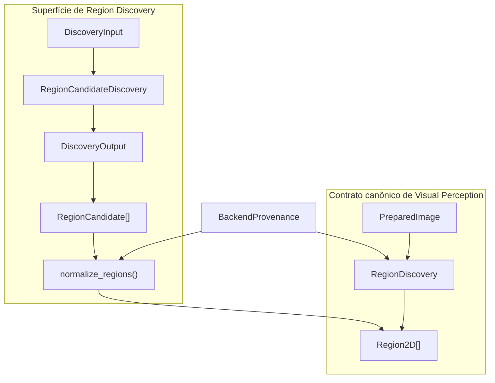
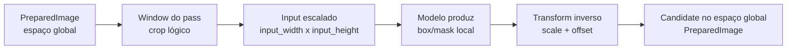
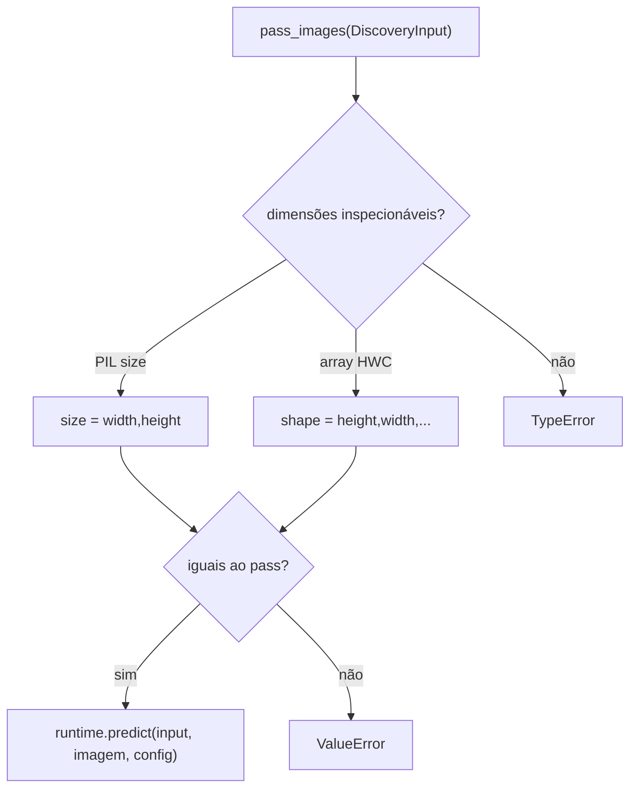
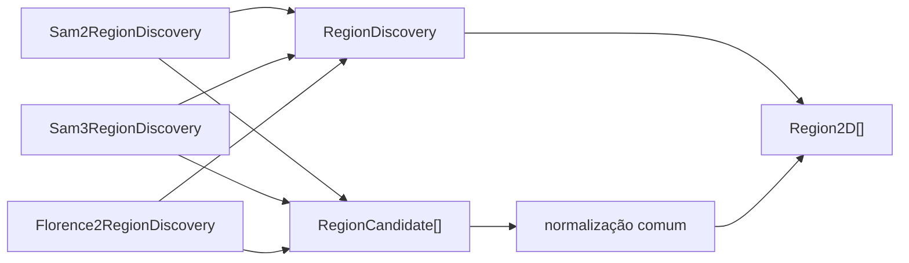
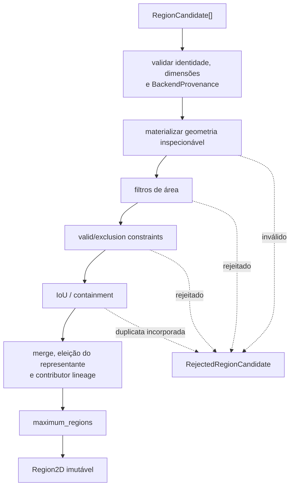
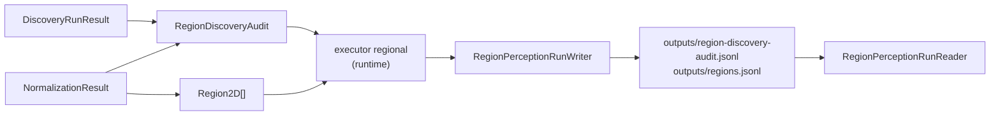
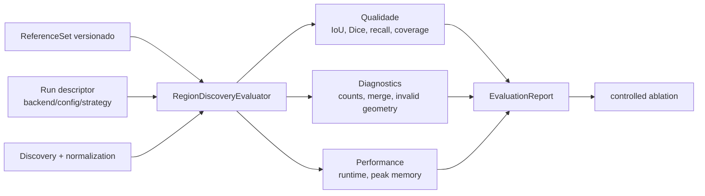

# Region Discovery

Region Discovery propõe geometria 2D para uma execução de Region Perception. A capability
preserva evidência geométrica e provenance, sem decidir identidade persistente, label final ou
suporte 3D.

## Visão geral

```mermaid
flowchart LR
    OBS["SourceObservation / imagem"] --> PREP["PreparedImage"]
    PREP --> PASS["Discovery passes<br/>full-frame / tiles / scales"]
    PASS --> ADAPTER["RegionDiscovery backend<br/>SAM2 / SAM3 / Florence-2"]
    ADAPTER --> CAND["RegionCandidate[]"]
    CAND --> REMAP["Remapeamento para<br/>coordenadas globais da imagem"]
    REMAP --> NORM["Normalização geométrica<br/>filtros + merge + budget"]
    NORM --> FREEZE["Geometry Freeze"]
    FREEZE --> REG["Region2D[]"]
    REG --> VP["conjunto regional canônico"]
    PASS --> AUD["RegionDiscoveryAudit<br/>passes, rejeições, merges"]
    NORM --> AUD
    AUD --> PRA["RegionPerceptionRunArtifact<br/>region-discovery-audit.jsonl"]
    VP --> PRA
```



O port consumido pelo Region Perception é `RegionDiscovery.discover(PreparedImage) -> Sequence[Region2D]`. Passes, candidatos, rejeições, diagnostics e avaliação existem para tornar a produção dessas regiões verificável sem transformar uma proposta de frame em verdade persistente do mapa. O caminho canônico do runtime usa `AuditedRegionDiscovery.discover_audited(PreparedImage) -> AuditedRegions`, que devolve as mesmas regiões junto com a `RegionDiscoveryAudit` do frame; essa auditoria é gravada no `RegionPerceptionRunArtifact` (ver [Evidência persistida](#evidência-persistida-a-auditoria-de-cada-frame)).

## Contratos canônicos

`RegionCandidate` representa uma proposta antes de validação, merge e normalização. A proposta
carrega identidade da observação física, run, resultado, pass e proposta nativa. Sua geometria pode
ser uma bounding box ou uma máscara `InlineMask` materializada. Uma `mask_reference` só é aceita
junto da máscara materializada que a normalização realmente inspeciona; uma referência opaca não é
publicada como geometria consumível. Quando a própria task do backend devolve texto junto com a
geometria (por exemplo Florence-2 `<OD>`), a proposta o carrega tipado em `native_text`
(`NativeRegionText`: task, prompt opcional e texto verbatim); ver
[Texto nativo das tasks do Florence-2](#texto-nativo-das-tasks-do-florence-2-523).

`InlineMask` é uma máscara da imagem inteira, imutável, com um byte por pixel (#593). Os pixels são
copiados uma vez, na construção, para um buffer `bytes` da própria máscara, e `as_array()` devolve
uma view `(height, width)` somente leitura desse buffer, sem cópia: nem a view nem nada abaixo dela
pode voltar a ser gravável, então a máscara continua sendo um valor, com igualdade e hash por
dimensões e pixels. Não há acesso a uma tupla de pixels: quem consome a máscara usa `as_array()`,
`area` ou `value_at()`. `to_dict()`/`from_dict()` mantêm a forma serializada (lista plana de 0/1
em ordem de linha), então nenhum artifact muda.

Os backends produzem a máscara direto da saída nativa, sem uma lista Python por pixel: a
segmentação do SAM2 é lida como array; os scores de máscara do SDK do SAM3 (`masks_logits`, ou
`masks` na ausência dele, com escala ainda não confirmada no SDK real, ver #610) saem do tensor para
a CPU em float64 (exato para float32, float16 e bfloat16) e são comparados com `mask_threshold` em
float64, como sempre foram;
os polígonos do Florence-2 são rasterizados pela regra par-ímpar no centro do pixel, aresta por aresta,
com a mesma aritmética do teste ponto a ponto.

A normalização trabalha sobre o recorte da máscara na caixa justa dos seus pixels (uma view) e só
compara pixel a pixel duas propostas cujas caixas se encontram. Com os dois limiares de merge
positivos, propostas de caixas disjuntas têm IoU e contenção 0 e não podem se fundir; com um limiar
0, todo par é comparado, como antes.

`Region2D` representa geometria aceita e congelada. A normalização mantém IDs locais para
seus testes determinísticos; `namespace_regions` qualifica a evidência publicada pelo run
regional e pela observação física. IDs de regiões de dois frames ou produtores nunca colidem;
a identidade não é um entity ID do mapa. Contributor IDs e provenance de geometry freeze
preservam a explicação científica da região.

`RejectedRegionCandidate` registra uma rejeição com motivo legível por máquina, detalhe e pass de
origem. Rejeições e propostas incorporadas por merge permanecem disponíveis para auditoria: a
`RegionDiscoveryAudit` de cada frame as leva até o `RegionPerceptionRunArtifact`. Nenhum backend de
produção devolve uma `Region2D` com `is_accepted=False`; o campo continua no contrato, mas a
rejeição do caminho canônico é sempre uma `RejectedRegionCandidate` da auditoria.

## Fronteiras de contrato



`PreparedImage`, `Region2D` e `RegionDiscovery` possuem uma única definição canônica em Region Perception. `DiscoveryInput`, `DiscoveryOutput`, `RegionCandidate`, `RejectedRegionCandidate`, `RegionDiscoveryAudit` e os tipos de passes são contratos adapter-facing e de auditoria exportados pelo módulo, mas não substituem `Region2D` como evidência consumida pelas capabilities downstream.

`AuditedRegionDiscovery` estende `RegionDiscovery` com `discover_audited()` e `discovery_identity()` e é o port que o executor de percepção do runtime exige. O port `RegionDiscovery` não muda: quem só precisa de regiões continua dependendo dele, e os três backends implementam os dois, com `discover()` devolvendo exatamente as regiões de `discover_audited()`. `discovery_identity()` devolve a [identidade efetiva do discovery](#identidade-efetiva-do-discovery) sob a qual todo frame do backend é decidido.

Uma `RegionCandidate` é evidência de proposta antes da consolidação. Ela preserva run/result, observação física, dimensões da imagem, provenance do proposal, score nativo e geometria materializada. Uma `Region2D` é a geometria canônica após validação, merge e freeze; ainda é evidência de um produtor regional, nunca uma entidade 3D persistente.

## Espaço de coordenadas

A convenção inicial é `pixel_xy_top_left`:

- origem no canto superior esquerdo;
- `x` cresce para a direita e `y` cresce para baixo;
- bounding boxes são intervalos semiabertos `[x_min, x_max)` e `[y_min, y_max)`;
- largura e altura descrevem o espaço da imagem preparada;
- máscaras inline usam ordem row-major e exatamente `width * height` valores.

Geometria fora dos limites da imagem é inválida: `RegionCandidate` e, quando conhece
`image_width`/`image_height`, `Region2D` recusam uma bounding box que passe da imagem (#619).
Remapeamentos de crop, resize ou tile devem ocorrer antes da criação da região canônica e
permanecer registrados em provenance.

## Scores

`BackendScore` exige nome, valor e semântica. Um `predicted_iou` do SAM não é tratado como
probabilidade nem comparado diretamente com scores de Florence-2. Ausência de score permanece
`None`; ela não é convertida em zero ou um.

## Normalização de backends

Adapters convertem apenas dados serializáveis para `RegionCandidate`:

```text
SAM2/SAM3 mask + box + native scores -> RegionCandidate
Florence-2 box ou mask + parser data  -> RegionCandidate
fake deterministic proposal          -> RegionCandidate
```

Tensors, objetos de SDK e handles de modelo ficam dentro do adapter. Prompt ou texto usado para
descobrir uma região pode aparecer na provenance, mas não cria automaticamente um
`SemanticClaim`.

## Organização da implementação

```text
region_perception/
├── region_evidence.py       # Region2D, RegionId
├── region_geometry.py       # propostas, máscaras e coordenadas
├── evidence_identity.py     # namespace pelo run e observação física
├── region_semantic_hint.py  # texto nativo vinculado à geometria
├── discovery/               # passes, remapeamento, normalização e auditoria
├── grounding/               # consultas explícitas e outputs
├── refinement/              # propostas de grounding para máscaras
├── artifacts/               # frames, regiões, auditoria e payloads
└── adapters/                # SAM2, SAM3, Florence-2 e LocateAnything
```

Imagem preparada pertence à API visual; políticas regionais e adapters concretos pertencem
a esta capability. O runtime liga providers e seleciona artifacts explicitamente.

## Preparação de imagem e constraints

`prepare_image` recebe uma `SourceImage` imutável e uma sequência explícita de operações. Sem
configuração, o resultado referencia o payload original e registra `transformations = []`. Resize,
crop, rectification e normalization recebem a referência do payload materializado pelo adapter de
imagem e produzem um `TransformationRecord` ordenado com dimensões de entrada/saída e parâmetros.
Cada operação também exige `provenance_source`, que identifica a configuração, calibração ou
política que solicitou a transformação e é serializada junto ao registro.

`ValidRegion` restringe os pixels elegíveis e `ExclusionRegion` remove áreas nomeadas. Ambos são
opcionais, precisam corresponder ao espaço de coordenadas final e registram motivo e origem da
configuração. A API não contém defaults para câmera fisheye, veículo, drone, rig ou dataset. Uma
necessidade desse tipo deve ser declarada pelo preset/source config que criou a constraint.

O contrato não pinta pixels excluídos de preto nem altera a observação física. Backends recebem a
imagem preparada e as constraints separadamente, evitando que uma alteração visual silenciosa seja
confundida com evidência do sensor.

## Transformações de coordenadas



A geometria produzida por backend pertence ao espaço efetivamente materializado para o pass. O remapeamento para `PreparedImage` ocorre antes da normalização, e a provenance mantém `discovery_pass_id`, configuração e identidade nativa da proposta.

## Passes e tiling

O baseline executa um único pass `full_frame`. `DiscoveryPassConfig` pode adicionar um ou mais
grids de tiles com tamanho, overlap, escala e budget por pass explícitos. As janelas são geradas em
ordem row-major e o último tile de cada eixo é alinhado ao limite da imagem para garantir cobertura
sem produzir coordenadas fora do espaço preparado.

O port público `RegionDiscovery` recebe `PreparedImage` e devolve `Sequence[Region2D]`, exatamente
como o Region Perception exige. A execução por pass é um detalhe interno exposto somente a
adapters pelo `RegionCandidateDiscovery`: ele recebe `DiscoveryInput` e devolve `RegionCandidate`
mais diagnostics. A orquestração do Core não contém branches para SAM2, SAM3 ou Florence-2.
Propostas locais de tiles são remapeadas para a imagem preparada, recebem ID prefixado pelo pass e
preservam o ID nativo em provenance. Máscaras inline são redimensionadas e expandidas no espaço
global antes da normalização. O redimensionamento é por vizinho mais próximo amostrando o
**centro** de cada pixel de saída: o pixel `x` cobre `[x, x + 1)`, seu centro `x + 0.5` vai para
`(x + 0.5) * largura_entrada / largura_saída`, a mesma convenção contínua do remapeamento de
boxes, e o pixel de entrada que contém esse ponto é o amostrado (em aritmética inteira, sem erro de
ponto flutuante). Amostrar o canto `x` deslocava a máscara em até 1 px sempre que a escala não era
1 (#619).

`TilingConfig.scale` define as dimensões efetivamente apresentadas ao backend: cada
`DiscoveryPass` registra `input_dimensions` e o transform inverso para o espaço preparado. Boxes e
máscaras retornadas nesse espaço escalado são remapeadas para a janela global. Assim, alterar a
escala altera o input do modelo sem alterar a coordenada canônica da mesma geometria.
Os adapters validam a imagem materializada de cada pass antes de entregá-la ao runtime do modelo:
imagens compatíveis com PIL devem expor `size = (width, height)` e arrays HWC devem expor
`shape = (height, width, ...)`, sempre iguais a `input_dimensions`. Uma imagem que não é o
crop/resize do pass falha explicitamente, antes da inferência (ver a seção seguinte).

`BorderPolicy.KEEP` mantém propostas que tocam bordas internas. A política
`REJECT_INTERNAL_BORDER` registra `tile_border_truncation` sem apagar a proposta dos diagnostics.
Cada pass de tile é pareado, no momento em que é criado, com o `TilingConfig` que o gerou; com
vários grids (`tiling` e `additional_tilings`), um tile é sempre julgado pela política de borda do
seu próprio grid, sem reconstruir essa atribuição pela contagem de janelas (#619).
Um candidato só-máscara (sem `bounding_box`) é testado pela caixa justa dos pixels verdadeiros da
máscara; uma máscara vazia não toca borda nenhuma (#596).
Deduplicação entre passes não ocorre aqui; ela pertence à normalização geométrica.

## Materialização e validação da imagem de cada pass (#661)

O runtime do modelo nunca recebe uma referência que não sabe resolver. Um `PreparedImage` nomeia
seu payload por uma referência relativa à raiz do run (o diretório de rascunho que o
`VisualPerceptionExecutor` cria dentro de `execute()`), e o runtime vem de um provider que recebe só
`(config, secrets)`. Por isso a imagem de cada pass é materializada do lado do adapter:

1. o adapter (`Sam2RegionDiscovery`, `Sam3RegionDiscovery`, `Florence2RegionDiscovery`) recebe
   `pass_images`, a função que materializa um pass; a composition root a liga à raiz do run,
   construindo o adapter uma vez por run (`RegionDiscoveryPlan.factory(prepared_image_root)`);
2. `materialize_discovery_pass(root, discovery_input)` (`backends/prepared_images.py`) lê o payload
   sob `root` e o confere contra `payload_artifact.sha256` antes de decodificá-lo
   (`read_prepared_image`, a mesma leitura do refinamento SAM2), decodifica em RGB com Pillow,
   confere as dimensões contra o `PreparedImage` e recorta a janela do pass. O resultado é uma
   imagem Pillow RGB, o que os processors oficiais do SAM3 e do Florence-2 consomem; o runtime do
   SAM2 a lê como o array HWC `uint8` que o gerador oficial documenta;
3. o adapter confere a imagem com `validate_materialized_discovery_image()` e só então chama
   `runtime.predict(discovery_input, image, config)`.

Um pass com escala diferente de 1 é recusado por `materialize_discovery_pass` antes de qualquer
leitura: apresentá-lo exigiria uma regra de reamostragem, e nenhuma está definida nem registrada na
`RegionDiscoveryIdentity`. Uma reamostragem escolhida em silêncio mudaria o input do modelo sem
mudar a identidade do run. A mesma regra vale para o plano inteiro: `require_unscaled_passes`
recusa uma `DiscoveryPassConfig` com algum tiling de escala diferente de 1, e a composition root a
chama ao compor o discovery, então essa configuração falha com `BackendConfigurationError` antes de
qualquer run, em vez de falhar o discovery de todo frame. Hoje nenhuma configuração do repositório
usa `TilingConfig.scale` diferente de 1; habilitá-la exige primeiro uma política versionada de
reamostragem.

A validação não confia só nos metadados do pass:



Isso torna `TilingConfig.scale` uma transformação verificável: alterar a escala muda o tamanho efetivamente apresentado ao modelo, e o remapeamento inverso retorna a geometria ao mesmo sistema de coordenadas global.

## Backend SAM2

`Sam2RegionDiscovery` implementa o mesmo port usado pelos demais backends. O adapter recebe
`Sam2Config` validada e um runtime injetado que isola carregamento de checkpoint, Torch e objetos
do SDK. Apenas boxes, máscaras booleanas e scores escalares atravessam essa fronteira interna.

A configuração efetiva inclui checkpoint, versão, device, precision, thresholds e parâmetros do
automatic mask generator. Seu digest determinístico acompanha cada proposta. `predicted_iou` e
`stability_score` mantêm seus nomes e significados SAM2; nenhum deles vira confidence universal.
O runtime recebe o `DiscoveryInput` completo, incluindo constraints explícitas, pass e tile, e a
imagem já materializada do pass (`Sam2Runtime.predict(discovery_input, image, config)`). Erros
de shape ou runtime interrompem a execução, sem fallback silencioso para outro backend.

`Sam2AutomaticMaskRuntime` encapsula a API oficial `SAM2AutomaticMaskGenerator.generate`. Ele
recebe a imagem do pass pronta e a entrega ao gerador como array HWC `uint8`; converte a box nativa
XYWH para XYXY, destaca a máscara binária e preserva `predicted_iou`, `stability_score` e área.
`from_model(model=..., config=...)` constrói o generator com os thresholds e settings que
participam do digest, sem tornar SAM2 dependência obrigatória do pacote principal; o runtime não
recebe nada do run, então um provider declarado em `resources.providers` o devolve direto.

`model_version` não tem default em `Sam2Config`, `Sam3Config` nem `Florence2Config`: a versão entra
na provenance e no digest, então uma execução nunca registra um placeholder no lugar da versão real
do checkpoint. O modelo chega carregado pela composition root, e device e precision da configuração
também vão para a provenance; por isso os runtimes oficiais conferem, antes de cada inferência,
**todos** os tensores do modelo contra a configuração (#617, #646), não uma amostra: um modelo
movido só em parte ou com pesos de vários dtypes passaria por uma checagem do primeiro parâmetro.

- todo parâmetro e todo buffer precisa estar num único device, o configurado (sem índice no
  device, qualquer GPU do tipo confere, como em `model.to("cuda")`);
- **placement distribuído é recusado**: um modelo espalhado por mais de um device (`device_map`,
  offload, um `.to()` incompleto) falha mesmo quando cada device isolado conferiria com um
  `"cuda"` sem índice. A configuração nomeia um device só e nenhum campo declara uma distribuição;
  aceitá-la exigiria declará-la na configuração e na provenance, o que nenhum uso atual pede;
- o dtype de todo parâmetro precisa ser aceito pela `precision` (a regra de cada backend está
  abaixo); o dtype dos buffers não é conferido, porque buffer não é peso (pode guardar ids
  inteiros, por exemplo);
- o erro conta os tensores por device ou por dtype, como `cpu (12 tensors), cuda:0 (340 tensors)`.

O SAM2 falha com `ValueError` se o modelo estiver em outro device ou em outro dtype que
`precision`: esse runtime não aplica autocast, então o dtype dos pesos é a precisão da inferência.
`from_model` confere antes de construir o generator do SDK, e `Sam2AutomaticMaskRuntime` recebe o
modelo também na construção direta e o confere a cada `predict()`, então nenhum caminho de
construção pula a verificação.

O `bbox` do SDK oficial usa **índices de pixel inclusivos** (`[x0, y0, x1 - x0, y1 - y0]`), e a
`BoundingBox` canônica é semiaberta. A conversão soma um pixel às duas bordas máximas
(`x + w + 1`, `y + h + 1`), o que torna a caixa justa à máscara. Sem isso a normalização, que exige
que a caixa contenha a máscara, rejeitaria todo candidato real como `invalid_geometry`. O
comportamento foi confirmado com o SDK e o checkpoint SAM 2.1 tiny em frames reais (issue #336).

## Backend SAM3

`Sam3RegionDiscovery` é o adapter concreto de SAM3 para Region Discovery e continua substituível
pelo mesmo port. `Sam3Config` torna checkpoint, versão, device, precision, thresholds, estratégia e
frases parte do digest da execução. Estratégias `automatic`, `text_prompt`, `point_grid`, `tracker`
e `pcs` são distintas; `text_prompt` exige ao menos uma frase em `prompts`, enquanto `automatic`
rejeita frase oculta.

O runtime retorna propostas escalares, warnings e métricas próprias. O adapter preserva query ID,
a frase que produziu cada proposta e nome/semântica do score em provenance. Texto usado para obter a
máscara não é publicado como `SemanticClaim`. Falha do runtime ou estratégia configurada é
propagada; não existe fallback silencioso para outra estratégia ou backend.

`Sam3ImageProcessorRuntime` integra o caminho oficial de imagem para `text_prompt`:
`set_image`, `set_confidence_threshold`, `set_text_prompt` e `reset_all_prompts` (ver
[Conjunto de conceitos](#conjunto-de-conceitos-do-sam3-662)), sobre a imagem Pillow do pass que o
adapter materializou (`Sam3Runtime.predict(discovery_input, image, config)`); ele é construído só
com o processor (e, opcionalmente, o contexto de precisão). Boxes, scores e os scores de máscara
do SDK (`masks_logits`, ou `masks` na ausência dele) são destacados dos tensors antes de sair do
runtime; a escala desses scores de máscara, contra a qual `mask_threshold` é comparado, ainda não
foi confirmada no SDK real (#610). As demais estratégias continuam
distinguíveis no contrato, mas esse runtime as rejeita explicitamente até existir uma integração
real específica; selecionar uma delas não aciona comportamento alternativo.

A `precision` de `Sam3Config` (`float32`, `float16` ou `bfloat16`; qualquer outro valor é rejeitado
na configuração) é a precisão com que a inferência realmente roda: o runtime executa as chamadas do
SDK dentro de `torch.autocast` para `float16`/`bfloat16` e sem autocast para `float32`. O modelo de
imagem oficial do SAM3 só executa sob autocast `bfloat16`; com `float32` o SDK falha com
`mat1 and mat2 must have the same dtype`. O contexto de precisão é injetável (`autocast=`), então os
testes registram a ordem das chamadas sem torch real (issue #338). Em qualquer precisão, as
chamadas do SDK rodam também dentro de `torch.inference_mode()`, sem depender de o SDK desligar o
autograd por conta própria; sem torch instalado, a inferência falha explicitamente (#617).

Antes de chamar o SDK, o runtime confere o modelo exposto pelo processor (`processor.model`) contra
a configuração: todos os tensores precisam estar em `Sam3Config.device`, e o dtype de todo peso
precisa ser um dos que realizam a `precision` configurada (#617, #646); pesos `float32` e no dtype
do autocast podem conviver. O `device` do próprio processor, para onde ele move cada imagem (o
default do SDK é `"cuda"`), também precisa nomear o device configurado: com o modelo no lugar certo,
um processor em outro device ainda rodaria a inferência fora do que a provenance registra.

| `precision` | pesos aceitos | por quê |
| --- | --- | --- |
| `float32` | `float32` | sem autocast, o dtype dos pesos é a precisão da inferência |
| `float16` | `float32` ou `float16` | o autocast converte pesos `float32` para `float16` nas operações |
| `bfloat16` | `float32` ou `bfloat16` | idem; é a configuração que funciona com o SDK oficial (#338) |

Pesos em outro dtype reduzido, como `float16` sob `bfloat16` ou sob `float32`, falham com
`ValueError` antes da inferência, porque a precisão registrada deixaria de ser a precisão real. A
regra não depende de medir o SDK: o dtype que o SAM3 real reporta nos parâmetros é uma
caracterização útil, mas não muda o que o autocast realiza.

### Conjunto de conceitos do SAM3 (#662)

`Sam3Config.prompts` é a lista ordenada de frases que **um** run de percepção consulta. Um mapa
construído com SAM3 tem assim todos os conceitos do conjunto, e não só a classe de uma frase. A
alternativa, um run por frase acumulado na mesma branch de contexto, contaria cada frase como
inferência repetida da mesma imagem e distorceria a semântica da fusão.

- **Validação.** Com `text_prompt`, a lista não pode ser vazia; com `automatic`, qualquer frase é
  recusada. Em toda estratégia, uma frase vazia ou só de espaços e uma frase repetida (igualdade
  exata) são recusadas. Não existe o campo antigo `prompt` nem alias para ele (v0.x).
- **Identidade.** A lista inteira, na ordem, entra em `Sam3Config.digest`, portanto na
  `BackendProvenance.configuration_fingerprint` do backend, no `RegionProvenance.config_digest` de
  cada proposta e no `config_digest` do estágio `region_perception` do runtime. Trocar uma frase ou
  a ordem gera outro run, nunca um reuso.
- **Execução.** Em cada passe, o runtime oficial codifica a imagem uma vez (`set_image`), aplica
  `set_confidence_threshold` e consulta as frases na ordem com `set_text_prompt`, chamando
  `reset_all_prompts` entre uma frase e a seguinte. O SDK grava prompt e resultados no próprio
  estado e devolve esse mesmo estado; por isso boxes, scores e máscaras de cada frase são destacados
  antes do reset seguinte, e as máscaras de uma frase nunca são lidas depois que a próxima as
  sobrescreve. Um run de uma frase só não chama `reset_all_prompts`.
- **Proveniência por proposta.** `proposal_id` é `sam3-<frase>-<proposta>` e `query_id` é
  `text-prompt-<frase>-<proposta>`: o índice da frase em `prompts` e o da proposta na saída
  daquela frase, com seis dígitos. Os dois são únicos dentro do passe e ordenam as propostas na
  ordem das frases. O candidato registra `provenance.query = "text_prompt:<frase>:<query_id>"` e a
  frase em `native_metadata` (`text_prompt`); os diagnostics do passe listam as frases em
  `prompt_000000`, `prompt_000001`, …. O adapter recusa com `ValueError` uma proposta de
  `text_prompt` sem frase ou com uma frase fora de `prompts`, porque o `Sam3Runtime` pode vir de um
  provider externo.
- **A frase é hipótese de consulta, não rótulo.** Ela não gera `SemanticClaim`, `native_text` nem
  `RegionSemanticHint`, e o `Region2D` não ganha classe. A interpretação semântica das regiões
  continua a cargo dos intérpretes.
- **`mask_threshold`** mantém a semântica atual para todas as frases, até a #610 medir a escala
  real de `masks_logits`.

**Quando duas frases produzem a mesma máscara.** A normalização canônica trata os candidatos de
todas as frases do mesmo jeito e não olha a frase. Duas máscaras idênticas têm IoU 1 e se fundem
como `iou_duplicate`. O representante segue `largest_area_v1`: com a mesma área, fica o menor
`candidate_id`, que no mesmo passe é o da frase que vem antes em `prompts`. A outra frase não se
perde:

- `Region2D.contributor_candidate_ids` lista os dois candidatos;
- `Region2D.discovery_provenance` guarda as duas `RegionProvenance`, cada uma com a própria
  `query`, e portanto a própria frase;
- a auditoria do frame registra a `MergeDecision` e a rejeição `merged_duplicate` do candidato
  incorporado.

Só a `native_metadata` do candidato incorporado não é persistida, como a de todo candidato, que
nunca entra no `Region2D`. Máscaras quase iguais (IoU de pelo menos `duplicate_iou_threshold`) ou
contidas (contenção de pelo menos `containment_threshold`) seguem a mesma regra, e o representante
é o de maior área, qualquer que seja a frase.

### Geometria das propostas SAM3

O SAM3 devolve `boxes` de um head independente do head de máscara. Na prática essa caixa pode
ultrapassar a imagem em alguns pixels e frequentemente não contém a máscara binarizada. Como a
normalização exige que a caixa contenha a máscara e que `RegionCandidate` fique dentro da imagem, o
adapter usa como geometria a **caixa justa e semiaberta da própria máscara** (mesma escolha do
Florence-2 para polígonos). A caixa nativa não é descartada: ela acompanha o candidato em
`native_metadata` (`native_box_x_min`, `native_box_y_min`, `native_box_x_max`, `native_box_y_max`) e
`native_box_contains_mask` registra se ela continha a máscara.

Uma proposta sem pixel de máscara mantém a caixa nativa recortada à janela do pass, quando existe
interseção, e é rejeitada de forma explícita pela normalização (`invalid_geometry`). Nenhum caso
levanta exceção que interrompa o pass por causa de uma única proposta (issue #337).

## Backend Florence-2

`Florence2RegionDiscovery` atende somente ao port de descoberta de regiões. Sua configuração
registra checkpoint, versão, device, precision, task, prompt opcional, threshold e generation
settings. O task é obrigatório porque diferentes modos de Florence-2 têm semânticas de proposta
distintas.

O parser interno pode produzir box, máscara opcional, score opcional, texto parseado e diagnostics.
O adapter transforma a geometria em `RegionCandidate`; task e prompt ficam em provenance, e o texto
que a task devolveu junto com a proposta vira `RegionCandidate.native_text` (seção seguinte). Nada
disso gera `SemanticClaim`.
`Florence2SemanticInterpreter` já implementa interpretação semântica por outro
port e outro adapter, mesmo que a composition root possa compartilhar o
lifecycle do modelo carregado.

`TransformersFlorence2Runtime` implementa o fluxo oficial do Transformers sobre a imagem Pillow do
pass que o adapter materializou (`Florence2Runtime.predict(discovery_input, image, config)`; o
runtime é construído só com modelo e processor): prepara o task prompt,
confere que o modelo está no device e no dtype configurados (sem autocast, o dtype dos pesos é a
precisão da inferência), move os inputs para esse device e converte os de ponto flutuante para esse
dtype, executa `generate` dentro de `torch.inference_mode()` (#617), mantém os tokens especiais no
decode e chama `post_process_generation` com o tamanho do pass. Tasks aceitas precisam produzir regiões;
um frame sem detecções devolve zero regiões (`box_count=0`, `polygon_count=0`), como SAM2 e SAM3,
e não falha o estágio.
Boxes são destacadas diretamente e polígonos são rasterizados por centro de pixel; o texto de cada
box ou polígono segue com a própria proposta.

### Texto nativo das tasks do Florence-2 (#523)

Algumas tasks do Florence-2 devolvem geometria e texto na **mesma inferência**. O texto é evidência
dessa inferência sobre aquela proposta, não rótulo do objeto nem crença do mapa. O parser oficial
(`post_process_generation` do Transformers) define o que cada task entrega:

| Task | Geometria | Texto por proposta |
|---|---|---|
| `<REGION_PROPOSAL>` | boxes | vazio (baseline só geométrico) |
| `<OD>` | boxes | categoria gerada |
| `<DENSE_REGION_CAPTION>` | boxes | descrição gerada |
| `<OPEN_VOCABULARY_DETECTION>` | boxes ou polígonos | texto condicionado ao prompt |
| `<CAPTION_TO_PHRASE_GROUNDING>` | boxes | frase da legenda de entrada |
| `<REFERRING_EXPRESSION_SEGMENTATION>`, `<REGION_TO_SEGMENTATION>` | polígonos | vazio |

A regra é pelo conteúdo, não por lista de tasks: a proposta recebe `NativeRegionText(task, prompt,
text)` exatamente quando o parser anexou a ela texto com algum caractere não branco, preservado
verbatim; texto vazio não gera registro. Assim `<REGION_PROPOSAL>` e as tasks de segmentação ficam
só geométricas sem nenhum caso especial, e um texto inesperado nunca é descartado em silêncio: ele
aparece com a task que o produziu. O prompt é a entrada da task (por exemplo a query open
vocabulary), registrado ao lado do texto porque o condiciona.

Depois da normalização, `derive_region_semantic_hints(candidates, normalization)` produz um
`RegionSemanticHint` por proposta com texto, ordenado por `candidate_id`. Cada hint preserva o
`candidate_id` global, observação, run e resultado, a `RegionProvenance` inteira (backend, versão,
checkpoint, digest da configuração, pass e ID nativo da proposta), o `NativeRegionText` e o vínculo
com a região canônica:

- `representative`: a geometria congelada da região é a geometria desta proposta;
- `merged`: a proposta foi incorporada à região, mas a geometria congelada é de outra proposta;
  o texto descreve a geometria incorporada e não pode ser lido como texto da região;
- `rejected`: a proposta não alcançou nenhuma região (filtro, ou merge em um grupo cortado pelo
  budget); `region_id` é `None`.

O vínculo vem da linhagem explícita da normalização (`contributor_candidate_ids` e
`MergeDecision`), nunca da posição na lista; uma região cuja linhagem não nomeia exatamente um
representante é recusada com `ValueError`. Todas as propostas de uma região fundida continuam
auditáveis, cada uma com o próprio texto. A derivação é determinística e independente da ordem de
entrada.

`Region2D` continua só geométrica, `RegionDiscovery.discover()` devolve as mesmas regiões com ou sem
texto, e nenhum `SemanticClaim`, entidade, confidence ou crença é criado: um consumidor downstream
pode ignorar o hint inteiramente. A avaliação semântica os pontua com
`evaluate_region_semantic_hints()` (ver
[avaliação de Semantic Interpretation](../../evaluation/docs/semantic-interpretation.md)) a partir do
mesmo `DiscoveryRunResult`/`NormalizationResult` que a avaliação geométrica mede: uma inferência
nativa, avaliada nas duas dimensões, sem segundo forward do modelo.

**Decisão.** Das alternativas da issue, foi escolhida a menor que atende a todos os critérios: um
registro de evidência da própria capability (`NativeRegionText` na proposta e `RegionSemanticHint`
derivado da linhagem). Foram rejeitadas:

- *execução semântica derivada da saída do Florence-2*: exigiria fabricar
  `SemanticInterpretationRequest`, views, prompt renderizado e resposta de um
  `SemanticInterpreter` que não executou, e suas `SemanticClaim` entrariam no `PerceptionResult`
  e seguiriam para Semantic Fusion, promovendo texto de descoberta a claim;
- *artifact de inferência compartilhado entre os adapters de descoberta e interpretação*: acoplaria
  dois adapters por um cache/artifact novo sem consumidor além deste caso (YAGNI), e a interpretação
  semântica continua podendo rodar o seu próprio forward quando o experimento pedir.

**Persistência.** `discover_canonical_regions()` deriva os hints do frame na mesma execução e os
entrega em `RegionDiscoveryAudit.semantic_hints`, então eles chegam ao `RegionPerceptionRunArtifact` na
[auditoria persistida de cada frame](#evidência-persistida-a-auditoria-de-cada-frame), ao lado das
rejeições e dos merges que os vinculam. O writer de estágio avulso que antes os gravava em
`outputs/region-semantic-hints.jsonl` (manifest `contextmap.region-discovery-stage/v2`) não tinha
chamador de produção e foi removido (#611); `RegionPerceptionRunReader.read_region_discovery_audits()` devolve os hints de cada frame.

## Relação entre backends



Os três adapters compartilham a mesma política geométrica depois da conversão para `RegionCandidate`. Scores permanecem backend-native e não são comparados como uma confiança universal. Texto de prompt fica em provenance e o texto nativo de uma task fica tipado na própria proposta (`NativeRegionText`); nenhum dos dois é promovido a `SemanticClaim`.

## Normalização, merge e geometry freeze

`normalize_regions` aplica a mesma política a propostas de SAM2, SAM3, Florence-2 e fakes. A ordem
é: validar geometria, aplicar limites de área, verificar valid/exclusion masks declaradas, detectar
duplicatas por IoU ou containment, aplicar budget e criar `Region2D` imutável. Nenhuma regra usa
label semântico ou compara scores de backends diferentes.



Rejeições permanecem evidência auditável, e não só durante a execução: a `RegionDiscoveryAudit` de cada frame é gravada no `RegionPerceptionRunArtifact` (ver [Evidência persistida](#evidência-persistida-a-auditoria-de-cada-frame)). Um merge não apaga a proposta incorporada: a região final mantém contributor IDs e `discovery_provenance`, enquanto a decisão de merge e a rejeição correspondente explicam o que ocorreu.

A chamada recebe o `BackendProvenance` exato reportado pelo adapter e valida sua consistência com
as propostas. O mesmo value object acompanha cada `Region2D`; provider, model, versão e fingerprint
não são reconstruídos a partir da provenance reduzida da proposta.

A ordem canônica de processamento é pelo `candidate_id`, tornando IDs `region-0001`,
`region-0002` e decisões de budget reproduzíveis: cada grupo ocupa a posição do seu primeiro
membro. Quem representa o grupo, e portanto a única geometria congelada na `Region2D`, não depende
do nome dos candidatos: é decidido pela política versionada
`NormalizationConfig.merge_representative_policy`. A política atual, `largest_area_v1`, elege o
membro de maior `area_pixels`, com empate resolvido pelo menor `candidate_id`. Scores não são
critério, porque não são comparáveis entre backends (o SAM2 reporta `predicted_iou`; o Florence-2
pode não reportar score algum).

A eleição acontece a cada merge. Quando a proposta que chega vence o representante atual, ela
assume a representação e o representante anterior passa a ser o incorporado. `MergeDecision` e a
rejeição `merged_duplicate` registram o par comparado já resolvido pela eleição, então as decisões
de um grupo formam uma cadeia que termina no representante final; IoU e containment são simétricos
e continuam descrevendo o par registrado. Todas as propostas contribuintes e respectivas
provenances permanecem em `contributor_candidate_ids` e `discovery_provenance`, na ordem de
processamento, e nenhuma proposta incorporada desaparece dos diagnostics.

Há um efeito colateral aceito: depois que um representante maior é eleito, os candidatos seguintes
são comparados com a geometria dele, então o agrupamento pode mudar transitivamente, e uma proposta
que antes formaria região própria pode ser incorporada ao grupo. Grupos já formados não são
fundidos entre si. O resultado continua determinístico, porque a ordem de processamento e o
desempate são fixos. A união das geometrias do grupo foi avaliada como alternativa e não foi
implementada: exigiria recompor máscara e bounding box, e não é necessária para remover a
arbitrariedade da ordem lexicográfica.

Os thresholds, os budgets e a política de representante vivem em `NormalizationConfig`; seu digest
acompanha o resultado, muda quando a política muda e faz parte da
[identidade efetiva do discovery](#identidade-efetiva-do-discovery). Máscaras inline são avaliadas
pixel a pixel.
`RegionCandidate` não aceita uma máscara persistida opaca como substituta da geometria
materializada, mesmo quando existe bounding box, evitando ignorar silenciosamente a máscara.
Constraints só são aplicadas quando a `PreparedImage` as declara explicitamente.

## Identidade efetiva do discovery

Um backend propõe candidatos; quem decide as regiões canônicas a partir deles é o caminho canônico:
o plano de passes, as políticas por pass, o remapeamento para a `PreparedImage` e a normalização.
`RegionDiscoveryIdentity` nomeia esse caminho com todos os defaults já resolvidos (#636):

| Campo | O que identifica |
| --- | --- |
| `pass_config_digest` | `DiscoveryPassConfig.digest`: full frame, grids (tamanho, overlap, escala, política de borda) e budget por pass |
| `normalization_config_digest` | `NormalizationConfig.digest`: thresholds, budgets e a política de representante do merge (`largest_area_v1`) |
| `pass_planning_policy_id` | `row_major_edge_aligned_v1`: full frame primeiro, depois cada grid em ordem, tiles row-major, último tile alinhado à borda da imagem, ids `tile-NNNN`/`tile-sKK-NNNN` |
| `border_truncation_policy_id` | `internal_edge_contact_v1`: uma proposta é truncada quando sua caixa (a caixa justa da máscara, se só-máscara) alcança uma borda do pass que não é borda da imagem, julgada pela política do grid que gerou o tile |
| `mask_remap_policy_id` | `nearest_pixel_center_v1`: vizinho mais próximo amostrando o centro de cada pixel de saída, depois posicionamento no offset da janela |

Os ids de algoritmo são versões: mudar o comportamento de um deles exige um novo id (por exemplo,
`nearest_pixel_center_v1` substituiu a amostragem pelo canto do pixel, #619). Um parâmetro definido
explicitamente com o valor do default produz a mesma identidade que o default implícito, e as duas
grafias de um mesmo grid (`tiling` ou a única entrada de `additional_tilings`), que planejam os
mesmos passes, têm o mesmo `pass_config_digest`. Mudar um default de `DiscoveryPassConfig` ou de
`NormalizationConfig`, ou um dos ids, muda a identidade.

`RegionDiscoveryIdentity.effective(pass_config, normalization_config)` calcula a identidade
(`None` é a configuração default). Ela aparece em três lugares, sempre a mesma:

- em cada registro da auditoria (`discovery_identity`, abaixo);
- em `ResolvedPipeline.configuration_digest()`, para todo estágio cujo backend a reporta
  (`AuditedRegionDiscovery.discovery_identity()`), e portanto no `configuration_digest` do manifest;
- na identidade de configuração que o executor de percepção do runtime declara, junto com a
  provenance do backend: ela entra no `run_id` e na chave de reuso do estágio (ver
  [reuso no runtime](../../runtime/docs/reuse.md#configuração-efetiva-de-um-executor)).

O remapeamento contínuo de boxes (`escala + offset` da janela) é a inversa exata da transformação
do pass e não tem versão própria; o restante do código fica coberto pela identidade de código do
reuso.

## Evidência persistida: a auditoria de cada frame

`discover_canonical_regions()` devolve `AuditedRegions`: as regiões canônicas e a
`RegionDiscoveryAudit` do frame, montada a partir do `DiscoveryRunResult` e do
`NormalizationResult` reais da execução, sem reconstrução. A auditoria é a evidência por trás das
regiões, não as regiões: as aceitas continuam no conjunto regional canônico e nomeiam seus contribuintes em
`contributor_candidate_ids`, com os mesmos IDs de candidato que as rejeições e as decisões de merge
usam, então resultado e auditoria se reconciliam.

O executor regional entrega a auditoria ao `RegionPerceptionRunWriter`, que a grava em
`outputs/region-discovery-audit.jsonl` do `RegionPerceptionRunArtifact` (schema `0.2.0`).
O inventário contém tamanho e SHA-256; a publicação é atômica. Um registro por frame:


```json
{
  "source_observation_id": "frame-0000",
  "region_artifact_id": "regional-run-0001",
  "backend": {"backend_id": "sam2", "capability": "region_discovery", "provider": "facebook",
              "model": "facebook/sam2-hiera-large", "version": "2.1",
              "configuration_fingerprint": "sha256:..."},
  "passes": [
    {"pass_id": "full-frame", "kind": "full_frame",
     "window": {"x_min": 0, "y_min": 0, "x_max": 640, "y_max": 480}, "scale": 1.0,
     "input_dimensions": [640, 480], "input_to_prepared_scale": [1.0, 1.0],
     "diagnostics": {"duration_ms": 812.4, "proposal_count": 37, "warnings": [],
                     "metadata": [{"name": "raw_proposal_count", "value": 41}]}}
  ],
  "pass_rejections": [],
  "discovery_identity": {"pass_config_digest": "sha256:...",
                         "normalization_config_digest": "sha256:...",
                         "pass_planning_policy_id": "row_major_edge_aligned_v1",
                         "border_truncation_policy_id": "internal_edge_contact_v1",
                         "mask_remap_policy_id": "nearest_pixel_center_v1"},
  "normalization_rejections": [
    {"candidate_id": "full-frame/p-2", "reason": "merged_duplicate",
     "detail": "merged into full-frame/p-1", "discovery_pass_id": "full-frame"}
  ],
  "merge_decisions": [
    {"representative_candidate_id": "full-frame/p-1", "merged_candidate_id": "full-frame/p-2",
     "kind": "iou_duplicate", "iou": 0.93, "containment_fraction": 0.97}
  ],
  "semantic_hints": []
}
```

- `passes` traz cada pass apresentado ao backend, na ordem de execução, com os diagnostics do
  backend naquele pass (duração, contagem, warnings e metadata nativa, como `raw_proposal_count`).
- `pass_rejections` são as rejeições das políticas de pass (budget por pass, borda interna de tile),
  antes da normalização; `normalization_rejections` são as da normalização, incluindo cada
  `merged_duplicate`, na ordem em que foram decididas. As duas listas ficam separadas porque o mesmo
  motivo `region_budget_exceeded` existe nos dois níveis (budget por pass e `maximum_regions`).
- `merge_decisions` encadeia cada grupo até o representante final, como descrito acima.
- `discovery_identity` é a [identidade efetiva do discovery](#identidade-efetiva-do-discovery) que
  decidiu o frame: os digests da `DiscoveryPassConfig` e da `NormalizationConfig` efetivas, com os
  defaults resolvidos, e as versões dos algoritmos de planejamento de passes, de borda de tile e de
  remapeamento de máscara. É a mesma identidade que entra no `configuration_digest` do manifest e na
  identidade do run.
- `backend` é a `BackendProvenance` exata do backend; sem ela, um frame sem nenhuma região não
  diria qual backend e configuração o analisaram.
- `semantic_hints` é o texto nativo das propostas normalizadas, um `RegionSemanticHint` por
  proposta com texto, ordenado por `candidate_id` (ver
  [Texto nativo das tasks do Florence-2](#texto-nativo-das-tasks-do-florence-2-523)): `candidate_id`,
  a `RegionProvenance` e o `NativeRegionText` da proposta, a contribuição (`representative`,
  `merged` ou `rejected`) e o `region_id` que ela alcançou. A wire publicada cita
  `region_artifact_id` e `source_observation_id`, com IDs regionais qualificados.
  O normalizer mantém seu escopo local apenas internamente, para validação e goldens.
  A auditoria recusa hints que contradigam merges, rejeições ou observação; o writer exige
  que a região citada liste o candidato entre seus contribuintes. A lista é vazia quando
  nenhuma proposta trouxe texto.

Um frame com zero candidatos tem registro (passes e diagnostics, listas vazias). Um frame cuja
descoberta falhou tem `RegionPerceptionFrame` com outcome `failed` e detalhe, mas não tem
auditoria de uma descoberta bem sucedida.
Ficam fora da tabela a geometria e as máscaras dos candidatos rejeitados (a rejeição guarda
identidade, motivo, detalhe e pass) e a geometria das regiões aceitas, que já está em
`outputs/regions.jsonl` e `outputs/masks/`.

A leitura usa o diretório regional: `RegionPerceptionRunReader.read_regions()` e
`read_region_discovery_audits()`. Ausência ou corrupção de streams exigidos gera
`RegionPerceptionRunError`; não há fallback para schemas do artifact monolítico.
`iter_frames()` lê a cobertura e prepara constraints de um frame por vez;
`frame(source_observation_id)` carrega só o frame solicitado.



Diagnósticos humanos (overlays SVG de candidatos e rejeições, máscara PBM por região) não são
gravados hoje. O antigo `RegionDiscoveryEvidenceWriter`, que os escrevia num diretório de estágio
avulso com manifest próprio, não tinha chamador de produção e foi removido (#611): a parte
contratual do que ele gravava agora está na tabela acima, e as métricas agregadas (contagens, razão
de merge, durações) derivam dela e de `outputs/regions.jsonl`, como a avaliação de Region Discovery
já as calcula. Se esses diagnósticos voltarem, vão para o `__DEBUG__/` do run, pelo
`RegionPerceptionRunWriter`, somente quando um nível de debug os pedir, e nunca como dependência de outra
capability.

## Avaliação objetiva

A avaliação específica de Region Discovery está em [`contextmap/evaluation/docs/region-discovery.md`](../../evaluation/docs/region-discovery.md). O mesmo reference set e schema medem SAM2, SAM3, Florence-2 ou fakes sem usar labels semânticos downstream.



Comparações de ablação exigem o mesmo reference set e exatamente uma variável declarada diferente. Backend, checkpoint, versão, strategy, thresholds, pipeline graph, `config_digest` e `execution_kind` são verificados para impedir atribuição de delta a uma variável errada. O baseline versionado atual é `ci_contract`, não evidência de qualidade do modelo SAM3 real.

## Falhas explícitas e invariantes

Region Discovery falha cedo quando um contrato que afeta a interpretação geométrica é violado. Entre os invariantes cobertos pelo código e testes estão:

- dimensões da imagem preparada e dos candidates positivas e consistentes;
- IDs de candidate únicos antes da normalização;
- candidate e `BackendProvenance` pertencem ao mesmo backend/configuração;
- `mask_reference` não substitui uma máscara materializada quando a geometria precisa ser inspecionada;
- materialização do pass possui as dimensões realmente declaradas;
- geometria não sai dos bounds da imagem;
- estratégias de runtime não implementadas falham sem fallback silencioso;
- cada auditoria persistida resolve para um resultado do mesmo run, no máximo uma por observação, e
  um registro que não seja a codificação canônica da auditoria é recusado na leitura;
- Geometry Freeze produz `Region2D` imutável.

## Como adicionar outro backend de Region Discovery

Um novo backend deve resolver um variation point real sem alterar o contrato downstream:

1. definir configuração efetiva e fingerprint reproduzível;
2. isolar o SDK/runtime dentro de `backends/`;
3. implementar `backend_provenance()`, `discover(PreparedImage)`, `discover_audited(PreparedImage)` e `discovery_identity()` (`AuditedRegionDiscovery`, que o runtime exige), delegando a `discover_canonical_regions()` e a `RegionDiscoveryIdentity.effective()` com as mesmas configurações;
4. converter output nativo para `RegionCandidate` no boundary adapter-facing;
5. preservar scores com nome e semântica próprios;
6. reutilizar passes, remapeamento e `normalize_regions()` em vez de criar política geométrica paralela;
7. adicionar testes determinísticos sem download/GPU e testes do runtime oficial quando aplicável;
8. avaliar no mesmo reference set e schema antes de qualquer decisão de baseline.

Adicionar um backend não o torna automaticamente parte de um `PipelinePreset`; seleção e composição continuam sendo responsabilidade explícita do pipeline/runtime.

## Testes que sustentam o contrato

A cobertura principal está em:

- `tests/unit/region_perception/test_region_contracts.py`;
- `tests/visual_perception/test_image_preparation.py`;
- `tests/unit/region_perception/test_discovery_passes.py`;
- `tests/unit/region_perception/test_region_normalization.py`;
- `tests/unit/region_perception/test_discovery_audit.py`;
- `tests/unit/region_perception/test_discovery_identity.py` (identidade efetiva: defaults e versões de algoritmo);
- `tests/unit/region_perception/test_artifacts.py` (streams e linhagem atuais);
- `tests/unit/region_perception/test_backend_sam2.py`;
- `tests/unit/region_perception/test_backend_sam3.py`;
- `tests/unit/region_perception/test_backend_florence2.py`;
- `tests/visual_perception/backends/test_prepared_images.py` (materialização verificada de cada pass, #661);
- `tests/visual_perception/backends/test_adapter_validation_contract.py` (imagem do pass conferida antes do runtime, nos três adapters);
- `tests/runtime/test_runtime_provider_materialized_inputs.py` (providers de `resources.providers` pelo executor real, #661);
- `tests/unit/region_perception/test_region_semantic_hints.py`;
- `tests/evaluation/test_region_discovery_evaluation.py`;
- `tests/evaluation/test_region_semantic_hint_evaluation.py`.

Esses testes verificam contratos, coordenadas, scale, materialização, adapters, provenance, normalização, persistência e comparação objetiva. O gate do repositório continua sendo `make check`, `make build` e os checks automatizados da PR.

## Integração com a documentação global

- [`docs/PIPELINE.md`](../../../../docs/PIPELINE.md) posiciona Region Discovery dentro do branch de Visual Perception;
- [`docs/CONTRACTS.md`](../../../../docs/CONTRACTS.md) define o significado global de `Region2D`;
- [`docs/architecture.md`](../../../../docs/architecture.md) define ownership, ports/adapters e direção de dependências;
- [`docs/ARTIFACTS.md`](../../../../docs/ARTIFACTS.md) define a relação entre outputs de estágio, debug e artifacts imutáveis;
- [`Visual Perception README`](README.md) é o índice do módulo.

## Geometry freeze

Depois da normalização, `Region2D` é um value object imutável. Feature extraction, semantic
interpretation, scoring e audit podem referenciar a região, mas não podem alterar seu ID, máscara
ou bounding box. Uma geometria diferente exige outro resultado de percepção ou outra evidência
derivada com identidade própria.
