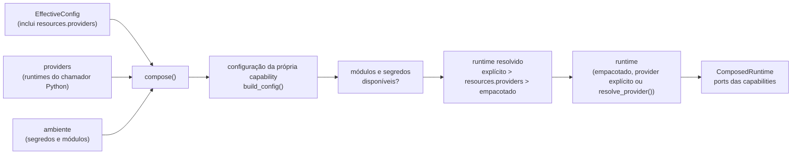

# Composition root

`contextmap.runtime.composition` é o **único** lugar em que backends concretos são nomeados e construídos. Uma capability nunca importa o runtime; um estágio downstream nunca descobre qual backend produziu sua entrada. Cada implementação sai daqui atrás do port que sua capability publica, então trocar de backend é uma mudança de configuração, sem editar código downstream.



## Regras

- **Construir não é carregar.** Os parâmetros são validados pela configuração da própria capability e os módulos/segredos são checados **antes** de qualquer modelo ser pedido. Os loaders empacotados são lazy; um modelo que o repositório não sabe carregar entra por um `RuntimeProvider`.
- **Sem fallback.** Um backend selecionado que não pode ser construído levanta um erro específico. Nada o substitui por outro backend nem remove o estágio.
- **Sem política científica.** As factories só traduzem valores configurados para os tipos da capability. Padrões, faixas e significado são da capability; `build_config()` lê os tipos declarados na dataclass de configuração e converte os valores JSON, então o runtime não duplica parâmetros de backend.
- **Sem registry nem plugin.** A tabela de factories é explícita e fechada; os módulos de backend são importados dentro da factory que os usa, então compor uma configuração importa só o que ela seleciona.

## API

- `compose(effective, providers=..., stages=..., environ=..., module_available=..., on_provider_override=...)` devolve um `ComposedRuntime`.
- `ComposedRuntime` guarda `effective`, os `stages` compostos, os `unavailable_stages` (estágios habilitados sem capability implementada, com o motivo) e as implementações: `source_adapter`, `region_discovery` (`RegionDiscoveryPlan`: factory run-scoped + proveniência do backend + `RegionDiscoveryIdentity` efetiva, #661), `region_grounding` (`RegionGroundingPlan`: queries + factory run-scoped + proveniência do backend, `None` quando não selecionado), `region_refinement` (`RegionRefinementPlan`: factory run-scoped + proveniência do refinador, `None` quando não selecionado), `dense_features`, `region_features`, `semantic_interpreter` (`SemanticInterpreterFactory`: constrói o interpretador de um run sobre o diretório das views dele, #661), `semantic_request_policy` (a política de request semântico resolvida, ver "Política de request semântico resolvida"), `semantic_scoring` (`SemanticScoringPlan`: factory por seleção de artifacts visual e semântico + proveniência do scorer + template do texto, `None` quando o estágio opcional está desligado), `state_estimator`, `geometric_mapping_pose_lookup`, `motion_correction`, `geometric_mapping_deskew` (a `PoseInterpolationDeskewPolicy`, `None` quando `geometric_mapping.deskew` não é selecionado), `geometric_mapping_aggregation` (a `ScanVoxelPolicy`, `None` quando `geometric_mapping.aggregation` não é selecionado), `point_encoder` e `center_selection` (o encoder e a política de centros de Point Representation, `None` quando o estágio opcional está desligado), `support_policy`, `accumulation_policy`, `occlusion_policy`, `association_tolerances`, `association_pose_policy`, `association_dense_sampling` (a `InterpolationPolicy` dos canais densos da associação, `None` quando `sensor_association.dense_sampling` não é selecionado), `association_box_policy` (a `BoxDepthComponentPolicy`, `None` quando `sensor_association.membership` não é selecionado), `entity_retrieval_policy`, `entity_comparison_channels`, `entity_resolution_policy`, `entity_belief_policy` (a `ResolvedBeliefPolicy`, `None` quando `entity_resolution.belief` não é selecionado) e `spatial_relations_policies` (que já inclui a política de geometry summary — `SpatialRelationsExecutor` a lê só dali, nunca de um segundo parâmetro, revisão do PR #540). Um campo é `None` quando seu estágio não foi composto.
- `compose_executors(effective, providers=..., environ=..., module_available=..., on_provider_override=..., on_composition_failure=..., semantic_map_id=..., code_digest=..., code_version=...)` devolve um `dict[str, StageExecutor]`: é a contraparte automática de `compose()` para o DAG (ver seção própria abaixo). `on_composition_failure(stage_id, error)` recebe o motivo de cada estágio que ela não conseguiu compor.
- `executor_identities(effective, code_identity)` deriva, da identidade do código de um run e do seu dataset, os três últimos argumentos de `compose_executors` (ver [a seção própria](#identidades-que-um-run-grava-executor_identities)); a CLI e `Runtime` compõem por ela.
- `provided_runtimes(effective, providers)` nomeia os componentes cujo runtime um provider supre, explícito ou declarado em `resources.providers`; é o `provided_runtimes` que a CLI e `Runtime` passam ao preflight (ver [Providers declarados](#providers-declarados-em-configuração-resourcesproviders)).
- `RuntimeProvider` é `Callable[[config, ResolvedSecrets], runtime]`: recebe a configuração da capability, já validada, e **somente** os segredos que aquele backend declara. Nada do run chega a ele: o runtime que devolve recebe cada entrada já materializada, resolvida contra o diretório do run pelo adapter que a composição constrói para aquele run (ver [O que um provider devolve](#o-que-um-provider-devolve-661)).
- `resolve_provider(component_id, target)` resolve um alvo `"module:attribute"` declarado em `resources.providers` (configuração) no `RuntimeProvider` que ele nomeia — ver a seção própria abaixo. `on_provider_override(component_id)` é chamado quando um `providers=` explícito vence um alvo declarado para o **mesmo** componente (nunca em uma execução comum pelo `contextmap` instalado, que nunca passa `providers=`).
- `FeatureBuildScope` reúne o estado de execução de que um extrator de features precisa (run, estágio, artifact, sink de payload, raiz das imagens preparadas, fonte de máscaras). Um extrator escreve seus payloads no run que o possui, então só pode ser construído quando esse run existe; por isso `dense_features` e `region_features` são factories que recebem o escopo, e a configuração é validada já em `compose()`.

## De onde vem cada runtime

| Ponto de variação | Backend | Runtime |
|---|---|---|
| `ingestion.source_adapter` | `ros1_bag`, `ros2_bag`, `pose_file` | adapter construído a cada pedido (`SourceAdapterConfig`); os bags exigem `rosbags`, o `pose_file` (arquivo de poses TUM, com `format`, `parent_frame`, `body_frame` e `pose_role` em `extra`) não exige nada; um pedido de outra família de source é recusado |
| `region_perception.discovery` | `sam2`, `sam3`, `florence2` | **provider** (`Sam2Runtime`, `Sam3Runtime`, `Florence2Runtime`, ex.: `Sam2AutomaticMaskRuntime.from_model(model=..., config=config)`), pedido uma vez na composição; `RegionDiscoveryPlan` com a factory run-scoped (`RegionDiscoveryFactory`), que liga o adapter às imagens preparadas do run e entrega ao runtime os pixels de cada pass, a `BackendProvenance` do backend (`backend`) e a `RegionDiscoveryIdentity` efetiva (`discovery_identity`), que entram na identidade do run |
| `region_perception.refinement` (**opcional**) | `sam2` | **provider** (`Sam2PromptRuntime`, ex.: `Sam2ImagePredictorRuntime.from_model(...)` sobre o SAM2 já carregado), pedido uma vez na composição; `RegionRefinementPlan` com a factory run-scoped (`RefinementFactory`) e a `BackendProvenance` do refinador (`backend`), que entra na identidade do run; exige `region_perception.grounding`, senão `ConfigurationError`; `None` quando não selecionado |
| `region_perception.grounding` (**opcional**) | `locateanything` | loader empacotado `TransformersLocateAnythingRuntime` (lazy; `torch`, `transformers`, `Pillow`, código remoto do modelo na revisão fixada) ou provider (`LocateAnythingRuntime`); é uma factory run-scoped (`RegionGroundingPlan.factory(prepared_image_root)`), então o modelo carrega uma vez por run; `None` quando não selecionado |
| `visual_features.dense` | `dinov2`, `dinov3`, `siglip2` | loader Hugging Face empacotado (lazy; `torch`, `transformers`, `Pillow`) ou provider; `siglip2` tem escopo `dense` **fixado** pelo slot |
| `visual_features.region` | `clip`, `alphaclip` | loader empacotado (HF / oficial) ou provider; `clip` tem escopo `region` **fixado** pelo slot; `alphaclip` exige `mask_source` no escopo |
| `semantic_interpretation.interpreter` | `qwen`, `gemini`, `florence2`, `eagle2_5` | **provider** (`QwenRuntime`, `GeminiClient`, `Florence2SemanticRuntime`, `EagleRuntime`, ex.: `HuggingFaceQwenRuntime(config=config)`), pedido uma vez na composição; a factory run-scoped (`SemanticInterpreterFactory`) liga o adapter às views do run, e o runtime recebe os bytes verificados de cada view; `gemini` declara o segredo `GEMINI_API_KEY`; `eagle2_5` exige o orçamento visual `max_dynamic_tiles` ([Eagle 2.5](../../visual_perception/docs/eagle2_5.md)) |
| `semantic_scoring.scorer` (estágio opcional `semantic_scoring`) | `clip`, `alphaclip` | `clip`: loader empacotado `HuggingFaceClipTextRuntime` (lazy; `torch`, `transformers`; só a torre de texto com a projeção, na revisão fixada) ou provider (`ClipTextRuntime`); `alphaclip`: **provider** (`AlphaClipTextRuntime`, ex.: `OfficialAlphaClipTextRuntime(config=..., checkpoint_root=...)`), pedido uma vez na composição, porque os checkpoints locais vivem numa raiz que a configuração não declara (#71). `SemanticScoringPlan` com a factory que monta o scorer sobre o feature store do artifact visual selecionado e a `BackendProvenance` do scorer (`backend`), que entra na identidade do run ([pontuação semântica](../../visual_perception/docs/semantic-scoring.md)) |
| `state_estimation.estimator` | `external_pose`, `fast_lio` | `external_pose` não precisa de runtime; `fast_lio` usa o runner por subprocesso empacotado, descrito no grupo `runner` (`command`, `timeout_s`, `work_root`), ou um provider |
| `geometric_mapping.pose_lookup`, `sensor_association.pose_policy` | `lookup-policy-v1` | nenhum; constrói um `state_estimation.LookupPolicy` (o tipo é de `state_estimation`, mas cada estágio que o consome declara seu próprio componente — ver "Estágios") |
| `geometric_mapping.motion_correction` | `motion-correction-v1` | nenhum; constrói um `MotionCorrectionPolicy` |
| `geometric_mapping.aggregation` (**opcional**) | `scan-voxel-centroid-v1` | nenhum; o parâmetro obrigatório `cell_m` vira a `ScanVoxelPolicy` que funde os pontos de cada scan que caem no mesmo voxel no seu centroide; `None` quando não selecionado, e o mapa guarda todo ponto bruto |
| `geometric_mapping.deskew` (**opcional**) | `pose-interpolation-deskew-v1` | nenhum; os parâmetros obrigatórios `time_field`, `time_unit` (`seconds`), `reference` (`scan_timestamp`) e `time_bin_ns` viram a `PoseInterpolationDeskewPolicy` que corrige cada scan para o movimento da plataforma antes do mapeamento (C3; ver [correção de movimento](../../geometric_mapping/docs/motion-correction.md)); `None` quando não selecionado, e cada scan é mapeado com a pose do seu timestamp, como antes. O corretor exige lookup `interpolated`, e um scan que não pode ser corrigido é recusado (`deskew_rejected`), nunca mapeado cru |
| `sensor_association.occlusion` | `conservative-depth-support-v1` | nenhum; constrói um `OcclusionPolicy` |
| `sensor_association.tolerances` | `diagnostic-tolerances-v1` | nenhum; constrói um `DiagnosticTolerances` |
| `sensor_association.dense_sampling` (**opcional**) | `dense-feature-sampling-v1` | nenhum; o parâmetro obrigatório `interpolation` (`nearest` ou `bilinear`) vira a `InterpolationPolicy` de todos os canais densos da associação (#651); `None` quando não selecionado, e a associação continua geometry-only |
| `sensor_association.membership` (**opcional**) | `box-depth-component-v1` | nenhum; os parâmetros obrigatórios `cell_size_m`, `core_fraction`, `minimum_support_points` e `ambiguity_ratio` viram a `BoxDepthComponentPolicy`, a regra por caixa para regiões sem máscara (ver [`membership.md`](../../sensor_association/docs/membership.md)); `None` quando não selecionado, e uma região só com caixa continua `NO_INLINE_MASK` |
| `point_representation.center_selection` (estágio opcional `point_representation`) | `observation-support-anchor-v1` | nenhum; constrói a `ObservationSupportAnchorPolicy` da capability, sem parâmetros: uma âncora por observação espacial da associação ([seleção de centros](../../point_representation/docs/center-selection.md)) |
| `point_representation.encoder` (estágio opcional `point_representation`) | `geometric_descriptor`, `ptv3` | `geometric_descriptor` não precisa de runtime; `ptv3` exige um provider (`PTv3Runtime`, ex.: `PointceptPTv3Runtime`; ver [PTv3 pelo runtime](../../point_representation/docs/ptv3.md#pelo-runtime)) |
| `semantic_fusion.support`, `semantic_fusion.accumulation` | políticas versionadas | nenhum |
| `entity_resolution.retrieval`, `entity_resolution.resolution`, `entity_resolution.geometry_comparison` | políticas versionadas (obrigatórias) | nenhum |
| `entity_resolution.semantic_compatibility`, `entity_resolution.temporal_compatibility` | políticas versionadas (**opcionais**) | nenhum; `None` quando não selecionado |
| `entity_resolution.appearance`, `entity_resolution.representation` | políticas versionadas (**opcionais**) | **provider** (`FeatureVectorSource`, `RepresentationVectorSource`); `None` quando não selecionado |
| `entity_resolution.belief` (**opcional**) | `resolved-belief-min-support-v1` | nenhum; o parâmetro obrigatório `min_supporting_physical_observations` (sem padrão; 2 é a hipótese a avaliar) vira a `ResolvedBeliefPolicy` que deriva a crença de cada entidade resolvida (C9); `None` quando não selecionado, e nenhuma crença é derivada |
| `spatial_relations.frame_conventions`, `spatial_relations.candidate`, `spatial_relations.geometry_summary` | políticas versionadas (obrigatórias) | nenhum; `geometry_summary` constrói um `semantic_mapping.GeometrySummaryPolicy` |
| `spatial_relations.geometric_predicate`, `spatial_relations.contact_predicate` | políticas versionadas (**opcionais**) | nenhum; `None` quando não selecionado |

Um provider fornecido para um backend que também empacota um loader **substitui** o loader e a checagem dos módulos opcionais dele: aqueles módulos passam a ser da responsabilidade do runtime fornecido.

## Grupos de parâmetros reservados

Alguns backends recebem, além da própria configuração, um segundo objeto de configuração. Ele é escrito como um grupo dentro do bloco do backend: `pass_config` e `normalization_config` nos backends de Region Discovery; `support_policy` nos encoders de Point Representation (obrigatório); `runner` no FAST-LIO; `query_set` no LocateAnything (obrigatório); `prompt_policy` nos interpretadores semânticos Qwen, Gemini e Eagle 2.5 e `view_policy` em todo interpretador semântico (obrigatórios, ver abaixo). Cada grupo é validado pela dataclass que a capability já define.

`query_set` (`GroundingQuerySet`) é a lista ordenada de queries de grounding que o run faz a **toda** imagem. Ela nunca chega à configuração do backend nem ao fingerprint dele: o executor transforma cada par (imagem, query) em um `RegionGroundingRequest` explícito, cuja identidade inclui a query. Por estar no bloco do componente, a query ainda entra no digest do estágio, então mudar uma query gera outro run de percepção em vez de reutilizar um run com outra pergunta. Cada query é validada contra as políticas declaradas pelo LocateAnything **na composição**, antes de qualquer modelo:

```toml
[components.region_perception.grounding]
backend = "locateanything"
[components.region_perception.grounding.locateanything]
model = "nvidia/LocateAnything-3B"
revision = "<commit SHA de 40 caracteres>"
dtype = "bfloat16"
generation_mode = "hybrid"
max_new_tokens = 8192
temperature = 0.0
text_attention = "sdpa"
vision_attention = "flash_attention_2"
[[components.region_perception.grounding.locateanything.query_set.queries]]
task = "category_detection"
policy_id = "locateanything.category-detection/1"
geometry = "box"
categories = ["chair", "table", "door"]
```

### Conjunto de conceitos do SAM3 (#662)

O SAM3 com `strategy = "text_prompt"` recebe as frases como **um** parâmetro do próprio bloco: `prompts`, uma lista ordenada (JSON ou TOML) que `compose()` entrega como `Sam3Config.prompts`. Não é um grupo reservado: diferente de `query_set`, a lista faz parte da configuração do backend, e portanto do fingerprint dele (`BackendProvenance.configuration_fingerprint`). Ela também entra no `config_digest` do estágio `region_perception`, então trocar uma frase ou a ordem gera outro run de percepção em vez de reutilizar um run com outro conjunto. A validação é da capability, na composição e antes de pedir o runtime ao provider: lista vazia com `text_prompt`, qualquer frase com `automatic`, frase em branco e frase repetida levantam `BackendConfigurationError`. O parâmetro antigo `prompt` não existe mais, e um bloco que ainda o usa é recusado como parâmetro desconhecido.

```toml
[components.region_perception.discovery]
backend = "sam3"
[components.region_perception.discovery.sam3]
checkpoint = "facebook/sam3"
model_version = "<revisão do checkpoint>"
precision = "bfloat16"
strategy = "text_prompt"
prompts = ["chair", "table", "door"]
```

Um override na linha de comando escreve a lista como literal JSON: `components.region_perception.discovery.sam3.prompts=["chair","table"]`. Execução, proveniência por frase e o que acontece quando duas frases produzem a mesma máscara estão em [Region Discovery](../../region_perception/docs/region-discovery.md#conjunto-de-conceitos-do-sam3-662).

### Política de prompt semântico (#542)

A política de prompt de Semantic Interpretation é selecionada pela configuração, antes de qualquer inferência, e nunca por um backend:

```toml
[components.semantic_interpretation.interpreter]
backend = "qwen"

[components.semantic_interpretation.interpreter.qwen]
model = "Qwen/Qwen3-VL-4B-Instruct"
precision = "bfloat16"
max_new_tokens = 256
temperature = 0.0
prompt_policy = { scene = "scene/v1", region = "region/v1" }
```

- **Obrigatória para Qwen, Gemini e Eagle 2.5.** O grupo `prompt_policy` é validado por `visual_perception.SemanticPromptPolicy`: cada identidade precisa existir em `SEMANTIC_PROMPT_TEMPLATES` e pertencer ao seu modo. Sem o grupo, ou com uma identidade desconhecida ou de outro modo, `compose()` levanta `BackendConfigurationError` antes de pedir o runtime do modelo. Não há padrão: a política canônica é declarada explicitamente (`scene/v1`/`region/v1`) e reproduz byte a byte o prompt anterior a #542. A mesma política vale para os três backends, que a renderizam de forma idêntica.
- **Contexto de cena (#529).** `prompt_policy.region_scene_context = true` condiciona cada request de região ao `SceneContext` do request de cena do mesmo frame; exige um template de região que renderize contexto (`region-scene-context/v1`) e um intérprete que o aceite (Qwen, Gemini; não o Eagle 2.5), e é recusado na composição caso contrário. Ausente ou `false`, nada é anexado; com `region-scene-context/v1` o prompt então diz que nenhum contexto foi fornecido, o braço desligado de uma ablação pareada.
- **Florence-2 é nativo da task.** Sua política é o prompt da task configurada (`florence2-task-prompt/1:<task>`), válida só para o modo que a task serve; um `prompt_policy` no bloco `florence2` é recusado com essa explicação, em vez de ser registrado como se o modelo o consumisse.
- **Composição.** O prompt de cada modo entra em `ComposedRuntime.semantic_request_policy` (`SemanticModePrompt`: `template_id`, `output_schema`), que o `VisualPerceptionExecutor` copia para `prompt_template_id`/`requested_output_schema` de cada request. Um modo sem prompt (o modo que a task do Florence-2 não serve) falha explicitamente ao montar o request, nunca recebe um padrão.
- **Identidade e reuso.** Como qualquer parâmetro de backend, `prompt_policy` entra na configuração efetiva, no seu digest e no `config_digest` do estágio `region_perception`. Trocar só a política recalcula `visual_perception` e, pelas entradas, os estágios que dependem dele; `ingestion`, `state_estimation` e `geometric_mapping` mantêm a identidade e continuam reutilizáveis. A granularidade é a do estágio: Region Discovery e features são recalculados junto, porque Semantic Interpretation ainda não é um estágio próprio do runtime.

### Política de views semânticas (#524)

A política de views de evidência também é selecionada pela configuração, como grupo reservado obrigatório `view_policy` no bloco de **qualquer** backend semântico (Qwen, Gemini, Eagle 2.5 e Florence-2), validado por `visual_perception.SemanticViewPolicy`:

```toml
[components.semantic_interpretation.interpreter.qwen]
# ...
prompt_policy = { scene = "scene/v1", region = "region/v1" }
view_policy = { region_views = ["masked_subject", "tight_crop", "contextual_crop"], mask_fill_rgb = [0, 0, 0], context_margin_ratio = 0.5, context_boundary = { rgb = [255, 0, 0], width_px = 2 } }
```

As views de contorno da máscara (braços B e D da ablação C6) declaram o contorno como grupo aninhado, obrigatório exatamente quando uma delas é declarada:

```toml
view_policy = { region_views = ["mask_outline_crop"], mask_outline = { rgb = [255, 0, 255], width_px = 2 } }
```

- **Sem padrão.** Sem o grupo, ou com uma política ambígua (views repetidas, sem view presa à região, parâmetro ausente para uma view declarada ou presente para uma view não declarada), `compose()` levanta `BackendConfigurationError` antes de pedir o runtime do modelo. A política equivalente ao comportamento anterior a #524 é `{ region_views = ["tight_crop"] }`.
- **Preflight contra o backend.** Depois de construir o intérprete (sem carregar modelo), `compose()` confere a política com `interpreter.capabilities()` via `check_view_policy_supported()`: o Florence-2, que aceita exatamente uma view que a região preenche, recusa duas views, recorte contextual ou frame inteiro já na composição.
- **Composição.** `ComposedRuntime.semantic_request_policy.views` guarda a política; o `VisualPerceptionExecutor` a entrega à bridge, que só monta requests: os bytes e a linhagem de cada view vêm de `materialize_region_views()`/`materialize_scene_view()`, da capability. A bridge decodifica a imagem preparada (Pillow, como antes) e identifica seus bytes pelo SHA-256 para a linhagem das views.
- **Identidade e reuso.** Como `prompt_policy`, `view_policy` entra na configuração efetiva, no seu digest e no `config_digest` de `visual_perception`, sem mudar a identidade de `ingestion`, `state_estimation` e `geometric_mapping` nem o fingerprint de configuração do backend.

### Política de request semântico resolvida (#544)

`prompt_policy`, `view_policy` e `prompt_policy.region_scene_context` continuam grupos irmãos no bloco do backend semântico; `resolve_semantic_request_policy(effective)` os resolve em **uma** `visual_perception.SemanticRequestPolicy`: o prompt de cada modo interpretado (`SemanticModePrompt`, com o schema de saída), as views ordenadas e o interruptor de contexto de cena, com uma identidade (`fingerprint()`, versão `semantic-request-policy/1`). O orçamento visual (`min_pixels`/`max_pixels`, tiles do Eagle) continua configuração do backend e fica fora dela.

- **Só configuração.** A resolução lê apenas a configuração efetiva: nenhum provider é chamado, nenhum modelo ou backend é construído. Um manifesto de experimento (#527) nomeia o tratamento de um arm pelo fingerprint antes de qualquer execução; `compose()` compõe exatamente essa política (`ComposedRuntime.semantic_request_policy`) e a entrega ao `VisualPerceptionExecutor`, a única fonte de prompt, views e contexto dos requests.
- **Determinística e deduplicável.** JSON, TOML com chaves em outra ordem e overrides que resolvem aos mesmos valores dão o mesmo digest efetivo, o mesmo `config_digest` de `visual_perception` e o mesmo fingerprint. Seleções equivalentes que diferem só na forma (por exemplo `region_scene_context = false` explícito ou omitido) têm o mesmo fingerprint; o `config_digest` do estágio segue os parâmetros como escritos e as trata como configurações distintas, o que recalcula em vez de reaproveitar indevidamente.
- **Recusa antes do modelo.** Na composição, `check_request_policy_supported()` confere a política com a declaração do intérprete (modos com prompt, tipos e número de views, contexto de cena) e levanta `BackendConfigurationError`; nenhum modelo é carregado para isso.
- **Identidade de estágio.** Mudar só a política muda só o `config_digest` de `visual_perception`; `ingestion`, `state_estimation` e `geometric_mapping` mantêm a identidade.
- **Por que não um grupo `request_policy`.** Os grupos irmãos já são declarativos e entram na identidade; agrupá-los obrigaria toda configuração a mudar de forma sem ganho semântico, e o Florence-2 aceita `view_policy` mas não `prompt_policy`, então o grupo único teria regras por backend de qualquer jeito. A identidade única de que manifestos e comparações pareadas precisam é o fingerprint resolvido.

### Orçamento de entrada visual do Qwen (#526)

O custo visual de uma request Qwen com várias views é controlado por dois parâmetros comuns do bloco `qwen`, não por um grupo reservado:

```toml
[components.semantic_interpretation.interpreter.qwen]
model = "Qwen/Qwen3-VL-4B-Instruct"
precision = "bfloat16"
max_new_tokens = 256
temperature = 0.0
min_pixels = 262144    # 256 tokens visuais de 32 px por view
max_pixels = 1310720   # 1280 tokens visuais de 32 px por view
prompt_policy = { scene = "scene/v1", region = "region/v1" }
```

- **Validação antes do runtime.** `QwenSemanticConfig` exige os dois juntos (ou nenhum), positivos e com `min_pixels ≤ max_pixels`; qualquer outro caso é `BackendConfigurationError` em `compose()`, antes de o provider ser chamado. O provider recebe o orçamento dentro do `QwenSemanticConfig`, e o `HuggingFaceQwenRuntime` o aplica e o confere ao construir o processor ([Adapter Qwen](../../visual_perception/docs/semantic-interpretation.md#runtime-transformers-huggingfaceqwenruntime)).
- **Por view, não por request.** Os limites valem para cada imagem depois do resize do processor; o custo de uma request é a soma das views. Não há parâmetro de total por request, porque o processor não o aplica.
- **Identidade.** O orçamento entra na configuração efetiva, no fingerprint do intérprete e no `config_digest` de `visual_perception`: uma ablação de orçamento recalcula só esse estágio. Sem os dois parâmetros, configuração efetiva, digest e fingerprint são os de antes do #526, e vale o default do processor do checkpoint na revisão fixada. Num manifesto de experimento, o fator é declarado nos campos `interpreter.qwen.min_pixels`/`interpreter.qwen.max_pixels`.
- **Diagnóstico, não identidade.** O tamanho que cada view atingiu e seus tokens visuais ficam em `SemanticBackendDiagnostics.visual_inputs` de cada execução; um estouro de memória é `QwenOutOfMemoryError`, cuja mensagem nomeia o número de views e o orçamento em vigor.

## Ordem de validação

1. a configuração da capability (`build_config()`), com **todos** os problemas de uma vez e a mensagem da própria capability;
2. os módulos opcionais e os segredos declarados no catálogo;
3. o runtime (provider ou loader empacotado).

Assim um checkpoint inválido ou um limiar fora da faixa falha antes de qualquer modelo ser pedido. Os erros são `BackendConfigurationError`, `BackendUnavailableError`, `BackendRuntimeMissingError`, `ProviderConfigurationError` e `StageUnavailableError`, todos `CompositionError`.

## Providers declarados em configuração (`resources.providers`)

Um `RuntimeProvider` é um `Callable` Python: um `providers={...}` em `compose()`/`compose_executors()` só existe para quem embute o runtime (uma API Python, um teste, um futuro TUI). O binário `contextmap` **instalado** — `contextmap run`/`contextmap stage`, chamando `main(argv)` sem nenhum `providers=` — nunca tem como construir esse dicionário: ele só recebe o que a configuração descreve. Por isso um backend sem loader empacotado (SAM2, SAM3, Qwen, Gemini, Florence-2 hoje) também aceita seu provider como um **alvo declarado em configuração**, sob `resources.providers`:

```json
{
  "resources": {
    "providers": {
      "region_perception.discovery": "meu_pkg.contextmap_loaders:load_sam3"
    }
  }
}
```

- **Formato.** O valor é `"módulo:atributo"` — nunca `eval`, nunca uma expressão. `resolve_provider(component_id, target)` (em `composition.py`, perto da própria definição de `RuntimeProvider`) faz `target.partition(":")`, importa o módulo com `importlib.import_module` e lê o atributo com `getattr`. O atributo importado **é** o provider — não existe uma fábrica intermediária que o embrulhe; ele já precisa satisfazer o contrato de `RuntimeProvider` diretamente (`Callable[[config, ResolvedSecrets], runtime]`).
- **Onde mora.** `resources.providers` é um novo campo de `ResourcesConfig` (`config.py`), ao lado de `device`/`workspace`: é uma decisão de composição/implantação (qual processo fornece qual runtime), nunca um parâmetro científico do backend, então nunca mistura com `components.<capability>.<slot>.<backend>`. Ele flui pelas mesmas camadas que qualquer outro campo (perfil < arquivos < overrides, mesclagem chave a chave em camadas de arquivo) e participa do digest da configuração efetiva automaticamente, porque `RuntimeConfig.to_document()` já o inclui.
- **Precedência.** Em `_Context.runtime()`/`_Context.optional_runtime()` (`composition.py`): um `providers=` explícito para um componente sempre vence, mesmo quando a configuração também declara um alvo para o mesmo componente; só na ausência do explícito é que o alvo declarado é resolvido; só na ausência de ambos é que `BackendRuntimeMissingError` é levantado, exatamente como antes. Quando o explícito de fato vence sobre um declarado (os dois existem para o mesmo componente — só acontece com um chamador Python), isso é reportado via `on_provider_override(component_id)` e acaba registrado no evento `run_planned` do próprio run (campo `provider_overrides`), nunca aplicado silenciosamente. Uma execução comum pelo binário instalado nunca passa `providers=`, então esse ramo nunca é exercitado nela.
- **Preguiça.** Um alvo declarado só é resolvido (importado) quando aquele componente está **de fato** sendo composto — nunca antecipadamente para o documento inteiro. Isso preserva a garantia já documentada no topo deste arquivo: compor uma configuração importa só os backends que ela seleciona. `ensure_available()` também para de exigir os módulos opcionais do backend quando um provider é esperado (explícito **ou** declarado): aquele import pesado é responsabilidade do provider, nunca de `contextmap.runtime`. A regra é uma só, `provided_runtimes(effective, providers)`, e o preflight a recebe pelo mesmo nome: a CLI e `Runtime` passam esses componentes a `preflight()`/`run_plan()`/`resume_plan()`, então um provider declarado para DINOv2 ou CLIP também dispensa torch, transformers e Pillow no preflight, e não só na composição (#659). Os segredos continuam exigidos: um provider não é necessariamente quem os lê.
- **Postura de segurança.** Um alvo `resources.providers` é código Python executado em tempo de execução: só a sintaxe `"módulo:atributo"` é aceita, nenhum módulo é instalado automaticamente, e a resolução é sempre pontual (nunca eager para o documento inteiro). Isso é a **mesma** fronteira de confiança de qualquer outra configuração que nomeia código executável — configuração de origem não confiável nunca deve ser resolvida assim. Não há sandbox nem allowlist (não há um problema concreto que os justifique hoje).

### O que um provider devolve (#661)

O contrato do provider continua `(config, secrets) -> runtime`, chamado **uma vez**, na composição.
O runtime devolvido não sabe nada do run: `RegionPerceptionExecutor` materializa imagens
preparadas; `VisualPerceptionExecutor` rematerializa as imagens necessárias às features;
`SemanticInterpretationExecutor` materializa suas views. Cada executor cria seu scratch dentro de
`execute()`, e as referências (`PreparedImage.payload_reference`, `SemanticVisualView.payload_reference`)
são relativas a esse diretório. Resolvê-las é trabalho do lado do adapter e da composição, no
mesmo padrão de grounding, refinamento e features:

- a composição devolve factories run-scoped para os dois slots: `RegionDiscoveryPlan.factory(prepared_image_root)`
  e `semantic_interpreter(view_root)`. O executor dono do stage chama sua factory com o scratch do run, então cada run
  tem seu adapter, e todos compartilham o runtime pedido ao provider;
- o adapter de Region Discovery recorta cada pass das imagens preparadas do run
  (`materialize_discovery_pass`: bytes conferidos pelo SHA-256 registrado, decodificados em RGB),
  confere as dimensões com `validate_materialized_discovery_image` e chama
  `runtime.predict(discovery_input, image, config)`
  ([Region Discovery](../../region_perception/docs/region-discovery.md#materialização-e-validação-da-imagem-de-cada-pass-661));
- o adapter de Semantic Interpretation lê cada view do request sob o diretório do run, confere o
  SHA-256 (`read_view_payload`) e chama o runtime com `visual_views: tuple[MaterializedSemanticView, ...]`,
  a identidade de cada view com os bytes verificados
  ([Integridade das views](../../visual_perception/docs/semantic-interpretation.md#integridade-das-views-na-inferência)).

Um provider devolve, portanto, só o runtime do modelo carregado, sem raiz nenhuma. Por exemplo:

```python
def load_sam2(config: Sam2Config, secrets: ResolvedSecrets) -> Sam2Runtime:
    model = build_sam2(...)  # o carregamento do modelo é do provider
    return Sam2AutomaticMaskRuntime.from_model(model=model, config=config)


def load_qwen(config: QwenSemanticConfig, secrets: ResolvedSecrets) -> QwenRuntime:
    return HuggingFaceQwenRuntime(config=config)
```

Nenhum desses helpers recebe mais `image_loader` ou `view_root`. Um runtime próprio implementa os
mesmos seams: `Sam2Runtime`/`Sam3Runtime`/`Florence2Runtime.predict(discovery_input, image, config)`
e `QwenRuntime`/`EagleRuntime`/`GeminiClient.generate(visual_views=..., prompt=..., config=...)`
(`Florence2SemanticRuntime.generate(visual_views=..., task_prompt=..., config=...)`). O diretório
de rascunho nunca aparece no artifact publicado e continua sendo apagado ao fim de `execute()`, com
ou sem sucesso. O adapter só materializa passes sem escala, porque nenhuma regra de reamostragem
está definida para discovery; por isso uma `pass_config` com algum tiling de `TilingConfig.scale`
diferente de 1 é recusada já na composição, com `BackendConfigurationError`, e nenhum run começa.

## Estágios

`compose()` monta todo estágio habilitado cuja capability existe e lista os demais em `unavailable_stages`; pedir explicitamente um estágio indisponível levanta `StageUnavailableError`. `stages=[...]` compõe só um subconjunto, e a completude da seleção é exigida apenas para ele.

`geometric_mapping` e `sensor_association` não introduzem um tipo próprio de política: `LookupPolicy` é de `state_estimation`, `MotionCorrectionPolicy` é de `geometric_mapping`, `OcclusionPolicy`/`DiagnosticTolerances` são de `sensor_association`. Cada estágio que consome uma política, mesmo uma que outra capability define, declara seu **próprio** componente sob seu próprio nome (`geometric_mapping.pose_lookup` e `sensor_association.pose_policy` são dois componentes distintos, ambos construindo um `LookupPolicy`): um componente pertence a exatamente um estágio, exatamente como `semantic_fusion.support`/`semantic_fusion.accumulation` já pertencem só a `semantic_fusion` (`tests/runtime/test_runtime_catalog.py::test_every_component_belongs_to_exactly_one_stage_of_its_capability`). `spatial_relations.geometry_summary` segue o mesmo padrão: `GeometrySummaryPolicy` é de `semantic_mapping`, mas o componente pertence a `spatial_relations`, o único estágio que o consome hoje.

### Canais opcionais: `optional=True` no catálogo

`ComponentSpec.optional` marca um ponto de variação que um estágio pode legitimamente deixar sem backend: `check_component_selection`/`check_selection` nunca reportam sua ausência como problema, e a composição constrói o valor apenas quando um backend foi selecionado (`_construct_optional`), devolvendo `None` caso contrário — nunca uma política padrão substituindo "não configurado". `geometric_mapping.deskew`, `entity_resolution.semantic_compatibility`, `.temporal_compatibility`, `.appearance`, `.representation`, `.belief`, `spatial_relations.geometric_predicate` e `.contact_predicate` estão entre os componentes hoje marcados assim; todo outro componente continua obrigatório para o estágio que o possui.

## `compose_executors`: os executores reais do DAG

`compose_executors(effective, providers=..., environ=..., module_available=..., on_provider_override=..., on_composition_failure=...)` é a contraparte automática de `compose()` para a execução: em vez de devolver backends e políticas soltos, ela os embrulha na classe concreta de `contextmap.runtime.executors` que cada estágio do DAG precisa, indexada por `stage_id`. É o que deixa o binário `contextmap` instalado executar o DAG real sem um chamador Python montando executores à mão **e** sem um chamador Python montando providers à mão: `resources.providers` supre o segundo caso (ver seção acima).

Hoje ela compõe `state_estimation`, `geometric_mapping`, `sensor_association` e `context_map` sempre que a seleção do estágio está completa e seus backends aceitam os parâmetros; `point_representation` só quando a configuração habilita o estágio opcional e o chamador passa `code_version`, que o run grava (#663); `semantic_fusion` (a acumulação pode ser a baseline, `baseline-evidence-accumulation-v1`, ou a ciente de qualidade, `quality-aware-evidence-accumulation-v1`, e `SemanticFusionExecutor` roda qualquer uma das duas, #655), `entity_resolution` e `spatial_relations` quando o chamador passa `code_version`, que o run deles grava; `semantic_scoring` só quando a configuração habilita o estágio opcional (desligado, ele não é tentado e não vira falha de composição); `semantic_mapping` quando o chamador passa `code_version`, `semantic_map_id` e `code_digest` (nenhum é valor de configuração, e os writers recusam um `code_version` ou um `code_digest` vazio, então esta função nunca inventa nenhum; ver [a seção própria](#identidades-que-um-run-grava-executor_identities)); e os produtores `region_perception`, `visual_perception` e `semantic_interpretation`, cada um quando seus próprios backends e runtimes estão disponíveis — explícito em `providers`, declarado em `resources.providers`, ou os dois (o explícito vence): cada um precisa da configuração efetiva, dos `providers` recebidos e dos artifacts upstream que o próprio DAG já entrega. Ela **nunca** levanta um erro de composição: um estágio que não pode ser composto por qualquer motivo (seleção incompleta, um parâmetro que o backend rejeita, um módulo/segredo ausente, um provider que faltou ou que não pôde ser resolvido) fica simplesmente ausente do dicionário devolvido, um estágio de cada vez — o fracasso de `sensor_association` nunca custa o executor de `state_estimation`. A ausência é honesta, e o motivo não se perde (issue #602): a exceção que `compose()` levantou para aquele estágio (`ConfigurationError` ou `CompositionError`, nunca outra) é entregue a `on_composition_failure(stage_id, error)`; uma identidade que o run do estágio grava e o chamador não passou chega como `ExecutorIdentityMissingError` (com `stage_id` e `missing`), que o preflight reporta em `stages.<estágio>` (#659). Os dois chamadores de produção (`Runtime` em `api.py` e a CLI em `cli.py`) as coletam e as repassam como `composition_failures` a `preflight()`/`run_plan()`/`resume_plan()` — ver [`pipeline.md`](pipeline.md#preflight). Nada substitui o estágio: o plano continua bloqueado, só o diagnóstico muda.

Casos que ficam de fora, deliberadamente:

- **`ingestion` e `pose_ingestion`.** `IngestionStageExecutor` precisa de um `IngestionRequest` concreto (caminho da fonte, tópicos, tolerância de sincronização) que nunca é parte de uma `EffectiveConfig` — é o que os próprios flags do comando `ingest` constroem. O caminho canônico é rodar `contextmap ingest` primeiro e alimentar o artifact publicado a `run`/`stage` como entrada fornecida ou selecionada; um chamador que queira `ingestion` (ou seu par opcional `pose_ingestion`, issue #555) dentro de `run_plan` injeta sua própria instância de `IngestionStageExecutor` explicitamente — uma segunda instância, com `stage_id="pose_ingestion"` e um `IngestionRequest` apontando para o adapter `pose_file`, para a auxiliar. Ver a seção da bridge de pose abaixo.
- **Três produtores independentes.** `RegionPerceptionExecutor` requer discovery e os
  componentes regionais opcionais selecionados; `VisualPerceptionExecutor` requer seus
  extratores de features; `SemanticInterpretationExecutor` requer intérprete e política de
  request/views. Cada composição falha no próprio componente, sem exigir que os três modelos
  coexistam para um stage poder rodar. Backends sem loader requerem provider explícito ou
  `resources.providers`, e factories recebem o scratch do stage que executa.
- **`semantic_scoring` desligado.** É opcional e desligado por padrão. Quando habilitado,
  `SemanticScoringExecutor` consome artifacts regional, visual e semântico com seleção e
  linhagem compatíveis; publica scores sem mutar os produtores. O run de scores é uma entrada
  opcional explícita de `semantic_fusion`. Ver [executores](executors.md#semanticscoringexecutor-652).
- **`point_representation` desligado.** O estágio é opcional e desligado por padrão, também em `canonical/1`; `compose_executors` só o compõe quando `pipeline.stages.point_representation = true` (desligado, ele não é tentado e não vira falha de composição) e com `code_version` (#663). `PointRepresentationExecutor` lê o mapa geométrico e o run de associação do DAG, escolhe os centros pela política selecionada em `point_representation.center_selection`, roda o `RepresentationService` com o encoder selecionado e publica o `PointRepresentationRunArtifact`, que referencia o mapa e nunca o copia. O `ptv3` sem `PTv3Runtime` deixa o estágio ausente com `BackendRuntimeMissingError`, que o preflight reporta em `components.point_representation.encoder`; nada cai para o descritor. A `configuration_identity` do executor cobre a identidade do encoder (versão do adaptador, configuração resolvida, hash do checkpoint), o fingerprint do espaço (com a política de suporte) e a política de centros, e entra na chave de reuso e no `run_id`. O run é saída derivada: nenhum estágio o consome (#657), então ligá-lo não muda a identidade de nenhum outro estágio. Ver [`executors.md`](executors.md#pointrepresentationexecutor-663).
- **`semantic_fusion`** roda a acumulação selecionada, sem substituir uma pela outra: a baseline, ou a ciente de qualidade, que pondera cada contribuição pela `ObservationQuality` que o run de associação persistiu (#655). Antes, só a baseline tinha executor e a ciente de qualidade deixava o estágio de fora. As rampas, o fator neutro e a `definitions_version` da política ciente de qualidade não têm default: vêm dos parâmetros do componente e, por isso, entram no `config_digest` do estágio e na identidade do run. A compatibilidade da `definitions_version` com o artifact de associação só é conhecida quando o executor abre suas entradas, e é conferida ali, antes de qualquer suporte (ver [`executors.md`](executors.md)).
- **`semantic_mapping`.** Tem um componente de catálogo (`semantic_mapping.geometry_summary`, o mesmo `GeometrySummaryPolicy` que `spatial_relations.geometry_summary` já compõe) e um executor real, mas dois identificadores que a configuração não carrega (`semantic_map_id`, a identidade do mapa semântico persistente; `code_digest`, exigido pelo writer da run), além do `code_version`, precisam vir do chamador — ver a seção seguinte.
- **`entity_resolution`** monta sempre o canal de geometria (obrigatório) e só monta `semantic`, `temporal`, `appearance` e `representation` quando o respectivo componente foi selecionado; um canal não selecionado é `None` no `ComparisonChannels`, nunca uma política padrão. `appearance`/`representation`, quando selecionados, ainda dependem de um `RuntimeProvider` (`FeatureVectorSource`/`RepresentationVectorSource`); sem ele, a composição do estágio falha e ele fica ausente, honestamente.
- **`spatial_relations`** monta sempre `frame_conventions`, `candidate` e `geometry_summary`; `geometric`/`contact` são `None` quando seus componentes não foram selecionados. `RelationsRunPolicies` confere que o alcance de proximidade dos candidatos cobre as tolerâncias dos avaliadores selecionados (regra de `spatial_relations`, ver [coerência entre alcance e tolerâncias](../../spatial_relations/docs/candidates.md#coerência-entre-alcance-e-tolerâncias-dos-avaliadores)); a composição só converte a recusa em `BackendConfigurationError` no componente `spatial_relations.candidate`, que o preflight reporta ali.
- **`context_map`** não tem ponto de variação próprio, então compõe sempre que seu preset o declara. Seu `up_axis` vem do mesmo `FrameConventions` que `spatial_relations` já compôs acima, quando disponível -- nunca derivado de novo -- e fica desconhecido caso contrário.

`cli.py` (`main(providers=...)`) e `Runtime` (`api.py`, `Runtime(providers=...)`) repassam `providers` para `compose_executors` na mesma forma e mesclam o resultado com os executores que o chamador forneceu explicitamente, e o explícito sempre vence — assim um teste, ou um chamador que precise substituir um estágio, continua podendo.

### Identidades que um run grava: `executor_identities`

Point Representation, Fusão, Semantic Mapping, Entity Resolution e Spatial Relations gravam no run o código que o produziu: o `RepresentationService` exige um, e o `ContextMap` recusa citar na linhagem um run da fusão em diante sem ele (`code_version must not be empty`). Semantic Mapping grava também o mapa semântico a que suas entidades pertencem e o digest do código. Nada disso é configuração: é fato da execução. `executor_identities(effective, code_identity)` é a regra única que a CLI (`--code-identity`) e `Runtime` (`code_identity=`, ou o da política de reuso) usam para derivá-los (#659):

| Argumento de `compose_executors` | Valor |
|---|---|
| `code_version` | a identidade do código, sem mudança |
| `code_digest` | `sha256:` + SHA-256 dos bytes UTF-8 da identidade: o runtime conhece o código só pela identidade que o run declara e nunca faz hash de uma árvore de fontes; é a mesma regra que os harnesses de #501/#504 usavam |
| `semantic_map_id` | `semantic-map-<dataset>` (`inputs.sequence`): o mapa semântico persistente do dataset em que o workspace arquiva o run |

O `semantic_map_id` é função só do dataset, nunca do build ou do run que pede, então repetir uma execução repete o conteúdo (a identidade do run já é função das entradas, e o reuso já inclui a identidade do código). Dois builds do mesmo dataset gravam o mesmo mapa semântico em versões diferentes; qual run materializou cada versão está na linhagem do `ContextMap`, com a identidade de conteúdo do run de Semantic Mapping. As entidades continuam identificadas por `EntityReference(semantic_map_id, entity_id)`, e nenhuma métrica de comparação entre builds usa esse identificador (a avaliação incremental pareia entidades pela geometria).

Sem identidade do código, `code_version` e `code_digest` são `None`: esses estágios ficam sem executor, e o preflight de um run que chega a eles diz por quê, antes de qualquer estágio, em vez de um run gravar `code_version = ""`. Os executores exigem um `code_version` não vazio e o recusam na construção (`ValueError`); uma identidade vazia também é recusada por `executor_identities`. `geometric_mapping`, `sensor_association` e `context_map` gravam a identidade quando existe e `None` quando não: o contrato deles aceita a ausência.

## Bridge de pose auxiliar em `state_estimation` (issue #555)

Uma sequência gravada pode não ter pose em nenhum tópico (`corridor-02.bag`, por exemplo): a trajetória vem de um arquivo separado, ingerido pelo `PoseFileSourceAdapter` (`ingestion/docs/adapters.md`) em um **segundo** `SequenceArtifact`, nunca misturado ao principal. `pose_ingestion` é um estágio opcional (`optional=True, default_enabled=False`, sem componente de catálogo próprio) que publica esse segundo artifact; `state_estimation` ganha um input opcional `pose_sequence`, ligado a `pose_ingestion` (`components/presets.py`), ausente por padrão exatamente como qualquer outro input opcional (ver "Canais opcionais" acima).

Isto é uma bridge incremental para a #177, não a arquitetura-alvo de "uma aquisição física = um `SequenceArtifact`": carregar só o artifact principal continua sem revelar a trajetória gravada. A fusão dos dois artifacts é decisão do executor, mas o resultado é nomeado explicitamente em `StateEstimationRequest`/`TrajectoryProvenance` sempre que a mesclagem de fato contribui observações (ver abaixo) — a lineage de per-stage input que a runtime já tem (`ArtifactRef`/`StageRequest.inputs`) não é suficiente sozinha, porque o `StateEstimationRunArtifact` precisa ser autoportável: um consumidor que só tenha esse artifact, sem o journal da runtime, ainda precisa conseguir fechar a proveniência de cada pose auxiliar.

- o `pose_role` declarado pela sequência auxiliar (`ground_truth`/`odometry`/`external_localization`, ver `adapters.md`) é checado primeiro: precisa ser único e consistente entre todas as suas observações; ausente ou divergente recusa o merge.
### Ordem de execução da percepção (#689)

`policies.perception_schedule` escolhe `frame_major` ou `stage_major` dentro de cada
produtor de percepção. O primeiro completa os stages internos de um frame antes do próximo;
o segundo completa um stage em todos os frames e libera o backend após seu último uso.
A política muda ordem e residência de modelos, sem alterar a identidade científica ou a
publicação contratual. Os três producers continuam separados no DAG e selecionam artifacts
imutáveis entre si. Máscaras são externalizadas pelo produtor regional, features pelo visual,
e requests/views/claims pelo semântico; scratch e buffers temporários têm lifecycle local.
Valor fora das duas opções é recusado em `policies.perception_schedule`.

### Política de candidatos de Sensor Association (#562)

`policies.association_max_range_m` é a maior distância, em metros, do centro óptico da câmera em que `sensor_association` ainda avalia um elemento do mapa. `_compose_sensor_association` a repassa como `SensorAssociationExecutor(candidates=CandidateGeometryPolicy(max_range_m=...))`.

Ela é um **policy cruzado da execução**, não um ponto de variação de backend, e por isso vive em `policies` e não em `components`: não há duas implementações de seleção de candidatos entre as quais escolher, há um parâmetro científico de uma delas.

O padrão é ausente (`None`), que avalia o mapa inteiro — exatamente como se a política não existisse —, de modo que ligar o corte é sempre uma decisão deliberada e registrada. Um valor limita o trabalho e a memória por frame pela geometria local em vez do tamanho do mapa, e **estreita a população avaliada**: é uma escolha científica, que o run registra no manifest (`candidate_policy` com seu fingerprint), no `configuration_fingerprint` da associação e nas contagens por frame de `outputs/projection-records.jsonl`. Ver `sensor_association/docs/projection_chain.md`.

- `pose_role="ground_truth"` nunca vira trajetória operacional por padrão: suas observações são descartadas do merge (o run se comporta exatamente como se a sequência auxiliar não existisse) a menos que `policies.trajectory_mode = "allow_ground_truth"` seja escolhido explicitamente na configuração — `_compose_state_estimation` repassa essa política como `StateEstimationExecutor(..., allow_ground_truth_trajectory=...)`, nunca inferida da simples presença do artifact ou da escolha do backend `external_pose`. Uma sequência ground-truth descartada por esta salvaguarda nunca chega a passar pela checagem de clock abaixo: um run em `operational_only` não pode ser bloqueado pela plausibilidade de dados que nunca seriam usados.
- só então `StateEstimationExecutor.execute()` chama `contextmap.ingestion.validate_cross_source_clock_plausibility()` sobre as duas sequências — nunca confia que os dois `timestamp_clock_id` batem só porque a string é igual; um intervalo de tempo disjuntos (o mesmo padrão de defeito que a #554 corrigiu) recusa o merge com um erro explícito. Esta é uma checagem de plausibilidade, não uma prova de alinhamento temporal (ver a docstring de `validate_cross_source_clock_plausibility`).
- quando a mesclagem de fato contribui observações, `StateEstimationExecutor` passa `auxiliary_sequence_artifact_id`/`auxiliary_selection_id` explícitos em `StateEstimationRequest`; `execute_state_estimation()` (não cada backend individualmente) copia esses dois campos para o `TrajectoryProvenance` publicado, qualquer que seja o backend que rodou. Quando a auxiliar é descartada pela salvaguarda de ground truth, os dois campos ficam `None` — o run se comporta, também na lineage persistida, exatamente como se a sequência auxiliar nunca tivesse sido configurada. `StateEstimationRunManifest` espelha os dois campos (`schema_version` `0.1.0`), e `cross_stage.lineage_closure` (`CrossStageInputs.auxiliary_sequence`) verifica, quando o cenário fornece a sequência auxiliar, que o id nomeado bate com o artifact real.

## Lacunas conhecidas

- **Loaders de modelo não empacotados.** O repositório não tem código que carregue SAM2, SAM3, Florence-2, Qwen, Gemini, PTv3 ou os `FeatureVectorSource`/`RepresentationVectorSource` de aparência/representação; esses backends dependem de um `RuntimeProvider`, fornecido por um chamador Python (`providers=`) ou declarado em `resources.providers` (resolvido por `resolve_provider`, ver seção acima — inclusive pelo binário `contextmap` instalado, sem wrapper Python). Nenhum é escolhido por padrão, e a falta de provider é um erro explícito, nunca um fallback.

- **`point_representation` sem consumidor.** O estágio roda e publica o run, mas nem a fusão nem a Entity Resolution recebem esse run: consumir a evidência 3D é um contrato novo, fora de escopo (#657). O canal `point_representation` da acumulação da fusão é recusado pela configuração, e o canal `entity_resolution.representation` continua lendo vetores só de um provider fora do DAG.
- **Identidade do código só declarada.** `executor_identities` deriva o `code_digest` da identidade que o run declara, não dos bytes do código: dois checkouts diferentes com o mesmo `--code-identity` gravam o mesmo digest. Um chamador que chame `compose_executors` sem identidade continua precisando suprir os artifacts da fusão em diante (`provided`/`inputs.selections`).
- **Composição fora do plano.** A CLI e `Runtime` compõem todo estágio que a configuração permite, não só os do plano escopado: um build com `resources.providers` declarados ainda chama os providers da percepção ao compor.
