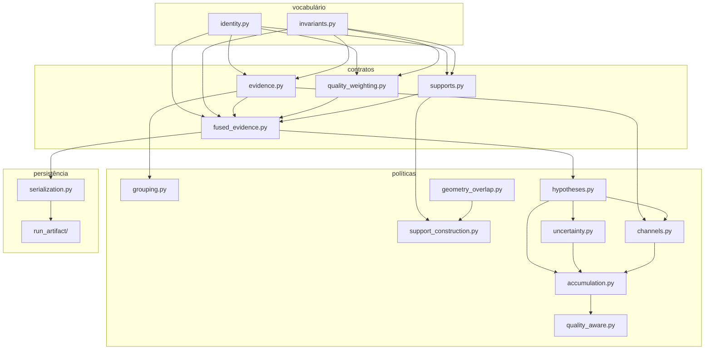

# Arquitetura de semantic_fusion

Este documento registra ownership, boundaries, direção de dependências e as invariantes arquiteturais da capability. Elas são verificáveis no código e nos testes citados, não apenas declaradas.

## O que a capability possui

Semantic Fusion possui **a acumulação de evidência semântica multi-vista sobre um suporte espacial compartilhado**, e nada além disso. Ela introduz quatro conceitos e é a única dona deles:

| Conceito | Significado | Quem define as invariantes |
| --- | --- | --- |
| `FusionSupport` | *Onde* a evidência é acumulada | `supports.py` |
| `EvidenceContribution` | *Uma vista*: uma região de um frame físico, uma inferência | `evidence.py` |
| `FusedEvidence` | A crença em formação sobre aquele suporte | `fused_evidence.py` |
| `QualityWeighting` | O peso derivado, opcional e inspecionável | `quality_weighting.py` |

## O que ela explicitamente não possui

| Não é dela | É de quem |
| --- | --- |
| identidade persistente de objeto, `Entity` | `semantic_mapping`, `entity_resolution` |
| geometria e coordenadas | `geometric_mapping` (aqui só `GeometryReference`) |
| claims | `semantic_interpretation` (aqui só referências) |
| scores de scorer | `semantic_scoring` (aqui só referências) |
| regiões, features | `region_perception`, `visual_perception` (aqui só referências) |
| qualidade de observação medida | `sensor_association` (aqui só `ObservationQualityRef`) |
| representação 3D | `point_representation` (aqui só `PointRepresentationRef`) |
| seleção de artifacts, construção de política, lifecycle | `runtime` |
| medir se a fusão está boa | `evaluation` |

Fusão nunca chama inferência. Não existe caminho desta capability para uma VLM, um scorer ou um extrator de features: um label errado não é corrigido aqui, é **reportado** como hipótese concorrente ou incerteza.

## Direção de dependências



O grafo é acíclico e tem um sentido único: **contratos nunca importam políticas, e políticas nunca importam persistência.** `geometry_overlap.py` é folha: ele não conhece nenhum contrato desta capability.

As identidades vivem num módulo próprio exatamente para manter isso: `quality_weighting` precisa de `FusedHypothesisId` e `fused_evidence` precisa de `QualityWeighting`. Sem `identity.py` haveria um ciclo, e resolvê-lo movendo algo para `shared` seria usar `shared` para esconder um problema de ownership — proibido pelo `AGENTS.md` §16.

## Dependências cross-capability

Permitidas, sempre pela API pública, declaradas em `tests/architecture/test_boundaries.py`:

| Capability | O que é usado | Por quê |
| --- | --- | --- |
| `shared` | `SourceTimestamp`, `Vector3`, `AtomicRunDirectory`, `FileEntry`, `check_file_inventory`, `BackendProvenance`, `DEBUG_DIRECTORY` | primitivas cross-cutting e publicação atômica |
| `ingestion` | `SourceObservationId`, `FrameId` | identidade do frame físico, só como tipo |
| `state_estimation` | `TimeBounds` | intervalo fechado de aquisição, para não duplicar a regra |
| `geometric_mapping` | `GeometryReference`, `GeometryId`, `GeometrySource`, `Bounds3D`, `MapId` | referenciar e resolver geometria persistente |
| `region_perception` | `RegionId`, `RegionPerceptionRunManifest` | identidade regional e seleção explícita dos produtores físicos |
| `visual_perception` | `FeatureId`, `FeatureScope`, `PerceptionResult`, `SemanticSupport` | features e visão derivada das entradas selecionadas |
| `semantic_interpretation` | `ClaimId`, `HypothesisRole`, `SemanticClaim` | evidência semântica e hipóteses originais |
| `semantic_scoring` | `SemanticScore`, `SemanticScoreType`, `SemanticScoringRunId` | score com semântica e produtor explícitos |
| `sensor_association` | `SpatialObservation*`, `ObservationQuality`, `QualityComponent` | a evidência de entrada e sua qualidade medida |
| `point_representation` | `PointRepresentationId`, `PointRepresentationRunId` | referenciar estrutura 3D estática |

Proibidas: `semantic_mapping`, `entity_resolution`, `spatial_relations`, `artifact`, `runtime`, `evaluation`. A fusão não conhece quem a consome.

Os contratos `SemanticClaimRef` e `VisualFeatureRef` pertencem à fusão, em `evidence.py`. Uma referência visual identifica o trio `(visual_artifact_id, source_observation_id, feature_id)`. As entradas derivadas são agrupadas por `(region_artifact_id, source_observation_id)`; claims de produtores semânticos diferentes permanecem correlacionadas com o mesmo frame físico, e features compartilhadas são referenciadas uma vez por observação espacial. A combinação dos produtores não multiplica a geometria nem o número de frames físicos.

## Adapters, ports e variation points

**A capability não tem adapter nem `Protocol`, e isso é deliberado.** Não há SDK, modelo, filesystem externo ou biblioteca a isolar: a entrada já chega como contrato de domínio, e a única dependência de I/O é a publicação atômica, que `shared` possui.

A variação real não é de *implementação*, é de **política versionada**:

| Variation point | Alternativas de hoje | Como é escolhida |
| --- | --- | --- |
| `semantic_fusion.support` | `geometry-jaccard-support-v1` | `runtime` constrói `GeometryOverlapSupportPolicy` |
| `semantic_fusion.accumulation` | `baseline-evidence-accumulation-v1`, `quality-aware-evidence-accumulation-v1` | `runtime` constrói a política; `SemanticFusionExecutor` despacha pelo **tipo** |

Não há fallback: uma política que nenhum ramo conhece é recusada com erro. Introduzir um `Protocol` aqui só adicionaria indireção sobre duas funções concretas que o runtime já seleciona por tipo — exatamente o que `AGENTS.md` §18 e §31 pedem para não fazer.

## Como a configuração chega

```text
perfil/CLI do runtime
    ↓  runtime/composition.py resolve e valida
GeometryOverlapSupportPolicy / BaselineAccumulationPolicy / QualityAwareAccumulationPolicy
    ↓  SemanticFusionExecutor
build_fusion_supports() / accumulate_*_evidence()
```

Nenhuma regra desta capability abre YAML, lê variável de ambiente ou consulta parâmetro de ROS. As políticas **não têm defaults** para limiares: `min_overlap`, `min_geometry_count`, as rampas, o fator neutro e a versão de definições são escolhas científicas que um perfil declara, e cada política expõe `fingerprint()` para que a configuração efetiva entre na proveniência.

`BaselineAccumulationPolicy` tem defaults apenas para o que significa *não assumir nada*: nenhum label é abstenção, só empate exato conta como empate, e só o canal de claims está ativo.

## Separação evidence / belief / knowledge

A capability atravessa exatamente duas das três camadas do ContextMap2, e os arquivos refletem isso:

- **evidence** (`evidence.py`) — o que uma execução observou, com identidade, timestamp, frame, sensor, modelo e versão preservados;
- **belief** (`fused_evidence.py`) — hipóteses acumuladas, stances, incerteza. Uma observação **nunca** se promove sozinha a verdade: uma hipótese com um único apoiador é uma hipótese, não um fato;
- **knowledge** — não é daqui. Relações e topologia são de `spatial_relations`.

`quality_weighting.py` é derivado de evidence e não altera belief: a ponderação acrescenta fatores e não muda uma hipótese, uma contribuição ou um registro de incerteza.

## Invariantes arquiteturais

1. **A fachada é a única porta, e só de fora.** Todo consumidor externo usa `from contextmap.semantic_fusion import ...`; de dentro da capability a fachada é proibida, porque ela alcança políticas e persistência e esconderia uma dependência para cima. Um módulo interno importa direto o módulo dono. Verificado por `tests/architecture/test_boundaries.py` e `test_semantic_fusion_layering.py`.
2. **Codec, motor de sobreposição e invariantes são internos.** `serialization`, `geometry_overlap`, `invariants`, `identity`, `hypotheses.ViewClaim` não aparecem em `__all__`.
3. **Nada a montante é copiado.** Nenhum contrato guarda XYZ, embedding, texto de claim de terceiros ou componente de qualidade: tudo é referência por identidade.
4. **Score heterogêneo nunca é combinado.** `SupportSignalKind` tem duas espécies e elas não se misturam; qualidade de observação deliberadamente **não** é uma delas.
5. **Ausência não é zero.** `SupportSignal.value is None` é não pontuado; um componente não medido recebe o fator neutro declarado e registra o motivo.
6. **Frame físico nunca é confundido com inferência.** A contagem de apoio é de observações físicas distintas, então N execuções sobre um frame não viram N evidências.
7. **Um run, uma política.** `run_artifact/metrics.py` recusa um run cujos suportes foram construídos ou fundidos sob políticas ou configurações diferentes.
8. **Artifact é imutável.** Publicação atômica, nunca substituição; schema pré-1.0 sem reader de compatibilidade.
9. **`__DEBUG__/` nunca é dependência.** Não entra no inventário; removê-lo não invalida o run.
10. **Incerteza é reportada, nunca resolvida.** Não existe campo de vencedor, hipótese primária ou confiança combinada em `FusedEvidence`.

## Limitações conhecidas

- A equivalência de labels é só tipográfica: `pallet` e `wooden pallet` competem como hipóteses separadas. Reconhecer refinamento exige uma regra versionada que o baseline não tem.
- O suporte por Jaccard não analisa conectividade: uma região cujos pontos estão distantes permanece um suporte só, com bounds cobrindo todos.
- O canal `point_representation` existe no contrato, mas o estágio do runtime não consome runs de Point Representation (#657).
- A qualidade da fusão não foi medida contra anotação: sem ground truth, nenhuma decisão sobre a política ciente de qualidade foi tomada. Ver [avaliação](../../evaluation/docs/semantic_fusion.md).
