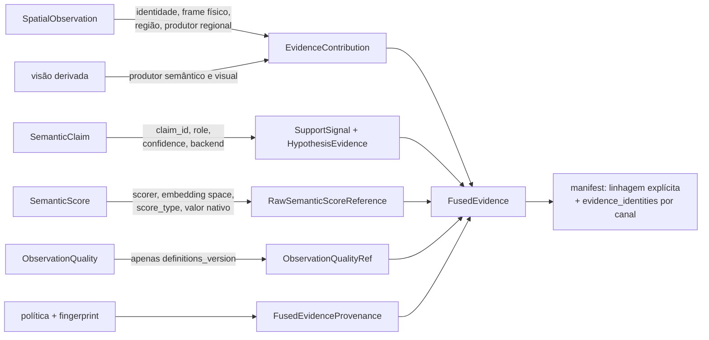

# Fluxo de dados de semantic_fusion

Este documento segue os dados reais através da implementação. Nenhuma etapa aqui é pretendida: todas existem no código citado.

## Caminho principal

```text
SpatialObservation (sensor_association)
RegionPerceptionRunManifest (region_perception, seleção explícita)
PerceptionResult (visual_perception, visão derivada)
SemanticClaim (semantic_interpretation)
VisualFeature (visual_perception, artifact visual independente)
SemanticScore (semantic_scoring, opcional)
GeometrySource (geometric_mapping)
acquisition_timestamps (ingestion, pelo índice da sequência)
        ↓
grouping.group_by_physical_observation()
        → PhysicalObservationGrouping          (frame físico ≠ inferência)
        ↓
support_construction.build_fusion_supports()
        → geometry_overlap.overlap_components()  (mecanismo: Jaccard + union-find)
        → FusionSupportBuild                     (FusionSupport[] + ExcludedObservation[])
        ↓
accumulation.accumulate_baseline_evidence()      por suporte
        ├─ monta EvidenceContribution por vista
        ├─ hypotheses.build_hypotheses()          → FusedHypothesis[]
        ├─ uncertainty.report_uncertainty()       → UncertaintyRecord[]
        └─ channels.channel_provenance()          → ChannelProvenance[]
        → FusedEvidence
        ↓
FusionOutcome(support, evidence)
        ↓
serialization.encode_*  →  run_artifact/writer  →  SemanticFusionRunArtifact
        ↓
run_artifact/reader  →  semantic_mapping, evaluation
```

O mapa de visões usa `(region_artifact_id, source_observation_id)` como chave. Cada lista pode combinar entradas semânticas e visuais selecionadas. A acumulação mantém uma contribuição por observação espacial e produtor semântico; features compartilhadas são deduplicadas por produtor e identidade antes de entrar uma vez na observação espacial. Uma entrada sem claims preserva a cobertura sem inventar um label.

## Caminho opcional: política ciente de qualidade

```text
ObservationQuality (sensor_association)
        ↓
quality_aware.accumulate_quality_aware_evidence()
        ├─ policy.require_definitions()      recusa versão divergente, antes de qualquer peso
        ├─ ObservationQualityRef por observação
        ├─ delega a accumulate_baseline_evidence()   ← a evidência é a do baseline, intacta
        └─ _weighting()                      → QualityWeighting
        → FusedEvidence com weighting preenchido e fusion_policy_id trocado
```

A evidência científica não muda: hipóteses, contribuições e incerteza são exatamente as do baseline. O que muda é o acréscimo de `weighting` e a identidade da política na proveniência.

## Como cada canal entra

Um canal só participa quando a política o declara. Dado oferecido para um canal não declarado é **ignorado**; um canal declarado sem entrada alguma é **erro**.

| Canal | Entrada | Onde é lido | Onde aparece |
| --- | --- | --- | --- |
| `semantic_claims` | `PerceptionResult.claims` | `accumulation._contribution` | `claim_refs`, `FusedHypothesis` |
| `geometry_support` | `SpatialObservation.geometry_support` | `accumulation._contribution` | `geometry_support` (sempre ativo, não ablatável) |
| `semantic_scores` | `SemanticSupport`, `SemanticScore` | `accumulation._scores_by_claim` | `score_refs`, `raw_score_refs`, `SupportSignal` |
| `visual_features` | `PerceptionResult.features` + identidade do artifact visual | `accumulate_baseline_evidence` | `visual_feature_refs` qualificados pelo trio produtor, observação e feature |
| `observation_quality` | `ObservationQualityRef` | `accumulation._contribution` | `observation_quality` (baseline nunca pondera) |
| `point_representation` | `PointRepresentationRef` | `accumulate_baseline_evidence` | `point_representation_refs`, uma vez no suporte |

## Proveniência: o que é preservado em cada salto



Pontos onde a proveniência é deliberadamente **não** colapsada:

- `RawSemanticScoreReference` guarda o valor nativo com o seu `score_type`: uma similaridade de cosseno mantém a faixa `[-1, 1]` e **não** vira `SupportSignal`, cujo contrato é suporte normalizado;
- `ObservationQualityRef` carrega só a identidade e a versão das definições — os componentes medidos ficam com `sensor_association`;
- `ChannelProvenance` nomeia o que alimentou cada canal, para que um efeito possa ser atribuído a um canal numa ablação;
- `FusionRunLineage.point_representation_run_ids` registra a **seleção**, não o uso, para que os braços de uma ablação vejam os mesmos artifacts a montante.

## Caminho de diagnóstico, paralelo e nunca contratual

```text
FusionOutcome ──→ run_artifact/debug.write_support_debug()
                      → __DEBUG__/supports/<id>/summary.json
                      → __DEBUG__/supports/<id>/hypotheses.json
                      → __DEBUG__/supports/<id>/conflicts.json
                      → __DEBUG__/supports/<id>/physical-observations.json
                      → (FULL) contribution-trace.jsonl, geometry-summary.json
```

Nada disso entra no inventário do manifest. Remover `__DEBUG__/` não invalida o run, e nenhum estágio a jusante pode lê-lo.

## Onde o fluxo para explicitamente

| Situação | Onde | O que acontece |
| --- | --- | --- |
| observação com geometria insuficiente | `support_construction` | vira `ExcludedObservation`, persistida; nunca descartada em silêncio |
| observação de outro mapa | `support_construction` | `ValueError` |
| run não selecionado | `grouping` | `ValueError` |
| canal declarado sem entrada | `accumulation` | `ValueError` |
| qualidade sob outra versão de definições | `quality_aware` | `ValueError`, antes de construir suporte |
| suportes fora de ordem ou de políticas diferentes | `run_artifact/metrics` | `FusionRunArtifactError` |
| nenhuma hipótese | `uncertainty` | `INSUFFICIENT_EVIDENCE`, citando as vistas silenciosas |
