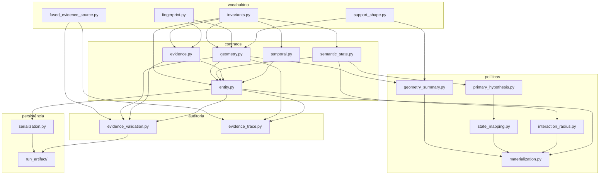

# Arquitetura de semantic_mapping

Este documento registra ownership, boundaries, direção de dependências e as invariantes arquiteturais da capability. Elas são verificáveis no código e nos testes citados, não apenas declaradas.

## O que a capability possui

Semantic Mapping possui **a materialização da evidência fundida como entidades semânticas persistentes dentro de um semantic map**, e nada além disso. Ela introduz quatro conceitos e é a única dona deles:

| Conceito | Significado | Quem define as invariantes |
| --- | --- | --- |
| `Entity` | O registro persistente de *algo no mapa* | `entity.py` |
| `EntityGeometry` | O suporte 3D e os resumos derivados dele | `geometry.py` |
| `EntitySemanticState` | O que a entidade pode ser, sem colapso | `semantic_state.py` |
| `EntityTemporalState` | Quando e quantas vezes foi observada | `temporal.py` |

`EntityEvidenceLinks` e `CandidateRejection` completam o envelope: a cadeia que justifica a entidade e a contrapartida explícita do candidato que não virou uma.

## O que ela explicitamente não possui

| Não é dela | É de quem |
| --- | --- |
| decidir se duas entidades são o mesmo objeto (match, merge, split, re-identificação) | `entity_resolution` |
| relações entre entidades | `spatial_relations` |
| geometria e coordenadas | `geometric_mapping` (aqui só `GeometryReference`) |
| evidência fundida, hipóteses, incerteza | `semantic_fusion` (aqui só referências e o estado derivado) |
| features visuais e claims | `visual_perception` (aqui só identidades) |
| representação 3D | `point_representation` (aqui só `PointRepresentationRef`) |
| seleção de artifacts, construção de política, lifecycle, `semantic_map_id` | `runtime` |
| medir se o mapa está bom | `evaluation` |

Semantic Mapping nunca chama percepção, fusão ou modelo, e nunca reescreve um artifact a montante. Dois suportes independentes continuam duas entidades, **mesmo com o mesmo label e geometria adjacente**.

## Direção de dependências



O grafo é acíclico e tem um sentido único: **contratos nunca importam políticas, e a persistência nunca importa política.** `invariants`, `fingerprint`, `support_shape` e `fused_evidence_source` são folhas: não conhecem nenhum contrato desta capability.

A camada de **auditoria** existe porque conferir e percorrer referências é uma preocupação de *evidência já persistida*: a persistência precisa alcançá-la (`reader.validate_references()`), e ela não pode alcançar nenhuma regra científica. Classificá-la como política tornaria esse import do reader uma violação; classificá-la como contrato seria mentira, porque ela abre artifacts.

Verificado por `tests/architecture/test_semantic_mapping_layering.py`.

## Dependências cross-capability

Permitidas, sempre pela API pública, declaradas em `tests/architecture/test_boundaries.py`:

| Capability | O que é usado | Por quê |
| --- | --- | --- |
| `shared` | `SourceTimestamp`, `Vector3`, `AtomicRunDirectory`, `FileEntry`, `DEBUG_DIRECTORY`, `check_file_inventory` | primitivas cross-cutting e publicação atômica |
| `semantic_fusion` | `FusedEvidence`, `FusionOutcome`, `SemanticFusionRunManifest`, `HypothesisEvidence`, `UncertaintyRecord`, identidades | a evidência de entrada e o run de origem |
| `geometric_mapping` | `GeometryReference`, `GeometrySource`, `GeometryPoint`, `Bounds3D`, `MapId` | referenciar e resolver geometria persistente |
| `ingestion` | `SourceObservationId`, `FrameId` | identidade do frame físico, só como tipo |
| `state_estimation` | `TimeBounds` | intervalo fechado de aquisição, para não duplicar a regra |
| `sensor_association` | `SpatialObservationId` | a observação que contribuiu, só como tipo |
| `point_representation` | `PointRepresentationId`, `PointRepresentationRunId` | referenciar estrutura 3D estática |
| `region_perception` | `RegionId` | referenciar regiões observadas |
| `semantic_interpretation` | `ClaimId`, `HypothesisRole` | referenciar claims interpretadas |
| `visual_perception` | `FeatureId`, `FeatureScope` | referenciar features visuais |

As cinco últimas entram **apenas como identidades e tipos**: nenhuma lógica delas é usada.

Proibidas: `entity_resolution`, `spatial_relations`, `artifact`, `runtime`, `evaluation`. A capability não conhece quem a consome.

## API pública

`src/contextmap/semantic_mapping/__init__.py` é a única porta cross-capability, com 90 símbolos em `__all__` explícito. Todos os 38 consumidores em `src/` a usam; nenhum alcança um caminho interno.

Internos por decisão, fora de `__all__`: `invariants`, `fingerprint`, `support_shape`, `serialization` (como módulo), `attach_interaction_radius`, `INTERACTION_RADIUS_DERIVATION_ID`, `EXTENT_RULE_HALF_MAX_EXTENT`, `EntityContractError` e `SCHEMA_VERSION`. Nenhum deles tem consumidor fora da capability; expô-los seria API sem requisito.

De dentro da capability a fachada é **proibida**: ela alcança todas as camadas, então passar por ela esconderia uma dependência para cima. Um módulo interno importa direto o módulo dono.

## Adapters, ports e variation points

**A capability não tem backend nem adapter, e isso é deliberado.** Não há SDK, modelo ou biblioteca a isolar: a entrada já chega como contrato de domínio, e a única dependência de I/O é a publicação atômica, que `shared` possui. A capability não importa nenhuma biblioteca externa — nem NumPy —, e é por isso que um artifact reabre sem runtime de percepção, de fusão ou de modelo.

Existem dois `Protocol`, cada um por uma razão concreta:

| Porta | Satisfeita por | Por que existe |
| --- | --- | --- |
| `GeometrySource` (de `geometric_mapping`) | o reader do mapa geométrico, e um fake em memória nos testes | isolar a leitura do mapa persistido de uma regra determinística |
| `FusedEvidenceSource` | `SemanticFusionRunReader`, e um fake nos testes | validação e travessia precisam da mesma superfície mínima |

A variação real não é de *implementação*, é de **política versionada**:

| Variation point | Alternativas de hoje | Como é escolhida |
| --- | --- | --- |
| resumo geométrico | `entity-geometry-summary-v1` | `runtime` constrói `GeometrySummaryPolicy` |
| hipótese primária | `unambiguous-single-hypothesis-v1` (default), `…-v2` com mínimo de suporte | `EntityMaterializationPolicy.primary_support`; a v2 ainda não é selecionável pelo runtime |
| raio de interação | `interaction-radius-from-factor-v1` | `EntityMaterializationPolicy.interaction_radius` |
| materialização | `one-support-one-entity-v1` | única; não há extension point sem variação real |

## Como a configuração chega

```text
perfil/CLI do runtime
    ↓  runtime/composition.py resolve e valida
GeometrySummaryPolicy  →  EntityMaterializationPolicy
    ↓  SemanticMappingExecutor
materialize_entities()  /  SemanticMappingRunWriter
```

Nenhuma regra desta capability abre YAML, lê variável de ambiente ou consulta parâmetro de ROS. `GeometrySummaryPolicy` e `OrientationPolicy` **não têm defaults** para limiares científicos: `sparse_point_threshold`, `connectivity_radius_m`, `min_points` e `min_variance_ratio` são escolhas que um perfil declara. A única exceção é `max_connectivity_points`, que tem default nomeado porque é trava de custo, não limiar científico.

`semantic_map_id`, `code_version` e `code_digest` **não são configuração**: o runtime os deriva da identidade do código e do dataset, e o writer grava `code_digest` exatamente como veio — a capability não inventa esquema de hash da árvore de fontes.

## Separação evidence / belief / knowledge

A capability atravessa duas das três camadas do ContextMap2:

- **evidence** — `evidence.py` referencia o que uma execução observou, preservando identidade, versão, digest e sequência do artifact de origem. Nada é copiado;
- **belief** — `semantic_state.py` e `temporal.py` guardam crença e estado acumulados. Uma observação **nunca** se promove sozinha a verdade: é exatamente o que `primary_hypothesis.py` existe para impedir;
- **knowledge** — não é daqui. Relações e topologia são de `spatial_relations`.

`EntityAttribute` com origem `EXTERNAL_KNOWLEDGE` é o único ponto onde Knowledge toca o estado, e por isso exige uma `ExternalKnowledgeSource` nomeada: sem fonte, seria uma afirmação sem origem dentro da crença.

## Invariantes arquiteturais

1. **A fachada é a única porta, e só de fora.** Verificado por `test_boundaries.py` e `test_semantic_mapping_layering.py`.
2. **Nenhuma camada importa a de cima, e a persistência nunca importa política.** Verificado pelo teste de layering, que também exige camada declarada para todo módulo novo.
3. **Nada a montante é copiado.** Nenhum contrato guarda XYZ, embedding, máscara ou payload de fusão: tudo é referência por identidade.
4. **Uma entidade nunca é só um label.** Todas as hipóteses, alternativas, abstenções, conflitos e sinais sem score são preservados; `primary_hypothesis` é conveniência, nunca substituto.
5. **Score ausente não é zero.** `SupportSignal.value is None` é "não pontuado" e sobrevive à serialização.
6. **Frame físico nunca é confundido com inferência.** As duas contagens são separadas em todo contrato e em toda métrica.
7. **Identidade tem escopo.** Um `EntityId` só significa algo dentro do seu semantic map; `EntitySet.resolve` recusa uma referência de outro mapa mesmo quando o id existe.
8. **Recalcular um resumo nunca muda a identidade.** O `EntityId` é função pura do suporte de fusão, não de valores de geometria.
9. **Nenhuma decisão de mesmo objeto.** Não existe API de merge, split ou match, e o artifact não tem estado de resolução.
10. **Um candidato inválido não desaparece.** Quatro causas viram `CandidateRejection` persistida; qualquer outro erro **propaga**, porque engoli-lo publicaria um mapa vazio como sucesso.
11. **Um run, uma política.** `run_artifact/metrics.py` recusa um run cujas entidades foram materializadas sob políticas ou configurações diferentes.
12. **Artifact é imutável.** Publicação atômica, nunca substituição; o writer recusa um `output_dir` existente; schema pré-1.0 sem reader de compatibilidade.
13. **`__DEBUG__/` nunca é dependência.** Não entra no inventário; `read_record` e `read_table` recusam-no como fonte.
14. **O artifact reabre sem runtime pesado.** Nenhuma dependência externa, verificado em subprocesso.

## Limitações conhecidas

- A qualidade semântica do mapa **nunca foi medida contra anotação**: o `corridor-02` roda de ponta a ponta, mas não existe reference set anotado. Os testes garantem consistência, preservação de evidência e reprodutibilidade, não acerto.
- O custo da conectividade é aproximadamente quadrático na densidade local e **não foi validado em suportes reais**; o default de `max_connectivity_points` é uma trava medida em dados sintéticos, não calibrada.
- A v2 da hipótese primária existe no contrato mas não é selecionável pela configuração do runtime: expô-la só tem consumidor depois que um mínimo acima de 1 for escolhido por tuning.
- A equivalência de labels é herdada da fusão e é só tipográfica.
- `EntityLifecycle` tem três valores, e a baseline atribui apenas `observed`; `stale` e `uncertain` esperam uma política documentada.
