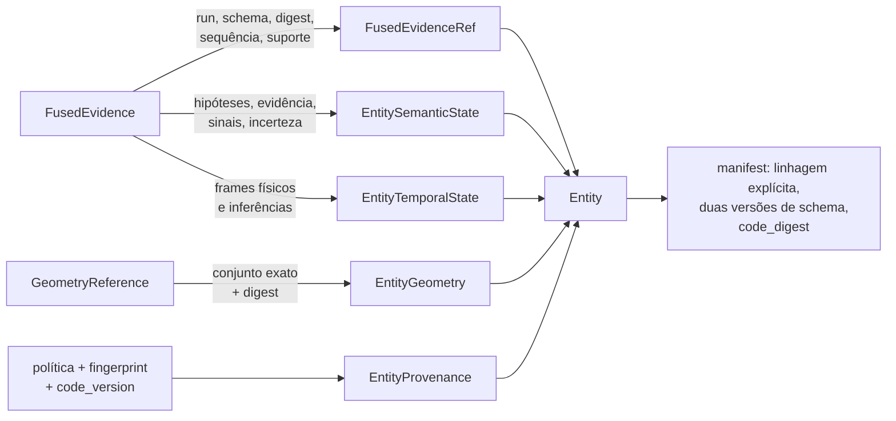

# Fluxo de dados de semantic_mapping

Este documento segue os dados reais através da implementação. Nenhuma etapa aqui é pretendida: todas existem no código citado.

## Caminho principal

```text
FusionOutcome[] selecionados (semantic_fusion)
SemanticFusionRunManifest  — o run que os possui
GeometrySource             — o mapa geométrico (geometric_mapping)
semantic_map_id, code_version, EntityMaterializationPolicy  (runtime)
        ↓
materialization._require_coherent_selection()
        → recusa suporte repetido e mapa divergente     MaterializationInputError
        ↓
materialization.materialize_entities()        um suporte → uma entidade
        │
        ├─ entity_id_for(fusion_support_id)                    identidade pura
        │
        ├─ geometry_summary.summarize_geometry()
        │       ├─ geometry.resolve_geometry()        → GeometryPoint[]
        │       └─ support_shape.centroid_of() / component_sizes() / principal_axes()
        │       → EntityGeometry  (+ SpatialSummaryProvenance, diagnósticos)
        │
        ├─ state_mapping.semantic_state_from_fused_evidence()
        │       ├─ semantic_state.derive_ambiguity_state()
        │       ├─ primary_hypothesis.withheld_for_lack_of_support()
        │       └─ atributos: class + os declarados pelas claims
        │       → EntitySemanticState
        │
        ├─ interaction_radius.attach_interaction_radius()      usa a extensão medida
        │
        ├─ evidence.evidence_links_from_fused_evidence()
        │       → EntityEvidenceLinks (+ fusion_artifact_digest)
        │
        └─ temporal.summarize_temporal_state()
                → EntityTemporalState
        ↓
entity.Entity(...)        ← a coerência entre as quatro partes é exigida aqui
        ↓
EntityMaterialization(entities, rejections)
        ↓
serialization.encode_entity()  →  run_artifact/writer  →  SemanticMappingRunArtifact
        ↓
run_artifact/reader  →  entity_resolution, spatial_relations, artifact, evaluation
```

## A passada única do writer

O writer faz três coisas na mesma iteração, e elas precisam concordar:

```text
para cada Entity do fluxo:
    metrics.RunTally.check(entity)          recusa ordem, mapa, linhagem, política dupla
    encode_entity() → encode_line()         os bytes do registro
    tables.IndexTables.add(entity, offset, length)
    metrics.RunTally.add(entity)            contagens e distribuições
    out.write(line); offset += len(line)    o deslocamento é contado aqui
    debug.write_entity_debug(...)           só se o nível pedir
```

O deslocamento é contado à mão porque o stream não expõe posição, e é ele que faz `entity-index.jsonl` permitir ler uma entidade sem carregar as outras. Nada é publicado antes do fim: `AtomicRunDirectory` só torna o run visível quando o fluxo termina.

## Caminho de auditoria, sob demanda

```text
Entity + {fusion_run_id: FusedEvidenceSource} [+ GeometrySource]
        ↓
evidence_validation.validate_entity_evidence()
        → EvidenceIntegrityIssue[]        relata, nunca levanta
          (cada run de fusão é verificado uma única vez)

Entity
        ├─ evidence_trace.trace_entity_evidence()   → até as claims e o frame físico
        └─ evidence_trace.trace_geometry_sources()  → até a observação LiDAR
          ambas levantam EvidenceTraceError se o run não puder ser lido
```

`reader.validate_references()` é o mesmo caminho a partir de um run já persistido: é por isso que a persistência alcança a auditoria.

## Proveniência: o que é preservado em cada salto



Pontos onde a proveniência é deliberadamente **não** colapsada:

- `FusedEvidenceRef` carrega `sequence_artifact_id` **além** do digest, porque o digest não cobre a linhagem do manifest: trocar só a sequência do run de fusão é detectado como `incompatible_lineage` em vez de passar;
- `EntityFeatureRef` é identificada pela tripla `(visual_artifact_id, source_observation_id, feature_id)`, porque um `FeatureId` é local à observação em um produtor visual e dois runs podem reutilizar o mesmo par;
- `SpatialSummaryProvenance` guarda contagem **e** digest do conjunto de entrada, então um resumo não pode ser atribuído a outro suporte;
- `EntityHypothesis.supporting_physical_observations` preserva o suporte por hipótese para que ele continue contável depois da resolução de identidade, sem a evidência fundida à mão;
- `schema_version` e `entity_schema_version` são separadas no manifest: versionar o layout do artifact não versiona o registro da entidade.

## Caminho de diagnóstico, paralelo e nunca contratual

```text
Entity ──→ run_artifact/debug.write_entity_debug()
               → __DEBUG__/entities/<entity-id>/summary.json
               → __DEBUG__/entities/<entity-id>/geometry-summary.json
               → __DEBUG__/entities/<entity-id>/semantic-state.json
               → __DEBUG__/entities/<entity-id>/evidence-trace.json
               → __DEBUG__/entities/<entity-id>/temporal-history.json
```

`NONE` (default) não escreve nada; `STANDARD` cobre uma amostra das primeiras entidades; `FULL` cobre todas. Nada disso entra no inventário do manifest: remover `__DEBUG__/` não invalida o run, e nenhum estágio a jusante pode lê-lo.

## Onde o fluxo para explicitamente

| Situação | Onde | O que acontece |
| --- | --- | --- |
| suporte selecionado duas vezes, ou mapa divergente entre linhagem e geometria | `materialization` | `MaterializationInputError`, antes de materializar qualquer candidato |
| candidato sem suporte 3D | `geometry` | `EmptyGeometrySupportError` → `CandidateRejection` |
| geometria não resolvível no mapa | `geometry` | `GeometryResolutionError` → `CandidateRejection` |
| evidência temporal ausente, repetida ou de dois clocks | `temporal` | `TemporalEvidenceError` → `CandidateRejection` |
| partes válidas que não satisfazem juntas o contrato | `entity` | `EntityContractError` → `CandidateRejection` |
| qualquer outro erro na materialização | `materialization` | **propaga**: engoli-lo publicaria um mapa vazio como sucesso |
| suporte sem nenhuma hipótese (só abstenções) | `state_mapping` | **não** é rejeição: vira entidade com `insufficient_evidence` — o mapa registra "há algo aqui, sem classe conhecida" |
| hipótese única com suporte abaixo do mínimo (v2) | `primary_hypothesis` | sem primária e sem `class`; `withheld_primary` diz por quê |
| entidades fora de ordem, de outro mapa, ou com política divergente | `run_artifact/metrics` | `MappingRunArtifactError`, sem deixar run visível |
| `output_dir` já existe | `run_artifact/writer` | `MappingRunArtifactError`: um run finalizado nunca é sobrescrito |
| registro adulterado, truncado ou de schema não suportado | `run_artifact/reader` | `MappingRunArtifactError` |
| run de fusão ausente, divergente, desatualizado ou corrompido | `evidence_validation` | `EvidenceIntegrityIssue`, e as comparações que dependiam dele são suprimidas |
