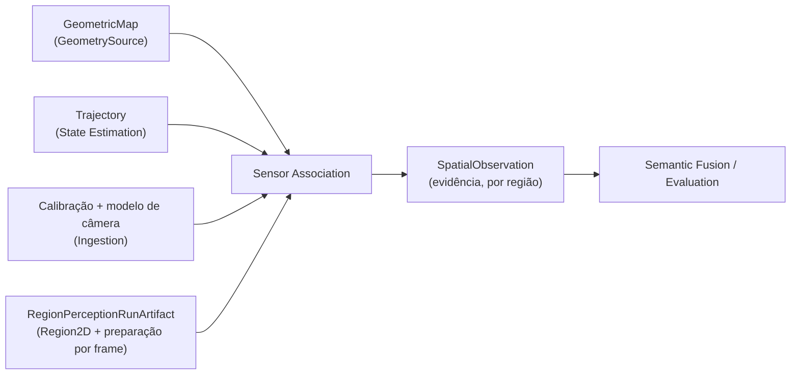

# Sensor Association

## Responsabilidade

Ligar a **evidência visual 2D** à **geometria 3D persistente**. Para cada região de uma imagem, responder: *quais elementos do mapa esta região enxerga?* A resposta é uma `SpatialObservation`: referências à geometria visível dentro da região, mais os diagnósticos que explicam os candidatos que **não** entraram (atrás da câmera, fora da imagem, ocluídos, …).



`AssociationFrameInput` seleciona `region_artifact_id`, `regions` e `prepared_image`. Canais densos opcionais acrescentam `visual_artifact_id`, `visual_evidence` e mapas declarados; sua identidade precisa coincidir com o produtor selecionado. `SensorAssociationRequest.association_run_id` identifica a nova execução.

Uma `SpatialObservation` é **evidência**: registra o que foi observado nesta execução. Não é crença nem conhecimento — não fixa label, identidade ou entidade, não escolhe um vencedor entre regiões sobrepostas e não copia XYZ, embeddings ou claims. Tudo o que ela aponta é alcançado por referência.

## O que este módulo explicitamente não possui

- geometria e sua linhagem: Geometric Mapping (`GeometryReference`, `GeometrySource`);
- pose e trajetória: State Estimation;
- calibração e modelos de câmera: Ingestion;
- regiões e máscaras: Region Perception;
- features: Visual Perception;
- claims: Semantic Interpretation;
- agregação de evidência em suporte por entidade (`FusionSupport`, `FusedEvidence`): Semantic Fusion;
- identidade de objeto e labels persistentes: Semantic Mapping e Entity Resolution.

## Estado implementado

- **Contratos e serialização**: `SpatialObservation`, visibilidade, referências, calibração e pose ([`contracts.md`](contracts.md)).
- **Projeção de câmera calibrada**: pinhole, fisheye equidistante e MEI, escolhida só pela calibração canônica ([`camera_models.md`](camera_models.md)).
- **Cadeia mapa → câmera → imagem preparada**, com proveniência por ponto ([`projection_chain.md`](projection_chain.md)).
- **Visibilidade e oclusão** por suporte de profundidade local conservador, com política explícita e sem valores padrão ([`visibility.md`](visibility.md)).
- **Pertencimento à máscara** de `Region2D`, índices região↔geometria, estatísticas de suporte versionadas e a montagem dos `SpatialObservation` ([`membership.md`](membership.md)).
- **Amostragem de features densas** (`DenseFeatureMap` nativo ou melhorado, mais próxima e bilinear, por índices e pesos) ([`dense_sampling.md`](dense_sampling.md)).
- **Qualidade da observação**: o contrato `ObservationQuality` e a derivação de suas medidas ([`quality.md`](quality.md)).
- **Diagnósticos** de calibração, reprojeção e alinhamento temporal, com achados explícitos, referência confiável e varredura de deslocamento temporal, e do suporte que o corte de alcance pode afetar ([`diagnostics.md`](diagnostics.md)).
- **Serviço e artifact de run**: `SensorAssociationService`, que projeta os candidatos de cada frame e o entrega a um `FrameSink` antes de soltá-lo, canais de features densas distintos e o `SensorAssociationRunArtifact` imutável, escrito frame a frame, com tabelas colunares compactas, linhagem e evidência de depuração ([`artifact.md`](artifact.md)).

A **validação** lê o artifact pela API pública e produz relatórios estratificados
de alcance, visibilidade, densidade de suporte, borda da imagem, ângulo de vista,
tempo, reprojeção e caminhos de features. Está implementada em
`contextmap.evaluation.sensor_association` e documentada em
[`evaluation/docs/sensor_association.md`](../../evaluation/docs/sensor_association.md).

## Contratos públicos

- `SpatialObservation`, `SpatialObservationId`, `spatial_observation_id_for()` — a geometria que uma região enxerga, por referência.
- `VisibilityState`, `VisibilityDiagnostics`, `DepthMetric` — por que um candidato entrou ou não como evidência, e como a profundidade foi medida.
- `PointCorrespondence`, `PixelCoordinate` — registro de baixo nível do resultado 2D de um elemento do mapa.
- `ProjectionSummary` — fatos da projeção no nível do frame.
- `CalibrationRef`, `PoseRef`, `AssociationProvenance` — qual calibração, qual pose e qual execução produziram a observação.
- `SensorAssociationService`, `SensorAssociationRequest`, `SensorAssociationOutcome`, `AssociationFrameInput`, `DenseChannel`, `FrameAssociation`, `FrameSink`, `CandidateGeometryPolicy`, `OcclusionPolicy`, `DiagnosticTolerances`, `InterpolationPolicy`, `TrustedCorrespondences` — a execução da capability (entradas, sink por frame e resultado).
- `SensorAssociationRunWriter`, `SensorAssociationRunReader`, `SensorAssociationRunManifest`, `SensorAssociationRunId`, `SensorAssociationDebugLevel` — o artifact de run.
- `ObservationQuality`, `ValueSummary`, `ReprojectionStatistics`, `QualityComponent` — medidas de qualidade da observação, separadas e tipadas, com ausência explícita; **não** são confiança semântica.
- `CameraProjection`, `PixelProjection`, `CameraIdentity`, `camera_projection_for()` — projeção 3D → pixel e raio inverso, com domínio de visão explícito e a identidade da calibração em todo resultado.

Ver [`contracts.md`](contracts.md) para a referência de campos, as convenções e as invariantes.

Os passos de seleção, projeção, visibilidade, pertencimento, amostragem e diagnóstico não têm
exports individuais na fachada. O envelope público `FrameAssociation` permite que o sink de
execução acesse essas estruturas intermediárias, incluindo arrays, para persistir um frame
por vez. O consumidor da evidência persistida usa `SensorAssociationRunReader` e os contratos
canônicos por referência; os arrays do sink não são o formato público do artifact.

O serviço valida a sequência declarada contra mapa e trajetória, e cada resultado de percepção
contra a sequência e a observação RGB do request. Essa validação precede o lookup de pose:
uma pose recusada não encobre entradas com lineage incompatível.

## Estrutura do código

```text
sensor_association/
├── models.py  serialization.py  errors.py   contratos, codificação, erro de entrada
├── run_definitions.py                       as versões de definições que identificam um run
├── camera/                                  projeção calibrada: port, numérica e 3 modelos
├── projection_chain/                        candidatos -> imagem -> projeção -> visibilidade
├── membership/                              regra de máscara, regra de caixa, montagem do contrato
├── dense_sampling.py                        índices e pesos de um mapa denso sobre a geometria
├── quality.py  quality_derivation.py        o contrato de qualidade e a sua derivação
├── diagnostics/                             resíduo, relatório de frame, varredura temporal
├── service.py                               composição da execução, em streaming
└── artifacts/                               formato, escrita, leitura e evidência de debug
```

Qual arquivo possui cada responsabilidade está em [`code-map.md`](code-map.md); por que as
fronteiras são essas, em [`architecture.md`](architecture.md).

## Módulos consumidos

- `contextmap.geometric_mapping`: `GeometrySource`, `GeometricMap`, `GeometryReference`, `MapId`, `geometry_id_for`.
- `contextmap.ingestion`: `CalibrationEntry`, os modelos de câmera canônicos (`PinholeCameraModel`, `FisheyeCameraModel`, `MeiCameraModel`), `FrameId`, `CalibrationReferenceId`, `SequenceArtifactId`, `SourceObservationId`.
- `contextmap.state_estimation`: `TrajectoryLookup`, `LookupPolicy`, `StaticFrameGraph`, `calibration_identity`, `TrajectoryId`, `StateEstimationRunId`, `PoseEstimateId`, `LookupOutcome`.
- `contextmap.visual_perception`: `PreparedImage` e seus registros de transformação, `DenseFeatureMap`, `DenseFeatureSampling`, `FeatureResolutionEnhancementProvenance`, `FeatureId`, `FeatureScope`, `VisualEvidenceResult`.
- `contextmap.region_perception`: `Region2D`, `RegionId`, artifacts e máscaras regionais.

## Módulos que consomem este

Cinco módulos, todos pela raiz pública `contextmap.sensor_association` e nenhum por
caminho interno:

| Consumidor | O que importa |
| --- | --- |
| `semantic_fusion` | `SpatialObservation`, `SpatialObservationId`, `ObservationQuality`, `QualityComponent`, `SemanticClaimRef`, `VisualFeatureRef` |
| `semantic_mapping` | `SpatialObservationId`, apenas como tipo de identidade da evidência |
| `point_representation` | `SpatialObservation`, para escolher o centro de um suporte; ele **não** depende da projeção nem do artifact, e extrai geometria diretamente de Geometric Mapping |
| `evaluation` | `SensorAssociationRunReader`, `SensorAssociationRunManifest`, `CameraProjection`, `ValueSummary`, `QualityComponent` |
| `runtime` | o serviço, o request, o writer, o reader e as políticas, para compor e executar o estágio |

O módulo global `artifact` já está implementado: compõe o `ContextMap` a partir dos
artifacts das capabilities donas, sem refazer as regras científicas de associação.

## Onde estão os documentos detalhados

Comece por estes quatro se a capability é nova para você:

- [`architecture.md`](architecture.md) — ownership, boundaries, direção de dependências, ports e invariantes arquiteturais.
- [`code-map.md`](code-map.md) — qual arquivo possui cada responsabilidade, e o que cada um **não** deve possuir.
- [`data-flow.md`](data-flow.md) — o caminho real de um frame, passo a passo, com os arquivos.
- [`testing.md`](testing.md) — responsabilidade → teste e os invariantes que nunca podem quebrar.

Os documentos de tópico:

- [`contracts.md`](contracts.md) — contratos, convenções, identidade e serialização.
- [`camera_models.md`](camera_models.md) — modelos de câmera, convenções de pixel, domínio de visão e verificação.
- [`projection_chain.md`](projection_chain.md) — cadeia mapa → câmera → imagem preparada, suporte, proveniência e validação.
- [`visibility.md`](visibility.md) — oclusão por suporte de profundidade local, política, métrica de profundidade e diagnósticos.
- [`membership.md`](membership.md) — pertencimento à máscara, sobreposição sem vencedor, índices, estatísticas e observações espaciais.
- [`dense_sampling.md`](dense_sampling.md) — amostragem de features densas, políticas, preflight e proveniência.
- [`quality.md`](quality.md) — qualidade da observação: componentes, ausência explícita, proveniência e derivação.
- [`diagnostics.md`](diagnostics.md) — diagnósticos de calibração, reprojeção e alinhamento temporal, achados e varredura de deslocamento.
- [`artifact.md`](artifact.md) — serviço, artifact de run, tabelas compactas, canais de features e debug.
- [avaliação de Sensor Association](../../evaluation/docs/sensor_association.md) — estratificação, tempo, reprojeção, caminhos de features e comparação controlada.
- [`docs/architecture.md`](../../../../docs/architecture.md) — ownership e direção de dependências.
- [`docs/CONTRACTS.md`](../../../../docs/CONTRACTS.md) — `SpatialObservation` no contexto global de contratos.
