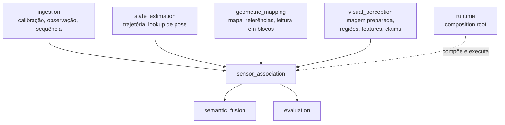

# Arquitetura de Sensor Association

Este documento descreve ownership, boundaries e direção de dependências. As regras aqui são
verificáveis no código e nos testes; onde houver divergência entre este texto e
`src/contextmap/sensor_association/`, o código vence e o texto é bug.

## O que a capability possui

Um conceito, com um dono: **a evidência de que uma região de uma imagem enxergou geometria
específica do mapa persistente**. Dela decorrem os contratos públicos:

- `SpatialObservation` e sua identidade determinística — a evidência por região;
- `ObservationQuality` — as condições sob as quais aquela evidência foi colhida, como medidas
  separadas e tipadas;
- `SensorAssociationRunArtifact` — a execução inteira, imutável e auditável;
- `CameraProjection` — a projeção calibrada 3D -> pixel e o raio inverso.

## O que a capability não possui

| Conceito | Dono |
| --- | --- |
| geometria e sua linhagem (`GeometryReference`, `GeometrySource`) | `geometric_mapping` |
| pose e trajetória | `state_estimation` |
| calibração e modelos de câmera canônicos | `ingestion` |
| regiões, features densas e claims | `visual_perception` |
| agregação de evidência em suporte por entidade | `semantic_fusion` |
| identidade de objeto e rótulo persistente | `semantic_mapping`, `entity_resolution` |

Sensor Association consome todos esses por **referência** e nunca copia XYZ, embedding ou
texto de claim para dentro de um contrato seu.

## Níveis semânticos

A capability vive inteiramente no nível de **evidência**. Isso é uma restrição de projeto, não
um estágio de maturidade:

- ela não promove uma observação a crença: regiões sobrepostas podem compartilhar a mesma
  geometria e nada aqui escolhe um vencedor;
- ela não produz conhecimento: não há relação, contenção nem topologia;
- ela não combina scores heterogêneos: `ObservationQuality` não tem escalar combinado, porque
  profundidade de suporte, ângulo fora do eixo, fração ocluída e resíduo de reprojeção não são
  a mesma grandeza.

## Direção de dependências



Permitido importar: `shared`, `ingestion`, `visual_perception`, `state_estimation`,
`geometric_mapping` — sempre pela raiz pública de cada um.

Proibido: qualquer capability a jusante (`semantic_fusion` em diante), `runtime`, e qualquer
caminho interno de outra capability. `tests/architecture/test_boundaries.py` declara e
verifica isso.

Dentro da capability os passos dependem dos contratos que consomem; o desenho abaixo resume
as dependências principais, não todas as arestas entre módulos:

```text
camera/  <-  projection_chain/  <-  membership/  <-  service.py  <-  artifacts/
                      ^                  ^              ^
                      +---- dense_sampling.py ----------+
                      +---- diagnostics/ ---------------+
                      +---- quality_derivation.py ------+
```

`models.py` e `errors.py` não dependem dos passos científicos. `serialization.py` depende de
`models.py` e `quality.py` para codificar e revalidar os contratos; a amostragem densa usa seus
encoders para registrar provenance. `artifacts/` depende de `service.py`, nunca o contrário — um serviço
que conhecesse o formato do disco não poderia ser executado sem escrever.

Em `artifacts/`, reader e writer dependem do formato em `run_manifest.py`. O writer usa o
serviço como fonte de frames e o módulo de debug como saída opcional; o reader não depende do
writer nem de debug. As versões registradas pelo writer vêm de `run_definitions.py`, o mesmo
dono do mapeamento usado no fingerprint.

## Ports e por que cada um existe

Três `Protocol`, cada um com razão concreta, todos junto do dono. Não há `ports.py` central.

| Port | Onde | Por que existe |
| --- | --- | --- |
| `CameraProjection` | `camera/projection.py` | três implementações reais (pinhole, fisheye, MEI), escolhidas pela calibração |
| `FrameSink` | `service.py` | é o que torna a execução streaming possível: o serviço entrega e esquece, e o chamador decide o que guardar. A transação do artifact e um coletor de teste são implementações reais |
| `RegionMaskLoader` | `membership/models.py` | uma máscara pode ter sido persistida por referência (#378); o pertencimento precisa de *alguma* forma de resolvê-la, nunca de um backend específico |

Não existe port para o serviço, para o writer nem para o reader: há uma implementação de cada
e nenhum ponto de variação demonstrado.

## Backends e adapters

Esta capability **não tem backend**. Não há SDK de modelo, nem ROS, nem provedor remoto.
O que mais se aproxima de um adapter é `camera/`, que traduz a calibração canônica de Ingestion
em projeção — e mesmo ali a dependência é de um contrato de domínio, não de uma biblioteca.

NumPy é a única dependência pesada, e é importada **de forma tardia**, dentro das funções que
calculam. Importar `contextmap.sensor_association` precisa continuar barato: dois testes
protegem isso (`test_sensor_association_models.py` e `test_association_run_artifact.py`).

## Composição e configuração

A configuração chega apenas pelo composition root; nenhuma regra desta capability lê YAML,
variável de ambiente ou parâmetro de ROS:

```text
config efetiva (runtime)
    -> contextmap.runtime.composition
        -> CandidateGeometryPolicy, OcclusionPolicy, DiagnosticTolerances,
           InterpolationPolicy, BoxDepthComponentPolicy
            -> SensorAssociationRequest
                -> SensorAssociationService.run(request, sink=...)
```

Os pontos de variação que o runtime expõe são `sensor_association.occlusion`,
`sensor_association.tolerances`, `sensor_association.pose_policy`,
`sensor_association.dense_sampling` (opcional) e `sensor_association.membership` (opcional);
ver [`runtime/docs/composition.md`](../../runtime/docs/composition.md).

**Não há fallback.** Um backend de câmera que a calibração não declara não é substituído por
outro; uma política não selecionada não ganha valor padrão; um frame cuja pose é rejeitada é
reportado como dado, não silenciosamente pulado.

## Invariantes arquiteturais

1. **Identidade é global, nunca posicional.** Uma linha de array de candidatos carrega o
   índice global do elemento do mapa; `geometry_support` nomeia elementos do mapa, não
   posições. O artifact persiste índices globais.
2. **Evidência canônica por referência.** `SpatialObservation` referencia geometria,
   features e claims sem copiar seus payloads. `FrameAssociation` é o envelope de execução
   entregue ao sink: ele contém estruturas intermediárias com arrays para permitir a escrita
   streaming, não representa o formato persistente de uma observação.
3. **Ausência é explicada.** Um candidato que não virou evidência tem um `VisibilityState`; um
   componente de qualidade não medido é `None` com razão em `unavailable`; uma região não
   avaliada tem um `SkipReason`.
4. **Profundidade tem métrica declarada.** `DepthMetric` vem do modelo de câmera e é gravada em
   cada `ProjectionSummary`; uma nunca substitui a outra em silêncio.
5. **Máscara não é reamostrada.** Uma máscara que não está no espaço da imagem preparada em que
   a geometria foi projetada é recusada.
6. **Configuração científica é registrada.** Políticas locais têm identidade versionada;
   parâmetros de lookup e interpolação também entram no fingerprint e no manifest, sem que
   seja necessário adicionar um `policy_id` aos contratos que seus donos já definem.
7. **Artifact é imutável.** Uma execução interrompida não deixa artifact publicável; uma
   execução finalizada não é modificada; `outputs/` e `metrics/` são contratuais e `__DEBUG__/`
   nunca é.
8. **A fachada é a fronteira.** Nenhum consumidor externo importa um submódulo. Os tipos dos
   passos não têm exports individuais na raiz, mas são alcançáveis pelo `FrameAssociation`
   público no boundary de execução do sink; o consumidor de evidência persistida usa reader
   e contratos canônicos.
9. **Lineage é validada antes do lookup.** A sequência declarada no request deve coincidir
   com mapa e trajetória; cada resultado de percepção deve pertencer à mesma sequência e
   observação RGB. Pose rejeitada não encobre entrada incompatível.
