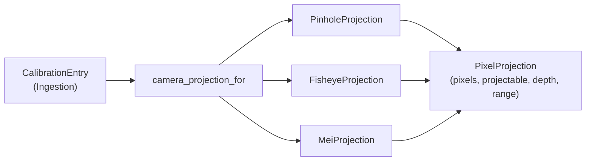

# Modelos de câmera e projeção 3D → pixel

Este documento descreve o subpacote `src/contextmap/sensor_association/camera/`: `projection.py` (o port, os contratos e a base compartilhada), `distortion.py` (a numérica de domínio e distorção), `pinhole.py`, `fisheye.py`, `mei.py` (um modelo cada) e `selection.py` (a escolha pela calibração canônica).

Sensor Association precisa de projeção fisicamente correta de um ponto no frame óptico da câmera para um pixel, e de volta para um raio. O modelo vem **apenas da calibração canônica** (`CalibrationEntry` de Ingestion): `camera_projection_for(entry)` escolhe a matemática de pinhole, fisheye equidistante ou MEI pelo tipo declarado, e nunca substitui um modelo por outro. Não há conhecimento de dataset e não há leitura de arquivo ou YAML aqui.

## Contrato

`CameraProjection` (Protocol) é a fronteira que o restante da capability consome:

| Operação | Resultado |
| --- | --- |
| `identity` | `CameraIdentity`: `calibration_id`, `content_hash`, `camera_frame`, `camera_model_kind` e `image_size` |
| `project(points_camera_m)` | `PixelProjection` para `(N, 3)` pontos finitos, em metros |
| `unproject(pixels)` | `(N, 3)` raios unitários para `(N, 2)` pixels finitos |
| `in_image(pixels)` | máscara de pixels dentro da extensão da imagem crua |
| `max_ray_angle_rad(u_bounds=, v_bounds=)` | cota superior do ângulo com o eixo óptico de todo raio do domínio que cai numa caixa fechada de pixels crus |

`PixelProjection` guarda `pixels` `(N, 2)`, `projectable` `(N,)`, `depth_m` (`z` com sinal no frame óptico), `range_m` (distância do centro óptico) e a `CameraIdentity` que a produziu, então todo resultado carrega a proveniência da calibração. Os arrays são revalidados: `projectable` é verdadeiro exatamente onde o pixel é finito.

O NumPy é importado sob demanda: importar `contextmap.sensor_association` continua sem NumPy.

## Convenções

- **Frame óptico**: `x` para a direita, `y` para baixo, `z` para a frente, metros. É o frame declarado por `CalibrationEntry.frame_id`; nada é inferido.
- **Pixel**: `(u, v)` contínuos, com o **centro** do pixel no inteiro. A imagem cobre `[-0.5, largura - 0.5) × [-0.5, altura - 0.5)`; `in_image` usa essa extensão e trata `NaN` como fora.
- **Alcance e profundidade**: `range_m` é `‖P‖` e `depth_m` é `z`; ambos são preservados. A oclusão usa a métrica que o modelo de câmera pede (`z` no pinhole, alcance nos modelos de campo amplo, onde `z` pode ser não positivo), registrada em cada resultado; ver [`visibility.md`](visibility.md).

## Modelos

### Pinhole

`u = fx·xd + cx`, `v = fy·yd + cy`, com `(xd, yd)` a distorção OpenCV de `(x/z, y/z)`. `DistortionModel.NONE` não distorce; `PLUMB_BOB` usa `(k1, k2, p1, p2, k3)` e `RATIONAL_POLYNOMIAL` usa `(k1, k2, p1, p2, k3, k4, k5, k6)`, com `k4..k6` no denominador do termo radial. O raio inverso parte do inverso exato do termo radial `R` sozinho, que preserva a direção e cresce no domínio: bisseção do ângulo com o eixo, robusta perto da dobra e do polo. O método de Newton, com o Jacobiano da distorção inteira, acrescenta então o termo tangencial `t`; cada passo é cortado pela metade até ficar dentro do domínio e baixar o resíduo. O inverso nunca sai do domínio, então não converge para o ramo externo além de uma dobra nem para o ramo espelhado além do polo, e converge perto deles, onde um ponto fixo com Jacobiano identidade estaciona (dobra) ou diverge (polo).

### Fisheye equidistante (Kannala-Brandt)

`θ = atan2(ρ, z)`, `θ_d = θ (1 + k1 θ² + k2 θ⁴ + k3 θ⁶ + k4 θ⁸)` e `u = fx·θ_d·x/ρ + cx`. Vale para qualquer direção, inclusive além de 90°. O raio inverso resolve `θ` de `θ_d` por bisseção em `[0, θ_max]`, que é robusta perto do limite onde o Newton divergiria.

### MEI (unificado omnidirecional)

Parametrização do CamOdoCal: `z' = z + xi·‖P‖`, plano normalizado `(x/z', y/z')`, distorção radial `(k1, k2)` e tangencial `(p1, p2)`, e `u = fx·xd + cx` com `fx = gamma1`, `cx = u0`. O plano normalizado é desdistorcido como no pinhole (termo radial exato por bisseção do ângulo, com `m = sin θ / (cos θ + xi)`, e tangencial por Newton), e o raio inverso usa a elevação à esfera unitária: `λ = (xi + √(1 + (1 − xi²)ρ²)) / (1 + ρ²)` e `P = (λx, λy, λ − xi)`.

## Domínio de visão explícito

Todo modelo projeta apenas parte da esfera de direções. Um ponto que o modelo não projeta sai como **não projetável**, com pixels `NaN`; nunca é recortado para dentro da imagem. O limite é onde a projeção deixa de ser injetiva:

| Modelo | Projetável quando |
| --- | --- |
| Pinhole | `z > 1e-9·‖P‖` (o plano `z = 0` e a origem ficam de fora); com distorção, também `√(x² + y²) < r_max·z`, com `r_max` o raio do maior disco em torno do eixo em que o Jacobiano da distorção inteira (radial e tangencial) tem determinante positivo, parado antes do polo do denominador racional (ou sem limite se nada disso existe) |
| Fisheye | `θ < θ_max`, o primeiro zero de `dθ_d/dθ = 1 + 3k1θ² + 5k2θ⁴ + 7k3θ⁶ + 9k4θ⁸` (ou `π` se nunca se anula) |
| MEI | `cos θ > −min(xi, 1/xi)`: o horizonte da esfera para `xi > 1` (a projeção dobra de volta além dele) e o zero de `z + xi·‖P‖` para `xi < 1`; com distorção, também `θ < θ_dobra`, o primeiro zero de `1 + 3k1·m² + 5k2·m⁴` antes do horizonte (ou sem limite se não se anula) |

A margem de `1e-9` em cosseno (constante `_COSINE_MARGIN`) mantém as coordenadas finitas junto da fronteira, onde os denominadores dos modelos se anulam.

O ponto sobre o eixo negativo, por exemplo, **não** vira o ponto principal em MEI com `xi > 1`, onde uma implementação ingênua o dobraria de volta para dentro da imagem.

No pinhole distorcido, o termo radial leva o raio sem distorção `r` a `r·radial(r)`. Além do primeiro zero de `d(r·radial)/dr` dois raios compartilham o mesmo raio distorcido e o polinômio dobra de volta: com `k1 = −0,28` sozinho, um ponto a 62,1° do eixo cairia exatamente no ponto principal, dentro da imagem. `r_max` é derivado no construtor pela mesma técnica do `θ_max` do fisheye (varredura do ângulo com o eixo, `r = tan θ`, refinada por bisseção), e os pontos além dele são não projetáveis. O pinhole sem distorção não tem esse limite.

No modelo racional o termo radial é `N(s)/D(s)`, com `s = r²` e `D(s) = 1 + k4·s + k5·s² + k6·s³`. A derivada de `r·N/D` tem o sinal de `N·D + 2s(N′·D − N·D′)` **só onde `D ≠ 0`**: num zero de `D` (um polo) o raio distorcido salta de `+∞` para `−∞` enquanto essa expressão pode continuar positiva, e além do polo o ponto cai espelhado do outro lado do ponto principal. Com `k4 = −1` sozinho, `D = 1 − r²` se anula a 45° do eixo, a expressão de crescimento `1 + r²` nunca se anula, e um ponto a 70° cairia dentro da imagem, espelhado. Por isso `r_max` é o **menor** entre o polo e a dobra: a varredura para no primeiro ângulo em que a expressão de crescimento deixa de ser positiva ou `D` cai a `1e-9` (constante `_DENOMINATOR_MARGIN`, com `D(0) = 1`). A margem é conservadora: o domínio acaba antes do polo, com raio distorcido finito (cerca de `1e9` vezes o numerador), e o arredondamento da avaliação de `D` na projeção nunca atravessa o polo. A dobra não tem margem: nela o raio é finito e contínuo.

No MEI, o termo radial leva o raio `m` do plano normalizado a `m·(1 + k1·m² + k2·m⁴)`, cuja derivada é `1 + 3k1·m² + 5k2·m⁴`, e `m = sin θ / (cos θ + xi)` cresce com o ângulo até o horizonte. Esse polinômio pode dobrar muito antes do horizonte: com `xi = 1` (`m = tan(θ/2)`) e `k1 = −0,3`, a dobra fica em `m = √(1/0,9)`, ou `θ ≈ 93,0°`, enquanto o horizonte está em 180°, e um ponto a 120° do eixo cairia a `0,17` do ponto principal, dentro da imagem. `θ_dobra` é derivado no construtor pela mesma varredura do ângulo refinada por bisseção, e o domínio é o menor entre o horizonte e a dobra. A dobra não tem margem, como no pinhole; o horizonte mantém a de `_COSINE_MARGIN`. Um MEI sem distorção (`k1 = k2 = 0`) mantém exatamente o domínio do horizonte.

No pinhole o domínio considera a transformação **inteira**, com os termos tangenciais, e não só o raio. A distorção `F(x) = x·N(s)/D(s) + t(x)` é o gradiente do potencial `G(s)/2 + s·(p2·x + p1·y)`, com `G′ = N/D`, então o seu Jacobiano `J` é simétrico. No eixo `J` é a identidade; num disco em torno do eixo em que `det J > 0`, nenhum autovalor cruza o zero, `J` continua positivo definido e, para quaisquer dois pontos `a ≠ b` do disco, `(b − a)·(F(b) − F(a)) = ∫ (b − a)ᵀ J (b − a) > 0`: `F` é **injetiva** no disco. Além do primeiro raio em que `det J` se anula em algum ponto da circunferência a transformação dobra. Sem termo tangencial `det J = g·(r·g)′`, com `g = N/D`: o primeiro zero é a dobra radial de antes, e o domínio de uma calibração só radial não muda. Com termo tangencial, no referencial das direções radial e azimutal `J = [[A + 6qc, 2qs], [2qs, B + 2qc]]`, com `A = (r·g)′`, `B = g`, `q = r·hypot(p1, p2)` e `c`, `s` o cosseno e o seno do ângulo entre `(p2, p1)` e a direção do ponto; o determinante `16q²c² + 2q(A + 3B)c + AB − 4q²` é uma parábola convexa em `c`, e o seu mínimo em `[−1, 1]`, no vértice cortado ao intervalo, dá em forma fechada o menor `det J` de cada circunferência. `r_max` é o primeiro zero desse mínimo, pela mesma varredura do ângulo refinada por bisseção, parado antes do polo como acima.

Com `p1 = 0,05` sozinho, na direção `−y` o Jacobiano é `diag(1 − 2p1·r, 1 − 6p1·r)`, e a dobra fica em `r = 1/(6p1)`, a 73,3° do eixo; antes o domínio ia até 90°, e o ponto a 81,5° em `−y`, onde `y + 3p1·y² = 0`, caía exatamente no ponto principal. Mesmo `p1 = 0,001`, típico de calibração real, dobra a 89,66° sem termo radial. Nas calibrações normais nada muda onde a transformação já era injetiva: plumb_bob de teste continua sem limite, e no racional de teste a dobra radial de 63,73° recua 0,02°, a faixa em que os termos tangenciais já dobravam a transformação. O critério é por ponto (fora do disco o ponto é não projetável e o pixel não tem raio), não uma rejeição da calibração.

No MEI os termos tangenciais (`p1`, `p2`) continuam **confiados** dentro do domínio: o domínio do MEI vem só do termo radial, e a injetividade da sua transformação completa com termos tangenciais extremos não é verificada.

## Ângulo máximo de raio sobre uma caixa de pixels

`max_ray_angle_rad(u_bounds=, v_bounds=)` devolve `θ_max`, uma cota **superior** do ângulo com o eixo óptico de todo raio do domínio de visão que o modelo manda para dentro da caixa. É o que o diagnóstico de corte de alcance (ver [`diagnostics.md`](diagnostics.md)) usa para limitar o ângulo de qualquer ponto que caia na imagem preparada; por isso ela só pode errar para cima. **Não** é a metade do campo de visão horizontal: é o ângulo do raio mais afastado que a caixa inteira alcança, cantos incluídos.

A derivação é a mesma para os três modelos:

1. **O canto mais distante.** O plano normalizado é uma escala alinhada aos eixos dos pixels (`x = (u − cx)/fx`, `y = (v − cy)/fy`), então o ponto da caixa mais distante do ponto principal nesse plano é um canto; `ρ` é o raio normalizado (distorcido) desse canto. Todo raio que cai na caixa tem raio distorcido `≤ ρ`.
2. **Uma cota inferior do raio por ângulo.** Para cada ângulo `θ`, `g(θ)` é um limite inferior do raio distorcido de todo raio a esse ângulo, qualquer que seja o azimute. O termo tangencial OpenCV `t` satisfaz `|t| ≤ c·r²` com `c = hypot(|p1| + 3|p2|, 3|p1| + |p2|)`, e pela desigualdade triangular:

   | Modelo | `g(θ)` | Domínio `[0, θ_dom]` |
   | --- | --- | --- |
   | Pinhole ideal | `tan θ` (exato) | `θ_dom = 90°` |
   | Pinhole distorcido | `r·abs(radial(r)) − c·r²`, `r = tan θ` | `θ_dom = atan(r_max)`, o disco injetivo (dobra radial ou tangencial) ou o polo racional (ou `90°`) |
   | Fisheye | `θ_d(θ)` (exato: Kannala-Brandt não tem termo tangencial) | `θ_dom = θ_max`, o primeiro zero de `dθ_d/dθ` (ou `π`) |
   | MEI | `m·abs(1 + k1 m² + k2 m⁴) − c·m²`, `m = sin θ / (cos θ + xi)` | `θ_dom`, o menor entre o horizonte `acos(−min(xi, 1/xi))` e a dobra da distorção |

3. **O maior ângulo compatível.** `θ_max = sup{θ ∈ [0, θ_dom] : g(θ) ≤ ρ}`: um raio mais inclinado que isso teria raio distorcido maior que o de qualquer ponto da caixa, e fora do domínio não há raio. Quando a caixa alcança o limite do domínio (o canto está além do círculo válido do fisheye, do horizonte ou da dobra do MEI, ou da dobra do pinhole), `θ_max = θ_dom`.

Sem termo tangencial (`p1 = p2 = 0`, e sempre no fisheye) `g` é o raio exato e crescente no domínio, então `θ_max` é exatamente o ângulo do raio do canto mais distante, cortado no domínio. Com termo tangencial a cota é um pouco mais larga (cerca de `0,1°` nas calibrações de teste). O supremo é achado por varredura do ângulo, com a resolução dos limites de domínio, e bisseção que guarda a ponta **externa**, mais 4 ULPs: o arredondamento só alarga a cota. A única suposição é a da varredura: uma `g` não monótona (termo tangencial) que descesse abaixo de `ρ` estritamente entre duas amostras não seria vista.

**Sem degeneração tangencial.** Quando o polinômio radial de um pinhole não domina o tangencial em raios grandes (por exemplo, só `p1`/`p2` não nulos), o modelo mandaria raios a quase 90° para dentro da imagem: o termo tangencial cancela o radial perto de `r = 1/(3|p|)`. Com o domínio parado na dobra tangencial esses raios não existem mais, e `θ_max` deixa de ser `90°`: com `p1 = 0,05` sozinho ele vai a 43,8°, e com `p1 = 0,001` a 39,2°, o raio do canto mais distante.

## Raio inverso e pixels sem raio

`unproject` **falha** quando algum pixel não tem raio sob o modelo (além do horizonte da esfera ou da dobra do MEI, além de `θ_d(θ_max)` num fisheye, com raio distorcido além do que o domínio `[0, r_max)` alcança num pinhole distorcido, ou quando a distorção não tem inverso confiável), com uma mensagem que conta os pixels e mostra o primeiro. Não devolve um raio chutado.

## Seleção e validação

`camera_projection_for` recusa uma entrada sem `camera_model` (`ValueError`) e valida a calibração pelo `validate_calibration_set` de Ingestion (`CalibrationError`): resolução positiva, parâmetros focais e de ponto principal finitos, contagem de coeficientes compatível com o modelo, `xi` finito e não negativo. Não há fallback para outro modelo: o tipo declarado é o tipo usado.

## Como é verificado

Os testes comparam as três projeções contra as fórmulas publicadas, escritas de forma escalar e independente da implementação (OpenCV plumb_bob/racional e equidistante; CamOdoCal `spaceToPlane`), contra casos exatos que se conferem à mão (pinhole por triângulos semelhantes, fisheye ideal linear em θ, MEI com `xi = 0` igual ao pinhole e `xi = 1` estereográfico), contra os limites analíticos do domínio (inclusive a dobra do polinômio radial do pinhole e o polo do denominador racional, pelas raízes dos polinômios em `s`, nas duas ordens, e a dobra da distorção do MEI antes do horizonte), contra o primeiro disco em que o Jacobiano da fórmula OpenCV, por diferenças centrais em 3600 azimutes, deixa de ter determinante positivo, e por ida e volta `unproject → project` em uma grade de pixels da imagem, com tolerância de `1e-6` pixel, e perto de cada limite de domínio. Sobre a imagem inteira, as métricas de injetividade são verificadas por calibração: nenhum pixel sem raio (fração inválida zero), menor `det J` positivo nos pontos desdistorcidos (0,39 no plumb_bob de teste, 0,27 no racional, 0,78 com `p1 = 0,05`) e erro de ida e volta abaixo de `1e-6` pixel (na prática `1e-13`).
