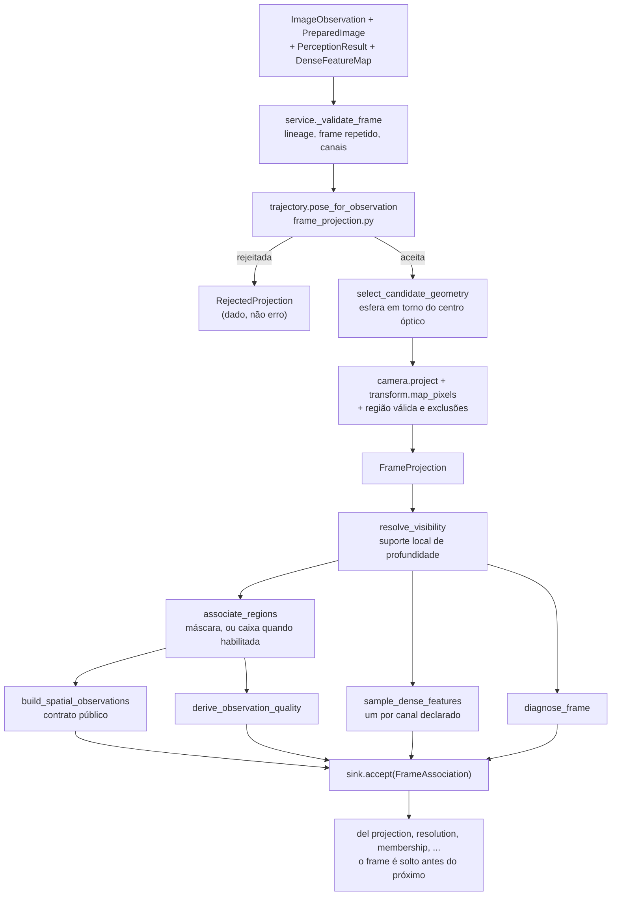

# Fluxo de dados de Sensor Association

Este documento segue os dados **reais** através da implementação. Cada passo nomeia o arquivo
que o executa; nada aqui é arquitetura pretendida.

## Visão de um frame



## Passo a passo, com os arquivos

| # | O que acontece | Arquivo | Entrada -> saída |
| --- | --- | --- | --- |
| 0 | validar fonte em blocos, sequência de mapa/ trajetória e canais únicos | `service.py` | request -> canais declarados |
| 1 | recusar percepção de outra sequência/observação, frame repetido ou canal ausente | `service.py` | `AssociationFrameInput` -> nada, ou erro |
| 2 | reproduzir a cadeia de preparo da imagem | `projection_chain/image_transform.py` | `PreparedImage` -> `RawToPreparedTransform` |
| 3 | resolver a pose no timestamp RGB | `projection_chain/frame_projection.py` | observação -> pose, ou `RejectedProjection` |
| 4 | compor `T_map_camera` e obter o centro óptico | `projection_chain/frame_projection.py` | pose + extrínseca -> translação e rotação |
| 5 | selecionar os candidatos na esfera | `projection_chain/candidate_geometry.py` | centro + política -> nuvem + relatório |
| 6 | levar para o frame da câmera e projetar | `camera/` | `(N,3)` no mapa -> pixels brutos + profundidade |
| 7 | levar o pixel bruto para a imagem preparada e conferir suporte | `projection_chain/frame_projection.py` | pixel bruto -> `FrameProjection` |
| 8 | decidir oclusão | `projection_chain/visibility.py` | projeção + política -> `VisibilityResolution` |
| 9 | descobrir que regiões contêm cada ponto visível | `membership/region_association.py` | visibilidade + resultado de percepção -> `FrameMembership` |
| 10 | montar as observações espaciais | `membership/spatial_observations.py` | pertencimento -> `SpatialObservation` |
| 11 | medir a qualidade de cada observação | `quality_derivation.py` | pertencimento + observações -> `ObservationQuality` |
| 12 | amostrar cada canal denso declarado | `dense_sampling.py` | visibilidade + `DenseFeatureMap` -> índices e pesos |
| 13 | diagnosticar o frame | `diagnostics/frame_report.py` | tudo acima -> `FrameDiagnostics` |
| 14 | entregar ao sink e soltar | `service.py` | `FrameAssociation` -> o sink decide |

## Caminhos paralelos

### Proveniência

A proveniência não é um passo: ela é carregada junto do dado, de ponta a ponta.

```text
calibração      -> CalibrationRef  -> SpatialObservation, ObservationQuality, FrameDiagnostics
pose            -> PoseRef         -> idem
política        -> policy_id + fingerprint -> AssociationProvenance e manifest
cadeia de imagem-> image_transform_id -> ProjectionSummary e diagnóstico
mapa, run de percepção, sequência -> AssociationProvenance
configuração    -> configuration_fingerprint -> cada observação persistida
código          -> code_version    -> AssociationProvenance e manifest
feature densa   -> DenseSamplingProvenance -> registro denso do artifact
```

A regra aplicada a **cada região** (máscara ou caixa) vai na proveniência daquela observação;
a política **configurada** do run vai no manifest. Dois frames do mesmo run podem ter seguido
regras diferentes, e a observação precisa dizer qual.

### Frames rejeitados

Incompatibilidade de lineage levanta `AssociationInputError` antes de consultar a pose e
antes de entregar o frame ao sink. A recusa de pose abaixo só ocorre para entradas que
passaram por essa validação; ela não transforma dados incompatíveis em um skip aceitável.

Um frame cuja pose o lookup recusa não produz observação, não vira erro e não desaparece: ele
entra em `outcome.rejected`, é contado no manifest (`rejected_frame_count`) e listado em
`metrics/summary.json`.

### Persistência

```text
FrameAssociation
    -> artifacts/run_writer.py (transação, que é um FrameSink)
        -> outputs/spatial-observations.jsonl   (observação, sem o suporte inline)
        -> outputs/observation-index.jsonl      (offset e tamanho, por identidade)
        -> outputs/geometry-support.u32         (índices globais, little-endian)
        -> outputs/observation-quality.jsonl
        -> outputs/projection-records.jsonl
        -> outputs/visibility-records.jsonl
        -> outputs/dense-feature-associations.jsonl + dense-feature-cells.bin
        -> metrics/frame-diagnostics.jsonl
        -> __DEBUG__/frames/<frame>/...         (não contratual)
    -> finalize(outcome)
        -> metrics/summary.json, metrics/runtime.json (só se o chamador mediu)
        -> __DEBUG__/feature-sources.json       (não contratual, só em full)
        -> manifest.json, publicado atomicamente
```

### Memória

O que sobrevive a um frame é escalar: identidades já vistas, frames rejeitados, contagens,
offsets de byte e um registro de timing por frame. Os arrays de um frame são soltos assim que
o sink devolve o controle. Isso não é `O(1)` e o módulo não afirma que seja — é um termo
linear de kilobytes contra arrays de gigabytes.

## Leitura

```text
diretório do run
    -> artifacts/run_reader.py
        -> manifest (schema conferido; versão diferente é recusada, nunca migrada)
        -> observation(id)      lê uma fatia de bytes, resolve o suporte da tabela colunar
                                e revalida o contrato ao decodificar
        -> quality(id), geometry_support(id), regions_of(frame, geometria)
        -> dense_association(frame, canal)
        -> verify_integrity()   confere o inventário contra o disco
```

Sem ROS, sem SDK de modelo e sem NumPy — e sem ler `__DEBUG__/`.
