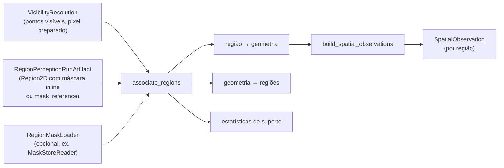

# Pertencimento à máscara de região

Este documento descreve o subpacote `src/contextmap/sensor_association/membership/`: `models.py` (os contratos que as duas regras compartilham), `region_association.py` (a regra de máscara e o despacho por região), `box_depth_component.py` (a regra de caixa e os componentes 3D) e `spatial_observations.py` (a montagem do contrato público).

Com a geometria projetada na imagem preparada e filtrada por visibilidade, `associate_regions(resolution, regions, *, region_artifact_id=, sequence_artifact_id=, mask_loader=None, box_policy=None)` responde, para cada ponto visível: **quais máscaras de `Region2D` congeladas contêm o seu pixel preparado?** A resposta é zero, uma ou várias regiões, e é mantida assim.

## Máscara por referência (#378)

Um `RegionPerceptionRunArtifact` reaberto carrega `mask_reference` em cada região. O `mask_loader: RegionMaskLoader | None` resolve a máscara pelo par `(source_observation_id, region_id)`. `RegionPerceptionRunReader.mask_store().load` satisfaz essa porta. Sem máscara inline ou loader, a região permanece explicitamente `NO_INLINE_MASK`.

## Regra (`mask-membership-v1`)

Um ponto visível pertence a **toda** região aceita cuja máscara inline é foreground no pixel cujo centro é o mais próximo do pixel preparado do ponto (índice `floor(c + 0.5)`). Truncar o pixel em vez de arredondá-lo erraria meio pixel; há um teste de regressão para isso.

## Sobreposição sem vencedor

Regiões sobrepostas são válidas. Quando várias máscaras contêm a mesma geometria, todas ficam: nada aqui escolhe um vencedor semântico, atribui uma classe final ao ponto, funde observações ou reexecuta a descoberta de regiões. As claims e features continuam **referências** à evidência de percepção, nunca rótulos escritos por Sensor Association.

`FrameMembership.regions_of(i)` devolve todas as regiões de um ponto, na ordem do resultado de percepção; uma tupla vazia é um ponto visível fora de toda máscara (`visible_unassigned`).

## Índices compactos

- **região → geometria**: `RegionMembership.associated_indices`, as posições ordenadas da geometria associada (`points_of(region_id)`);
- **geometria → regiões**: pares `(ponto, região)` ordenados (`point_indices`, `point_region_slots`), consultados por busca binária.

Uma região sem geometria visível ainda é avaliada: seu suporte é vazio e os contadores explicam o porquê. Nada é copiado para os pontos: o suporte é uma lista de `GeometryReference`.

## Regiões não avaliadas

Vão para `FrameMembership.skipped`, com o motivo, em vez de sumirem:

| Motivo | Quando |
| --- | --- |
| `REJECTED` | o candidato foi rejeitado pela normalização, então não está no conjunto canônico congelado |
| `NO_INLINE_MASK` | a região não tem nenhuma máscara resolvível: só caixa, ou a máscara está por referência sem um `mask_loader` capaz de resolvê-la |
| `EMPTY_MASK` | a região aceita tem máscara sem nenhum pixel de foreground: sem footprint, as estatísticas por pixel (cobertura, densidade de suporte) não têm definição, e `observation-quality-v3` exige `footprint_area_px >= 1` |
| `EMPTY_BOX` | regra por caixa: a caixa não contém nenhum centro de pixel da imagem preparada |
| `INSUFFICIENT_BOX_SUPPORT` | regra por caixa: nenhum componente 3D visto pelo núcleo da caixa tem `minimum_support_points` |
| `AMBIGUOUS_BOX_SUPPORT` | regra por caixa: o segundo componente vê `ambiguity_ratio` ou mais do núcleo que o melhor vê |

Sem `box_policy`, não há regra por caixa: uma região só com caixa, como as do grounding ou do Florence-2 `<OD>`, fica `NO_INLINE_MASK` e aparece com esse motivo em `skipped_regions` do registro de visibilidade do frame. A #649 recusou aceitar **todos** os pontos da caixa, porque ela cobre também o fundo e os oclusores; a regra por caixa abaixo não faz isso.

## Regra por caixa (`box-depth-component-v1`, opcional)

Selecionada pelo componente opcional `sensor_association.membership` (`BoxDepthComponentPolicy`), só vale para regiões aceitas que, depois do `mask_loader`, continuam sem máscara. Uma região com máscara segue a regra de máscara no mesmo run.

1. **Pegada**: os pixels cujo centro `i + 0,5` está na caixa semiaberta (a mesma rasterização da normalização de regiões), recortados à imagem preparada.
2. **Componentes 3D**: os pontos visíveis da pegada, no frame da câmera (`FrameProjection.camera_points_m`), são agrupados em células cúbicas de `cell_size_m`; células ocupadas que se tocam (vizinhança 26) formam um componente.
3. **Seleção**: o suporte é o componente com mais pontos no **núcleo** da caixa (a fração central `core_fraction` de cada lado); desempate por mais pontos e depois pela menor célula.
4. **Rejeição explícita**: sem componente com pelo menos um ponto no núcleo e `minimum_support_points` pontos → `INSUFFICIENT_BOX_SUPPORT`; segundo componente com núcleo ≥ `ambiguity_ratio` × o do melhor → `AMBIGUOUS_BOX_SUPPORT`.

Os pontos visíveis da caixa fora do componente escolhido ficam `visible_unassigned` (salvo se outra região os contém) e são contados em `excluded_visible_count`. A observação registra `membership_policy_id = "box-depth-component-v1"`, e a qualidade `footprint_kind = box`.

**Política configurada versus regra aplicada.** `FrameMembership.membership_policy_id` (e o `membership_policy_id` do manifesto do run) é a política *configurada*: `mask-membership-v1` sem a regra por caixa, ou `mask-or-box-depth-component-v1` quando ela está habilitada. A regra *aplicada* a cada região fica em `RegionMembership.membership_rule_id` (`mask-membership-v1` para máscara, `box-depth-component-v1` para região só com caixa) e é o que cada `AssociationProvenance.membership_policy_id` registra. Assim, num mesmo frame, uma região com máscara e outra só com caixa têm proveniências diferentes.

Limite conhecido: um objeto que toca o fundo dentro da caixa (uma porta no batente da parede, um objeto apoiado no piso) leva para o componente a parte do fundo que está na caixa. A regra separa o que a geometria separa, não o que só a aparência separa; o vazamento é medido, não presumido (ver o experimento `ablation-f055-f061-20260930`).

## Espaço de coordenadas

A máscara de uma região deve estar **na imagem preparada** em que a geometria foi projetada. Uma máscara com outras dimensões (por exemplo, no espaço cru enquanto a imagem preparada foi recortada e redimensionada) é **recusada** com `AssociationInputError`, não reamostrada. O resultado de percepção também deve ser da mesma observação que o frame. As máscaras só são lidas, nunca alteradas, e os `region_id` são preservados.

## Estatísticas (`region-support-metrics-v2`)

As definições são versionadas; mudar uma delas muda a versão.

Por região (`RegionMembership`):

| Valor | Definição |
| --- | --- |
| *pegada* (`footprint`) | pontos cujo pixel preparado cai na máscara ou, na regra por caixa, na caixa (`footprint_kind`), qualquer que seja o estado (atrás da câmera e fora da imagem não têm pixel e nunca estão nela) |
| `associated_count` | pontos da pegada que sustentam a região: todos os visíveis na regra de máscara; os do componente escolhido na regra por caixa |
| `excluded_visible_count` | pontos visíveis da pegada que a regra por caixa deixou de fora; sempre `0` numa máscara |
| `occluded_count`, `outside_valid_support_count` | pontos da pegada ocluídos ou fora do suporte válido |
| `footprint_area_px` | número de pixels da pegada (foreground da máscara, ou pixels da caixa) |
| `covered_pixel_count` | pixels distintos da pegada com pelo menos um ponto associado |
| `support_pixel_coverage` | `covered_pixel_count / footprint_area_px`: a fração dos pixels da região com geometria 3D suportada (baixa num mapa esparso) |
| `visible_share` | pontos visíveis da pegada / tamanho da pegada; `None` para pegada vazia |

Por frame (`MembershipStatistics`): `point_count`; os cinco estados que o particionam (`behind_camera`, `outside_image`, `outside_valid_support`, `occluded` e `visible`); `visible_count = associated_count + visible_unassigned_count`; `overlap_point_count` (visíveis em duas ou mais máscaras); `membership_pair_count`; e `points_by_region_count`, quantos pontos visíveis pertencem a exatamente `k` regiões (`k = 0` são os não atribuídos).

## `SpatialObservation` por região

`build_spatial_observations(membership, association_run_id=, configuration_fingerprint=, code_version=)` monta um `SpatialObservation` por região avaliada:

- `geometry_support`: as `GeometryReference` da geometria associada, ordenadas;
- `visibility`: `ASSOCIATED`, `OCCLUDED` e `OUTSIDE_VALID_SUPPORT` da pegada da região;
- `projection_summary`: modelo de câmera, métrica de profundidade, identidade da cadeia de imagem, tamanho preparado, pontos considerados e visíveis do frame;
- `calibration_ref`, `pose_ref` e a proveniência: mapa, execução de associação, produtor regional, sequência canônica, políticas de visibilidade e de pertencimento, fingerprint e versão do código.

## Como é verificado

Cenas sintéticas com pixel e profundidade conhecidos: associação reproduzível, ordem dos pontos irrelevante, região sem geometria, sobreposição de três máscaras com a mesma geometria, pegada com pontos ocluídos e fora do suporte, definições de cobertura, partição das estatísticas, recorte e redimensionamento sem deslocar a pertença, máscara em espaço errado, resultado de outra observação, regiões rejeitadas e só com caixa, linhagem regional por observação, proveniência e ida e volta em JSON. Mutações que truncam o pixel, ignoram a visibilidade, pulam a checagem de espaço, escolhem a primeira região, avaliam regiões rejeitadas ou incluem features globais fazem testes falharem.
