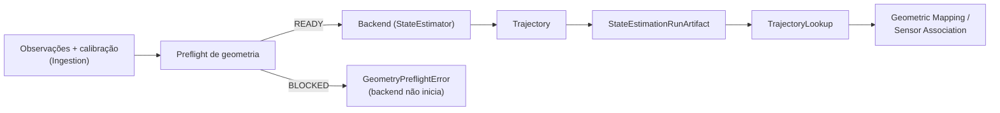

# State Estimation

## Propósito

Produzir a **pose dinâmica** do rig ao longo do tempo: onde o frame do corpo (`body`) está no frame do mapa (`map`) em cada instante. O resultado é publicado como contratos canônicos (`PoseEstimate`, `Trajectory`) que Geometric Mapping e Sensor Association consomem sem conhecer ROS, o estimador que produziu a pose ou o formato de pose de um dataset.

Uma medição de pose vinda da fonte é apenas entrada (evidence). Ela só se torna `PoseEstimate` depois que um backend a valida e a publica com frames, unidades e provenance explícitos.

## Responsabilidades

- contratos de pose e trajetória, com invariantes de frame, unidade, ordenação e clock;
- o port `StateEstimator` e os backends que o satisfazem;
- o **preflight de geometria**, que bloqueia uma run antes de o estimador iniciar quando frames, extrínsecos ou relógios não são confiáveis;
- o **lookup temporal** `T_map_body(t)`, com interpolação e rejeições explícitas;
- o grafo estático de frames sobre os extrínsecos canônicos;
- métricas de movimento de uma trajetória;
- o `StateEstimationRunArtifact` (escrita imutável e leitura).

## Não responsabilidades

- calibração estática (extrínsecos, intrínsecos, identidade de frames): pertence a Ingestion; esta capability apenas a consome;
- projeção 3D→2D e associação com imagens: Sensor Association;
- geometria persistente e mapa global: Geometric Mapping;
- validação de qualidade (ATE/RPE, comparação entre backends): `evaluation`;
- escolher e construir backends, ler configuração, decidir o diretório do artifact: `runtime`;
- qualquer conceito semântico.

## Inputs e outputs

| | Conteúdo | Obrigatório? |
| --- | --- | --- |
| **Entrada** | `SourceObservation`s selecionadas (`ExternalPoseMeasurement`, `LidarObservation`, `ImuObservation`), de Ingestion | sim; as modalidades dependem do backend |
| **Entrada** | `CalibrationSet` | só para backends que declaram extrínsecos (FAST-LIO); `ExternalPose` não a usa |
| **Saída** | `Trajectory` / `PoseEstimate[]` (evidence) com provenance | sempre |
| **Saída** | `StateEstimationRunArtifact` | quando o runtime o persiste |
| **Saída** | `TrajectoryLookup`, `StaticFrameGraph`, relatório de preflight, `MotionSummary` | sob demanda do consumidor |

## Fluxo de alto nível

O caminho detalhado, com os arquivos de cada passo, está em [`data-flow.md`](data-flow.md).

## Estrutura do código

| Arquivo | Papel |
| --- | --- |
| `models.py` | contratos de pose e trajetória |
| `requirements.py` | declaração do que um backend exige (vocabulário do port) |
| `ports.py` | port `StateEstimator`, request/result, diagnósticos, erros |
| `service.py` | `execute_state_estimation`: preflight, depois backend |
| `preflight/`, `frame_graph.py` | avaliação de pré-requisitos de geometria (pacote: `models`, `facts`, `calibration`, `readiness`, `clocks`, `service`) e grafo estático |
| `lookup.py`, `motion.py` | lookup temporal e estatísticas de movimento |
| `pose_validation.py` | regras de publicação compartilhadas pelos backends |
| `serialization.py`, `run_artifact.py` | codificação JSON e o artifact persistido |
| `backends/` | `external_pose`, `fast_lio`, `fast_lio_process`, `fast_lio_wrapper` |

Responsabilidade, entrada/saída e o que **não** pertence a cada arquivo: [`code-map.md`](code-map.md).

## API pública

`from contextmap.state_estimation import ...`. A fachada (`__init__.py`) exporta os contratos, o port, o lookup, o preflight, o serviço, as métricas de movimento e o artifact. Os backends **não** são reexportados: só o composition root em `runtime` os importa pelo caminho completo (`contextmap.state_estimation.backends.<backend>`).

## Documentos

- [`architecture.md`](architecture.md) — ownership, direção de dependências, configuração e invariantes arquiteturais;
- [`code-map.md`](code-map.md) — arquivo por arquivo;
- [`data-flow.md`](data-flow.md) — dados reais através da implementação;
- [`testing.md`](testing.md) — responsabilidade → teste e invariantes;
- [`contracts.md`](contracts.md) — campos, convenção de transform e invariantes;
- [`lookup.md`](lookup.md) — semântica de lookup e interpolação;
- [`backends.md`](backends.md) — port, `ExternalPose`, FAST-LIO e configuração dos backends;
- [`preflight.md`](preflight.md) — frame graph, checagens e serviço;
- [`artifact.md`](artifact.md) — layout, manifest, debug e integridade;
- [avaliação de State Estimation](../../evaluation/docs/state_estimation.md) — harness de validação entre backends;
- [`docs/architecture.md`](../../../../docs/architecture.md), [`docs/CONTRACTS.md`](../../../../docs/CONTRACTS.md), [`docs/shared-primitives.md`](../../../../docs/shared-primitives.md) — visão global.

## Limitações relevantes

- as poses do FAST-LIO estão num frame **local** (ancorado na primeira pose), e as varreduras não são corrigidas de movimento (isso é registrado como diagnóstico);
- o lookup nunca extrapola: um timestamp fora da trajetória é rejeitado;
- a covariância nunca é inventada: uma pose interpolada, ou de uma fonte sem incerteza, não a tem;
- o `runtime` não passa `downstream=` ao serviço, então a prontidão de capabilities posteriores não é reportada numa run do DAG (ver [`architecture.md`](architecture.md#questões-abertas)).
