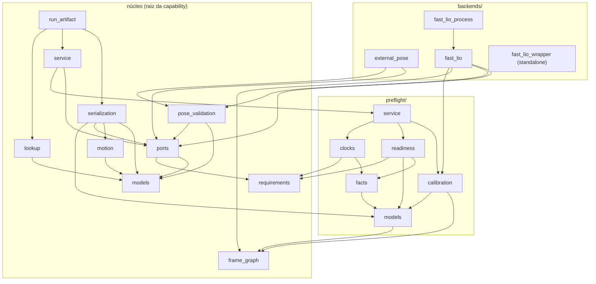

# Arquitetura de State Estimation

Este documento descreve o que está **implementado**. Cada regra da seção de invariantes é verificável no código ou em um teste de arquitetura.

## Ownership

| Conceito | Owner | Observação |
| --- | --- | --- |
| `PoseEstimate`, `Trajectory`, `TrajectoryGap`, proveniência de pose e trajetória | State Estimation (`models.py`) | evidence publicada por um backend |
| `StateEstimator`, `StateEstimationRequest/Result`, `EstimationDiagnostic` | State Estimation (`ports.py`) | boundary com os backends |
| `GeometryRequirements`, `StaticRelationRequirement` | State Estimation (`requirements.py`) | o que um backend declara precisar |
| `TrajectoryLookup`, `LookupPolicy`, `ResolvedPose`, `RejectedLookup` | State Estimation (`lookup.py`) | alinhamento temporal auditável |
| `StateEstimationRunArtifact` | State Estimation (`run_artifact.py`) | layout, manifest, escrita e leitura |
| `CalibrationSet`, `RigidTransform`, `FrameId`, `SourceObservation`, `Covariance6x6` | Ingestion | consumidos pela API pública |
| `SourceTimestamp`, `Vector3`, `Quaternion`, álgebra de transform rígido, `AtomicRunDirectory` | `shared` | primitivas sem owner semântico |
| escolha e construção de backend, configuração, diretório do artifact | `runtime` | composition root |

## Direção de dependências



Setas apontam para o que é importado e mostram só as dependências estruturalmente relevantes: quase todos os módulos, inclusive os backends, também importam `models`, e `run_artifact` importa também `motion` e `preflight`. Todo o núcleo depende também de `contextmap.ingestion` e `contextmap.shared` pela fachada pública. `fast_lio_wrapper` não importa nada de `contextmap`.

## Fronteiras e API pública

- `contextmap.state_estimation` (`__init__.py`) é a fachada cross-capability, com `__all__` explícito (63 símbolos).
- Consumers externos importam só dela. A única exceção em `src/` é o composition root (`runtime/composition.py`), que importa `backends.external_pose`, `backends.fast_lio` e `backends.fast_lio_process` de forma tardia, dentro das factories.
- `backends/` e `pose_validation.py` são internos: não são reexportados.
- Dependências permitidas da capability: `shared` e `ingestion` (`tests/architecture/test_boundaries.py`, `ALLOWED_DEPENDENCIES`). Quem pode importar esta capability: `geometric_mapping`, `sensor_association`, `semantic_fusion`, `semantic_mapping`, `runtime` e `evaluation`.

## Adapters e backends

| Backend | Entrada | Variação real | Config |
| --- | --- | --- | --- |
| `ExternalPoseEstimator` | `ExternalPoseMeasurement` | baseline sem estimador; política `FAIL`/`SKIP` para amostra inválida | `ExternalPoseConfig` |
| `FastLioEstimator` | LiDAR + IMU + extrínseco LiDAR→IMU | estimador LiDAR-inercial atrás de `FastLioRunner` | `FastLioConfig` + runner |

Existe um port (`StateEstimator`) porque há duas implementações reais, e a avaliação compara uma com a outra. `FastLioRunner` é um segundo port, que isola o processo e o ROS do lado canônico do FAST-LIO; ele tem uma implementação real (`SubprocessFastLioRunner`) e o runtime aceita um runner injetado (provider), o que também serve como fake em teste.

`fast_lio_wrapper.py` é uma **exceção arquitetural deliberada**: um script de implantação autônomo, executado dentro do container ROS 1 (Python 3.8), que não faz parte da API Python da capability e não deve importar `contextmap`.

## Configuração e composição

```text
config externa (YAML/JSON, --set)
        ↓
runtime  (EffectiveConfig → components.state_estimation.estimator)
        ↓
configuração tipada do backend (ExternalPoseConfig | FastLioConfig [+ runner])
        ↓
StateEstimator   ← construído pelo composition root
        ↓
execute_state_estimation(estimator, StateEstimationRequest)
```

- Nenhuma regra da capability abre arquivo de configuração, lê variável de ambiente ou consulta ROS. Os backends recebem a configuração já tipada e validam o que é seu em `__post_init__`.
- Variáveis de ambiente só chegam ao runtime (segredos e disponibilidade de módulos); nenhum dos dois backends declara segredo.
- As políticas `debug_level` e `trajectory_mode` chegam ao executor do runtime, não aos backends. A política de lookup de Geometric Mapping e de Sensor Association é construída pelo runtime a partir da configuração delas e entregue como `LookupPolicy`.
- Parâmetros específicos de cada backend estão em [`backends.md`](backends.md). Schema, policy, backend e configuração permanecem separados: o `configuration_fingerprint` registra a configuração efetiva na proveniência da trajetória.

## Artifact

O `StateEstimationRunArtifact` é descrito em [`artifact.md`](artifact.md). Para esta arquitetura importam três propriedades: o writer grava **exatamente** no `output_dir` que o chamador entrega (não calcula caminho nem aloca identidade); recusa substituir um diretório existente; e uma run bloqueada pelo preflight nunca é persistida. Onde o runtime coloca esse diretório (`<workspace>/<dataset>/run-NNNN/state_estimation/`) é decisão do runtime, não da capability.

## Invariantes arquiteturais

| Invariante | Como é verificado |
| --- | --- |
| a capability depende só de `shared` e `ingestion`, pela fachada pública | `tests/architecture/test_boundaries.py` |
| nenhuma capability importa um backend desta capability; só o runtime, e de forma tardia | `test_boundaries.py`, `tests/architecture/test_runtime_boundaries.py` |
| o port não depende do avaliador de preflight | `tests/architecture/test_state_estimation_structure.py` |
| nenhum módulo do núcleo importa um backend | `test_state_estimation_structure.py` |
| `models.py` e `requirements.py` não dependem de outro módulo da capability | `test_state_estimation_structure.py` |
| em `preflight/`, contratos e fatos não importam outro módulo do pacote; os avaliadores não importam `service` nem uns aos outros | `test_state_estimation_structure.py` |
| o resto da capability acessa o preflight só pela fachada do pacote (`preflight/__init__.py`) | `test_state_estimation_structure.py` |
| `fast_lio_wrapper.py` não importa `contextmap` | `test_state_estimation_structure.py` |
| não há fallback implícito de um backend para outro | `service.py` não seleciona backend; o runtime recebe um único `StateEstimator` |
| `__DEBUG__/` nunca é dependência contratual | `StateEstimationRunReader.read_record` recusa `__DEBUG__/` (`test_state_estimation_run_artifact.py`) |

## Decisões de estrutura

Arquivos grandes que **não** foram divididos, e por quê. Dividir só se justifica quando há razões independentes para mudar; tamanho sozinho não basta.

| Arquivo | Decisão | Razão |
| --- | --- | --- |
| `run_artifact.py` | mantido | Manifest, writer e reader compartilham as mesmas constantes de layout e o mesmo schema: um campo ou arquivo novo altera os três juntos. A codificação JSON, a razão independente de mudança, já está em `serialization.py`. Separar em `artifact/{models,writer,reader}` espalharia um único contrato por três arquivos sem reduzir o acoplamento. |
| `backends/fast_lio.py` | mantido | A fronteira entre estimador e processo já existe: o lado host (bag, job, processo, parser) está em `fast_lio_process.py`, e `FastLioRunner` é o port entre os dois. O que sobra em `fast_lio.py` (falhas, `FastLioJob`/saída do runner, config e estimador) muda junto com o contrato de troca. Um pacote `backends/fast_lio/` mudaria caminhos importados pelo composition root e referenciados por testes de empacotamento, sem novo ownership. |
| `backends/fast_lio_wrapper.py` | mantido | É uma unidade de implantação standalone (ROS Noetic, Python 3.8) que não pode importar `contextmap`; um único arquivo copiável é uma propriedade, não um defeito. Dividir só faria sentido se os blocos continuassem empacotáveis juntos. |
| `lookup.py` | mantido | Política, resolução e resumo temporal giram em torno de `Trajectory` + timestamp. O resumo (`TemporalAlignmentSummary`) é pequeno e consome exclusivamente os resultados do lookup. |

Reavaliar quando uma segunda razão independente de mudança aparecer nesses arquivos (por exemplo, um segundo formato de artifact ou um segundo runner do FAST-LIO).

## Questões abertas

Registradas aqui para uma decisão futura; **nenhuma alteração cross-capability é feita nesta refatoração**.

1. **`calibration_identity()` é candidata a pertencer a Ingestion.** Ela identifica o conteúdo de um `CalibrationSet`. Ingestion já tem `compute_content_hash` (por entry) e `rigid_transform_digest` (por transform), mas não uma identidade do conjunto. `calibration_identity()` compõe os `content_hash` das entries de Ingestion e **recodifica os transforms por conta própria**, em vez de usar `rigid_transform_digest`; ou seja, hoje existem duas codificações do conteúdo de um transform. Mover para Ingestion e passar a compor `rigid_transform_digest` **mudaria o valor do hash**, que está persistido na proveniência de trajetórias, mapas e associações; por isso é uma mudança de formato persistido e precisa de decisão própria. Consumers: `geometric_mapping`, `sensor_association` e os backends daqui.
2. **`StaticFrameGraph` tem ownership menos óbvio.** Ele consome os transforms de Ingestion, mas oferece uma interpretação geométrica (resolução por caminho, consistência de laços) usada pelo preflight, pelo FAST-LIO e por Geometric Mapping e Sensor Association. As arestas vindas de Ingestion não bastam para movê-lo; a decisão depende de quem realmente precisa da interpretação e de quem altera suas regras.
3. **Prontidão downstream não está ligada no runtime.** `StateEstimationExecutor` aceita `downstream=`, mas `compose_executors` nunca o passa; `execute_state_estimation` recebe `()` e o relatório de preflight de uma run do DAG não registra a prontidão de Geometric Mapping nem de Sensor Association. É uma lacuna do runtime, não da capability. `src/contextmap/runtime/docs/executors.md` afirma que a prontidão é reportada.
4. **Revisão da fachada.** Os 63 símbolos foram preservados nesta refatoração. Nove deles não têm nenhum consumer no repositório (`ClockCheck`, `DownstreamReadiness`, `EstimationDiagnostic`, `FrameGraphSummary`, `GeometryPreflightReport`, `LoopInconsistency`, `MotionDelta`, `TrajectoryQualitySummary`, `TransformCheck`), mas a maioria aparece em tipos de retorno públicos. Uma revisão própria deve decidir, símbolo a símbolo, se é contrato cross-capability.
5. **Decidido: a trajetória continua sendo um estágio versionado da run.** Ela é gravada em `<workspace>/<dataset>/run-NNNN/state_estimation/`, e reaproveitá-la em outra run é por seleção (`--select state_estimation=<id>`), sem pasta fixa em `artifacts/`. Diferente de `ingestion`, que precisa de um comando próprio porque o pipeline não consegue montá-la a partir da configuração, `state_estimation` é composto automaticamente pelo runtime. Uma pasta substituível `artifacts/state_estimation-<dataset>/` só se justificaria se surgisse a necessidade de estimar fora do pipeline.
