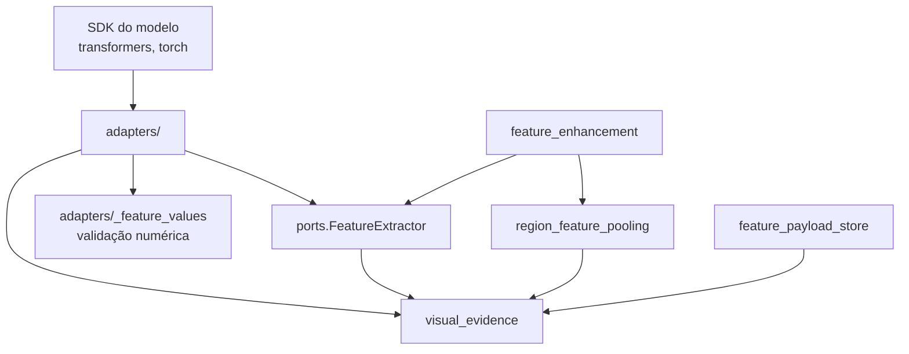

# Arquitetura: visual_features

## Ownership

A capability possui os conceitos que **ela introduz**: a feature visual e a identidade do espaço
onde ela vive.

| Conceito | Por que é dela |
|---|---|
| `VisualFeature`, `FeatureId`, `FeatureScope` | ela produz a feature; ninguém mais |
| `EmbeddingSpace` e seu fingerprint | a identidade do espaço decide o que é comparável |
| `PoolingMethod`, `POOLING_POLICY` | como agregar da grade para a região é decisão dela |
| `DenseFeatureMap`, `DenseFeatureSampling` | o contrato da grade densa e seu mapeamento |
| `RegionPoolingResult`, `RegionPoolingDiagnostics`, `RegionPoolingProvenance` | o que o pooling decidiu e por quê |
| `FeaturePayloadEntry` e o índice | como o array é persistido e reencontrado |
| `FeatureResolutionEnhancementProvenance` e os invariantes do realce | a fronteira do estágio opcional |
| `FeatureExtractor`, `FeatureResolutionEnhancement` | os pontos de substituição |

Conceitos que ela **consome sem possuir**: `Region2D` e `RegionId` (de `region_perception`),
`SourceObservationId` (de `ingestion`), `BackendProvenance` (de `shared`), `PreparedImage` e
`BoundingBox2D` (ainda de `visual_perception` — dívida declarada abaixo).

## Direção de dependências



Nenhum módulo fora de `adapters/` importa SDK de modelo. O NumPy é importado **dentro** das
funções que serializam ou desserializam bytes de array, de modo que ler metadados ou o índice não
exija tê-lo instalado — é por isso que `region_feature_pooling` entra na fachada por
`__getattr__` e não por import eager.

## Dependências permitidas

Este pacote não tem entrada própria em `ALLOWED_DEPENDENCIES`: por ser submódulo, ele é
coberto pela entrada de `visual_perception`, que o detector resolve pelo primeiro segmento do
caminho. As permitidas são, portanto, as daquela capability:

```text
shared  ingestion  model_runtime  region_perception  semantic_scoring
```

Um import deste pacote feito de outra capability conta como **caminho interno** de
`visual_perception`, e a regra o acusa — é o comportamento desejado: quem está fora importa
pela fachada `contextmap.visual_perception`.

`semantic_scoring` já não é alcançado daqui: as torres de texto saíram, desfazendo o ciclo.

## Dependências proibidas

| Proibida | Por quê |
|---|---|
| `semantic_interpretation` | consome as features; dependeria de quem a consome |
| `semantic_fusion`, `semantic_mapping`, `entity_resolution`, `spatial_relations` | downstream |
| `runtime` | o composition root escolhe o extrator; a capability não se compõe |
| `geometric_mapping`, `state_estimation`, `point_representation` | nada aqui é geométrico 3D |

## API pública

A fachada é `visual_features/__init__.py`, com `__all__` explícito. Ficam **fora**: os sete
adapters, `adapters/_feature_values.py` (validação numérica privada, compartilhada entre os
adapters desta capability) e os helpers com prefixo `_`.

O array numérico **não** faz parte da identidade pública persistida: só `pool_region_feature` o
aceita, e o contrato público carrega `payload_reference`.

## Adapters e backends

Cinco extratores de imagem, distintos pelo escopo que declaram:

| Adapter | Linhas | `required_scope()` |
|---|---:|---|
| `alphaclip.py` | 917 | `REGION` |
| `siglip2.py` | 711 | `DENSE`, `GLOBAL` |
| `clip.py` | 684 | `GLOBAL`, `REGION` |
| `dinov2.py` | 617 | `DENSE` |
| `dinov3.py` | 550 | `DENSE` |

As torres de texto dos mesmos modelos **não** estão aqui: elas foram para
`contextmap.semantic_scoring.adapters`, porque codificam a hipótese de um claim para a
comparação — o que é scoring — e consomem a infra de template de lá. Enquanto moravam neste
pacote fechavam um ciclo entre as duas capabilities. Cada torre continua declarando o
embedding space da torre visual correspondente, que segue definido aqui.

SigLIP2 declara explicitamente que não implementa escopo de região.

A variação é real e exercida: cinco implementações do mesmo port, com escopos diferentes. É o que
justifica o `Protocol` por AGENTS.md §18.

## Composição no runtime

Este pacote é um **submódulo** de `visual_perception`, não uma capability de topo, e no
catálogo (`runtime/catalog.py`) **não é um stage**: são dois componentes daquele stage.

```python
StageDeclaration(
    stage_id="visual_perception",
    components=(
        "visual_features.dense",  # <- aqui
        "visual_features.region",  # <- e aqui
    ),
    output=VISUAL_EVIDENCE,
)
```

`_compose_visual_perception` constrói `dense_features` e `region_features` e os entrega ao
`VisualPerceptionExecutor`, cuja saída é o `VisualEvidenceArtifact`. Os payloads numéricos vão
pelo `FeatureStoreWriter`. Não há writer de run próprio deste pacote: o stage que publica é
`visual_perception`.

## Invariantes arquiteturais

Verificáveis, não aspiracionais:

1. **A feature não carrega semântica.** Não há campo de rótulo, categoria ou hipótese. Significado
   só surge na comparação, em `semantic_scoring`.
2. **O array nunca está inline no contrato.** `VisualFeature` carrega `payload_reference`; o
   payload mora no feature store.
3. **Mesma dimensão não é mesmo espaço.** O fingerprint cobre os sete campos de `EmbeddingSpace`,
   e `ensure_compatible_embedding_spaces` recusa comparar espaços diferentes.
4. **A região é congelada.** O pooling mapeia a geometria para células da grade e nunca altera a
   `Region2D` recebida.
5. **A política de pooling é nomeada e versionada.** `mask_weighted_mean_preserve_l2_v2` entra na
   proveniência; mudar a política é mudar a identidade.
6. **Região sem suporte é erro explícito.** `EmptyRegionSupportError` quando nenhuma célula da
   grade cai na região — nunca um vetor de zeros silencioso.
7. **O realce produz identidade nova.** Feature realçada não pode reusar `feature_id`,
   `payload_reference` ou, com normalização diferente, o mesmo `embedding_space_id` da origem. São
   dez invariantes em `feature_enhancement.py`.
8. **O payload é `.npy` real.** O contêiner nativo preserva shape, dtype e byte order exatos, e dá
   acesso aleatório porque cada feature é um arquivo.
9. **O índice tem schema versionado.** `FEATURE_INDEX_SCHEMA_VERSION = "0.1.0"`, em
   `feature-index.jsonl`, com hash de conteúdo por entrada.

## Dívida arquitetural declarada

- `PreparedImage` pertence ao domínio de preparação de imagem em `visual_perception`; `BoundingBox2D`, `Region2D` e a resolução de máscaras vêm da API pública de `region_perception`. O extrator preserva a identidade regional selecionada sem copiar seu artifact.
- **Ciclo com `semantic_scoring`: resolvido.** As torres de texto importavam
  `render_text`, `TextEmbeddingBatch` e `validate_text_template` de `semantic_scoring.adapters`,
  enquanto aquela capability importava `VisualFeature` e `FeatureId` daqui. O ciclo estava
  escondido por um import quebrado para um módulo deletado; consertá-lo o tornou visível, e o
  aninhamento deste pacote sob `visual_perception` o tornou bloqueante para o import. As torres
  foram para `semantic_scoring.adapters`, onde o ownership as coloca: elas codificam a hipótese
  de um claim para a comparação, o que é scoring. A dependência tem um sentido só agora.
- **`FeatureResolutionEnhancement` sem implementação.** Port e fronteira validada existem; backend
  concreto, não. Por AGENTS.md §4 o port se justifica pelo fake de teste e pelo boundary estável,
  mas é bom saber que nada o satisfaz em produção.
- **~~Artifacts sem consumidor~~ — resolvido.** `VisualFeaturesRunWriter`/`Reader` foram
  removidos. Não tinham consumidor algum e duplicavam, com `dict` em vez de contrato tipado, a
  publicação que o `VisualEvidenceRunWriter` do stage já faz. Por AGENTS.md §14, estrutura sem
  consumidor sai.
